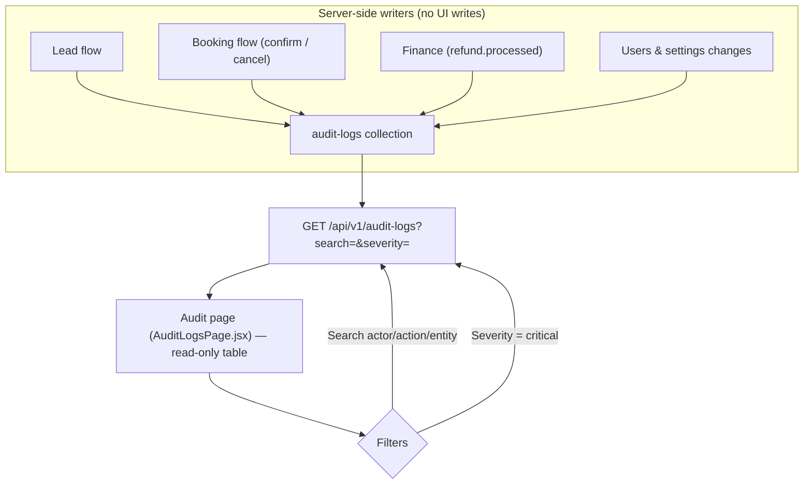
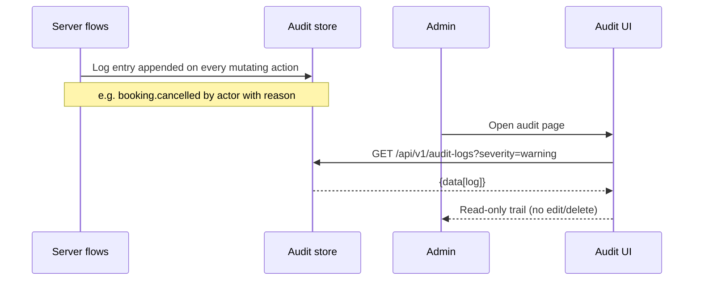

# Audit Logs — Endpoints, Bodies & Workflow

> Section: **Audit logs** (Admin Console · mock branch — real API + local fallback, follows `VITE_USE_MOCK_API`)
> Module: `src/admin/features/settings/auditApi.js`

---

## 1. Endpoints

| # | Method | Endpoint | Auth | Request body | Response body | Purpose |
|---|---|---|---|---|---|---|
| 1 | GET | `/api/v1/audit-logs` | Admin | — (query: `?search=&severity=&page=&limit=`) | `{data[log]}` | Immutable audit trail |

### Log object

```json
{
  "id": "AL-1001",
  "actor": "Ali Hussain (ops)",
  "action": "booking.cancelled",
  "entity": "BK-2026-100254",
  "description": "Cancelled booking — customer requested cancellation per refund policy",
  "severity": "warning",
  "timestamp": "2026-09-22T10:30:00.000Z"
}
```
`severity`: `info | warning | critical` · typical `action` verbs: `lead.created`, `lead.converted`, `booking.confirmed`, `booking.cancelled`, `refund.processed`, `user.created`, `settings.updated`.

### List response

```json
{
  "data": [
    { "id": "AL-1001", "actor": "Ali Hussain (ops)", "action": "booking.cancelled", "entity": "BK-2026-100254", "description": "...", "severity": "warning", "timestamp": "..." }
  ]
}
```

---

## 2. Workflow



### Sequence



---

## 3. Notes

- **Read-only by design** — no POST/PATCH/DELETE from this module; entries are appended server-side whenever any CRM flow mutates state.
- The booking cancel flow (`POST /api/v1/crm/packages/bookings/{id}/cancel {reason}`) and the remark trail are the primary producers of warning-severity entries.
- Mock branch: `phase7MockData.auditLogs` with search + severity filtering.
