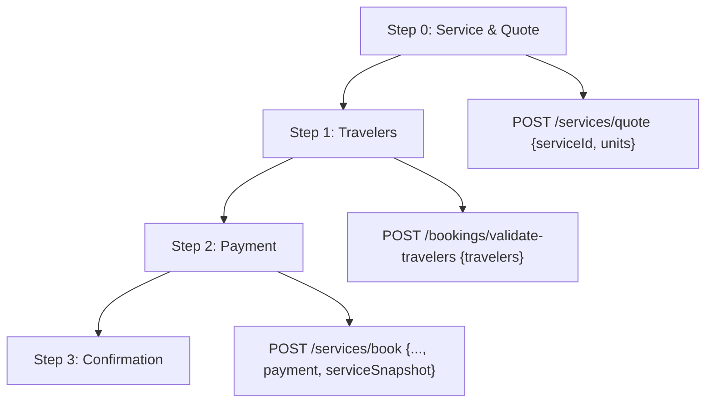
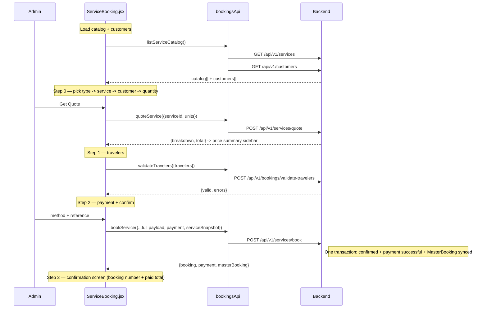
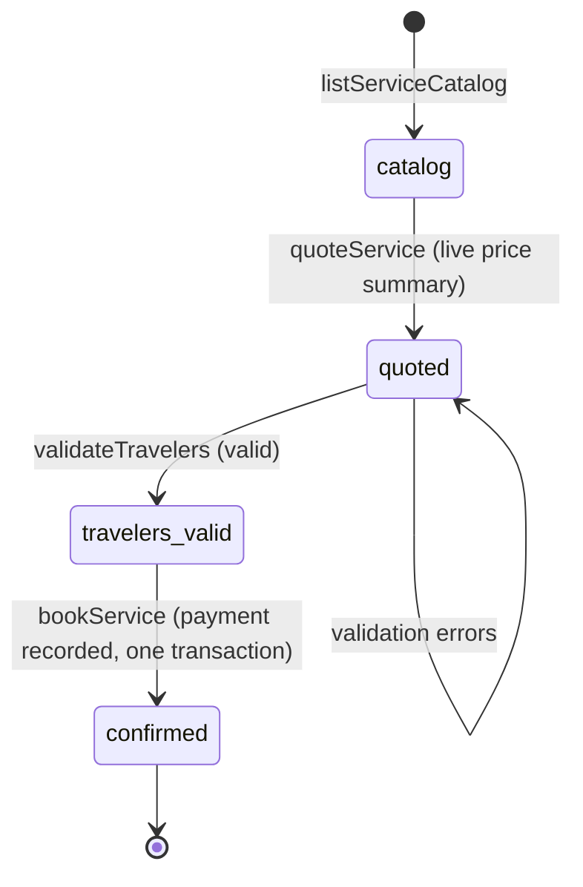

# Book a Service — Standalone Service Booking — Endpoints, Bodies & Workflow

> Section: **Book a Service (standalone service booking: flight / hotel / cab / meal / visa)** (Admin Console · mock branch — real API + local fallback, follows `VITE_USE_MOCK_API`)
> Module: `src/admin/features/bookings/bookingsApi.js` (single-service methods) · UI: `src/admin/features/bookings/pages/ServiceBooking.jsx` · Route `/admin/bookings/create-service`

---

## 1. Bookable single services

| Type | Example | Unit |
|---|---|---|
| `flight` | Delhi → Jeddah Economy Flight (Saudia SV-758) | seat |
| `hotel` | Pullman Zamzam Makkah — Deluxe Room | room-night |
| `cab` | Makkah → Madinah Private Transfer | vehicle |
| `meal` | Daily Buffet Meals | person-day |
| `visa` | Umrah Visa Processing | application |

---

## 2. Endpoints

| # | Method | Endpoint | Auth | Request body | Response body | Purpose |
|---|---|---|---|---|---|---|
| 1 | GET | `/api/v1/services` | Admin | — (query: `?search=&type=`) | `{data[service], meta}` | Bookable single-service catalog |
| 2 | GET | `/api/v1/services/{serviceId}` | Admin | — | service object | Single service details |
| 3 | POST | `/api/v1/services/quote` | Admin | `{serviceId, units}` | quote object (below) | Price a service for N units |
| 4 | POST | `/api/v1/services/book` | Admin | booking payload (below) | `{booking, payment, masterBooking}` | Final: confirm + payment + MasterBooking in one transaction |
| 5 | POST | `/api/v1/bookings/validate-travelers` | Admin | `{travelers[]}` | `{valid, errors[]}` | Traveler validation (shared with package flow) |

### Service object (catalog row)

```json
{
  "id": "SRV-FLT-001",
  "type": "flight",
  "name": "Delhi -> Jeddah Economy Flight",
  "provider": "Saudia SV-758",
  "providerType": "airline",
  "retailPrice": 48500,
  "discountPercentage": 5,
  "unitLabel": "seat"
}
```

### 2.1 POST `/services/quote`

Request:
```json
{ "serviceId": "SRV-FLT-001", "units": 4 }
```

Response:
```json
{
  "serviceId": "SRV-FLT-001",
  "serviceType": "flight",
  "serviceName": "Delhi -> Jeddah Economy Flight",
  "units": 4,
  "unitPrice": 48500,
  "unit": "seat",
  "breakdown": { "retail": 194000, "discount": -9700, "taxes": 9215 },
  "subtotal": 194000,
  "discount": 9700,
  "discountPercentage": 5,
  "taxes": 9215,
  "total": 193515,
  "currency": "INR"
}
```
Metric definitions: `retail = unitPrice × units`, `discount = retail × discountPercentage/100`, `taxes = (retail − discount) × 5%`, `total = retail − discount + taxes`.

### 2.2 POST `/services/book`

Request (built by `confirmBooking()`):
```json
{
  "serviceId": "SRV-FLT-001",
  "serviceType": "flight",
  "serviceName": "Delhi -> Jeddah Economy Flight",
  "customerId": "6ab0b26696be5f33244620fe",
  "customerName": "Mohammed Rahman",
  "units": 4,
  "unit": "seat",
  "totalAmount": 193515,
  "travellers": [
    { "firstName": "Mohammed", "lastName": "Rahman", "dateOfBirth": "1988-04-12", "passportNumber": "P1234567", "isLead": true },
    { "firstName": "Aisha", "lastName": "Siddiqui", "dateOfBirth": "1992-08-30", "passportNumber": "P7654321", "isLead": false }
  ],
  "payment": {
    "method": "bank_transfer",
    "referenceNumber": "TXN-1726980000000",
    "notes": "Delhi -> Jeddah Economy Flight for Mohammed Rahman"
  },
  "serviceSnapshot": {
    "serviceId": "SRV-FLT-001",
    "serviceName": "Delhi -> Jeddah Economy Flight",
    "provider": "Saudia SV-758",
    "unitPrice": 48500,
    "units": 4,
    "subtotal": 194000,
    "discount": 9700,
    "taxes": 9215,
    "total": 193515,
    "capturedAt": "2026-09-22T10:15:00.000Z"
  }
}
```

Response (flattened into the booking shape the UI reads):
```json
{
  "id": "SB-1726981000000",
  "bookingNumber": "SB-2026-100254",
  "status": "confirmed",
  "createdAt": "2026-09-22T10:16:10.000Z",
  "payment": { "status": "paid", "amount": 193515, "paymentMethod": "bank_transfer" },
  "masterBooking": { "_id": "MBK-9912", "syncedAt": "..." }
}
```
Backend contract mirrors `/api/v1/crm/packages/book-for-customer` (spec C): one transaction confirms the booking, records the successful payment, and syncs a MasterBooking.

### 2.3 Traveler validation payload/response

```json
{ "travelers": [ { "firstName": "Mohammed", "lastName": "Rahman", "dateOfBirth": "1988-04-12" } ] }
```
→ `{ "valid": true, "errors": [] }` — or `{ "valid": false, "errors": ["Traveler 2: firstName is required"] }`

---

## 3. Workflow — 4-step service wizard

### Wizard steps



### Full sequence



### State machine



---

## 4. Notes

- **Why no inventory-lock step?** Single services carry their own availability (seats/rooms/vehicles) checked by the backend **at booking time** inside the same transaction — if availability is gone, `POST /services/book` rejects and the UI shows the error. Packages need the explicit `inventory-lock` step because they bundle flight + hotel + guide + visa capacity claimed atomically over a 10-minute window.
- **Access**: sidebar **Bookings → Book a Service** (`/admin/bookings/create-service`).
- **Payment methods**: `bank_transfer | upi | card | cash`; reference auto-generates as `TXN-<timestamp>` if left empty.
- **Full package flow counterpart**: see BOOKING-SYSTEM.md (6-step package wizard).
