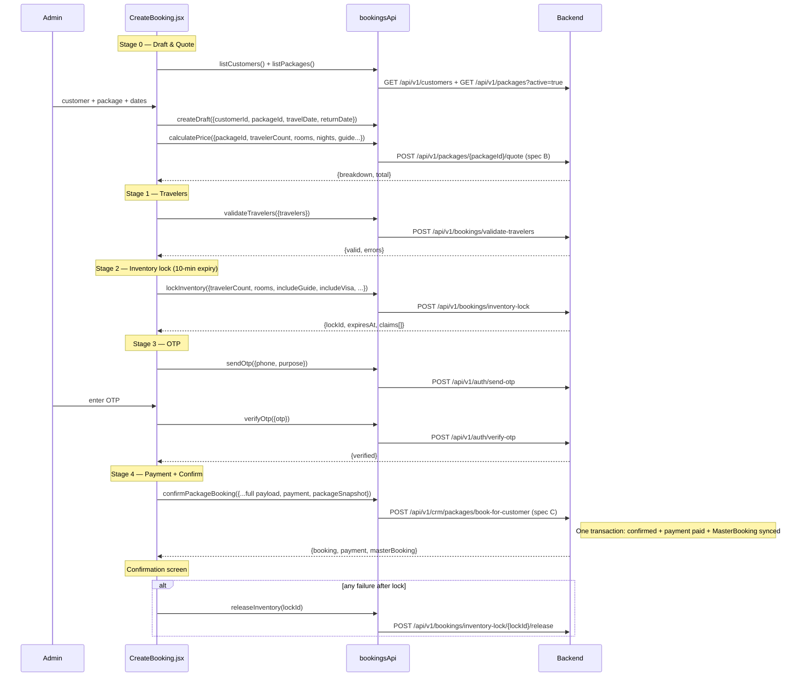
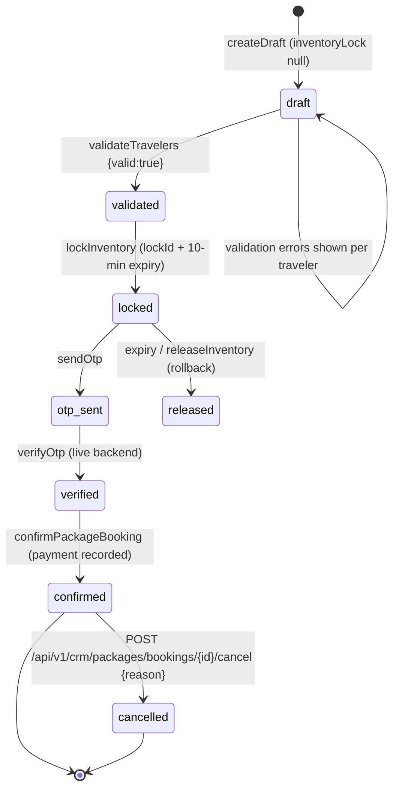
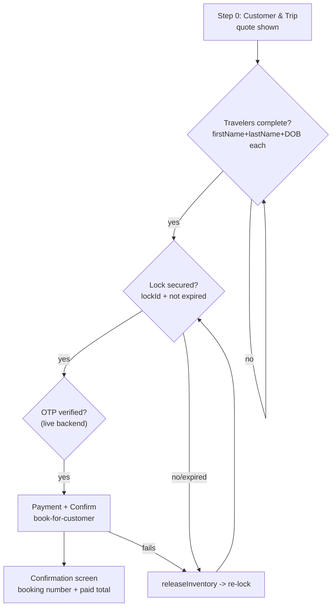

# Booking Journey (Draft → Travelers → Payment → Confirm) — Endpoints, Bodies & Workflow

> Section: **Booking journey** (Package booking wizard — assisted checkout)
> Module: `src/admin/features/bookings/bookingsApi.js` · UI: `src/admin/features/bookings/pages/CreateBooking.jsx` · Route `/admin/bookings/create`
> Status: mock branch — real API + local fallback, follows `VITE_USE_MOCK_API`
> Companion docs: BOOKING-SYSTEM.md · Book a Service_remaning.md (standalone services)

---

## 1. Journey at a glance

Six gated steps — each stage must succeed before the next unlocks:

```
Draft & quote → Travelers → Inventory lock → OTP → Payment → Confirmed
```

| # | Stage | API method | Endpoint | Gates |
|---|---|---|---|---|
| 0 | Customer & Trip (draft + quote) | `createDraft` / `calculatePrice` | `POST /api/v1/bookings/draft`, `POST /api/v1/packages/{packageId}/quote` | customer + package + dates selected |
| 1 | Travelers | `validateTravelers` | `POST /api/v1/bookings/validate-travelers` | every traveler has firstName, lastName, dateOfBirth |
| 2 | Inventory | `lockInventory` | `POST /api/v1/bookings/inventory-lock` | lockId issued, 10-min expiry |
| 3 | OTP | `sendOtp` / `verifyOtp` | `POST /api/v1/auth/send-otp`, `POST /api/v1/auth/verify-otp` | customer phone verified |
| 4 | Payment + Confirm | `confirmPackageBooking` | `POST /api/v1/crm/packages/book-for-customer` | payment recorded, booking confirmed, MasterBooking synced |
| — | Rollback (on failure) | `releaseInventory` | `POST /api/v1/bookings/inventory-lock/{lockId}/release` | returns capacity |

---

## 2. Stage 0 — Draft & Quote

### 2.1 POST `/bookings/draft`

Request (partial booking):
```json
{
  "customerId": "6ab0b26696be5f33244620fe",
  "packageId": "PKG-001",
  "travelDate": "2026-10-15",
  "returnDate": "2026-10-20"
}
```

Response:
```json
{
  "bookingId": "DRAFT-1726980000000",
  "bookingNumber": "BK-2026-100254",
  "customerId": "6ab0b26696be5f33244620fe",
  "packageId": "PKG-001",
  "status": "draft",
  "inventoryLock": null
}
```
`inventoryLock` stays `null` until stage 2 locks capacity.

### 2.2 POST `/packages/{packageId}/quote` (spec B)

Request — three guide variants (default / catalog / travel-agent override):
```json
{ "quantity": 4, "includeGuide": true }
```
```json
{ "quantity": 4, "guideId": "6789abc..." }
```
```json
{ "quantity": 4, "guideSelected": "Imran Guide", "guideLocation": ["Makkah", "Madinah"], "guidePrice": 15000 }
```

Response (mapped by `calculatePrice()` into the UI price shape):
```json
{
  "travelerCount": 4,
  "adults": 3,
  "children": 1,
  "rooms": 2,
  "nights": 5,
  "breakdown": {
    "package": 98000,
    "bundleDiscount": -10,
    "guide": 15000
  },
  "subtotal": 98000,
  "markup": 0,
  "discount": 10,
  "total": 113000,
  "finalSellPrice": 113000,
  "guideDetails": { "price": 15000 },
  "guideSelected": "Imran Guide",
  "quote": { "items": [], "totalAmount": 113000 }
}
```

Pickers feeding this stage: `GET /api/v1/customers` (`listCustomers`) and `GET /api/v1/packages?active=true` (`listPackages`).

---

## 3. Stage 1 — Travelers

### POST `/bookings/validate-travelers`

Request:
```json
{
  "travelers": [
    { "travellerId": "6ab2aa10...", "firstName": "Mohammed", "lastName": "Rahman", "dateOfBirth": "1988-04-12", "passportNumber": "P1234567", "isLead": true },
    { "travellerId": "6ab2aa11...", "firstName": "Aisha", "lastName": "Siddiqui", "dateOfBirth": "1992-08-30", "passportNumber": "P7654321" }
  ]
}
```

Response (valid):
```json
{ "valid": true, "errors": [] }
```

Response (invalid — per-traveler error strings):
```json
{
  "valid": false,
  "errors": [
    "Traveler 2: first name is required.",
    "Traveler 2: last name is required.",
    "Traveler 2: date of birth is required."
  ]
}
```
Validation rules (enforced identically in the mock branch): at least one traveler; per traveler — firstName, lastName, dateOfBirth required.

---

## 4. Stage 2 — Inventory Lock

### POST `/bookings/inventory-lock`

Request:
```json
{
  "travelerCount": 4,
  "rooms": 2,
  "nights": 5,
  "includeGuide": true,
  "includeVisa": true,
  "flightLabel": "Saudia SV-758",
  "hotelLabel": "Pullman Zamzam Makkah"
}
```

Response:
```json
{
  "lockId": "LOCK-1726980000000",
  "expiresAt": "2026-09-22T10:10:25.000Z",
  "status": "locked",
  "claims": [
    { "type": "flight", "label": "Saudia SV-758", "quantity": 4, "status": "locked" },
    { "type": "hotel", "label": "Pullman Zamzam", "quantity": 2, "unit": "rooms", "status": "locked" },
    { "type": "guide", "label": "Guide capacity", "quantity": 1, "status": "locked" },
    { "type": "visa", "label": "Visa quota", "quantity": 4, "status": "locked" }
  ]
}
```
- **10-minute expiry** — `expiresAt = now + 10 min`. After expiry the lock auto-releases.
- Components marked `not_required` when the corresponding include flag is false.

### Release (rollback) — POST `/bookings/inventory-lock/{lockId}/release`

```json
{ "lockId": "LOCK-1726980000000", "status": "released" }
```

---

## 5. Stage 3 — OTP (customer phone verification)

### POST `/auth/send-otp`

Request:
```json
{ "phone": "919192929292", "purpose": "booking_confirmation", "bookingId": "DRAFT-1726980000000" }
```
Response:
```json
{ "sent": true, "expiresIn": 120, "maskedPhone": "919192929292" }
```

### POST `/auth/verify-otp`

Request:
```json
{ "otp": "123456", "purpose": "booking_confirmation", "bookingId": "DRAFT-1726980000000" }
```
Response:
```json
{ "verified": true }
```
Note: in mock mode `verifyOtp` deliberately returns `{verified:false, error:"Mock booking OTP verification is disabled. Use the live backend."}` — OTP verification requires the live backend.

---

## 6. Stage 4 — Payment + Confirm (one transaction)

### POST `/crm/packages/book-for-customer` (spec C)

Confirms immediately, records the payment, and syncs a MasterBooking in the **same transaction** — no separate payment-intent round trips on this path.

Request (built by `pay()`):
```json
{
  "packageId": "PKG-001",
  "customerId": "6ab0b26696be5f33244620fe",
  "quantity": 4,
  "includeGuide": true,
  "guideSelected": "Imran Guide",
  "guideLocation": ["Makkah"],
  "guidePrice": 15000,
  "travellers": [
    { "travellerId": "6ab2aa10...", "isLead": true },
    { "travellerId": "6ab2aa11...", "isLead": false }
  ],
  "payment": {
    "method": "bank_transfer",
    "referenceNumber": "TXN-1726980000000",
    "notes": "Package booking with Imran Guide for Mohammed"
  },
  "customerName": "Mohammed Rahman",
  "travelDate": "2026-10-15",
  "returnDate": "2026-10-20",
  "totalAmount": 113000,
  "packageSnapshot": {
    "packageId": "PKG-001",
    "title": "Umrah Premium",
    "sellPrice": 98000,
    "destination": "Makkah",
    "durationDays": 5,
    "guidePrice": 15000,
    "guideSelected": "Imran Guide",
    "capturedAt": "2026-09-22T09:55:00.000Z"
  }
}
```

Response (flattened into the booking shape the UI reads):
```json
{
  "id": "BK-1726981000000",
  "bookingNumber": "BK-2026-100254",
  "status": "confirmed",
  "createdAt": "2026-09-22T10:00:10.000Z",
  "payment": { "status": "paid", "amount": 113000, "paymentMethod": "bank_transfer" },
  "masterBooking": { "_id": "MBK-9911", "syncedAt": "..." }
}
```

### Legacy two-step payment path (non-CRM direct confirm)

| Method | Endpoint | Request | Response |
|---|---|---|---|
| POST | `/payments/create-intent` | `{amount}` | `{paymentIntentId:"PI-...", amount, currency:"INR", status:"created"}` |
| POST | `/payments/confirm` | `{paymentIntentId, amount}` | `{success:true, status:"paid", transactionId:"TXN-...", paidAt}` |
| POST | `/bookings/confirm` | booking payload | booking object `status:"confirmed"` |

---

## 7. Workflow

### Full journey sequence



### Booking state machine



### Step-gating flow



---

## 8. Notes

- **Why locks exist for packages but not services**: the package bundles flight + hotel + guide + visa capacity that must be claimed atomically over a 10-minute window; standalone services (Book a Service) check availability at booking time inside the confirm transaction.
- **Failure policy**: any failure after stage 2 releases the lock (`releaseInventory`) so capacity returns to the pool immediately.
- **Snapshot policy**: `packageSnapshot` freezes title/sellPrice/guide at booking time so later package price edits never mutate confirmed bookings.
- **Post-confirm edits**: CRM booking management accepts only non-structural updates (`travelDates`, `contactDetails`, `remark`) — see CRM section in BOOKING-SYSTEM.md.
