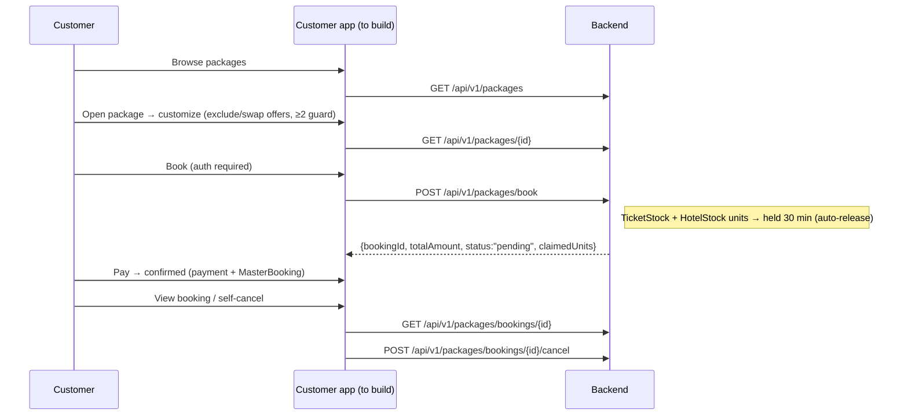
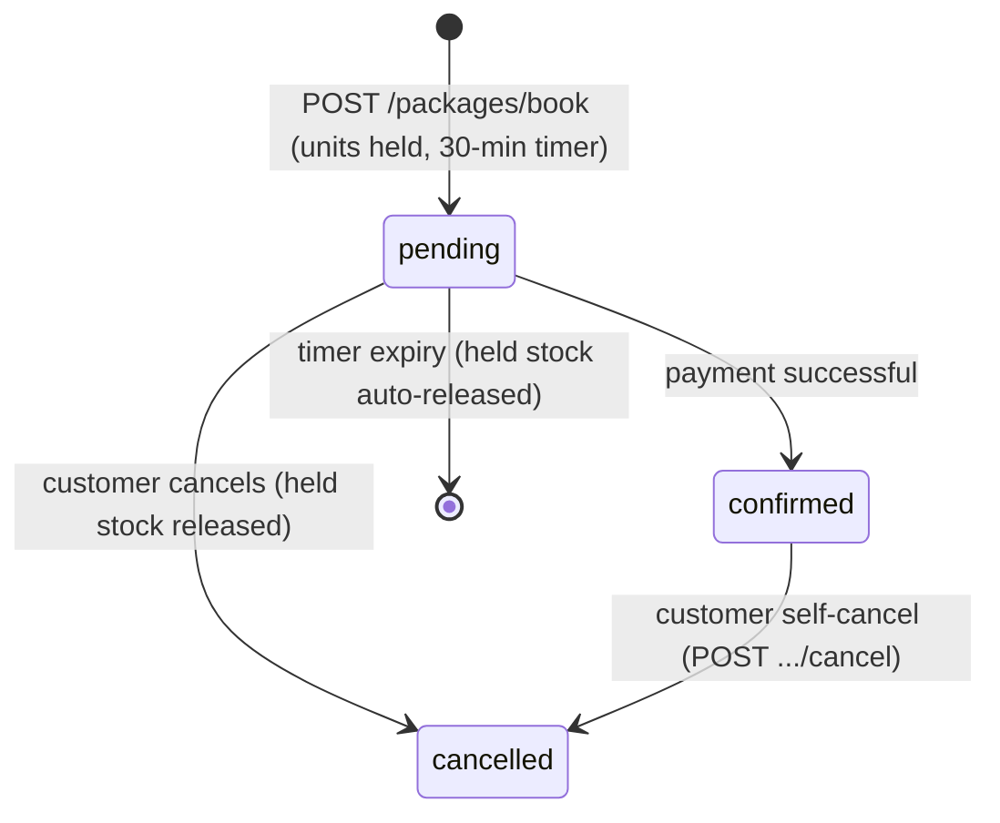

# Customer Self-Service Checkout (Packages / Offers) — Endpoints, Bodies & Workflow

> Section: **Customer self-service checkout (packages/offers)** (Planned — served by backend, NOT yet consumed by this frontend. Status: `missing` in the data source registry)
> Source contract: `PACKAGE_OFFER_STOCK_FULLSTACK_ALIGNMENT_GUIDE (2).md` §3.6–3.9 · The assisted wizard already works in the admin console (see BOOKING-SYSTEM.md)

---

## 1. Status

The backend supports the full customer self-checkout: browse customized package → book → 30-minute stock hold → payment → confirmed. The **admin CRM counterpart** (`book-for-customer`, CRM dossier, assign/cancel) already works in this frontend. Missing: the **customer-facing pages** (package detail, customization, booking, payment, booking status).

## 2. Backend endpoints (contract to implement)

| # | Method | Endpoint | Auth | Request body | Response body | Purpose |
|---|---|---|---|---|---|---|
| 1 | GET | `/api/v1/packages` | Public | — (`?search=&destination=`) | `{packages[]}` | Browse curated packages |
| 2 | GET | `/api/v1/packages/{id}` | Public | — | package + offer components | Package detail page |
| 3 | POST | `/api/v1/packages/book` | Customer | booking payload (below) | `{bookingId, totalAmount, claimedUnits[]}` — `201` | Book customized package, hold stock 30 min |
| 4 | GET | `/api/v1/packages/bookings/{id}` | Customer | — | booking + snapshot + claimedUnits | View own booking status |
| 5 | POST | `/api/v1/packages/bookings/{id}/cancel` | Customer | — | booking (`cancelled`, held stock auto-released) | Self-cancel |

### Book payload (customer auth — supports customization)

```json
{
  "packageId": "66d4a8e2e944f7b6b199e111",
  "quantity": 1,
  "travellers": [
    { "travellerId": "66c1b011e944f7b6b199e001", "isLead": true }
  ],
  "excludedOfferIds": ["66d4a404e944f7b6b199e404"],
  "swappedOffers": [
    { "originalOfferId": "66d4a202e944f7b6b199e202", "replacementOfferId": "66d4a555e944f7b6b199e555" }
  ]
}
```
**Rule**: a Package must retain ≥ 2 Offer components — the API rejects opt-outs down to 1 item with `400 Bad Request`.

### Book response (`201 Created`)

```json
{
  "success": true,
  "message": "Customized package booking created. Proceed to payment.",
  "bookingId": "66d4b555e944f7b6b199e555",
  "totalAmount": 37000,
  "currency": "INR",
  "status": "pending",
  "quantity": 1,
  "claimedUnits": [
    { "stockModel": "TicketStock", "stock": "66d4a8e2e944f7b6b199e111", "unitId": "66d4u101e944f7b6b199e101" },
    { "stockModel": "HotelStock", "stock": "66d4a555e944f7b6b199e555", "unitId": "66d4u202e944f7b6b199e202" }
  ]
}
```

## 3. Workflow (target journey)



### Hold/confirm lifecycle



---

## 4. Notes

- **Assisted counterpart already live**: the admin package wizard performs the same flow assisted — quote → inventory-lock (10 min) → OTP → `book-for-customer` in one transaction (see BOOKING-SYSTEM.md).
- The customer checkout must respect the same stock models (`TicketStock`, `HotelStock`) and surface the countdown; self-cancel releases held units server-side.
- Offer self-checkout (standalone offers) shares this checkout UI — see Public offer details doc.
