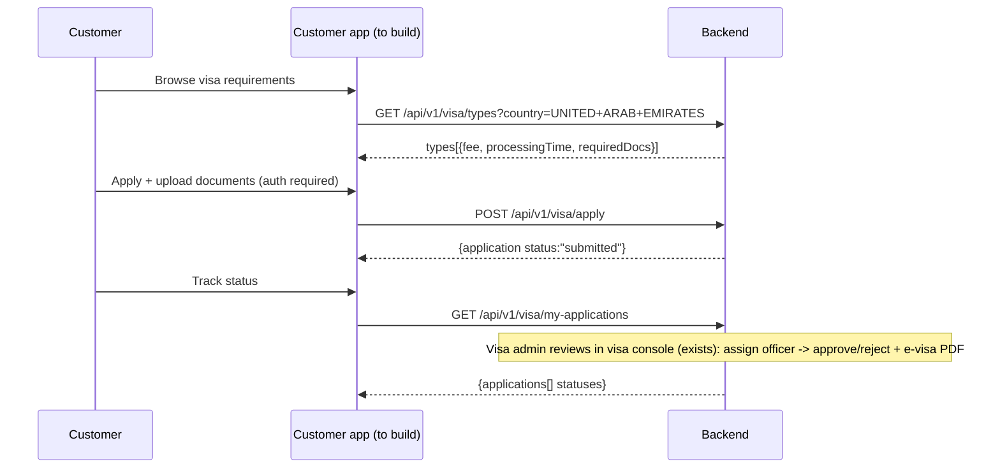
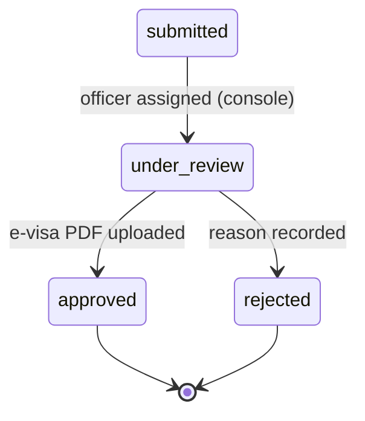

# Customer Visa Application Intake (Public Side) — Endpoints, Bodies & Workflow

> Section: **Customer visa application intake (public side)** (Planned — served by backend, NOT yet consumed by this frontend. Status: `missing` in the data source registry)
> Source contract: `PACKAGE_OFFER_STOCK_FULLSTACK_ALIGNMENT_GUIDE (2).md` §4 — "Standalone Visas are 100% standalone products sold through their own independent `/api/v1/visa/*` flow"
> Note: the **admin visa console** already exists in this frontend (`src/admin/features/inventory/visa` — visaApi/visaStore/visaStatus); the **public customer journey** is what is missing.

---

## 1. Status

Visas are standalone products — never bundled in packages. The backend serves the full public intake + admin review chain. This frontend already reviews applications in the visa console (`/api/v1/visa/admin/applications` chain is the admin side); missing: the **public-side pages** (browse requirements, apply with documents, track status).

## 2. Backend endpoints (contract to implement)

| # | Method | Endpoint | Auth | Request body | Response body | Purpose |
|---|---|---|---|---|---|---|
| 1 | GET | `/api/v1/visa/types` | Public | — (query: `?country=UNITED+ARAB+EMIRATES`) | `{types[{name, fee, processingTime, requiredDocs[]}]}` | Browse destination country visa types & pricing |
| 2 | POST | `/api/v1/visa/apply` | Customer | application payload (below) | `{application{...status:"submitted"}}` | Submit standalone visa application with documents |
| 3 | GET | `/api/v1/visa/my-applications` | Customer | — | `{applications[]}` | Track customer's application statuses |
| 4 | GET | `/api/v1/visa/admin/applications` | Visa Admin | — (`?status=`) | `{applications[]}` | Review & assign specialist officer (admin side — console exists) |
| 5 | PATCH | `/api/v1/visa/admin/applications/:id/assign` | Visa Admin | `{caseOfficer}` | application | Assign case officer |
| 6 | PATCH | `/api/v1/visa/admin/applications/:id/status` | Visa Admin | `{status, evisaPdfUrl?}` | application | Approve/Reject + upload issued e-visa PDF |

### Visa types response (display shape)

```json
{
  "types": [
    {
      "name": "30-Day Tourist Visa",
      "country": "UNITED ARAB EMIRATES",
      "fee": 8500,
      "processingTime": "3-5 working days",
      "requiredDocs": ["Passport copy (6 months validity)", "Passport-size photo", "Return ticket"]
    }
  ]
}
```

### Apply payload (customer auth)

```json
{
  "visaTypeId": "VISA-30D-TOURIST",
  "traveller": {
    "firstName": "Mohammed",
    "lastName": "Rahman",
    "passportNumber": "P1234567",
    "passportExpiry": "2030-04-12"
  },
  "travelDate": "2026-10-15",
  "documents": [
    { "type": "passport", "url": "https://cdn.maqam.com/visa/passport-mohammed.pdf" },
    { "type": "photo", "url": "https://cdn.maqam.com/visa/photo-mohammed.jpg" }
  ]
}
```

### Apply response

```json
{
  "success": true,
  "application": {
    "_id": "66e1visa001e944f7b6b1001",
    "status": "submitted",
    "fee": 8500,
    "submittedAt": "2026-09-22T10:00:00.000Z"
  }
}
```

## 3. Workflow (target journey)



### Status chain



---

## 4. Notes

- **Admin side already works**: this frontend's visa console consumes the `/api/v1/visa/admin/applications` chain (review, assign, status with e-visa upload) — see `src/admin/features/inventory/visa`.
- A standalone visa can also be purchased assisted via the admin **Book a Service** wizard (type `visa`, `POST /services/book`) — the public intake is the self-service counterpart.
- Package bundle rule: visas are never a package component; single components are sold via standalone Offer endpoints, visas via `/api/v1/visa/apply`.
