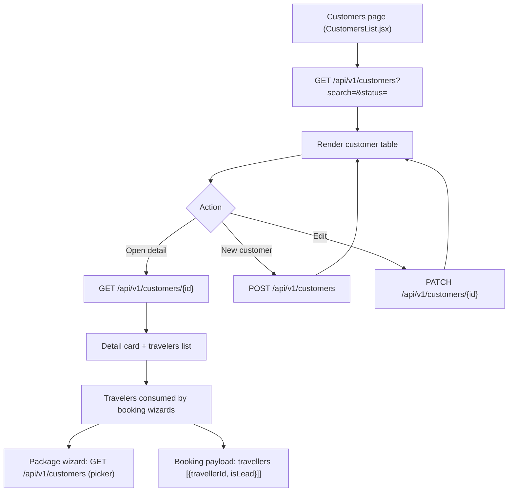
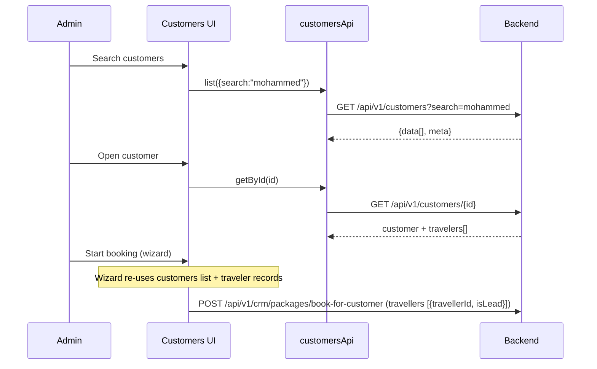

# Customers & Travelers — Endpoints, Bodies & Workflow

> Section: **Customers & travelers** (Admin Console · mock branch — real API + local fallback, follows `VITE_USE_MOCK_API`)
> Module: `src/admin/features/customers/customersApi.js`

---

## 1. Endpoints

| # | Method | Endpoint | Auth | Request body | Response body | Purpose |
|---|---|---|---|---|---|---|
| 1 | GET | `/api/v1/customers` | Admin | — (query: `?search=&status=&page=&limit=`) | `{data[customer], meta{total,page,pageSize}}` | Customer list |
| 2 | GET | `/api/v1/customers/{id}` | Admin | — | customer object + `travelers[]` | Customer detail with travelers |
| 3 | POST | `/api/v1/customers` | Admin | create payload (below) | customer object | Create customer |
| 4 | PATCH | `/api/v1/customers/{id}` | Admin | `{name?, phone?, email?, city?, status?, ...}` | customer object | Update customer |
| 5 | GET | `/api/v1/customers/{id}/travelers` | Admin | — | `{data[traveler]}` | Travelers of a customer |

Customer objects are also consumed by the booking wizards via `bookingsApi.listCustomers()` (`GET /api/v1/customers`).

### Customer object (display shape)

```json
{
  "id": "CUS-1726980000000",
  "name": "Mohammed Rahman",
  "phone": "+919192929292",
  "email": "mohammed@example.com",
  "city": "Hyderabad",
  "status": "active",
  "totalBookings": 3,
  "totalSpent": 339000,
  "travelersCount": 4,
  "createdAt": "2026-09-22"
}
```

### Create payload

```json
{
  "name": "Mohammed Rahman",
  "phone": "+919192929292",
  "email": "mohammed@example.com",
  "city": "Hyderabad"
}
```
Mock defaults applied: `status:"active"`, `totalBookings:0`, `totalSpent:0`, `travelersCount:0`, `createdAt` = today.

### Traveler object (from `store.travelers[customerId]`)

```json
{
  "travellerId": "6ab2aa10c9e4f1a2b3c4d5e6",
  "firstName": "Mohammed",
  "lastName": "Rahman",
  "dateOfBirth": "1988-04-12",
  "passportNumber": "P1234567",
  "relation": "self"
}
```

Travelers are attached to bookings at booking time as `travellers: [{ travellerId, isLead }]` (see BOOKING-SYSTEM.md).

### List response

```json
{
  "data": [
    { "id": "CUS-1", "name": "Mohammed Rahman", "phone": "+91...", "email": "...", "city": "Hyderabad", "status": "active", "totalBookings": 3, "totalSpent": 339000 }
  ],
  "meta": { "total": 25, "page": 1, "pageSize": 25 }
}
```

### Detail response (id + travelers)

```json
{
  "id": "CUS-1",
  "name": "Mohammed Rahman",
  "status": "active",
  "totalBookings": 3,
  "totalSpent": 339000,
  "travelers": [
    { "travellerId": "6ab2aa10...", "firstName": "Mohammed", "lastName": "Rahman", "dateOfBirth": "1988-04-12", "passportNumber": "P1234567" },
    { "travellerId": "6ab2aa11...", "firstName": "Aisha", "lastName": "Siddiqui", "dateOfBirth": "1992-08-30", "passportNumber": "P7654321" }
  ]
}
```

---

## 2. Workflow



### Sequence (detail → booking usage)



---

## 3. Notes

- **Relationship model**: one customer → many travelers (family members). Travelers carry passport + DOB (required by traveler validation at booking: firstName, lastName, dateOfBirth per traveler).
- **Lifecycle use**: customers created here appear in the customer pickers of both booking wizards; travelers become `travellers[]` entries in the booking payload.
- **Mock branch**: `phase6MockData` fixtures with search/status filtering; live branch expects the same `{data, meta}` envelope.
