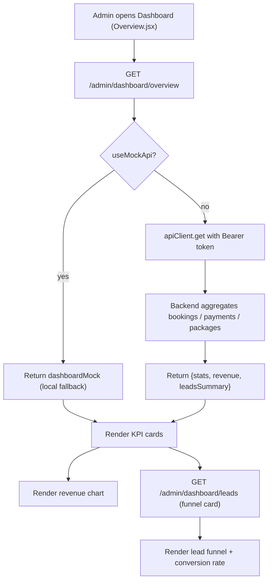
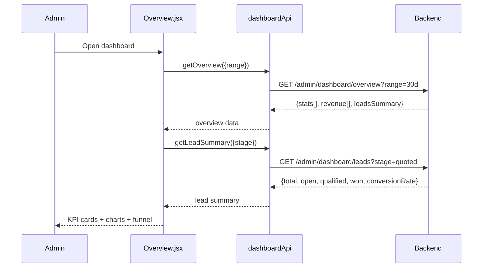

# Dashboard Overview — Endpoints, Bodies & Workflow

> Section: **Dashboard overview** (Admin Console · mock branch — real API + local fallback, follows `VITE_USE_MOCK_API`)
> Module: `src/admin/features/dashboard/dashboardApi.js` · Consumed by `Overview.jsx`

---

## 1. Endpoints

| # | Method | Endpoint | Auth | Request body | Response body | Purpose |
|---|---|---|---|---|---|---|
| 1 | GET | `/admin/dashboard/overview` | Admin | — (query: `?range=`) | `{stats[], revenue[], leadsSummary{...}}` | KPI cards + revenue chart for the admin dashboard |
| 2 | GET | `/admin/dashboard/leads` | Admin | — (query: `?stage=&assignedTo=`) | `{total, open, qualified, won, conversionRate}` | Lead funnel summary card |

Both endpoints are called with the shared `apiClient` (Bearer token from `localStorage["maqam_admin_token"]`, base URL from `VITE_API_URL`).

### 1.1 GET `/admin/dashboard/overview`

Request query:
```json
{ "range": "30d" }
```

Response body:
```json
{
  "stats": [
    { "key": "bookings",  "title": "Total Bookings",      "value": "1,284",  "change": "+12.8%", "comparison": "vs last month", "icon": "calendar" },
    { "key": "revenue",   "title": "Total Revenue",       "value": "₹18.4L", "change": "+8.4%",  "comparison": "vs last month", "icon": "revenue" },
    { "key": "confirmed", "title": "Confirmed Bookings",  "value": "86",     "change": "+6.2%",  "comparison": "this month",    "icon": "check" },
    { "key": "pending",   "title": "Pending Payments",    "value": "12",     "change": "-3.1%",  "comparison": "vs last month", "icon": "clock" },
    { "key": "packages",  "title": "Active Packages",     "value": "34",     "change": "+4.5%",  "comparison": "this month",    "icon": "package" },
    { "key": "leads",     "title": "Open Leads",          "value": "48",     "change": "+10.2%", "comparison": "vs last month", "icon": "leads" }
  ],
  "revenue": [
    { "label": "Mar", "value": 12.2 },
    { "label": "Apr", "value": 13.8 },
    { "label": "May", "value": 12.9 }
  ],
  "leadsSummary": { "total": 48, "open": 48, "qualified": 18, "won": 9, "conversionRate": 18.75 }
}
```

- `stats[]` → rendered as KPI cards (value + delta trend).
- `revenue[]` → rendered as the monthly revenue line/bar chart.
- `leadsSummary` → rendered as the lead funnel widget.

### 1.2 GET `/admin/dashboard/leads`

Request query:
```json
{ "stage": "quoted" }
```

Response body:
```json
{
  "total": 48,
  "open": 48,
  "qualified": 18,
  "won": 9,
  "conversionRate": 18.75
}
```

- `conversionRate` = `won / total × 100` (metric definition: converted leads ÷ all leads).

---

## 2. Workflow



### Sequence



---

## 3. Notes

- **Mock branch**: with `VITE_USE_MOCK_API=true` (default) both methods return local fixtures instantly (`dashboardMock` / inline summary object), so the dashboard renders without a backend.
- **Live branch**: flip to `VITE_USE_MOCK_API=false` to read the real aggregates. The backend must respond in the envelope shapes above (stats/revenue/leadsSummary).
- These dashboard endpoints are separate from the CRM agent dashboard stats (`GET /api/v1/crm/stats`, `GET /api/v1/crm/pipeline`) documented in the Leads doc.
