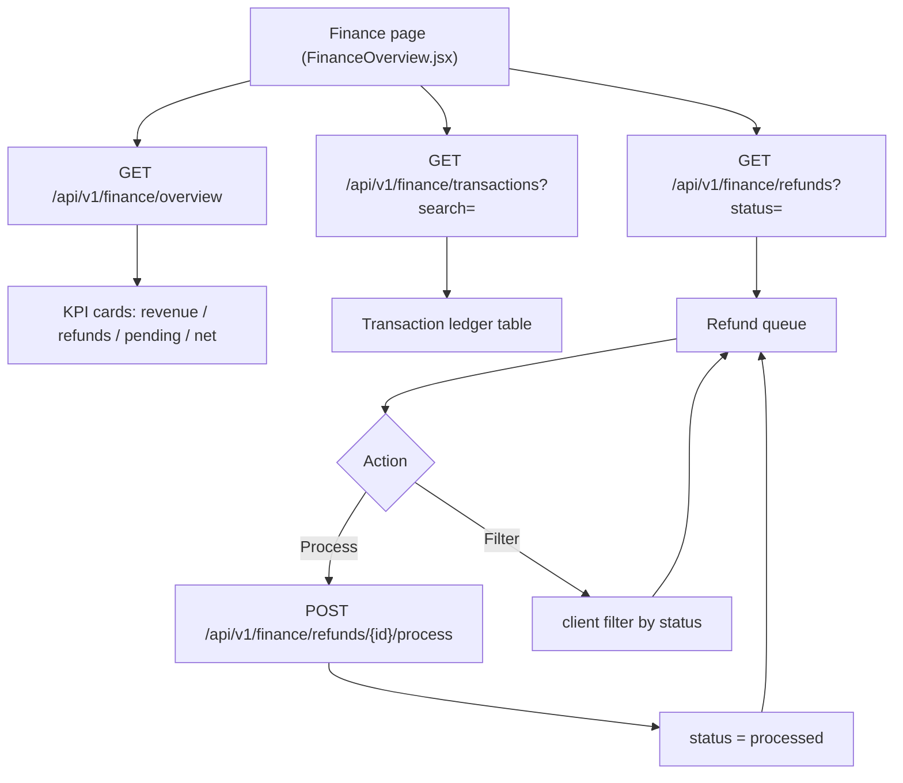
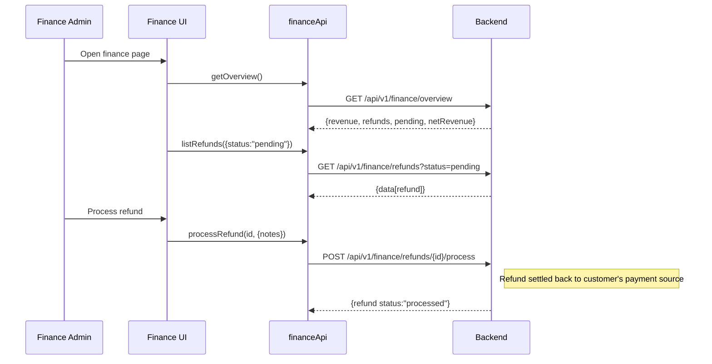

# Finance Overview, Transactions & Refunds — Endpoints, Bodies & Workflow

> Section: **Finance overview, transactions & refunds** (Admin Console · mock branch — real API + local fallback, follows `VITE_USE_MOCK_API`)
> Module: `src/admin/features/finance/financeApi.js`

---

## 1. Endpoints

| # | Method | Endpoint | Auth | Request body | Response body | Purpose |
|---|---|---|---|---|---|---|
| 1 | GET | `/api/v1/finance/overview` | Admin/Finance | — (query: `?range=`) | `{revenue, refunds, pending, netRevenue, transactionCount, currency}` | KPI summary cards |
| 2 | GET | `/api/v1/finance/transactions` | Admin/Finance | — (query: `?search=&page=&limit=`) | `{data[transaction]}` | Transaction ledger |
| 3 | GET | `/api/v1/finance/refunds` | Admin/Finance | — (query: `?status=`) | `{data[refund]}` | Refund queue |
| 4 | POST | `/api/v1/finance/refunds/{id}/process` | Admin/Finance | `{notes?, ...}` | refund object (`status:"processed"`) | Process a refund |

### 1.1 GET `/finance/overview`

Response:
```json
{
  "revenue": 2745000,
  "refunds": 45000,
  "pending": 85500,
  "netRevenue": 2700000,
  "transactionCount": 132,
  "currency": "INR"
}
```
Metric definitions (mock logic, mirrored live):
- `revenue` = Σ positive-amount successful transactions
- `refunds` = Σ |negative-amount successful transactions|
- `pending` = Σ positive-amounts of pending transactions
- `netRevenue` = `revenue − refunds`
- `transactionCount` = total ledger rows

### Transaction object (ledger row)

```json
{
  "bookingNumber": "BK-2026-100254",
  "customer": "Mohammed Rahman",
  "reference": "NEFT-HDFC-991282",
  "method": "bank_transfer",
  "amount": 113000,
  "status": "success",
  "date": "2026-09-22"
}
```
`status`: `success | pending | failed` · `method`: `bank_transfer | upi | card | cash`

### Refund object

```json
{
  "id": "RF-1001",
  "bookingNumber": "BK-2026-099812",
  "customer": "Aisha Siddiqui",
  "amount": 45000,
  "reason": "Cancellation per refund policy",
  "status": "pending",
  "requestedAt": "2026-09-20"
}
```
`status`: `pending | processed | rejected`

### Process refund payload/response

```json
{ "notes": "Processed via original payment method" }
```
→ `{ "id": "RF-1001", "status": "processed", "notes": "...", ... }`

---

## 2. Workflow



### Sequence (refund flow)



---

## 3. Notes

- **Where money enters**: payments are recorded at booking time (spec C — `book-for-customer` / `services/book`); the finance module is read-mostly (ledger + refunds), it does not create payments.
- Refund ledger rows appear as negative-amount successful transactions in the ledger; the KPI card nets them out of `netRevenue`.
- Mock branch: `phase6MockData` fixtures with derived KPIs; live branch expects the same envelope shapes.
