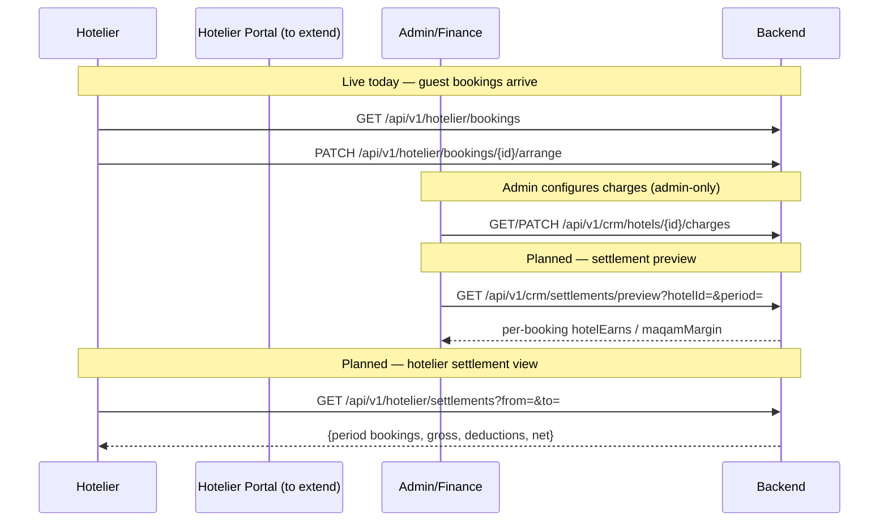
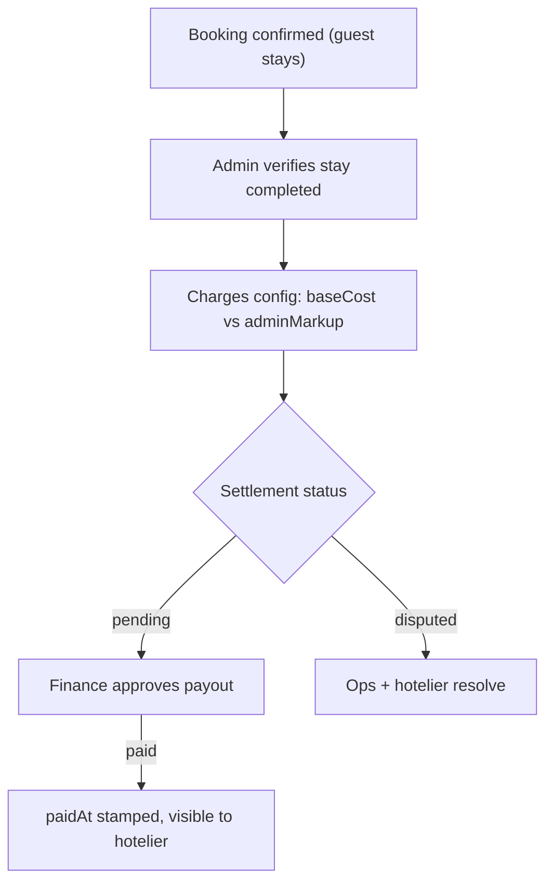

# Hotelier Settlement View — Endpoints, Bodies & Workflow

> Section: **Hotelier settlement view** (Planned — internal charges + settlement calculation are admin-only by design. Status: `missing` in the data source registry)
> Source contract: `FRONTEND_CRM_HOTEL_AND_HOTELIER_INTEGRATION_GUIDE.md` + `hotel-and-hoteliers.md` (charges are admin-only; hotelier sees his hotel's bookings)
> Existing pieces: hotelier bookings list (`GET /api/v1/hotelier/bookings`), admin charges API (`/api/v1/crm/hotels/{id}/charges`, admin-only)

---

## 1. Status

The hotelier portal already shows **received bookings** (read-only) and lets the hotelier arrange availability. What is missing is the **settlement view**: what Maqam owes the hotel per booking/per period — derived from admin-only charge configuration (base cost vs admin markup). Charge configuration is deliberately hidden from hoteliers; the settlement calculation itself is an admin/finance concern, with a hotelier-facing "payouts" summary as the target feature.

## 2. Endpoints (existing + contract to build)

| # | Method | Endpoint | Auth | Request body | Response body | Status |
|---|---|---|---|---|---|---|
| 1 | GET | `/api/v1/hotelier/bookings` | Hotelier | — (`?status=&page=`) | `{bookings[]}` + `/{id}` | Live — portal |
| 2 | PATCH | `/api/v1/hotelier/bookings/{id}/arrange` | Hotelier | `{arranged: true}` | booking | Live — portal |
| 3 | GET | `/api/v1/crm/hotels/{id}/bookings` | Admin | — | bookings with **full charges** | Live — admin |
| 4 | GET | `/api/v1/crm/hotels/{id}/charges` | Admin | — | `{charges[{roomType, baseCost, adminMarkup, effectiveDate}]}` | Live — admin-only |
| 5 | PATCH | `/api/v1/crm/hotels/{id}/charges` | Admin | `{charges[...]}` | updated charges | Live — admin-only |
| 6 | GET | `/api/v1/hotelier/settlements` | Hotelier | — (`?from=&to=`) | `{settlements[{period, bookings[], gross, deductions, net}], summary}` | **Planned** |
| 7 | GET | `/api/v1/crm/settlements/preview` | Admin | — (`?hotelId=&period=`) | settlement calc object | **Planned** |

### Existing — hotelier booking row (portal)

```json
{
  "_id": "MBK-9911",
  "bookingNumber": "BK-2026-100254",
  "guest": { "name": "Mohammed Rahman", "phone": "+919192929292" },
  "roomType": "Deluxe Room",
  "checkIn": "2026-10-15",
  "checkOut": "2026-10-20",
  "nights": 5,
  "rooms": 2,
  "status": "confirmed",
  "arranged": false
}
```

### Existing — admin charge configuration (hidden from hotelier)

```json
[
  {
    "roomType": "Deluxe Room",
    "baseCost": 7500,
    "adminMarkup": 2000,
    "effectiveDate": "2026-10-01"
  }
]
```
Sell price to customer = `baseCost + adminMarkup`. The hotelier is owed `baseCost × nights × rooms` per booking.

### Planned — settlement calc object (per booking, admin preview)

```json
{
  "bookingNumber": "BK-2026-100254",
  "roomType": "Deluxe Room",
  "nights": 5,
  "rooms": 2,
  "baseCostPerNight": 7500,
  "hotelEarns": 75000,
  "customerPaid": 95000,
  "maqamMargin": 20000,
  "settlementStatus": "pending"
}
```
Metric definitions: `hotelEarns = baseCost × nights × rooms`; `customerPaid` from the booking record; `maqamMargin = customerPaid − hotelEarns`.

### Planned — hotelier settlement object

```json
{
  "period": "2026-10",
  "bookings": ["BK-2026-100254", "BK-2026-100301"],
  "gross": 160000,
  "deductions": 5000,
  "net": 155000,
  "status": "pending",
  "paidAt": null
}
```

## 3. Workflow (target journey)



### Settlement flow



---

## 4. Notes

- **Security boundary**: `charges` (base cost + markup) and the admin dossier with full charges stay hidden from hoteliers; the planned hotelier settlement endpoint must expose only aggregates (gross/deductions/net) — never per-charge markup details.
- **Where the data comes from**: confirmed bookings from the storefront + charge configuration; storefront booking creation already applies admin charges server-side (`POST /api/v1/bookings` availability + create, always live).
- **Live today**: hotelier bookings + arrange, admin charges + admin full-charges bookings. The two settlement endpoints are the missing build.
