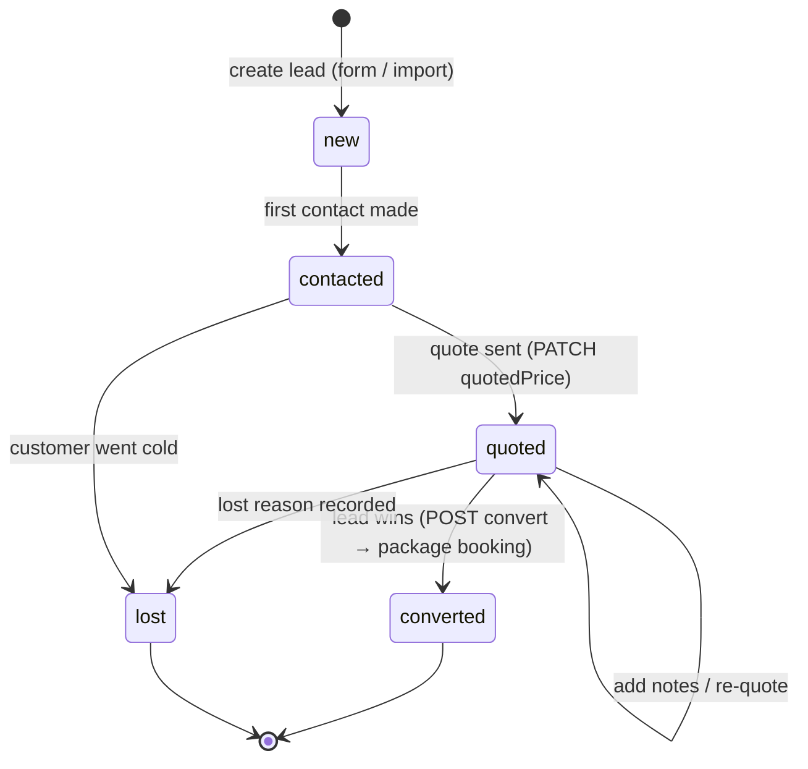
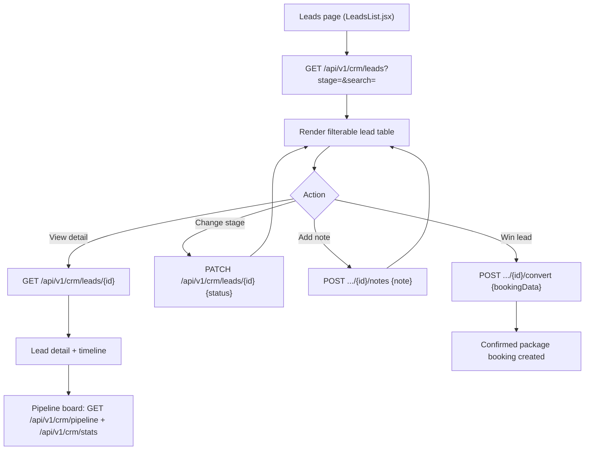
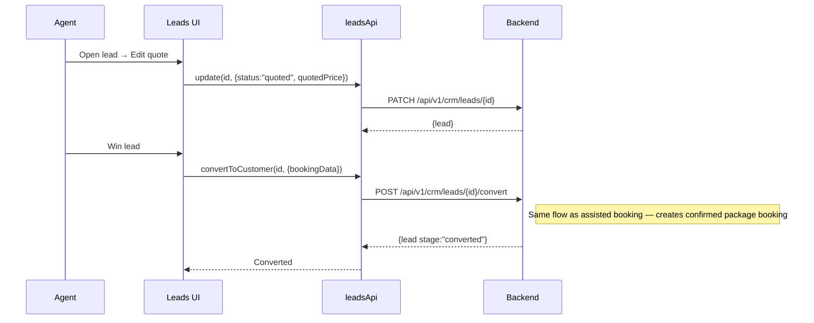

# Leads Management — Endpoints, Bodies & Workflow

> Section: **Leads management** (CRM Console · live + mock dev fallback)
> Module: `src/admin/features/leads/leadsApi.js` · Spec: `LEADS_API_GUIDE.md` · CRM root `/api/v1/crm/leads`

---

## 1. Endpoints

| # | Method | Endpoint | Auth | Request body | Response body | Purpose |
|---|---|---|---|---|---|---|
| 1 | GET | `/api/v1/crm/leads` | Admin/Agent | — (query: `?stage=&search=&priority=&source=&assignedTo=`) | `{leads[], pagination{total,page,limit}}` | List/filter leads by stage |
| 2 | GET | `/api/v1/crm/leads/{id}` | Admin/Agent | — | `{lead}` | Lead detail (with timeline) |
| 3 | POST | `/api/v1/crm/leads` | Admin/Agent | lead payload (below) | `{lead}` | Create lead |
| 4 | PATCH | `/api/v1/crm/leads/{id}` | Admin/Agent | `{status?, priority?, contactNotes?, quotedPrice?, lostReason?, travelDates?, numberOfPeople?, ...}` | `{lead}` | Update lead fields / stage |
| 5 | POST | `/api/v1/crm/leads/{id}/notes` | Admin/Agent | `{note}` | `{lead}` (timeline entry appended) | Add follow-up note |
| 6 | POST | `/api/v1/crm/leads/{id}/convert` | Admin/Agent | `{bookingData}` | `{lead}` (stage → `converted`) | Convert lead → confirmed package booking |
| 7 | GET | `/api/v1/crm/stats` | Admin/Agent | — | dashboard stats object | Agent dashboard stats |
| 8 | GET | `/api/v1/crm/pipeline` | Admin/Agent | — | pipeline columns + cards | Pipeline board data |

### Stage model

`new → contacted → quoted → converted | lost`

The UI "status" filter maps to the `stage` query param.

### Lead payload (create — backend format, per `LEADS_API_GUIDE.md #2`)

```json
{
  "firstName": "Mohammed",
  "lastName": "Rahman",
  "email": "mohammed@example.com",
  "phone": "+919192929292",
  "destination": "Makkah",
  "tripType": "umrah",
  "travelDates": { "from": "2026-10-15", "to": "2026-10-20" },
  "numberOfPeople": 4,
  "specialRequests": "Family rooms near Haram",
  "priority": "high",
  "source": "Manual"
}
```

Normalize layer (kept in the UI): `name = firstName + lastName`, `travelers = numberOfPeople`, `query = specialRequests`, `nextFollowUp = travelDates.from`. All original fields are preserved so mock and live data flow identically.

### Update payload (examples)

```json
{ "status": "quoted", "quotedPrice": 113000 }
```
```json
{ "status": "lost", "lostReason": "Chose another operator" }
```

### Note payload

```json
{ "note": "Called customer — wants October dates, will confirm tomorrow" }
```

Timeline entry appended (display shape):
```json
{ "id": "T-1726980000000", "type": "note", "title": "Note added", "detail": "...", "time": "22/9/2026, 10:30:00" }
```

### Convert payload + response

```json
{
  "bookingData": {
    "packageId": "PKG-001",
    "quantity": 4,
    "travelDate": "2026-10-15",
    "returnDate": "2026-10-20"
  }
}
```
→ lead stage moves to `converted`, a confirmed package booking is created (see BOOKING-SYSTEM.md).

### List response (mapped)

```json
{
  "data": [
    {
      "id": "LD-1001",
      "name": "Mohammed Rahman",
      "email": "mohammed@example.com",
      "phone": "+919192929292",
      "destination": "Makkah",
      "tripType": "umrah",
      "status": "quoted",
      "priority": "high",
      "source": "Manual",
      "travelers": 4,
      "query": "Family rooms near Haram",
      "nextFollowUp": "2026-10-15",
      "timeline": []
    }
  ],
  "meta": { "total": 48, "page": 1, "pageSize": 48 }
}
```

---

## 2. Workflow

### Pipeline lifecycle



### UI flow



### Sequence (convert flow)



---

## 3. Notes

- **Live CRM**: leads CRM is fully wired — list/create/update/notes/convert hit the real backend; the mock branch remains only as a dev fallback when `VITE_USE_MOCK_API=true`.
- **Conversion metric**: `conversionRate` on the dashboard = won ÷ total leads.
- Converting does **not** collect payment — it creates the booking; payments are recorded via the booking journey (`crm/packages/book-for-customer`) or finance module.
