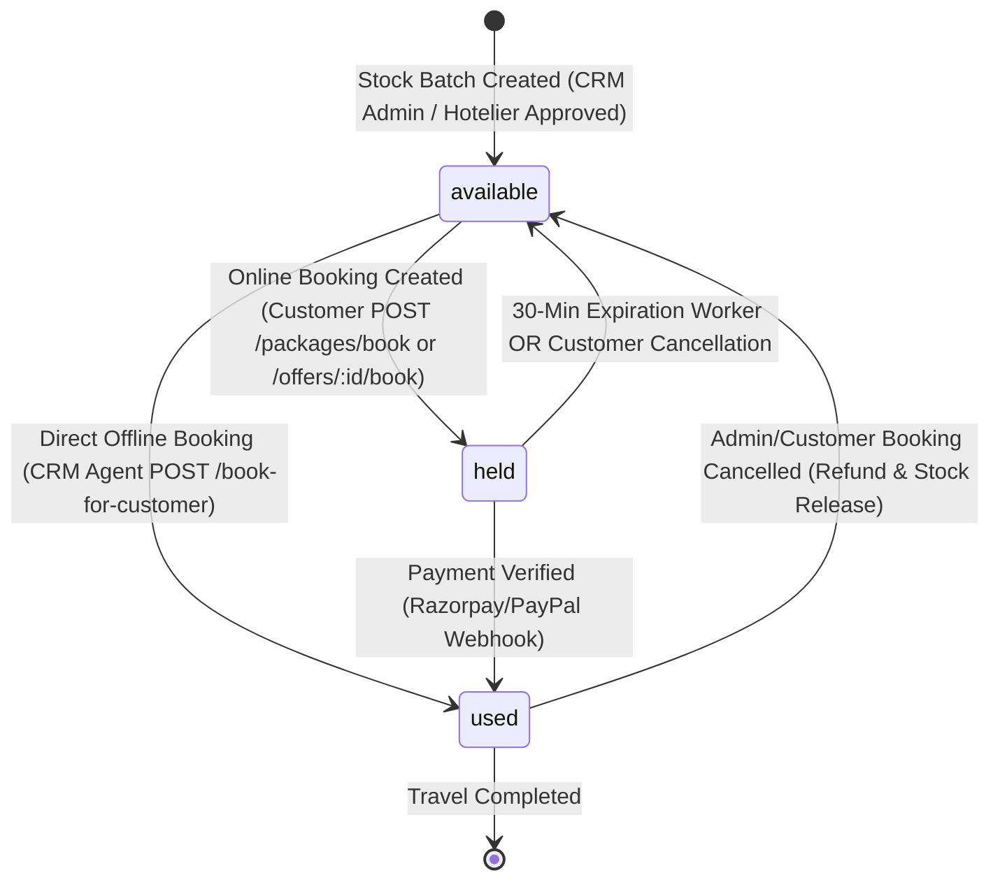

# Packages, Offers & Wholesale Stocks — Complete Fullstack API & Integration Guide

> **Document Purpose:** Definitive engineering blueprint and API specification for **Customer Frontend Developers** (User Website/App) and **CRM Frontend Developers** (Admin/Operations Portal), aligned with backend architecture.  
> **Version:** 2.2.0  
> **Status:** Production Ready  
> **Architectural Note:** Packages bundle **Offers only** (Flights, Hotels, and future Guides/Insurance) with an enforced $\ge 2$ Offer components guardrail. **Visas are 100% standalone products** sold through their own independent `/api/v1/visa/*` flow.

---

## 1. System Architecture & The 3-Tier Pre-Requisite Hierarchy

The platform implements a strict **3-Tier Hierarchy** where inventory flows logically from raw wholesale allocations to retail products, and finally into composite packages.

```mermaid
flowchart TD
    classDef stockStyle fill:#1e1b4b,stroke:#6366f1,color:#e0e7ff,stroke-width:2px;
    classDef offerStyle fill:#0c4a6e,stroke:#38bdf8,color:#e0f2fe,stroke-width:2px;
    classDef pkgStyle fill:#064e3b,stroke:#10b981,color:#ecfdf5,stroke-width:2px;
    classDef bookStyle fill:#3b0764,stroke:#a855f7,color:#f3e8ff,stroke-width:2px;

    subgraph Tier1 ["STEP 1: Wholesale Stocks (Cost Price) — Mandatory 1st Prerequisite"]
        TS["TicketStock<br/>(Flight Seats, bulk PNR block, costPerUnit)"]:::stockStyle
        HS["HotelStock<br/>(Contracted Room Allotments, pricePerNight)"]:::stockStyle
    end

    subgraph Tier2 ["STEP 2: Standalone Retail Offers — Mandatory 2nd Prerequisite"]
        OF_F["Flight Offer<br/>(Linked to TicketStock, sellPrice: ₹15,000)"]:::offerStyle
        OF_H["Hotel Offer<br/>(Linked to HotelStock, sellPrice: ₹20,000)"]:::offerStyle
    end

    subgraph Tier3 ["STEP 3: Curated Packages — Composite Product (Requires >= 2 Offers)"]
        PKG["Package Document<br/>• offerRefs: [Flight Offer, Hotel Offer]<br/>• Unbundled Total: ₹35,000<br/>• Bundle Discount: 10%<br/>• Base Sell Price: ₹31,500"]:::pkgStyle
    end

    subgraph UserFlow ["STEP 4: Booking & Operations Flow"]
        CUSTOM["Interactive Customizer / Direct Quote<br/>• POST /api/v1/packages/:id/quote<br/>• Swaps/Opt-outs dynamically calculated"]
        PB_CUST["Customer Booking Flow<br/>• POST /api/v1/packages/book<br/>• 30-min auto-release timer"]:::bookStyle
        PB_CRM["CRM Direct Agent Booking<br/>• POST /api/v1/crm/packages/book-for-customer<br/>• Direct 'used' lock & Bank Transfer"]:::bookStyle
    end

    TS -->|flightRef.stock| OF_F
    HS -->|hotelRef.stock| OF_H
    OF_F & OF_H ===>|offerRefs (min 2)| PKG
    PKG --> CUSTOM
    CUSTOM --> PB_CUST
    PKG --> PB_CRM
    PB_CUST & PB_CRM -->|Atomic Unit Lock (available -> held -> used)| TS & HS
```

### Why This Pre-Requisite Sequence is Mandatory

| Stage | Entity | Why it Must Come First |
| :--- | :--- | :--- |
| **Step 1** | **Wholesale Stocks (`TicketStock`, `HotelStock`)** | Bulk flight seats under specific PNRs and contracted hotel room allotments represent the **physical inventory and baseline cost**. Without physical seats or rooms in inventory, no retail product can exist. |
| **Step 2** | **Retail Offers (`Offer`)** | Offers assign **retail pricing, margins, dates, and inclusions** to underlying stock. They can be sold standalone (e.g. public flight deal) OR act as eligible building blocks for packages. |
| **Step 3** | **Curated Packages (`Package`)** | A package **cannot be created without existing Offers**. Backend validation strictly enforces a **minimum of 2 active Offer components** (`offerRefs.length >= 2`). The package references Tier 2 offers, computing bundle discounts and dynamic swap alternatives. |
| **Step 4** | **Booking & Operations Engine** | Bookings reserve the underlying Tier 1 stock units. Whether booked online by a customer or booked offline by a CRM agent, the physical units transition atomically from `available` -> `held` -> `used`. |

---

## 2. Stock Unit Lifecycle & Atomic Reservation Engine

Every `TicketStock` and `HotelStock` batch automatically provisions an array of discrete `units`:
- **`available`**: Open for sale or package inclusion.
- **`held`**: Reserved by a pending booking. Stock is atomically held with a **30-minute auto-release timer** via background expiration workers.
- **`used`**: Payment verified (online via Razorpay/PayPal) or confirmed directly by an agent (offline Bank Transfer). The seat or room is definitively locked.



---

## 3. Option A Pricing Math Explained (In Plain English)

### 3.1 Base Package Sell Price (Anchored Discount)
- **Unbundled Total** = $\sum(\text{Retail Sell Price of Included Offers})$
- **Base Package Sell Price** = $\text{Unbundled Total} - (\text{Unbundled Total} \times \frac{\text{bundleDiscountPercentage}}{100})$

> **Example (3 Offers Bundled):**
> - IndiGo Flight Offer (₹15,000) + Marina 3-Star Hotel Offer (₹20,000) + Desert Safari Excursion Offer (₹5,000) = **₹40,000 Unbundled Total**
> - Apply 10% Bundle Discount: ₹40,000 - 10% (₹4,000) = **₹36,000 Base Package Sell Price**

### 3.2 Customizer Live Recalculation (Toggles & Swaps)
- **Opting out of an optional item:** Deducts that item's standalone retail price from the base package price.
  - *Example:* Remove Desert Safari (-₹5,000) $\rightarrow$ New Price = ₹36,000 - ₹5,000 = **₹31,000**
- **Upgrading / Swapping an item:** Adds the exact price delta between the replacement offer and original offer.
  - *Example:* Swap 3-Star Hotel (₹20,000) for 5-Star Luxury Resort (₹26,000) $\rightarrow$ Delta = +₹6,000 $\rightarrow$ New Price = ₹36,000 + ₹6,000 = **₹42,000**
- **Complete Formula:**
  $$\text{Final Customized Price} = \text{Base Package Sell Price} - \text{Total Deductions} + \text{Total Swap Deltas}$$

### 3.3 Guardrail Rule (Minimum 2 Offer Components)
- A package must contain **at least 2 active Offer components** at all times.
- If a customer attempts to opt out until only 1 item remains, the API rejects the request with `400 Bad Request` (*"A Package must contain at least 2 Offer components (e.g. Flight + Hotel)"*). Single components must be purchased via standalone Offer endpoints. Single visas are purchased via standalone `/api/v1/visa/apply`.

---

# SECTION 1: Wholesale Stocks (Tier 1) — The First Prerequisite

Wholesale stocks establish the bulk inventory, costs, and physical allocations. Managed exclusively by CRM Operations/Admins.

### Base Path: `/api/v1/crm/stocks`
*Authentication: Bearer Token (`admin`, `super_admin`)*

---

### 1.1 Inventory Utilization Overview Dashboard
`GET /api/v1/crm/stocks/overview`

Returns consolidated health and utilization metrics across all flight seats and hotel rooms.

**Response (`200 OK`):**
```json
{
  "success": true,
  "overview": {
    "flights": {
      "total": 120,
      "available": 85,
      "held": 15,
      "used": 20,
      "expiringSoon": 5
    },
    "hotels": {
      "total": 90,
      "available": 60,
      "held": 10,
      "used": 20,
      "expiringSoon": 0
    },
    "totalStockBatches": 8
  }
}
```

---

### 1.2 Add Wholesale Flight Ticket Stock Batch
`POST /api/v1/crm/stocks/flights`

Adds a bulk PNR block of airline seats. Auto-generates individual unit items in `available` status.

**Request Body:**
```json
{
  "airline": "IndiGo",
  "flightNumber": "6E-1452",
  "origin": "DEL",
  "destination": "DXB",
  "departureDate": "2026-11-15T08:30:00.000Z",
  "arrivalDate": "2026-11-15T12:00:00.000Z",
  "cabinClass": "Economy",
  "pnr": "IND99812A",
  "nameAdditionDeadline": "2026-11-10T23:59:59.000Z",
  "costPerUnit": 9500,
  "totalUnits": 30,
  "notes": "Bulk group booking blocked via GDS aggregator"
}
```

**Response (`201 Created`):**
```json
{
  "success": true,
  "message": "Flight ticket stock batch created successfully",
  "stock": {
    "_id": "66d4a8e2e944f7b6b199e811",
    "airline": "IndiGo",
    "flightNumber": "6E-1452",
    "origin": "DEL",
    "destination": "DXB",
    "pnr": "IND99812A",
    "costPerUnit": 9500,
    "totalUnits": 30,
    "availableUnits": 30,
    "heldUnits": 0,
    "usedUnits": 0,
    "units": [
      {
        "unitIndex": 1,
        "status": "available",
        "heldUntil": null,
        "bookingRef": null
      }
    ],
    "isActive": true
  }
}
```

---

### 1.3 List Wholesale Flight Ticket Stocks
`GET /api/v1/crm/stocks/flights`

**Query Parameters:**
- `airline` (string): Filter by airline (e.g. `IndiGo`)
- `origin` / `destination` (string): IATA codes (e.g. `DEL`, `DXB`)
- `pnr` (string): Filter by PNR reference
- `availableOnly` (boolean): Only stocks with `availableUnits > 0`
- `page` (number, default: 1), `limit` (number, default: 20)

---

### 1.4 Get Wholesale Flight Stock Details
`GET /api/v1/crm/stocks/flights/:id`

Returns complete stock batch details including individual seat allocations, held bookings, and passenger name addition deadlines.

---

### 1.5 Add Contracted Hotel Room Allotment
`POST /api/v1/crm/stocks/hotels`

Adds contracted room blocks from partner hotels. Auto-generates individual room units.

**Request Body:**
```json
{
  "hotelId": "66d4a101e944f7b6b199e100",
  "roomType": "Deluxe King Room",
  "checkIn": "2026-11-15T14:00:00.000Z",
  "checkOut": "2026-11-20T11:00:00.000Z",
  "pricePerNight": 3500,
  "meals": ["breakfast"],
  "reservationRef": "HYATT-BLK-8821",
  "nameAdditionDeadline": "2026-11-10T23:59:59.000Z",
  "totalUnits": 15,
  "notes": "Direct seasonal contract allotment"
}
```

**Response (`201 Created`):**
```json
{
  "success": true,
  "message": "Hotel room allotment stock created successfully",
  "stock": {
    "_id": "66d4a8e2e944f7b6b199e822",
    "hotelId": "66d4a101e944f7b6b199e100",
    "roomType": "Deluxe King Room",
    "pricePerNight": 3500,
    "totalUnits": 15,
    "availableUnits": 15,
    "heldUnits": 0,
    "usedUnits": 0,
    "isActive": true
  }
}
```

---

### 1.6 List Wholesale Hotel Room Stocks
`GET /api/v1/crm/stocks/hotels`

**Query Parameters:**
- `hotelId` (string): Filter by hotel ID
- `destination` (string): Filter by destination city
- `availableOnly` (boolean): Filter stocks with available inventory
- `page` (number, default: 1), `limit` (number, default: 20)

---

### 1.7 Get Wholesale Hotel Stock Details
`GET /api/v1/crm/stocks/hotels/:id`

Returns room allotment breakdown, claimed nights, and room unit states.

---

### 1.8 Hotelier Stock Review Queue (CRM Approvals)
Hoteliers submit room allotments from their self-service portal. CRM Operations reviews and approves them into usable inventory:
- **List Pending Submissions:** `GET /api/v1/crm/hotel-stock/pending`
- **Review & Approve/Reject:** `PATCH /api/v1/crm/hotel-stock/:id/review`
  ```json
  {
    "status": "approved",
    "reviewNotes": "Confirmed room inventory and contract rates with hotel sales manager"
  }
  ```
- **List Approved Stocks:** `GET /api/v1/crm/hotel-stock/approved`

---

### 1.9 Contracted Hotel Property Entities
Manage physical hotel listings and contracts:
- **Onboard New Hotel:** `POST /api/v1/crm/hotels`
- **List All Hotels:** `GET /api/v1/crm/hotels`
- **Get Hotel Profile:** `GET /api/v1/crm/hotels/:id`
- **Update Hotel Details:** `PATCH /api/v1/crm/hotels/:id`

---

# SECTION 2: Standalone Retail Offers & Visas (Tier 2) — The Second Prerequisite

Retail offers bridge wholesale stock into standalone consumer-facing items AND swappable components for packages.

### Base Paths:
- **CRM Admin Management:** `/api/v1/crm/offers` *(Auth: Admin)*
- **Customer Public Portal:** `/api/v1/offers` *(Public / Customer Auth)*

---

### 2.1 Create Standalone Retail Offer (CRM)
`POST /api/v1/crm/offers` (Requires Admin Auth)

Links directly to a `TicketStock` (`flightRef.stock`) or `HotelStock` (`hotelRef.stock`). Automatically computes profit margin based on underlying wholesale cost.

**Request Body (Flight Offer Example):**
```json
{
  "title": "Direct Flight to Dubai — IndiGo Special",
  "description": "Special non-stop flight from Delhi to Dubai with baggage allowance.",
  "destination": "Dubai",
  "itemType": "flight",
  "flightRef": {
    "stock": "66d4a8e2e944f7b6b199e811",
    "unitsPerBooking": 1
  },
  "sellPrice": 12500,
  "originalPrice": 15000,
  "discountPercentage": 16,
  "inclusions": ["7kg Cabin Baggage", "30kg Check-in Baggage"],
  "startDate": "2026-11-15T08:30:00.000Z",
  "endDate": "2026-11-15T12:00:00.000Z",
  "termsAndConditions": "Non-refundable. Date change allowed up to 48 hours prior."
}
```

**Request Body (Hotel Offer Example):**
```json
{
  "title": "Grand Hyatt Dubai — 5 Nights Deluxe Package",
  "description": "Luxury 5-star stay with daily international breakfast.",
  "destination": "Dubai",
  "itemType": "hotel",
  "hotelRef": {
    "stock": "66d4a8e2e944f7b6b199e822",
    "unitsPerBooking": 1
  },
  "sellPrice": 22000,
  "originalPrice": 25000,
  "discountPercentage": 12,
  "inclusions": ["Daily Buffet Breakfast", "Access to Spa & Pools"],
  "startDate": "2026-11-15T14:00:00.000Z",
  "endDate": "2026-11-20T11:00:00.000Z"
}
```

**Response (`201 Created`):**
```json
{
  "success": true,
  "message": "Standalone retail offer created successfully",
  "offer": {
    "_id": "66d4a999e944f7b6b199e999",
    "title": "Direct Flight to Dubai — IndiGo Special",
    "itemType": "flight",
    "sellPrice": 12500,
    "costPrice": 9500,
    "grossProfit": 3000,
    "profitMarginPercentage": 24.0,
    "availableUnits": 30,
    "isActive": true
  }
}
```

---

### 2.2 List Retail Offers with Margin Analytics (CRM)
`GET /api/v1/crm/offers` (Requires Admin Auth)

**Query Parameters:**
- `itemType`: `flight` or `hotel`
- `destination`: string (e.g. `Dubai`)
- `isActive`: boolean
- `page`: number (default: 1), `limit`: number (default: 20)

**Response (`200 OK`):**
```json
{
  "success": true,
  "offers": [
    {
      "_id": "66d4a999...",
      "title": "Direct Flight to Dubai — IndiGo Special",
      "itemType": "flight",
      "destination": "Dubai",
      "sellPrice": 12500,
      "costPrice": 9500,
      "grossProfit": 3000,
      "profitMarginPercentage": 24.0,
      "availableBookings": 30,
      "isActive": true
    }
  ],
  "pagination": { "total": 12, "page": 1, "limit": 20, "totalPages": 1 }
}
```

---

### 2.3 Update or Toggle Offer Status (CRM)
- **Update Offer:** `PATCH /api/v1/crm/offers/:id` (Update price, dates, inclusions)
- **Toggle Active/Inactive:** `PATCH /api/v1/crm/offers/:id/toggle-status`

---

### 2.4 Customer Browse Public Offers
`GET /api/v1/offers` (Public)

**Query Parameters:**
- `itemType` (`flight` | `hotel`)
- `destination` (e.g. `Dubai`)
- `minPrice` / `maxPrice` (number)
- `page` / `limit`

**Response (`200 OK`):**
```json
{
  "success": true,
  "offers": [
    {
      "_id": "66d4a999...",
      "title": "Direct Flight to Dubai — IndiGo Special",
      "itemType": "flight",
      "destination": "Dubai",
      "sellPrice": 12500,
      "originalPrice": 15000,
      "discountPercentage": 16,
      "inclusions": ["7kg Cabin Baggage", "30kg Check-in Baggage"],
      "availableUnits": 30,
      "startDate": "2026-11-15T08:30:00.000Z",
      "endDate": "2026-11-15T12:00:00.000Z"
    }
  ],
  "pagination": { "total": 8, "page": 1, "limit": 10 }
}
```

---

### 2.5 Customer Book Standalone Offer
`POST /api/v1/offers/:id/book` (Requires Customer Auth)

Creates an offer booking and reserves the underlying stock unit for 30 minutes pending payment.

**Request Body:**
```json
{
  "quantity": 1,
  "travellers": [
    {
      "travellerId": "66c1b011e944f7b6b199e001",
      "isLead": true
    }
  ]
}
```

**Response (`201 Created`):**
```json
{
  "success": true,
  "message": "Offer booking created. Proceed to payment.",
  "booking": {
    "_id": "66d4b111...",
    "offer": "66d4a999...",
    "quantity": 1,
    "totalAmount": 12500,
    "status": "pending",
    "heldUntil": "2026-09-08T11:15:00.000Z"
  }
}
```

---

### 2.6 Direct Offer Booking for Customer via Bank Transfer (CRM)
`POST /api/v1/crm/offers/book-for-customer` (Requires Admin/Agent Auth)

Used when walk-in customers or telephone clients pay via direct bank deposit or cash. Automatically confirms booking, records payment, and marks stock unit directly as `used`.

**Request Body:**
```json
{
  "customerId": "66d4a8e2e944f7b6b199e111",
  "offerId": "66d4a999e944f7b6b199e999",
  "quantity": 1,
  "travellers": [
    {
      "travellerId": "66c1b011e944f7b6b199e001",
      "isLead": true
    }
  ],
  "payment": {
    "method": "bank_transfer",
    "referenceNumber": "NEFT-HDFC-991282",
    "notes": "Direct NEFT settlement into company account"
  }
}
```

**Response (`201 Created`):**
```json
{
  "success": true,
  "message": "Offer booked directly for customer with bank transfer settlement",
  "booking": {
    "_id": "66d4b222...",
    "status": "confirmed",
    "totalAmount": 12500,
    "stockUnitAllocations": [
      { "stockId": "66d4a8e2e944f7b6b199e811", "unitIndex": 1, "status": "used" }
    ]
  },
  "payment": {
    "_id": "66d4p111...",
    "status": "successful",
    "method": "bank_transfer",
    "transactionId": "NEFT-HDFC-991282"
  }
}
```

---

### 2.7 Offer Bookings Operations & Cancellation
- **List All Offer Bookings (CRM):** `GET /api/v1/crm/offers/bookings?status=confirmed`
- **Customer View Booking:** `GET /api/v1/offers/bookings/:id`
- **Customer Cancel Booking:** `POST /api/v1/offers/bookings/:id/cancel`
- **Admin Cancel Booking & Release Stock:** `POST /api/v1/crm/offers/bookings/:id/cancel`
  ```json
  { "reason": "Customer requested cancellation per refund policy" }
  ```

---

# SECTION 3: Curated Packages (Tier 3) — The Composite Product

With wholesale stocks and retail offers in place, administrators create curated packages bundling flights, hotels, and future services (guides, insurance).

### Base Paths:
- **CRM Admin Package Operations:** `/api/v1/crm/packages` *(Auth: Admin / Agent)*
- **Customer Package Experience:** `/api/v1/packages` *(Public / Customer Auth)*

---

### 3.1 Create Package (CRM Builder)
`POST /api/v1/crm/packages` (Requires Admin Auth)

> **Mandatory Rule:** Must link **at least 2 Offer items** in `offerRefs`. If `sellPrice` is omitted, the server automatically computes it from retail prices and applies `bundleDiscountPercentage`.

**Request Body:**
```json
{
  "title": "Dubai Luxury Explorer 6D5N",
  "description": "Curated Dubai tour featuring direct flights, 5-star hotel stay, and desert safari.",
  "destination": "Dubai",
  "images": ["https://cdn.example.com/dubai-pkg.jpg"],
  "offerRefs": [
    {
      "offer": "66d4a999e944f7b6b199e999",
      "unitsPerBooking": 1,
      "isOptional": false,
      "isDefaultSelected": true,
      "allowSwap": false,
      "notes": "Direct non-stop IndiGo flight DEL-DXB"
    },
    {
      "offer": "66d4a202e944f7b6b199e202",
      "unitsPerBooking": 1,
      "isOptional": true,
      "isDefaultSelected": true,
      "allowSwap": true,
      "notes": "Deluxe Room at Marina 3-Star (Swappable to 5-Star)"
    },
    {
      "offer": "66d4a404e944f7b6b199e404",
      "unitsPerBooking": 1,
      "isOptional": true,
      "isDefaultSelected": true,
      "allowSwap": false,
      "notes": "Desert Safari & Bedouin Camp Experience"
    }
  ],
  "bundleDiscountPercentage": 10,
  "itinerary": [
    {
      "day": 1,
      "title": "Arrival in Dubai & Marina Check-in",
      "description": "Airport pickup and private transfer to Marina hotel",
      "assignedOffers": [
        { "offer": "66d4a999e944f7b6b199e999", "role": "flight_arrival" },
        { "offer": "66d4a202e944f7b6b199e202", "role": "hotel_stay" }
      ]
    }
  ],
  "validity": {
    "from": "2026-10-01T00:00:00.000Z",
    "to": "2026-12-31T23:59:59.000Z"
  },
  "isPublic": true
}
```

**Response (`201 Created`):**
```json
{
  "success": true,
  "package": {
    "_id": "66d4a8e2e944f7b6b199e888",
    "title": "Dubai Luxury Explorer 6D5N",
    "destination": "Dubai",
    "unbundledTotal": 40000,
    "bundleDiscountPercentage": 10,
    "sellPrice": 36000,
    "totalCostPrice": 25000,
    "grossProfit": 11000,
    "profitMarginPercentage": 30.56,
    "availableSlots": 8,
    "isActive": true,
    "isPublic": true
  }
}
```

---

### 3.2 List Packages with Margin Analytics (CRM)
`GET /api/v1/crm/packages` (Requires Admin Auth)

Returns live inventory bottlenecks (`availableSlots`), vendor cost, sell price, and calculated profit margins.

---

### 3.3 Browse & Search Packages (Customer Portal)
`GET /api/v1/packages` (Public)

**Query Parameters:**
- `destination` (string, e.g. `Dubai`)
- `sellPriceMin` / `sellPriceMax` (number)
- `page` (number, default: 1), `limit` (number, default: 10)

---

### 3.4 Get Package Detail with Alternatives (Customizer Screen)
`GET /api/v1/packages/:id` (Public)

Returns the package with its day-by-day itinerary, itemized breakdown, and **`availableAlternatives`** (candidate swap options for upgrades).

**Response (`200 OK`):**
```json
{
  "success": true,
  "package": {
    "_id": "66d4a8e2...",
    "title": "Dubai Luxury Explorer 6D5N",
    "destination": "Dubai",
    "sellPrice": 36000,
    "bundleDiscountPercentage": 10,
    "availableSlots": 8,
    "priceBreakdown": [
      {
        "id": "66d4a999...",
        "title": "Direct Flight to Dubai — IndiGo Special",
        "itemType": "flight",
        "retailPrice": 15000,
        "unitsPerBooking": 1,
        "isOptional": false,
        "allowSwap": false
      },
      {
        "id": "66d4a202...",
        "title": "City Marina 3-Star Stay",
        "itemType": "hotel",
        "retailPrice": 20000,
        "unitsPerBooking": 1,
        "isOptional": true,
        "allowSwap": true
      },
      {
        "id": "66d4a404...",
        "title": "Desert Safari Bedouin Night",
        "itemType": "hotel",
        "retailPrice": 5000,
        "unitsPerBooking": 1,
        "isOptional": true,
        "allowSwap": false
      }
    ],
    "availableAlternatives": {
      "offers": {
        "66d4a202...": [
          {
            "_id": "66d4a555...",
            "title": "Luxury Marina Resort 5-Star Stay",
            "itemType": "hotel",
            "sellPrice": 26000,
            "priceDelta": 6000,
            "images": ["https://cdn.example.com/luxury-hotel.jpg"]
          }
        ]
      }
    }
  }
}
```

---

### 3.5 Live Dynamic Customizer Quote Recalculation
`POST /api/v1/packages/:id/quote` (Public / No Auth Required)

Call on every checkbox toggle or alternative swap in the customer UI for instantaneous recalculation.

**Request Body:**
```json
{
  "quantity": 2,
  "excludedOfferIds": ["66d4a404..."],
  "swappedOffers": [
    {
      "originalOfferId": "66d4a202...",
      "replacementOfferId": "66d4a555..."
    }
  ]
}
```

**Response (`200 OK`):**
```json
{
  "success": true,
  "quote": {
    "packageId": "66d4a8e2...",
    "basePackageSellPrice": 36000,
    "deductions": 5000,
    "swapDeltas": 6000,
    "finalSellPrice": 37000,
    "quantity": 2,
    "totalAmount": 74000,
    "activeComponentsCount": 2,
    "items": [
      {
        "id": "66d4a999...",
        "name": "Direct Flight to Dubai",
        "type": "flight",
        "retailPrice": 15000,
        "isIncluded": true
      },
      {
        "id": "66d4a555...",
        "originalOfferId": "66d4a202...",
        "name": "Luxury Marina Resort 5-Star Stay",
        "type": "hotel",
        "retailPrice": 26000,
        "isIncluded": true,
        "isSwapped": true,
        "delta": 6000
      },
      {
        "id": "66d4a404...",
        "name": "Desert Safari Bedouin Night",
        "type": "hotel",
        "retailPrice": 5000,
        "isIncluded": false,
        "isOptedOut": true,
        "deduction": 5000
      }
    ]
  }
}
```

---

### 3.6 Book Customized Package (Customer Website)
`POST /api/v1/packages/book` (Requires Customer Auth)

Holds underlying `TicketStock` and `HotelStock` units for 30 minutes.

**Request Body:**
```json
{
  "packageId": "66d4a8e2...",
  "quantity": 1,
  "travellers": [
    {
      "travellerId": "66c1b011...",
      "isLead": true
    }
  ],
  "excludedOfferIds": ["66d4a404..."],
  "swappedOffers": [
    {
      "originalOfferId": "66d4a202...",
      "replacementOfferId": "66d4a555..."
    }
  ]
}
```

**Response (`201 Created`):**
```json
{
  "success": true,
  "message": "Customized package booking created. Proceed to payment.",
  "bookingId": "66d4b555...",
  "totalAmount": 37000,
  "currency": "INR",
  "status": "pending",
  "quantity": 1,
  "claimedUnits": [
    { "stockModel": "TicketStock", "stock": "66d4a8e2...", "unitId": "66d4u101..." },
    { "stockModel": "HotelStock", "stock": "66d4a555...", "unitId": "66d4u202..." }
  ]
}
```

---

### 3.7 Direct Package Booking for Customer via Bank Transfer (CRM)
`POST /api/v1/crm/packages/book-for-customer` (Requires Admin/Agent Auth)

Allows sales/operations agents to book directly for walk-in or offline clients who settled via bank deposit.
- Immediately marks stock units as `used` (bypasses the 30-minute hold timer).
- Generates a successful `Payment` and synced `MasterBooking` record.

**Request Body:**
```json
{
  "customerId": "66d4a8e2e944f7b6b199e111",
  "packageId": "66d4a8e2e944f7b6b199e888",
  "quantity": 2,
  "excludedOfferIds": [],
  "swappedOffers": [],
  "travellers": [
    { "travellerId": "66c1b011e944f7b6b199e001", "isLead": true },
    { "travellerId": "66c1b011e944f7b6b199e002", "isLead": false }
  ],
  "travelDates": {
    "from": "2026-11-15T00:00:00.000Z",
    "to": "2026-11-20T23:59:59.000Z"
  },
  "contactDetails": {
    "email": "amit.sharma@example.com",
    "phone": "+919876543210"
  },
  "payment": {
    "method": "bank_transfer",
    "referenceNumber": "NEFT-AXIS-882191",
    "notes": "Paid in full via Axis Bank corporate account"
  }
}
```

**Response (`201 Created`):**
```json
{
  "success": true,
  "message": "Direct package booking completed successfully via bank transfer",
  "booking": {
    "_id": "66d4b777...",
    "bookingReference": "PKG-20260908-9121",
    "status": "confirmed",
    "totalAmount": 72000,
    "claimedUnits": [
      { "stockModel": "TicketStock", "stock": "66d4a8e2...", "unitId": "66d4u101..." },
      { "stockModel": "HotelStock", "stock": "66d4a202...", "unitId": "66d4u202..." }
    ]
  },
  "payment": {
    "_id": "66d4p888...",
    "status": "successful",
    "method": "bank_transfer",
    "transactionId": "NEFT-AXIS-882191"
  },
  "masterBooking": {
    "_id": "66d4m999...",
    "status": "confirmed"
  }
}
```

---

### 3.8 List All Package Bookings (CRM)
`GET /api/v1/crm/packages/bookings` (Requires Admin/Agent/Finance Auth)

**Query Parameters:**
- `status`: `pending`, `confirmed`, `cancelled`, `completed`
- `package`: Package ID
- `customer`: Customer User ID
- `assignedTo`: Operations Agent ID
- `page`: number (default: 1), `limit`: number (default: 20)

---

### 3.9 Operations Lookup of Customer Booking (CRM)
`GET /api/v1/crm/packages/bookings/:id` (Requires Admin/Agent Auth)

**Returns Complete Operational Dossier:**
- Customer contact info (`name`, `phone`, `email`).
- Assigned Operations Officer (`assignedTo`).
- Exact physical units claimed in `TicketStock` and `HotelStock`.
- Traveller profiles and lead passenger details.
- Operational remarks timeline and payment transaction details.

---

### 3.10 Assign Operations Officer to Package Booking
`PATCH /api/v1/crm/packages/bookings/:id/assign` (Requires Admin Auth)

**Request Body:**
```json
{
  "assignedTo": "66ce08fe944f7b6b199e088"
}
```

---

### 3.11 Safely Update Confirmed Booking Details (CRM)
`PATCH /api/v1/crm/packages/bookings/:id` (Requires Admin/Agent Auth)

Allows updating non-structural operational details without breaking physical inventory holds.
> **Strict Guardrail:** Structural changes (adding/removing components or swapping items) on confirmed bookings are rejected.

**Request Body:**
```json
{
  "travelDates": {
    "from": "2026-11-16T00:00:00.000Z",
    "to": "2026-11-21T23:59:59.000Z"
  },
  "contactDetails": {
    "phone": "+919999888877",
    "emergencyContact": "+919888777666"
  }
}
```

---

### 3.12 Add Operational Remark to Booking
`PATCH /api/v1/crm/packages/bookings/:id/remark` (Requires Admin/Agent Auth)

Appends a timestamped audit trail remark to the booking dossier.

**Request Body:**
```json
{
  "remark": "Customer confirmed flight ticket names match passport exactly. Hotel voucher sent via WhatsApp."
}
```

---

### 3.13 Cancel Package Booking & Auto-Release Stock
- **Customer Self-Cancel:** `POST /api/v1/packages/bookings/:id/cancel`
- **Admin Operations Cancel:** `POST /api/v1/crm/packages/bookings/:id/cancel`
  ```json
  { "reason": "Medical emergency cancellation request approved by management" }
  ```
> **Inventory Effect:** Atomically releases all held or used units in `TicketStock` and `HotelStock` back to `available` status for other buyers.

---

# SECTION 4: CRM Lead Management & Package Conversion

Capture inquiries, manage the sales pipeline, and convert interested leads directly into confirmed package bookings:

1. **Create Lead:** `POST /api/v1/crm/leads`
   ```json
   {
     "name": "Rajesh Gupta",
     "phone": "+919811223344",
     "email": "rajesh.gupta@example.com",
     "destination": "Dubai",
     "budget": 75000,
     "paxCount": 2,
     "packageInterest": "66d4a8e2..."
   }
   ```
2. **List Leads / Filter by Stage:** `GET /api/v1/crm/leads?stage=quoted`  
   *(Stages: `new`, `contacted`, `quoted`, `converted`, `lost`)*
3. **Convert Lead to Booking:** `POST /api/v1/crm/leads/:leadId/convert`

---

# SECTION 5: Master API Matrix (Cheat Sheet)

Organized strictly according to the **Stocks $\rightarrow$ Offers $\rightarrow$ Packages** prerequisite sequence:

| Domain | Method | Endpoint | Auth | Purpose |
| :--- | :--- | :--- | :--- | :--- |
| **1. Wholesale Stock** | `GET` | `/api/v1/crm/stocks/overview` | Admin | Overall inventory utilization dashboard |
| **1. Wholesale Stock** | `POST`| `/api/v1/crm/stocks/flights` | Admin | Add bulk airline PNR ticket stock batch |
| **1. Wholesale Stock** | `GET` | `/api/v1/crm/stocks/flights` | Admin | List & search wholesale flight stocks |
| **1. Wholesale Stock** | `GET` | `/api/v1/crm/stocks/flights/:id` | Admin | View flight stock units & allocations |
| **1. Wholesale Stock** | `POST`| `/api/v1/crm/stocks/hotels` | Admin | Add contracted hotel room allotment |
| **1. Wholesale Stock** | `GET` | `/api/v1/crm/stocks/hotels` | Admin | List & search wholesale hotel room stocks |
| **1. Wholesale Stock** | `GET` | `/api/v1/crm/stocks/hotels/:id` | Admin | View hotel room stock units & allocations |
| **1. Wholesale Stock** | `GET` | `/api/v1/crm/hotel-stock/pending` | Admin | Review pending hotelier stock blocks |
| **1. Wholesale Stock** | `PATCH`| `/api/v1/crm/hotel-stock/:id/review` | Admin | Approve or reject submitted hotel stock |
| **1. Wholesale Stock** | `GET` | `/api/v1/crm/hotel-stock/approved` | Admin | Browse approved hotel stock |
| **1. Wholesale Stock** | `POST`| `/api/v1/crm/hotels` | Admin | Onboard contracted hotel entity |
| **1. Wholesale Stock** | `GET` | `/api/v1/crm/hotels` | Admin | List onboarded hotel entities |
| **2. Retail Offers** | `POST`| `/api/v1/crm/offers` | Admin | Create retail offer linked to Ticket/HotelStock |
| **2. Retail Offers** | `GET` | `/api/v1/crm/offers` | Admin | List offers with margins & available stock |
| **2. Retail Offers** | `GET` | `/api/v1/crm/offers/:id` | Admin | Get single offer detail with stock metrics |
| **2. Retail Offers** | `PATCH`| `/api/v1/crm/offers/:id` | Admin | Update retail offer details & pricing |
| **2. Retail Offers** | `PATCH`| `/api/v1/crm/offers/:id/toggle-status`| Admin | Activate or deactivate offer |
| **2. Retail Offers** | `POST`| `/api/v1/crm/offers/book-for-customer`| Admin/Agent| Direct offline offer booking via Bank Transfer |
| **2. Retail Offers** | `GET` | `/api/v1/crm/offers/bookings` | Admin | List all standalone offer bookings |
| **2. Retail Offers** | `POST`| `/api/v1/crm/offers/bookings/:id/cancel`| Admin | Admin cancel offer booking & release stock |
| **2. Retail Offers** | `GET` | `/api/v1/offers` | Public | Customer browse active retail offers |
| **2. Retail Offers** | `GET` | `/api/v1/offers/:id` | Public | Customer get offer details & live stock |
| **2. Retail Offers** | `POST`| `/api/v1/offers/:id/book` | Customer | Customer book offer (30-min stock hold) |
| **2. Retail Offers** | `GET` | `/api/v1/offers/bookings/:id` | Customer | Customer view offer booking status |
| **2. Retail Offers** | `POST`| `/api/v1/offers/bookings/:id/cancel` | Customer | Customer cancel offer booking |
| **3. Curated Packages**| `POST`| `/api/v1/crm/packages` | Admin | Create package with component links ($\ge$ 2 items) |
| **3. Curated Packages**| `GET` | `/api/v1/crm/packages` | Admin | List packages with margin analytics |
| **3. Curated Packages**| `GET` | `/api/v1/crm/packages/:id` | Admin | Detailed package view with margin breakdown |
| **3. Curated Packages**| `PATCH`| `/api/v1/crm/packages/:id` | Admin | Edit package details or pricing |
| **3. Curated Packages**| `PATCH`| `/api/v1/crm/packages/:id/deactivate` | Admin | Soft-delete / deactivate package |
| **3. Curated Packages**| `GET` | `/api/v1/crm/packages/bookings` | Admin/Agent| List all package bookings with filters |
| **3. Curated Packages**| `POST`| `/api/v1/crm/packages/book-for-customer`| Admin/Agent| Direct package booking for customer (Bank Transfer) |
| **3. Curated Packages**| `GET` | `/api/v1/crm/packages/bookings/:id` | Admin/Ops | Operations dossier of customer package booking |
| **3. Curated Packages**| `PATCH`| `/api/v1/crm/packages/bookings/:id/assign` | Admin | Assign Operations Officer to package booking |
| **3. Curated Packages**| `PATCH`| `/api/v1/crm/packages/bookings/:id` | Admin/Agent| Update travel dates or contact on confirmed booking |
| **3. Curated Packages**| `PATCH`| `/api/v1/crm/packages/bookings/:id/remark`| Admin/Agent| Append operational remark / audit trail |
| **3. Curated Packages**| `POST`| `/api/v1/crm/packages/bookings/:id/cancel`| Admin | Admin cancel package booking & release stock |
| **3. Curated Packages**| `GET` | `/api/v1/packages` | Public | Search & list active public packages |
| **3. Curated Packages**| `GET` | `/api/v1/packages/:id` | Public | View package details, itinerary & swap options |
| **3. Curated Packages**| `POST`| `/api/v1/packages/:id/quote` | Public | Live dynamic customizer price recalculation |
| **3. Curated Packages**| `POST`| `/api/v1/packages/book` | Customer | Create booking & hold physical stock |
| **3. Curated Packages**| `GET` | `/api/v1/packages/bookings/:id` | Customer | View customer booking status & snapshot |
| **3. Curated Packages**| `POST`| `/api/v1/packages/bookings/:id/cancel` | Customer | Cancel booking & auto-release held stock |
| **CRM Leads** | `GET` | `/api/v1/crm/leads` | Sales Agent | Lead pipeline tracking |
| **CRM Leads** | `POST` | `/api/v1/crm/leads` | Sales Agent | Create inbound customer lead |
| **CRM Leads** | `POST` | `/api/v1/crm/leads/:id/convert`| Sales Agent | Convert lead into confirmed sale |
| **Standalone Visas** | `GET` | `/api/v1/visa/types` | Public | List destination country visa types & pricing |
| **Standalone Visas** | `POST`| `/api/v1/visa/apply` | Customer | Submit standalone visa application with documents |
| **Standalone Visas** | `GET` | `/api/v1/visa/my-applications`| Customer | Track customer visa application status |
| **Standalone Visas** | `GET` | `/api/v1/visa/admin/applications`| Visa Admin| Review & assign visa specialist officer |
| **Standalone Visas** | `PATCH`| `/api/v1/visa/admin/applications/:id/status`| Visa Admin| Approve/Reject visa & upload issued e-visa PDF |

---

# SECTION 6: Standalone Visas (Sold Independently)

Visas are **never bundled inside packages** and are sold 100% standalone through dedicated visa endpoints.

### Customer Standalone Visa Journey:
1. **Browse Requirements & Fees:** `GET /api/v1/visa/types?country=UNITED+ARAB+EMIRATES`
2. **Apply & Upload Documents:** `POST /api/v1/visa/apply`
   ```json
   {
     "destinationCountry": "UNITED ARAB EMIRATES",
     "visaType": "Tourist",
     "totalApplicants": 1,
     "applicants": [
       {
         "firstName": "Arun",
         "lastName": "Shaw",
         "passportNumber": "Z1234567",
         "nationality": "Indian",
         "dateOfBirth": "1992-05-15",
         "documents": {
           "passportScan": "https://res.cloudinary.com/.../passport.jpg",
           "photo": "https://res.cloudinary.com/.../photo.jpg"
         }
       }
     ]
   }
   ```
3. **Payment & Visa Group Confirmation:**
   - Once paid, a `VisaGroup` and individual `VisaApplication` documents are created with `status: "submitted"`.
4. **Visa Desk Processing (Admin):**
   - Visa Admin assigns a Case Officer: `PATCH /api/v1/visa/admin/applications/:id/assign`
   - Case Officer submits to embassy / immigration portal.
   - On issuance, Case Officer approves and uploads issued e-visa:
     `PATCH /api/v1/visa/admin/applications/:id/status`
     ```json
     {
       "status": "approved",
       "issuedVisaUrl": "https://res.cloudinary.com/.../issued_evisa.pdf"
     }
     ```

