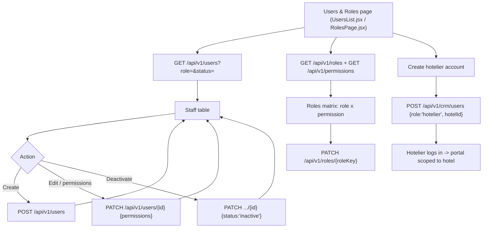
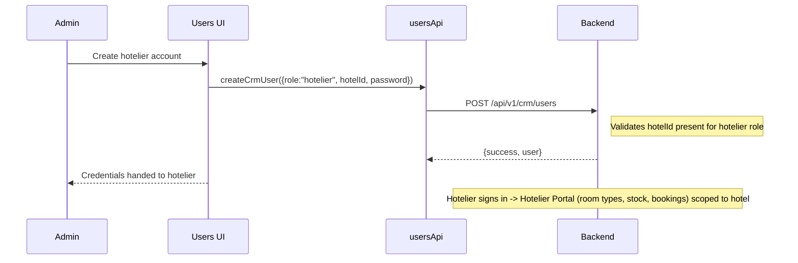

# Platform Users, Roles & Permissions — Endpoints, Bodies & Workflow

> Section: **Platform users, roles & permissions** (Admin Console · mock branch — real API + local fallback, follows `VITE_USE_MOCK_API`)
> Module: `src/admin/features/users/usersApi.js` (+ CRM-side `createCrmUser`) · Role definitions: `src/admin/features/users/roles.js`

---

## 1. Endpoints

| # | Method | Endpoint | Auth | Request body | Response body | Purpose |
|---|---|---|---|---|---|---|
| 1 | GET | `/api/v1/users` | Admin | — (query: `?search=&role=&status=`) | `{data[staff], meta{total,page,pageSize}}` | Staff list |
| 2 | GET | `/api/v1/users/{id}` | Admin | — | staff object | User detail |
| 3 | POST | `/api/v1/users` | Admin | create payload (below) | staff object | Create user |
| 4 | PATCH | `/api/v1/users/{id}` | Admin | `{name?, role?, department?, status?, permissions?}` | staff object | Update user / permissions |
| 5 | GET | `/api/v1/roles` | Admin | — | `{data[role]}` | Role list with permission keys |
| 6 | PATCH | `/api/v1/roles/{roleKey}` | Admin | `{label?, description?, permissions?}` | role object | Update role definition |
| 7 | GET | `/api/v1/permissions` | Admin | — | `{data[catalog]}` | Permission catalog (grouped keys) |
| 8 | POST | `/api/v1/crm/users` | Admin | CRM user payload (below) | `{success, user}` | CRM-side create (hotelier needs `hotelId`) |

### Staff object

```json
{
  "id": "USR-1726980000000",
  "name": "Ali Hussain",
  "email": "ali@maqam.com",
  "phone": "+919198989898",
  "department": "Operations",
  "role": "ops",
  "status": "active",
  "permissions": ["bookings.edit", "bookings.cancel"],
  "lastLogin": null,
  "createdAt": "2026-09-22"
}
```

### Create user payload

```json
{
  "name": "Ali Hussain",
  "email": "ali@maqam.com",
  "phone": "+919198989898",
  "department": "Operations",
  "role": "ops",
  "password": "••••••••"
}
```
Mock defaults: `status:"active"`, `permissions:[]`, `lastLogin:null`.

### Role object

```json
{
  "key": "ops",
  "label": "Operations Officer",
  "description": "Handles assigned bookings, travel dates and operations dossier",
  "permissions": ["bookings.edit", "bookings.remark", "bookings.assign.read"]
}
```

### Permission catalog (display shape)

```json
[
  {
    "group": "Bookings",
    "keys": ["bookings.view", "bookings.edit", "bookings.cancel", "bookings.remark", "bookings.assign"]
  },
  {
    "group": "Finance",
    "keys": ["finance.view", "finance.refund.process"]
  }
]
```

### CRM user creation (hotelier account — see FRONTEND_CRM_HOTEL_AND_HOTELIER_INTEGRATION_GUIDE.md #3.I)

```json
{
  "firstName": "Yusuf",
  "lastName": "Khan",
  "email": "yusuf@pullman.com",
  "phone": "+919187676767",
  "password": "••••••••",
  "role": "hotelier",
  "hotelId": "64f8a1b2c3d4e5f6a7b8c9d0"
}
```
**Rule**: `role:"hotelier"` must be accompanied by `hotelId` — the hotelier user is scoped to that hotel (sees only his hotel's stock/bookings). Response:
```json
{ "success": true, "message": "CRM user created", "user": { "_id": "...", "role": "hotelier", "hotelId": "..." } }
```

---

## 2. Workflow



### Sequence (hotelier onboarding)



---

## 3. Notes

- **Role families**: platform roles (`admin`, `finance`, `ops`, `support`...) are defined in `roles.js` + `/roles`; `hotelier` is a CRM-side role tied to a hotel via `hotelId`.
- **Permissions flow**: catalog (`/permissions`) → assigned per user (`permissions[]`) or per role (`/roles/{roleKey}`); enforcement happens server-side on every protected route (RoleRoute guards UI routes).
- Update user and update permissions share the same `PATCH /users/{id}` endpoint (`updatePermissions` is a wrapper).
