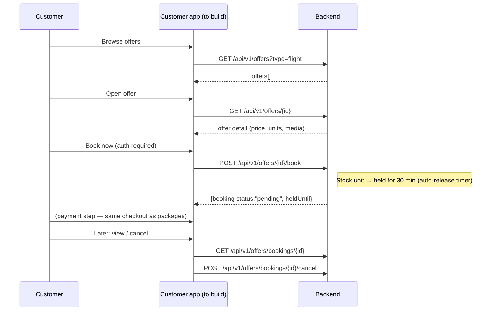
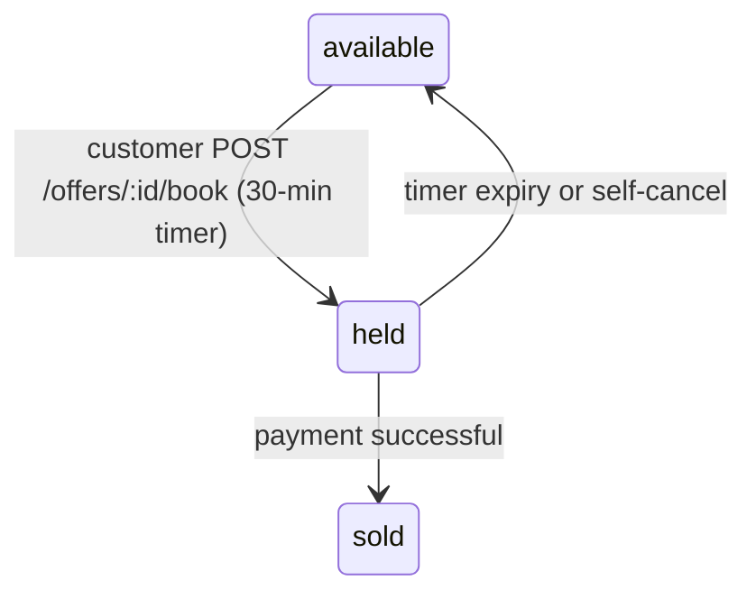

# Public Offer Details — Endpoints, Bodies & Workflow

> Section: **Public offer details** (Planned — served by backend, NOT yet consumed by this frontend. Status: `missing` in the data source registry)
> Source contract: `PACKAGE_OFFER_STOCK_FULLSTACK_ALIGNMENT_GUIDE (2).md` §2.5–2.7 · Planned module: customer app offer detail page

---

## 1. Status

The backend serves standalone offers (flights / hotels / future components) with public browsing and customer-authenticated booking. The **admin CRM already consumes** the CRM-side endpoints (`/api/v1/crm/offers`, `/api/v1/crm/offers/bookings`). What is missing is the **customer-facing detail + booking journey**.

## 2. Backend endpoints (contract to implement)

| # | Method | Endpoint | Auth | Request body | Response body | Purpose |
|---|---|---|---|---|---|---|
| 1 | GET | `/api/v1/offers` | Public | — (query: `?type=flight|hotel&search=`) | `{offers[]}` | Public offer browsing |
| 2 | GET | `/api/v1/offers/{id}` | Public | — | offer detail object | Public offer detail page |
| 3 | POST | `/api/v1/offers/{id}/book` | Customer | `{quantity, travellers[]}` (below) | `{booking{...heldUntil}}` — `201` | Book offer, stock held 30 min pending payment |
| 4 | GET | `/api/v1/offers/bookings/{id}` | Customer | — | customer booking + snapshot | View own booking |
| 5 | POST | `/api/v1/offers/bookings/{id}/cancel` | Customer | — | booking (`cancelled`, stock released) | Self-cancel + auto-release stock |

### Offer detail object (display shape)

```json
{
  "_id": "66d4a999e944f7b6b199e999",
  "type": "flight",
  "title": "Delhi -> Jeddah Economy Flight",
  "provider": "Saudia SV-758",
  "retailPrice": 48500,
  "discountPercentage": 5,
  "finalSellPrice": 46075,
  "availableUnits": 12,
  "media": [],
  "description": "Direct economy flight, 7kg cabin + 23kg checked"
}
```

### Book payload (customer auth)

```json
{
  "quantity": 1,
  "travellers": [
    { "travellerId": "66c1b011e944f7b6b199e001", "isLead": true }
  ]
}
```

### Book response (`201 Created`)

```json
{
  "success": true,
  "message": "Offer booking created. Proceed to payment.",
  "booking": {
    "_id": "66d4b111e944f7b6b199e111",
    "offer": "66d4a999e944f7b6b199e999",
    "quantity": 1,
    "totalAmount": 12500,
    "status": "pending",
    "heldUntil": "2026-09-22T11:15:00.000Z"
  }
}
```

## 3. Workflow (target journey)



### Stock state link



---

## 4. Notes

- The **single-service wizard** in the admin console (Book a Service) is the assisted counterpart of this journey — staff can already book standalone offers for customers via `POST /services/book` (see Book a Service doc).
- Stock lifecycle (`available → held → sold`) is enforced server-side; the customer app must surface the `heldUntil` countdown.
- CRM-side offer bookings (`GET /api/v1/crm/offers/bookings`) already work in this frontend.
