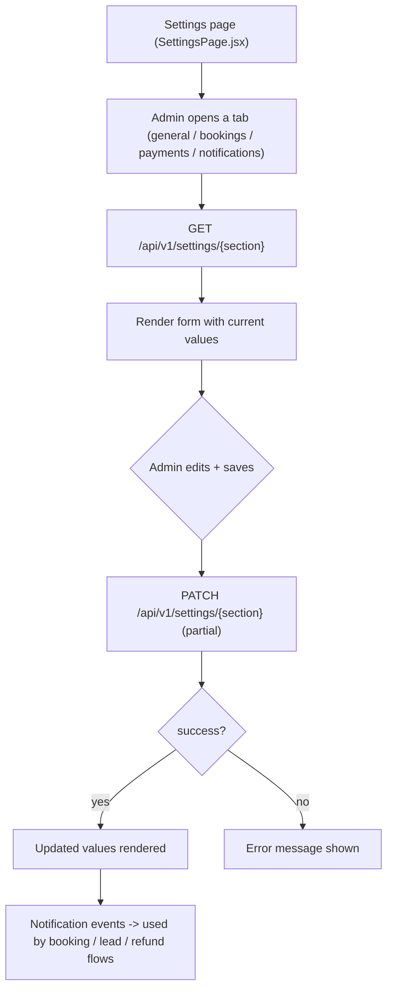
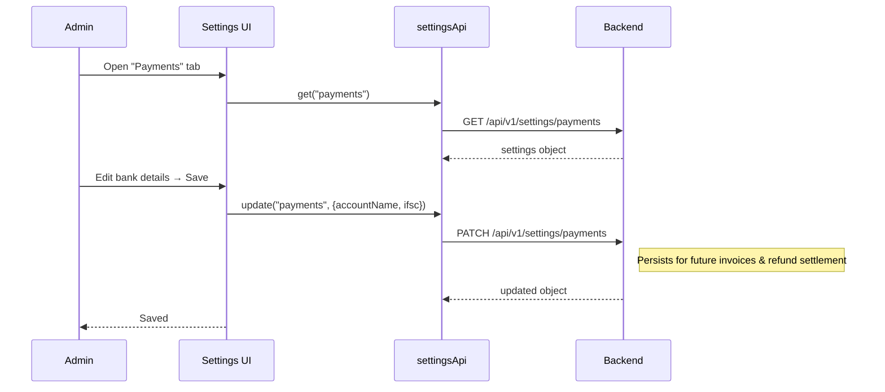

# System Settings — Endpoints, Bodies & Workflow

> Section: **System settings** (Admin Console · mock branch — real API + local fallback, follows `VITE_USE_MOCK_API`)
> Module: `src/admin/features/settings/settingsApi.js`

---

## 1. Endpoints

| # | Method | Endpoint | Auth | Request body | Response body | Purpose |
|---|---|---|---|---|---|---|
| 1 | GET | `/api/v1/settings/{section}` | Admin | — | settings object for the section | Load a settings tab |
| 2 | PATCH | `/api/v1/settings/{section}` | Admin | partial payload for the section | updated settings object | Save a settings tab |

### Sections

Settings are organized per tab (`store.settings[section]`):

| Section | Typical contents |
|---|---|
| `general` | company name, support email/phone, timezone, currency |
| `bookings` | default payment method, auto-cancel window, booking prefix |
| `payments` | bank account details, UPI id, invoice footer note |
| `notifications` | email/SMS toggles per event (lead created, booking confirmed, refund processed) |

### GET response (example — `general`)

```json
{
  "companyName": "Maqam Travels",
  "supportEmail": "support@maqam.com",
  "supportPhone": "+911180808080",
  "timezone": "Asia/Kolkata",
  "currency": "INR"
}
```

### PATCH payload (partial — only changed keys)

```json
{ "supportEmail": "care@maqam.com", "currency": "INR" }
```

→ merged settings object returned (mock: shallow-merges into `store.settings[section]`).

---

## 2. Workflow



### Sequence



---

## 3. Notes

- **One endpoint pair for all tabs** — the section path is the tab key; no per-field endpoints.
- **Consumers**: booking wizards read `bookings.bookingPrefix` (display), payment notes templates come from `payments`, SMS/email dispatch respects `notifications` toggles server-side.
- Mock branch: `phase7MockData.settings` fixtures; live branch must accept section path + partial merge semantics.
