# Hotel & Hoteliers — Full System Guide (Admin + Hotelier Portal)

Complete connection map, endpoints, request/response bodies and mock data for
the end-to-end hotel flow: admin creates the hotel → admin creates hotelier
users for it → hotelier builds room types, facilities and services → customers
book through the Maqam storefront with admin-set additional charges → hotelier
sees booked customers (read-only) and arranges availability.

---

## 1. System graph — how everything connects

```mermaid
flowchart TD
    subgraph ADMIN["ADMIN CONSOLE (this app)"]
        A1["Create Hotel<br/>POST /crm/hotels"] --> A2["Create Hotelier Users<br/>POST /crm/users (hotelId)"]
        A1 --> A3["Set Additional Charges<br/>PATCH /crm/hotels/{id}/charges<br/>(ADMIN ONLY)"]
        A2 --> H
        A3 --> B2
        A4["Stock Review Queue<br/>pending → approved"] --> S2
        A5["Bookings + Charges View<br/>(full breakdown)"] --> B1
    end

    subgraph HOTELIER["HOTELIER PORTAL (role=hotelier, hotelId-bound)"]
        H["Login → own hotel only<br/>GET /hotelier/profile"] --> R1["Room Types CRUD<br/>/hotelier/room-types"]
        H --> F1["Facilities<br/>GET/PUT /hotelier/facilities"]
        H --> V1["Services<br/>/hotelier/services"]
        R1 --> S1["Submit Stock / Allotment<br/>POST /hotelier/stock"]
        S1 -->|"review"| A4
        S1 --> S2["Approved Stock → storefront"]
        B1["Booked Customers (read-only)<br/>GET /hotelier/bookings"] --> B3["Arrange Availability<br/>PATCH /hotelier/bookings/{id}/arrange"]
    end

    subgraph STORE["STOREFRONT (customer)"]
        C1["Search Hotels<br/>Maqam filter"] --> C2["Book Hotel<br/>POST /bookings"]
        S2 --> C1
        C2 -->|"server applies admin charges"| B2["Booking created"]
        B2 --> B1
        B2 --> A5
    end
```



**Rule of access:**

| Actor | Can do | Cannot see |
|---|---|---|
| Admin | Everything: hotels, hotelier users, charges, stock review, bookings with full charge breakdown | — |
| Hotelier | Only his own hotel: room types, facilities, services, stock submission, **view** booked customers, arrange availability | Additional charges / markup (admin-only), other hotels |
| Customer | Search & book via Maqam filter | Internal charges, hotelier data |

---

## 2. Admin — Hotels (LIVE, already implemented)

### 2.1 Create hotel
```
POST /api/v1/crm/hotels
```
Request:
```json
{
  "name": "Pullman Zamzam Makkah",
  "destination": "Makkah",
  "address": "Abraj Al Bait Complex, Makkah",
  "starRating": 5
}
```
Response:
```json
{
  "success": true,
  "message": "Hotel created successfully",
  "data": {
    "_id": "6ab0b26696be5f33244620fe",
    "name": "Pullman Zamzam Makkah",
    "destination": "Makkah",
    "address": "Abraj Al Bait Complex, Makkah",
    "images": [], "amenities": [], "isActive": true,
    "createdAt": "2026-09-21T04:28:22.958Z",
    "updatedAt": "2026-09-21T04:28:22.958Z"
  }
}
```

### 2.2 List / get / update / delete
```
GET    /api/v1/crm/hotels?page=1&limit=20&search=
GET    /api/v1/crm/hotels/{id}
PATCH  /api/v1/crm/hotels/{id}        { name?, destination?, address?, isActive? }
DELETE /api/v1/crm/hotels/{id}
```

---

## 3. Admin — Hotelier users (LIVE, already implemented)

### 3.1 Create hotelier user (must carry hotelId)
```
POST /api/v1/crm/users
```
Request:
```json
{
  "firstName": "Imran",
  "lastName": "Hossain",
  "email": "imran@pullman.com",
  "phone": "917700112233",
  "password": "Secret@123",
  "role": "hotelier",
  "hotelId": "6ab0b26696be5f33244620fe"
}
```
Response:
```json
{
  "success": true,
  "message": "Hotelier user created",
  "data": {
    "_id": "6ab2aa10c9e4f1a2b3c4d5e6",
    "firstName": "Imran",
    "lastName": "Hossain",
    "email": "imran@pullman.com",
    "role": "hotelier",
    "hotelId": "6ab0b26696be5f33244620fe",
    "isActive": true,
    "createdAt": "2026-09-21T10:02:11.230Z"
  }
}
```
Backend rule: `role: "hotelier"` without a valid `hotelId` must be rejected (400).

### 3.2 List users of one hotel (MOCK — for the hotel-detail "Team" tab)
```
GET /api/v1/crm/hotels/{hotelId}/users
```
Response:
```json
{
  "success": true,
  "data": [
    { "_id": "6ab2aa10c9e4f1a2b3c4d5e6", "firstName": "Imran", "lastName": "Hossain", "email": "imran@pullman.com", "role": "hotelier", "isActive": true },
    { "_id": "6ab2aa10c9e4f1a2b3c4d5e7", "firstName": "Sara", "lastName": "Ali", "email": "sara@pullman.com", "role": "hotelier", "isActive": false }
  ]
}
```

### 3.3 Enable / disable a hotelier user
```
PATCH /api/v1/crm/users/{id}        { "isActive": false }
```

---

## 4. Admin — Additional charges for hotel services (ADMIN ONLY)

Admin sets per-hotel extra charges (service charge, Maqam markup, taxes).
These are applied by the **server** when a customer books and are **never
returned to the hotelier portal**.

### 4.1 Set charges
```
PATCH /api/v1/crm/hotels/{hotelId}/charges
```
Request:
```json
{
  "serviceChargePercent": 5,
  "maqamMarkupPercent": 8,
  "taxPercent": 12,
  "flatFees": [
    { "name": "Ramadan peak fee", "amount": 1500, "perNight": true },
    { "name": "Airport transfer", "amount": 2200, "perNight": false }
  ]
}
```
Response:
```json
{
  "success": true,
  "message": "Charges updated",
  "data": {
    "hotelId": "6ab0b26696be5f33244620fe",
    "serviceChargePercent": 5,
    "maqamMarkupPercent": 8,
    "taxPercent": 12,
    "flatFees": [
      { "name": "Ramadan peak fee", "amount": 1500, "perNight": true },
      { "name": "Airport transfer", "amount": 2200, "perNight": false }
    ],
    "updatedBy": "6aacc0352df766456873afa1",
    "updatedAt": "2026-09-21T11:30:00.000Z"
  }
}
```

### 4.2 Get charges (admin only)
```
GET /api/v1/crm/hotels/{hotelId}/charges
```
Same `data` shape as above. Hotelier-role tokens requesting this must get `403`.

**Price math at booking (server-side):**
```
roomTotal      = nights × pricePerNight × units
serviceCharge  = roomTotal × serviceChargePercent / 100
maqamMarkup    = roomTotal × maqamMarkupPercent / 100
tax            = (roomTotal + serviceCharge + maqamMarkup) × taxPercent / 100
flatFeesTotal  = Σ flatFees (perNight ? amount × nights : amount)
grandTotal     = roomTotal + serviceCharge + maqamMarkup + tax + flatFeesTotal
```

---

## 5. Hotelier portal — profile (MOCK)

After login, the hotelier token resolves to exactly one hotel.

```
GET /api/v1/hotelier/profile
```
Response:
```json
{
  "success": true,
  "data": {
    "user": { "_id": "6ab2aa10c9e4f1a2b3c4d5e6", "firstName": "Imran", "role": "hotelier" },
    "hotel": {
      "_id": "6ab0b26696be5f33244620fe",
      "name": "Pullman Zamzam Makkah",
      "destination": "Makkah",
      "images": [],
      "amenities": [],
      "isActive": true
    }
  }
}
```

---

## 6. Hotelier — Room types (MOCK)

Hotelier creates and manages the room categories of his own hotel.

### 6.1 List room types
```
GET /api/v1/hotelier/room-types
```
Response:
```json
{
  "success": true,
  "data": [
    {
      "_id": "6ab3r1000000000000000001",
      "hotelId": "6ab0b26696be5f33244620fe",
      "name": "Standard Double",
      "maxOccupancy": 2,
      "bedType": "King",
      "basePrice": 850,
      "sizeSqm": 28,
      "images": [],
      "inclusions": ["Free WiFi", "Breakfast"],
      "isActive": true,
      "createdAt": "2026-09-21T09:00:00.000Z"
    },
    {
      "_id": "6ab3r1000000000000000002",
      "hotelId": "6ab0b26696be5f33244620fe",
      "name": "Zamzam Suite — Haram View",
      "maxOccupancy": 4,
      "bedType": "King + Sofa",
      "basePrice": 2400,
      "sizeSqm": 55,
      "images": [],
      "inclusions": ["Free WiFi", "Breakfast", "Airport pickup"],
      "isActive": true,
      "createdAt": "2026-09-21T09:05:00.000Z"
    }
  ]
}
```

### 6.2 Create / update / delete
```
POST   /api/v1/hotelier/room-types
PATCH  /api/v1/hotelier/room-types/{id}
DELETE /api/v1/hotelier/room-types/{id}
```
Create request:
```json
{
  "name": "Standard Double",
  "maxOccupancy": 2,
  "bedType": "King",
  "basePrice": 850,
  "sizeSqm": 28,
  "inclusions": ["Free WiFi", "Breakfast"]
}
```
Response: the created room-type object (same shape as 6.1 items) with `_id`.

---

## 7. Hotelier — Facilities (MOCK)

Hotel-level facilities (pool, WiFi, shuttle…). Single replace-all endpoint keeps the UI simple.

```
GET /api/v1/hotelier/facilities
PUT /api/v1/hotelier/facilities
```
GET response:
```json
{
  "success": true,
  "data": {
    "hotelId": "6ab0b26696be5f33244620fe",
    "facilities": [
      { "name": "Haram View", "icon": "landmark", "available": true },
      { "name": "Infinity Pool", "icon": "waves", "available": true },
      { "name": "Spa & Sauna", "icon": "sparkles", "available": true },
      { "name": "Free WiFi", "icon": "wifi", "available": true },
      { "name": "Shuttle to Haram", "icon": "bus", "available": false }
    ]
  }
}
```
PUT request: the same `{ "facilities": [ ... ] }` body — server replaces the list.

---

## 8. Hotelier — Services (MOCK)

Paid / bookable extra services the hotel offers (airport pickup, laundry…). These surface on the storefront as add-ons.

```
GET    /api/v1/hotelier/services
POST   /api/v1/hotelier/services
PATCH  /api/v1/hotelier/services/{id}
DELETE /api/v1/hotelier/services/{id}
```
Service object:
```json
{
  "_id": "6ab4s1000000000000000001",
  "hotelId": "6ab0b26696be5f33244620fe",
  "name": "Airport Pickup (Jeddah)",
  "description": "Private car, up to 4 passengers",
  "price": 2200,
  "unit": "per trip",
  "isActive": true
}
```
Create request: `{ "name": "...", "description": "...", "price": 2200, "unit": "per trip" }`

---

## 9. Hotelier — Stock / allotment submission (LIVE, already implemented)

```
GET  /api/v1/hotelier/stock
POST /api/v1/hotelier/stock
```
Submission lands in the admin review queue:
`GET /api/v1/crm/hotel-stock/pending` → `PATCH /api/v1/crm/hotel-stock/{id}/review`
→ approved stock becomes bookable on the storefront
(`GET /api/v1/crm/stocks/hotels`, `/overview`, `/{id}`).

---

## 10. Booking flow — Maqam filter + admin charges (server-side)

### 10.1 Storefront availability (public)
```
GET /api/v1/bookings/hotels/{hotelId}/availability?checkIn=2026-10-01&checkOut=2026-10-05&guests=2
```
Response (NO internal charges exposed):
```json
{
  "success": true,
  "data": {
    "hotelId": "6ab0b26696be5f33244620fe",
    "checkIn": "2026-10-01",
    "checkOut": "2026-10-05",
    "nights": 4,
    "roomTypes": [
      {
        "roomTypeId": "6ab3r1000000000000000001",
        "name": "Standard Double",
        "unitsAvailable": 3,
        "pricePerNight": 850,
        "estimatedTotal": 4539.20
      }
    ],
    "services": [
      { "serviceId": "6ab4s1000000000000000001", "name": "Airport Pickup (Jeddah)", "price": 2200, "unit": "per trip" }
    ]
  }
}
```
(`estimatedTotal` = base price **after** admin charges are applied silently.)

### 10.2 Customer books
```
POST /api/v1/bookings
```
Request:
```json
{
  "hotelId": "6ab0b26696be5f33244620fe",
  "roomTypeId": "6ab3r1000000000000000001",
  "units": 1,
  "checkIn": "2026-10-01",
  "checkOut": "2026-10-05",
  "guests": { "adults": 2, "children": 0 },
  "customer": { "name": "Ashraf Ali", "phone": "919812345678", "email": "ashraf@example.com" },
  "serviceIds": ["6ab4s1000000000000000001"],
  "specialRequests": "High floor, away from elevator"
}
```
Response — server fetched admin charges and computed the split:
```json
{
  "success": true,
  "message": "Booking confirmed",
  "data": {
    "_id": "6ab5b2000000000000000001",
    "status": "confirmed",
    "hotelId": "6ab0b26696be5f33244620fe",
    "roomTypeId": "6ab3r1000000000000000001",
    "checkIn": "2026-10-01",
    "checkOut": "2026-10-05",
    "nights": 4,
    "customer": { "name": "Ashraf Ali", "phone": "919812345678", "email": "ashraf@example.com" },
    "priceSummary": {
      "roomTotal": 3400,
      "serviceCharge": 170,
      "maqamMarkup": 272,
      "tax": 461.04,
      "flatFees": 2200,
      "grandTotal": 6503.04
    },
    "createdAt": "2026-09-21T12:00:00.000Z"
  }
}
```
Booking creation must atomically block the reserved room units
(`units[].status: available → blocked`).

---

## 11. Hotelier — Booked customers (read-only) + arrange availability (MOCK)

### 11.1 List bookings for his hotel (no charge internals)
```
GET /api/v1/hotelier/bookings?status=confirmed&checkIn=2026-10-01
```
Response:
```json
{
  "success": true,
  "data": [
    {
      "_id": "6ab5b2000000000000000001",
      "status": "confirmed",
      "roomType": { "_id": "6ab3r1000000000000000001", "name": "Standard Double" },
      "units": 1,
      "checkIn": "2026-10-01",
      "checkOut": "2026-10-05",
      "nights": 4,
      "customer": { "name": "Ashraf Ali", "phone": "919812345678", "email": "ashraf@example.com" },
      "guests": { "adults": 2, "children": 0 },
      "services": [{ "name": "Airport Pickup (Jeddah)" }],
      "specialRequests": "High floor, away from elevator",
      "arrangement": { "status": "pending", "roomNumbers": [] },
      "createdAt": "2026-09-21T12:00:00.000Z"
    }
  ]
}
```
Note: `priceSummary.serviceCharge` / `maqamMarkup` / `tax` are **omitted** in
hotelier responses — he only sees what he earns, never the admin margins.

### 11.2 Booking detail
```
GET /api/v1/hotelier/bookings/{id}
```
Same object as 11.1 (single).

### 11.3 Arrange availability (the only write a hotelier can do on bookings)
```
PATCH /api/v1/hotelier/bookings/{id}/arrange
```
Request:
```json
{
  "status": "arranged",
  "roomNumbers": ["1204", "1205"],
  "notes": "Keys ready at reception, late check-in 22:30"
}
```
Response:
```json
{
  "success": true,
  "message": "Arrangement saved",
  "data": {
    "_id": "6ab5b2000000000000000001",
    "arrangement": { "status": "arranged", "roomNumbers": ["1204", "1205"], "notes": "Keys ready at reception, late check-in 22:30", "arrangedBy": "6ab2aa10c9e4f1a2b3c4d5e6", "arrangedAt": "2026-09-21T14:10:00.000Z" }
  }
}
```
Allowed `arrangement.status`: `pending` · `arranged` · `guest_checked_in` · `completed`.

---

## 12. Admin — Bookings view with full charge breakdown (ADMIN ONLY)

```
GET /api/v1/crm/hotels/{hotelId}/bookings?page=1&limit=20&status=
```
Response: same booking objects as 11.1 **plus** the hidden money:
```json
{
  "success": true,
  "data": {
    "bookings": [
      {
        "_id": "6ab5b2000000000000000001",
        "customer": { "name": "Ashraf Ali", "phone": "919812345678" },
        "roomType": { "name": "Standard Double" },
        "nights": 4,
        "priceSummary": {
          "roomTotal": 3400,
          "hotelPayout": 3400,
          "serviceCharge": 170,
          "maqamMarkup": 272,
          "tax": 461.04,
          "flatFees": 2200,
          "grandTotal": 6503.04
        },
        "arrangement": { "status": "arranged", "roomNumbers": ["1204", "1205"] },
        "status": "confirmed"
      }
    ],
    "pagination": { "total": 12, "page": 1, "limit": 20, "totalPages": 1 }
  }
}
```

---

## 13. Mock data & endpoint registry

Endpoints currently running on **mock data** in this frontend (also listed in
the clickable "Mock data" badge table via `src/admin/config/dataSources.js`):

| Method | Endpoint | Mock? | Where used |
|---|---|---|---|
| GET | `/api/v1/crm/hotels` (+ POST, GET/PATCH/DELETE `/{id}`) | **Live** | Hotel directory, detail page, dropdowns |
| POST | `/api/v1/crm/users` (hotelier + hotelId) | **Live** | Create User form |
| GET | `/api/v1/crm/hotels/{id}/users` | Mock | Hotel detail → Team tab (when built) |
| PATCH | `/api/v1/crm/hotels/{id}/charges` · GET | **Live (admin-only)** | Charges editor (when built) |
| GET/POST/PATCH/DELETE | `/api/v1/hotelier/room-types` | Mock | Room-type manager |
| GET/PUT | `/api/v1/hotelier/facilities` | Mock | Facility toggles |
| GET/POST/PATCH/DELETE | `/api/v1/hotelier/services` | Mock | Service manager |
| GET/POST | `/api/v1/hotelier/stock` | **Live** | Hotelier stock submission |
| GET | `/api/v1/hotelier/profile` | Mock | Portal shell |
| GET | `/api/v1/hotelier/bookings` (+ `/{id}`) | Mock | Booked-customers view |
| PATCH | `/api/v1/hotelier/bookings/{id}/arrange` | Mock | Arrange availability |
| GET | `/api/v1/crm/hotels/{id}/bookings` | Mock | Admin bookings w/ charges |
| POST | `/api/v1/bookings` · GET availability | **Live** | Storefront booking |

### Sample mock seed (drop into `mockData.js` when the UI tabs are built)

```js
export const mockRoomTypes = [
  { _id: "6ab3r1000000000000000001", hotelId: "6ab0b26696be5f33244620fe", name: "Standard Double", maxOccupancy: 2, bedType: "King", basePrice: 850, sizeSqm: 28, images: [], inclusions: ["Free WiFi", "Breakfast"], isActive: true },
  { _id: "6ab3r1000000000000000002", hotelId: "6ab0b26696be5f33244620fe", name: "Zamzam Suite — Haram View", maxOccupancy: 4, bedType: "King + Sofa", basePrice: 2400, sizeSqm: 55, images: [], inclusions: ["Free WiFi", "Breakfast", "Airport pickup"], isActive: true },
];

export const mockHotelFacilities = [
  { name: "Haram View", icon: "landmark", available: true },
  { name: "Infinity Pool", icon: "waves", available: true },
  { name: "Spa & Sauna", icon: "sparkles", available: true },
  { name: "Free WiFi", icon: "wifi", available: true },
  { name: "Shuttle to Haram", icon: "bus", available: false },
];

export const mockHotelServices = [
  { _id: "6ab4s1000000000000000001", hotelId: "6ab0b26696be5f33244620fe", name: "Airport Pickup (Jeddah)", description: "Private car, up to 4 passengers", price: 2200, unit: "per trip", isActive: true },
  { _id: "6ab4s1000000000000000002", hotelId: "6ab0b26696be5f33244620fe", name: "Daily Laundry", description: "Per bag, same-day service", price: 350, unit: "per bag", isActive: true },
];

export const mockHotelierBookings = [
  {
    _id: "6ab5b2000000000000000001",
    status: "confirmed",
    roomType: { _id: "6ab3r1000000000000000001", name: "Standard Double" },
    units: 1,
    checkIn: "2026-10-01",
    checkOut: "2026-10-05",
    nights: 4,
    customer: { name: "Ashraf Ali", phone: "919812345678", email: "ashraf@example.com" },
    guests: { adults: 2, children: 0 },
    services: [{ name: "Airport Pickup (Jeddah)" }],
    specialRequests: "High floor, away from elevator",
    arrangement: { status: "pending", roomNumbers: [] },
    createdAt: "2026-09-21T12:00:00.000Z",
  },
];

export const mockHotelCharges = {
  hotelId: "6ab0b26696be5f33244620fe",
  serviceChargePercent: 5,
  maqamMarkupPercent: 8,
  taxPercent: 12,
  flatFees: [
    { name: "Ramadan peak fee", amount: 1500, perNight: true },
    { name: "Airport transfer", amount: 2200, perNight: false },
  ],
};
```

### Build order

1. **Admin**: hotel CRUD (done) → hotelier users (done) → charges editor (§4).
2. **Hotelier portal**: profile shell (§5) → room types (§6) → facilities (§7) → services (§8).
3. **Stock**: hotelier submits (done) → admin approves (done) → storefront availability (§10.1).
4. **Booking**: storefront `POST /bookings` with server-side charge math (§10.2) → hotelier booked-customers view + arrange (§11) → admin bookings with breakdown (§12).
