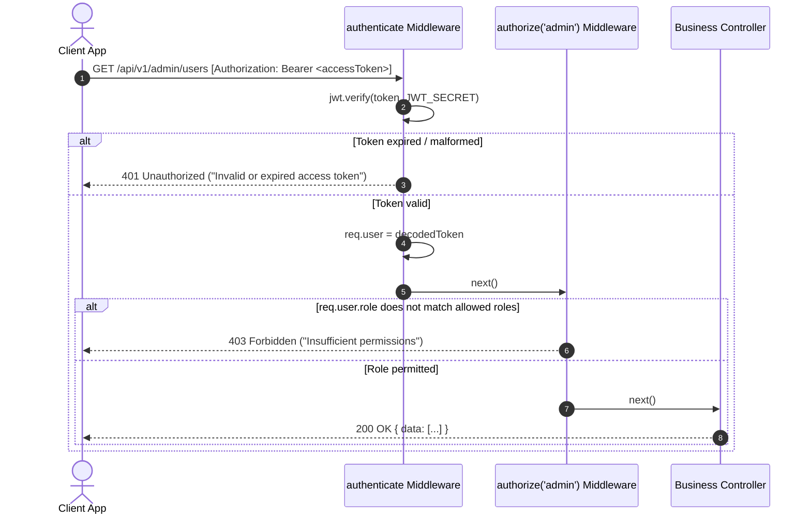
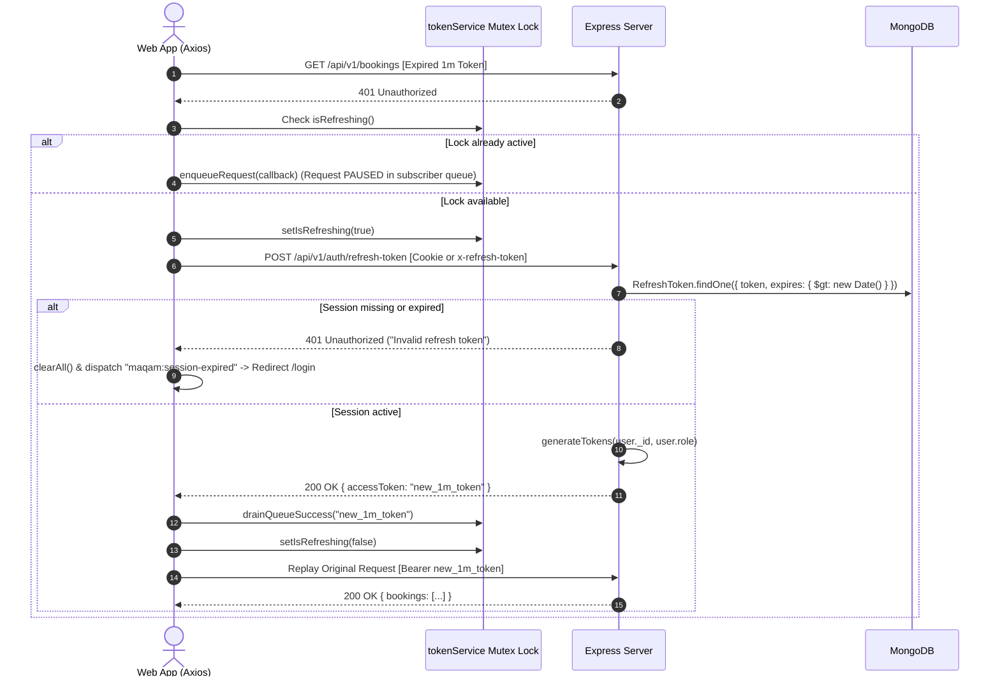
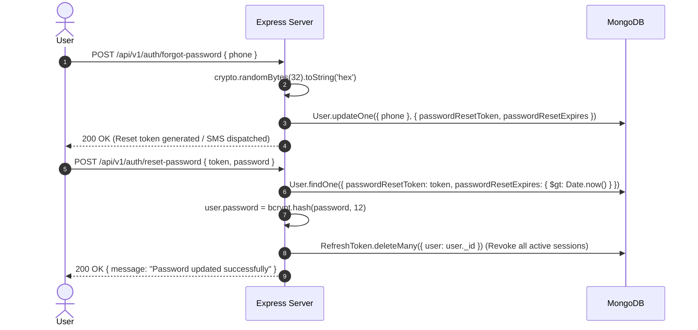

# Master Architecture Specification: Maqam End-to-End Authentication System

Comprehensive architectural blueprint, data model specifications, sequence flows, multi-platform runtime protocols, and API reference documentation for the authentication ecosystem across **MaqamTravelsAlpha** (Node.js/Express/MongoDB/Redis) and **Maqam-Frontend** (React/Vite/Redux Toolkit/Axios).

---

## 1. Core Architecture & Design Principles

```
┌────────────────────────────────────────────────────────────────────────────────────────┐
│                        MAQAM PLATFORM AUTHENTICATION TOPOLOGY                          │
├────────────────────────────────────────────────────────────────────────────────────────┤
│                                                                                        │
│   CLIENT LAYER                                                                         │
│   ┌────────────────────────────────────────┐  ┌────────────────────────────────────┐   │
│   │ Web Client (React / Vite / Axios)      │  │ Mobile Client (Flutter / React Nat)│   │
│   │ ├── In-Memory & LocalStorage (1m/15m)  │  │ ├── Secure Hardware Storage        │   │
│   │ ├── HttpOnly Cookie (30d Refresh Token)│  │ └── Header / Body Refresh Token    │   │
│   │ └── Silent Mutex Axios Interceptor     │  └────────────────────────────────────┘   │
│   └────────────────────────────────────────┘                     │                     │
│                        │                                         │                     │
│                        ▼                                         ▼                     │
│   GATEWAY / MIDDLEWARE LAYER                                                           │
│   ┌────────────────────────────────────────────────────────────────────────────────┐   │
│   │ Express Engine (app.js)                                                        │   │
│   │ ├── CORS Middleware (credentials: true, allowedHeaders: ['x-refresh-token'...])│   │
│   │ ├── Cookie Parser (cookieParser())                                             │   │
│   │ ├── Auth Middleware (authenticate: verifies Bearer JWT, hydrates req.user)     │   │
│   │ └── RBAC Middleware (authorize(...roles): verifies role enum permissions)      │   │
│   └────────────────────────────────────────────────────────────────────────────────┘   │
│                        │                                                               │
│                        ▼                                                               │
│   APPLICATION SERVICES LAYER                                                           │
│   ┌────────────────────────────────────────────────────────────────────────────────┐   │
│   │ Auth Controller & Service (modules/auth/)                                      │   │
│   │ ├── registerUser (Bcrypt hash + auto-login)                                    │   │
│   │ ├── loginUser (Email/Password credential verification)                         │   │
│   │ ├── sendOtpService (Cryptographic OTP generator, Redis TTL, dev bypass)        │   │
│   │ ├── verifyOtpService (Redis verification, auto-registration for new phones)    │   │
│   │ ├── refreshAccessToken (Persistent 30d session check, 1m/15m token renewal)    │   │
│   │ ├── logoutUser (Token removal from MongoDB, cookie clearing)                   │   │
│   │ └── forgotPassword & resetPassword (Crypto token, multi-session revocation)    │   │
│   └────────────────────────────────────────────────────────────────────────────────┘   │
│                        │                                         │                     │
│                        ▼                                         ▼                     │
│   STORAGE & PERSISTENCE LAYER                                                          │
│   ┌────────────────────────────────────────┐  ┌────────────────────────────────────┐   │
│   │ MongoDB Database                       │  │ Redis Cache                        │   │
│   │ ├── users (credentials, roles, status) │  │ └── otp:{phone} (5m expiration TTL)│   │
│   │ └── refreshtokens (TTL auto-purge: 0)  │  └────────────────────────────────────┘   │
│   └────────────────────────────────────────┘                                           │
└────────────────────────────────────────────────────────────────────────────────────────┘
```

### 1.1 Dual-Token Paradigm
The Maqam platform enforces a strict separation between ephemeral access authorization and long-lived session persistence:
1. **Access Token (Short-Lived)**:
   - **Lifespan**: Configured to `1m` (`ACCESS_TOKEN_EXPIRES_IN || '1m'`) during development/testing, seamlessly configurable to `15m` in production.
   - **Nature**: Asymmetric/stateless JSON Web Token (JWT) signed by `JWT_SECRET`.
   - **Transport**: Transmitted via HTTP `Authorization: Bearer <token>` header.
   - **Storage**: Retained in volatile application memory (`tokenService`) and mirrored in `localStorage` (`maqam_access_token`) to survive page refreshes (F5 reload) without jarring UI flickering.
2. **Refresh Token (Long-Lived & Persistent)**:
   - **Lifespan**: Exactly 30 days (`30d`).
   - **Nature**: Stateful cryptographically secure UUID token (`jti`) persisted in MongoDB.
   - **Transport**:
     - **Web**: Sent and received automatically via strict `HttpOnly`, `SameSite=Lax`, `Path=/api/v1/auth` cookie (`refreshToken`), invisible to JavaScript.
     - **Mobile**: Returned in JSON response envelope (`data.refreshToken`) and sent via `x-refresh-token` header or request body (`{ refreshToken }`).

### 1.2 Non-Rotating Refresh Token Model (No Race Conditions)
Traditional Refresh Token Rotation (RTR) invalidates and replaces the refresh token on every single refresh cycle. In multi-tab web applications or high-frequency mobile environments, concurrent requests triggering parallel refresh calls frequently cause false token invalidation, killing the user's active session.

**Maqam Architectural Decision**:
- The refresh token is **persistent for its entire 30-day lifecycle**.
- A single user session holds a stable `refreshToken` record in MongoDB until:
  1. The 30-day TTL expires (automatically removed by MongoDB TTL index).
  2. The user explicitly logs out (`POST /api/v1/auth/logout`).
  3. The user resets their password (`POST /api/v1/auth/reset-password`).
  4. An administrator revokes the session.
- When `/api/v1/auth/refresh-token` is invoked, the server verifies the existing refresh token and returns a **fresh access token** while preserving the existing 30-day session.

---

## 2. Data Models & Schema Specifications

### 2.1 User Schema (`modules/auth/auth.model.js`)
```javascript
const userSchema = new mongoose.Schema({
  name: { type: String, required: true, trim: true },
  email: { type: String, unique: true, sparse: true, lowercase: true, trim: true },
  password: { type: String, minlength: 6, select: false },
  phone: { type: String, unique: true, sparse: true, trim: true },
  role: {
    type: String,
    enum: ['customer', 'sales_agent', 'support_agent', 'admin', 'super_admin', 'hotelier'],
    default: 'customer',
  },
  avatar: {
    type: String,
    default: 'https://images.unsplash.com/photo-1535713875002-d1d0cf377fde?auto=format&fit=crop&w=150',
  },
  isVerified: { type: Boolean, default: false },
  isActive: { type: Boolean, default: true },
  passwordResetToken: String,
  passwordResetExpires: Date,
}, { timestamps: true });
```
- **Password Security**: Passwords are hashed with Bcrypt (salt rounds: 12) with `select: false` to ensure hashes are never leaked in queries.
- **Role Permissions**: Supported roles include `customer`, `sales_agent`, `support_agent`, `admin`, `super_admin`, and `hotelier`.

### 2.2 Refresh Token Schema (`modules/auth/refreshToken.model.js`)
```javascript
const refreshTokenSchema = new mongoose.Schema({
  user: {
    type: mongoose.Schema.Types.ObjectId,
    ref: 'User',
    required: true,
    index: true,
  },
  token: {
    type: String,
    required: true,
    unique: true,
  },
  expires: {
    type: Date,
    required: true,
  },
  createdByIp: String,
  revoked: { type: Boolean, default: false },
  revokedAt: Date,
});

// Automatic eviction by MongoDB background task
refreshTokenSchema.index({ expires: 1 }, { expireAfterSeconds: 0 });
```
- **MongoDB TTL Index**: The `{ expires: 1 }, { expireAfterSeconds: 0 }` index instructs MongoDB to auto-purge stale sessions the exact second `expires` is reached.

### 2.3 Redis OTP Storage Structure
```
Key:   otp:<normalized_phone>  (e.g., otp:9876543210)
Type:  String / Hash
TTL:   300 seconds (5 minutes)
Value: JSON.stringify({
  otp: "<hashed_or_random_6_digit>",
  attempts: 0,
  createdAt: 1728384910000
})
```
- **Bypass in Non-Production**: When `NODE_ENV !== 'production'`, OTP generation defaults to `123456` or logs directly to console for testing speed.

---

## 3. Sequence Flows & State Transitions

### 3.1 Flow 1: User Registration (Email/Password)
```mermaid
sequenceDiagram
    autonumber
    actor Client as Web/Mobile Client
    participant Router as Express Router
    participant Service as Auth Service
    participant DB as MongoDB
    
    Client->>Router: POST /api/v1/auth/register { name, email, password, role }
    Router->>Service: registerUser(payload)
    Service->>DB: User.findOne({ email })
    alt Email already taken
        Service-->>Client: 409 Conflict ("Email already in use")
    else Email available
        Service->>Service: bcrypt.hash(password, 12)
        Service->>DB: User.create({ name, email, passwordHash, role })
        Service->>Service: generateTokens(userId, role)
        Service->>DB: RefreshToken.create({ user: userId, token: jti, expires: +30d })
        Service-->>Router: Set-Cookie: refreshToken=...; HttpOnly; SameSite=Lax; Max-Age=2592000
        Router-->>Client: 201 Created { status: "success", data: { user, accessToken, refreshToken } }
    end
```

### 3.2 Flow 2: Standard Login (Email/Password)
```mermaid
sequenceDiagram
    autonumber
    actor Client as Web/Mobile Client
    participant Controller as Auth Controller
    participant DB as MongoDB
    
    Client->>Controller: POST /api/v1/auth/login { email, password }
    Controller->>DB: User.findOne({ email }).select("+password")
    alt User not found or inactive
        Controller-->>Client: 401 Unauthorized ("Invalid credentials")
    else User verified
        Controller->>Controller: bcrypt.compare(password, user.password)
        Controller->>Controller: generateTokens(user._id, user.role)
        Controller->>DB: RefreshToken.create({ user: user._id, token: jti, expires: +30d })
        Controller-->>Client: Set-Cookie: refreshToken=...; HttpOnly; SameSite=Lax
        Controller-->>Client: 200 OK { status: "success", data: { user, accessToken, refreshToken } }
    end
```

### 3.3 Flow 3: OTP Authentication Flow (Send & Verify)
```mermaid
sequenceDiagram
    autonumber
    actor Client as Web/Mobile Client
    participant Router as Express Auth Router
    participant Redis as Redis Cache
    participant DB as MongoDB
    
    Client->>Router: POST /api/v1/auth/send-otp (or /login/request-otp) { phone }
    Router->>Redis: SETEX otp:phone 300 "123456"
    Router-->>Client: 200 OK { status: "success", message: "OTP sent successfully" }
    
    Client->>Router: POST /api/v1/auth/verify-otp (or /login/verify-otp) { phone, otp }
    Router->>Redis: GET otp:phone
    alt OTP invalid or expired
        Router-->>Client: 400 Bad Request ("Invalid or expired OTP")
    else OTP valid
        Router->>Redis: DEL otp:phone
        Router->>DB: User.findOne({ phone })
        opt User not found (First Time Login)
            Router->>DB: User.create({ phone, role: "customer", isVerified: true })
        end
        Router->>DB: RefreshToken.create({ user: userId, token: jti, expires: +30d })
        Router-->>Client: Set-Cookie: refreshToken=...; HttpOnly
        Router-->>Client: 200 OK { status: "success", data: { user, accessToken, refreshToken } }
    end
```

### 3.4 Flow 4: Authenticated Request & RBAC Authorization Flow


### 3.5 Flow 5: Silent Access Token Refresh Flow (Axios Mutex Interceptor)


### 3.6 Flow 6: Explicit Logout & Cookie Invalidation
```mermaid
sequenceDiagram
    autonumber
    actor Client as Web/Mobile Client
    participant Server as Express Server
    participant DB as MongoDB
    
    Client->>Server: POST /api/v1/auth/logout [withCredentials: true]
    Server->>DB: RefreshToken.deleteOne({ token: req.cookies.refreshToken || req.body.refreshToken })
    Server-->>Client: Clear-Cookie: refreshToken=; Max-Age=0; Path=/api/v1/auth
    Server-->>Client: 200 OK { status: "success", message: "Logged out successfully" }
    Client->>Client: tokenService.clearAll() & authSession.clear()
```

### 3.7 Flow 7: Password Reset & Multi-Session Revocation


---

## 4. Multi-Platform Support: Web vs Mobile Runtime

The Maqam backend accommodates both browser environments and mobile native apps through a unified dual-transport architecture:

| Operational Feature | Web Client (React / Vite) | Mobile Client (Flutter / React Native) |
|---|---|---|
| **Primary Refresh Transport** | HttpOnly Cookie (`refreshToken`) | `x-refresh-token` Header & JSON body (`{ refreshToken }`) |
| **CORS Configuration** | `credentials: true`, specific origins | `*` or native HTTP engine bypass |
| **Client Storage** | Application Memory + `localStorage` (`maqam_access_token`) | `FlutterSecureStorage` / `react-native-keychain` |
| **Refresh Endpoint Payload** | Empty JSON `{}` (Cookie attached by browser) | `{ refreshToken: "<stored_token>" }` |
| **XSS Vulnerability Protection** | Protected: Refresh token cannot be read by JS | Protected: Sandboxed mobile operating system keystore |
| **CSRF Protection** | `SameSite=Lax`, restricted Path `/api/v1/auth` | Not applicable (no browser cookie ambient credentials) |

---

## 5. Complete API Reference Catalog

All authentication routes are prefixed with `/api/v1/auth`.

### 5.1 `POST /api/v1/auth/register`
- **Description**: Registers a new user account with email and password. Automatically creates a 30-day session.
- **Headers**: `Content-Type: application/json`
- **Request Body**:
  ```json
  {
    "name": "Ahmad Khan",
    "email": "ahmad@example.com",
    "password": "Password123!",
    "role": "customer"
  }
  ```
- **Response `201 Created`**:
  ```json
  {
    "status": "success",
    "message": "User registered successfully",
    "data": {
      "user": {
        "id": "670564e5...",
        "name": "Ahmad Khan",
        "email": "ahmad@example.com",
        "role": "customer"
      },
      "accessToken": "eyJhbGciOi...",
      "refreshToken": "48b11158-..."
    }
  }
  ```
- **Error Codes**: `400 Bad Request` (Validation error), `409 Conflict` (Email already registered).

---

### 5.2 `POST /api/v1/auth/login`
- **Description**: Authenticates user via email and password credentials.
- **Headers**: `Content-Type: application/json`
- **Request Body**:
  ```json
  {
    "email": "ahmad@example.com",
    "password": "Password123!"
  }
  ```
- **Response `200 OK`**:
  ```json
  {
    "status": "success",
    "data": {
      "user": {
        "id": "670564e5...",
        "name": "Ahmad Khan",
        "email": "ahmad@example.com",
        "role": "customer"
      },
      "accessToken": "eyJhbGciOi...",
      "refreshToken": "48b11158-..."
    }
  }
  ```
- **Error Codes**: `400 Bad Request` (Missing fields), `401 Unauthorized` (Invalid credentials), `403 Forbidden` (Account disabled).

---

### 5.3 `POST /api/v1/auth/send-otp` (Alias: `/api/v1/auth/login/request-otp`)
- **Description**: Generates and dispatches a 6-digit OTP code to the provided phone number.
- **Headers**: `Content-Type: application/json`
- **Request Body**:
  ```json
  {
    "phone": "9876543210"
  }
  ```
- **Response `200 OK`**:
  ```json
  {
    "status": "success",
    "message": "OTP sent successfully"
  }
  ```
- **Error Codes**: `400 Bad Request` (Invalid phone format), `429 Too Many Requests` (Rate limit exceeded).

---

### 5.4 `POST /api/v1/auth/verify-otp` (Alias: `/api/v1/auth/login/verify-otp`)
- **Description**: Verifies the submitted OTP against Redis. Auto-creates customer account if user does not exist.
- **Headers**: `Content-Type: application/json`
- **Request Body**:
  ```json
  {
    "phone": "9876543210",
    "otp": "123456"
  }
  ```
- **Response `200 OK`**:
  ```json
  {
    "status": "success",
    "data": {
      "user": {
        "id": "670564e5...",
        "phone": "9876543210",
        "role": "customer",
        "isVerified": true
      },
      "accessToken": "eyJhbGciOi...",
      "refreshToken": "48b11158-..."
    }
  }
  ```
- **Error Codes**: `400 Bad Request` (Invalid or expired OTP), `404 Not Found` (Route not found).

---

### 5.5 `POST /api/v1/auth/refresh-token`
- **Description**: Issues a brand new access token. Requires valid 30-day session in cookie or mobile header/body.
- **Headers**:
  - Web: (No special header needed; cookie is sent automatically)
  - Mobile: `x-refresh-token: 48b11158-...`
- **Request Body**:
  - Web: `{}`
  - Mobile: `{ "refreshToken": "48b11158-..." }`
- **Response `200 OK`**:
  ```json
  {
    "status": "success",
    "data": {
      "accessToken": "eyJhbGciOi...",
      "refreshToken": "48b11158-..."
    }
  }
  ```
- **Error Codes**: `401 Unauthorized` (Refresh token missing or session expired).

---

### 5.6 `POST /api/v1/auth/logout`
- **Description**: Invalidates the active session in MongoDB and clears the browser's HttpOnly cookie.
- **Headers**: `Content-Type: application/json`
- **Request Body**: `{}`
- **Response `200 OK`**:
  ```json
  {
    "status": "success",
    "message": "Logged out successfully"
  }
  ```

---

### 5.7 `GET /api/v1/auth/me`
- **Description**: Retrieves current authenticated profile.
- **Headers**: `Authorization: Bearer <accessToken>`
- **Response `200 OK`**:
  ```json
  {
    "status": "success",
    "data": {
      "user": {
        "id": "670564e5...",
        "name": "Ahmad Khan",
        "email": "ahmad@example.com",
        "role": "customer"
      }
    }
  }
  ```
- **Error Codes**: `401 Unauthorized` (Missing or expired access token).

---

## 6. Frontend Integration Blueprint

The frontend uses two layers of state and networking:
1. **`tokenService.js`**: Core singleton managing access token hydration, dynamic lead time, mutex concurrency, and subscriber queues.
2. **Axios Instances (`axios.js` & `api.jsx`)**: Request/response interceptors that enforce `withCredentials: true`, Bearer headers, and seamless 401 retry.
3. **Redux Store (`AuthSlice.jsx`)**: Reactive user slice handling authentication thunks, route aliases, and error state.

### 6.1 Token Storage & Hydration Matrix
- **Access Token**: Stored in volatile JavaScript memory and mirrored in `localStorage` (`maqam_access_token` and `accessToken`) so page reloads do not trigger false logouts.
- **Refresh Token**: On web, stored solely in the browser's HttpOnly cookie jar. On mobile, stored in `tokenService` / persistent storage and transmitted via `x-refresh-token`.

### 6.2 Decoupled Silent Refresh Interceptor
```javascript
// Mutex Lock to avoid parallel refresh storms
if (tokenService.isRefreshing()) {
  return new Promise((resolve, reject) => {
    tokenService.enqueueRequest(
      (newToken) => {
        original.headers.Authorization = `Bearer ${newToken}`;
        resolve(axiosInstance(original));
      },
      (err) => reject(err)
    );
  });
}

tokenService.setIsRefreshing(true);
let newToken;
try {
  const result = await executeSilentRefresh();
  newToken = result.token;
  tokenService.drainQueueSuccess(newToken);
} catch (refreshErr) {
  tokenService.drainQueueFailure(refreshErr);
  tokenService.clearAll();
  window.dispatchEvent(new CustomEvent('maqam:session-expired'));
  return Promise.reject(refreshErr);
} finally {
  tokenService.setIsRefreshing(false);
}

// Replay outside refresh try/catch: business errors do NOT logout the user
original.headers.Authorization = `Bearer ${newToken}`;
return axiosInstance(original);
```

---

## 7. Security Matrix & Threat Analysis

| Threat Vector | Mitigation Strategy Implemented |
|---|---|
| **Cross-Site Scripting (XSS)** | The 30-day refresh token is locked in an `HttpOnly` cookie on web clients; malicious JavaScript cannot read or exfiltrate it. Access tokens have an ultra-short lifespan (`1m` test / `15m` prod). |
| **Cross-Site Request Forgery (CSRF)** | Refresh cookie is scoped with `SameSite=Lax` and restricted to `Path=/api/v1/auth`. State-changing API routes require an `Authorization: Bearer` header, which browsers never send automatically with cross-site requests. |
| **Token Theft / Session Hijacking** | Access tokens expire in 1 to 15 minutes. Global logout and password reset immediately delete or revoke the refresh token in MongoDB, rendering stolen tokens useless. |
| **Race Conditions / Refresh Storms** | Client-side Mutex lock in `tokenService` ensures that even if 20 API requests return 401 simultaneously, exactly **one** refresh request is sent to `/api/v1/auth/refresh-token`, pausing the remaining 19 in an in-memory queue until completion. |
| **Brute Force OTP Attacks** | Redis enforces a 5-minute TTL (`300s`) on OTPs. Production rate limiting restricts OTP requests per IP/phone number. |
| **Replay Attack / Stale Replay** | Requests retried once are flagged with `original._retry = true` to guarantee infinite retry loops can never occur. |

---

## 8. Troubleshooting & Debugging Guide

### Common Error Codes & Resolutions

#### 1. `401 - Refresh token not provided` (Error 56)
- **Root Cause**: The client called `POST /api/v1/auth/refresh-token`, but neither an `HttpOnly` cookie nor a mobile `x-refresh-token` header / body payload was attached.
- **Fix**: Ensure `withCredentials: true` is configured on the Axios instance and CORS `credentials: true` is enabled on the server. For mobile clients, verify that `tokenService.getRefreshToken()` is non-empty.

#### 2. `401 - Invalid or expired access token`
- **Root Cause**: The access token's short lifespan (`1m` or `15m`) expired.
- **Normal Lifecycle**: This is an **expected operational event**. The Axios response interceptor intercepts this 401, invokes `/api/v1/auth/refresh-token`, receives a fresh token, and replays the original request transparently.

#### 3. `403 - Insufficient permissions`
- **Root Cause**: The user's role (e.g. `customer`) is not included in the endpoint's RBAC whitelist (e.g. `authorize('admin', 'super_admin')`).
- **Fix**: Verify user role assignment in MongoDB or log in with administrative credentials.

#### 4. `404 - Cannot POST /api/v1/auth/login/request-otp`
- **Root Cause**: Frontend called route alias `/login/request-otp` while backend only exposed `/send-otp`.
- **Fix**: Resolved by the fallback mechanism in `AuthSlice.jsx` (which cascades from `/send-otp` -> `/login/request-otp` -> `/otp/send-otp`) and backend route aliases.

#### 5. Session Lost on Page Refresh (F5 Reload)
- **Root Cause**: Access token was only in volatile memory and wiped on browser reload before async refresh completed.
- **Fix**: Resolved by immediate hydration from `localStorage` (`maqam_access_token`) in `authStore.js` and `tokenService.js`.
