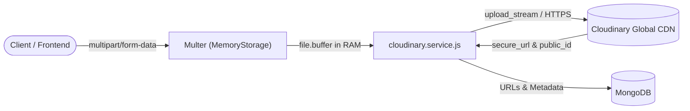
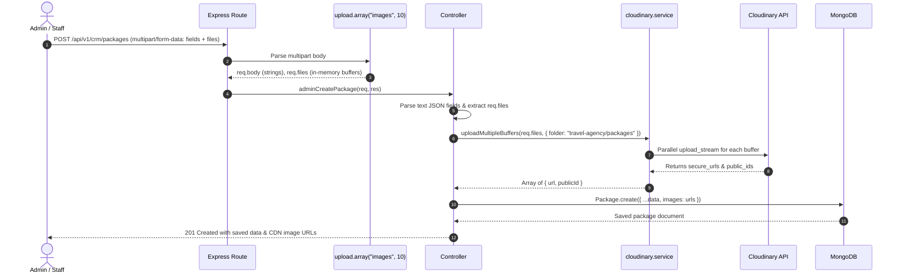
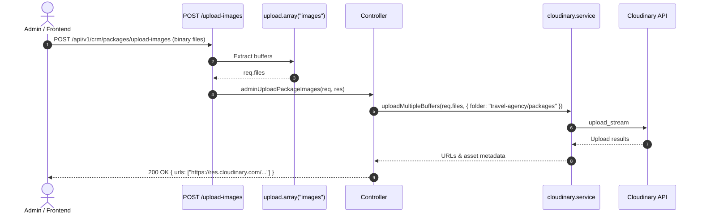
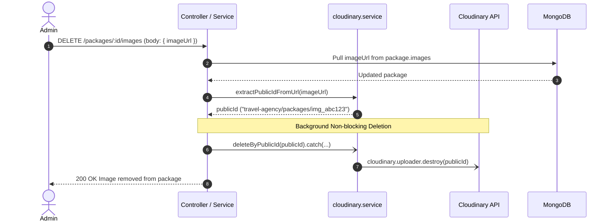

# Cloudinary Architecture & Asset Upload Flow

This document details the architectural structure, pipeline, integration patterns, and operational flows for media and document assets managed via Cloudinary across the **MaqamTravels** platform.

---

## 1. High-Level Architecture

The platform uses an **in-memory streaming architecture** for media handling. Binary files uploaded by clients never touch the local filesystem or server disk. Instead, files are captured directly in memory buffers via Multer and streamed immediately to Cloudinary's global Content Delivery Network (CDN).



### Key Architectural Benefits
1. **Stateless Backend**: Servers remain ephemeral and horizontally scalable without needing shared network drives or ephemeral disk cleanup.
2. **Global Edge Delivery**: Media assets are instantly cached, delivered, and transformed through Cloudinary's worldwide CDN.
3. **Format & Quality Optimization**: Cloudinary handles dynamic format conversion (e.g., auto WebP/AVIF) and responsive resizing.
4. **Safe Asynchronous Cleanups**: Deletions and image replacements trigger background cleanups to prevent orphaned assets.

---

## 2. Core Components

### 2.1 Configuration (`utils/cloudinary.js`)
Configures the official Cloudinary SDK (`cloudinary.v2`) using environment credentials loaded from `.env`:

```javascript
const cloudinary = require("cloudinary").v2;

cloudinary.config({
  cloud_name: process.env.CLOUDINARY_CLOUD_NAME,
  api_key: process.env.CLOUDINARY_API_KEY,
  api_secret: process.env.CLOUDINARY_API_SECRET,
});

module.exports = cloudinary;
```

**Required `.env` Variables**:
- `CLOUDINARY_CLOUD_NAME`
- `CLOUDINARY_API_KEY`
- `CLOUDINARY_API_SECRET`

---

### 2.2 Middleware Layer (`middleware/upload.js`)
Configures `multer.memoryStorage()` with customizable file size limits, MIME type filtering, and convenience route handlers.

```
                    ┌─────────────────────────┐
                    │      Incoming HTTP      │
                    │   multipart/form-data   │
                    └────────────┬────────────┘
                                 │
                 ┌───────────────┴───────────────┐
                 ▼                               ▼
       imageFileFilter()               documentFileFilter()
  (image/jpeg, png, webp, gif)      (Images + PDF + Word Docs)
                 │                               │
                 └───────────────┬───────────────┘
                                 ▼
                     multer.memoryStorage()
                  (Buffers held in req.files)
```

#### Middleware Generators:
- `uploadSingle(fieldName, options)`: Single file (e.g. `heroPic`, `file`).
- `uploadArray(fieldName, maxCount, options)`: Array of files (e.g. up to 10 images).
- `uploadFields(fieldsArray, options)`: Multiple named fields (e.g. `countryPhoto` + `flagPhoto`).
- `createUploader(options)`: Base generator for custom upload pipelines.

---

### 2.3 Service Layer (`services/cloudinary.service.js`)
The central façade providing modular, promise-based methods:

| Method | Parameters | Return Value | Description |
| :--- | :--- | :--- | :--- |
| `uploadBuffer` | `(fileBuffer, options)` | `Promise<{ url, publicId, format, bytes, width, height }>` | Streams a single buffer using `upload_stream`. |
| `uploadMultipleBuffers` | `(files, options)` | `Promise<Array<{ url, publicId, ... }>>` | Uploads an array of Multer files in parallel using `Promise.all`. |
| `uploadBufferToUrl` | `(fileBuffer, options)` | `Promise<string>` | Convenience method that returns only the secure HTTPS URL string. |
| `deleteByPublicId` | `(publicId, resourceType)` | `Promise<Object>` | Destroys an asset on Cloudinary (`image`, `raw`, or `video`). |
| `extractPublicIdFromUrl` | `(url)` | `string \| null` | Parses a Cloudinary CDN URL and extracts the canonical `public_id`. |

---

## 3. Folder Hierarchy & Routing

All assets stored in Cloudinary are organized under the unified namespace `travel-agency/`:

```
travel-agency/
├── packages/              # Tour and Umrah package gallery images
├── offers/                # Standalone promotional deal & retail package images
├── hotels/                # Contracted and partner hotel property pictures
├── cms/
│   └── hero/              # Main website homepage hero banners
└── visas/
    ├── documents/         # Traveler passport scans, photos, applicant docs
    ├── countries/         # Country destination banners & national flags
    └── issued/            # Official issued visa PDFs (resourceType: "raw")
```

---

## 4. Operational Flows

### 4.1 Flow A: Batch Upload During Entity Creation (e.g., Packages, Offers, Hotels)

Used when an administrator creates a new entity and submits images simultaneously via `multipart/form-data`.



---

### 4.2 Flow B: Standalone Image Upload Endpoint

Used when the client wants to upload images first, obtain CDN URLs, and later associate them with models.



---

### 4.3 Flow C: Asset Replacement & Deletion Cleanup

When an asset is deleted or replaced (e.g., updating a CMS banner or removing a package image), the system cleans up the old Cloudinary asset to avoid storage bloat.



---

## 5. Domain Module Integration Matrix

| Module | Route / Endpoint | Middleware | Folder | Storage Format |
| :--- | :--- | :--- | :--- | :--- |
| **Packages** | `POST /api/v1/crm/packages` | `uploadArray("images", 10)` | `travel-agency/packages` | Array of URLs (`[String]`) |
| **Packages** | `POST /api/v1/crm/packages/upload-images` | `uploadArray("images", 10)` | `travel-agency/packages` | Array of URLs (`[String]`) |
| **Packages** | `DELETE /api/v1/crm/packages/:id/images` | - | - | Removes URL + deletes by publicId |
| **Offers** | `POST /api/v1/crm/offers` | `uploadArray("images", 10)` | `travel-agency/offers` | Array of URLs (`[String]`) |
| **Offers** | `POST /api/v1/crm/offers/upload-images` | `uploadArray("images", 10)` | `travel-agency/offers` | Array of URLs (`[String]`) |
| **Hotels** | `POST /api/v1/hotels` | `uploadArray("images", 10)` | `travel-agency/hotels` | Array of URLs (`[String]`) |
| **Hotels (CRM)**| `POST /api/v1/crm/hotels` | `uploadArray("images", 10)` | `travel-agency/hotels` | Array of URLs (`[String]`) |
| **CMS** | `POST /api/v1/cms/hero` | `uploadSingle("heroPic")` | `travel-agency/cms/hero` | `{ url, publicId }` |
| **Visa Catalog**| `POST /api/v1/visa/admin/inventory` | `uploadVisaMedia` | `travel-agency/visas/countries` | `countryPhoto`, `flagPhoto` URLs |
| **Visa User** | `POST /api/v1/visa/user/applications` | `upload.any()` | `travel-agency/visas/documents` | Passport scan & photo URLs |

---

## 6. Implementation Patterns & Best Practices

### 6.1 Parsing `multipart/form-data` Text Fields
When using `multipart/form-data`, non-binary fields (such as nested arrays or JSON objects) are received as strings. Always safe-parse them before model insertion:

```javascript
const parseImagesField = (images) => {
  if (typeof images === "string") {
    try {
      return JSON.parse(images);
    } catch {
      return [images];
    }
  }
  return Array.isArray(images) ? images : [];
};
```

### 6.2 Merging Existing URLs with Uploaded Files
Support requests that supply both newly uploaded files and pre-existing Cloudinary URLs:

```javascript
const files = req.files || (req.file ? [req.file] : []);
let imageUrls = parseImagesField(req.body.images);

if (files.length > 0) {
  const uploadResults = await cloudinaryService.uploadMultipleBuffers(files, {
    folder: "travel-agency/hotels",
  });
  const newUrls = uploadResults.map((r) => r.url);
  imageUrls = [...imageUrls, ...newUrls];
}
data.images = imageUrls;
```

### 6.3 Fire-and-Forget Asset Cleanup
Cloudinary asset deletion should never fail a user transaction if the database update succeeds. Use fire-and-forget handling:

```javascript
const publicId = cloudinaryService.extractPublicIdFromUrl(oldImageUrl);
if (publicId) {
  cloudinaryService.deleteByPublicId(publicId).catch((err) => {
    logger.warn(`Failed to delete Cloudinary asset ${publicId}: ${err.message}`);
  });
}
```

---

## 7. Security & Limitations

1. **File Size Limits**:
   - Default: `5 MB` per file.
   - CMS / High-res banners: `10 MB` maximum.
2. **File Type Filtering**:
   - Standard: `imageFileFilter` restricts uploads to valid image MIME types (`image/jpeg`, `image/png`, `image/webp`, `image/gif`).
   - Documents: `documentFileFilter` permits PDFs and Microsoft Word files for visa processing.
3. **Credentials Protection**:
   - Cloudinary API secret is restricted to server-side code and must never be exposed to the client/frontend.
