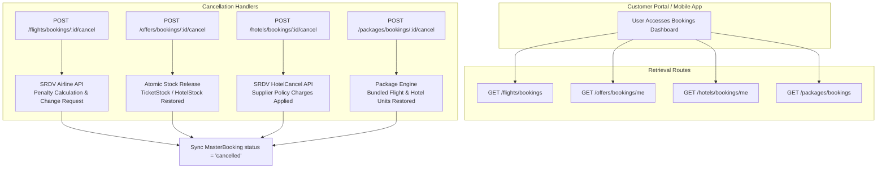

# 📑 Customer Bookings & Cancellation API Specification

> **Base Route URL:** `/api/v1`  
> **Target Audience:** Frontend Engineers (Web SPAs, Next.js, React Native, Mobile Apps), Back-Office Operations, QA Automation Engineers  
> **Specification Version:** 2.0.0  
> **Document Location:** [`docs/booking/CUSTOMER_BOOKINGS_AND_CANCELLATION_API_DOCUMENTATION.md`](file:///d:/Debanjan/joydeb_folder/MaqamTravelsAlpha/docs/booking/CUSTOMER_BOOKINGS_AND_CANCELLATION_API_DOCUMENTATION.md)  
> **Source Routers & Controllers:**
> - Flights: [`modules/flights/flight.routes.js`](file:///d:/Debanjan/joydeb_folder/MaqamTravelsAlpha/modules/flights/flight.routes.js) & [`modules/flights/flight.controller.js`](file:///d:/Debanjan/joydeb_folder/MaqamTravelsAlpha/modules/flights/flight.controller.js)
> - Offers: [`modules/packages/offers/offer.routes.js`](file:///d:/Debanjan/joydeb_folder/MaqamTravelsAlpha/modules/packages/offers/offer.routes.js) & [`modules/packages/offers/offerBooking.controller.js`](file:///d:/Debanjan/joydeb_folder/MaqamTravelsAlpha/modules/packages/offers/offerBooking.controller.js)
> - Hotels: [`modules/hotels/hotel.routes.js`](file:///d:/Debanjan/joydeb_folder/MaqamTravelsAlpha/modules/hotels/hotel.routes.js) & [`modules/hotels/hotel.controller.js`](file:///d:/Debanjan/joydeb_folder/MaqamTravelsAlpha/modules/hotels/hotel.controller.js)
> - Tour Packages: [`modules/packages/user/packageUser.routes.js`](file:///d:/Debanjan/joydeb_folder/MaqamTravelsAlpha/modules/packages/user/packageUser.routes.js) & [`modules/packages/user/packageBookingUser.controller.js`](file:///d:/Debanjan/joydeb_folder/MaqamTravelsAlpha/modules/packages/user/packageBookingUser.controller.js)

---

## 📋 Table of Contents
1. [Executive Summary & Multi-Vertical Architecture](#1-executive-summary--multi-vertical-architecture)
2. [Master Endpoints Quick Reference Matrix](#2-master-endpoints-quick-reference-matrix)
3. [Global Headers, Security & Standard Envelopes](#3-global-headers-security--standard-envelopes)
4. [Vertical 1: Live Flight Bookings (SRDV Aggregator)](#4-vertical-1-live-flight-bookings-srdv-aggregator)
   - [4.1 List Authenticated User Flight Bookings (`GET /flights/bookings`)](#41-list-authenticated-user-flight-bookings-get-flightsbookings)
   - [4.2 Get Flight Booking Details (`GET /flights/bookings/:bookingId`)](#42-get-flight-booking-details-get-flightsbookingsbookingid)
   - [4.3 Flight Cancellation Charges Pre-Check (`GET /flights/bookings/:bookingId/cancellation-charges`)](#43-flight-cancellation-charges-pre-check-get-flightsbookingsbookingidcancellation-charges)
   - [4.4 Cancel Flight Booking (`POST /flights/bookings/:bookingId/cancel`)](#44-cancel-flight-booking-post-flightsbookingsbookingidcancel)
   - [4.5 Submit Airline Change / Cancellation Request (`POST /flights/bookings/:bookingId/change-request`)](#45-submit-airline-change--cancellation-request-post-flightsbookingsbookingidchange-request)
   - [4.6 Check Flight Cancellation Status (`GET /flights/bookings/:bookingId/cancel-status`)](#46-check-flight-cancellation-status-get-flightsbookingsbookingidcancel-status)
5. [Vertical 2: Standalone Retail Offers (In-House Flights & Hotels)](#5-vertical-2-standalone-retail-offers-in-house-flights--hotels)
   - [5.1 List Customer Offer Bookings (`GET /offers/bookings/me`)](#51-list-customer-offer-bookings-get-offersbookingsme)
   - [5.2 Get Single Offer Booking Details (`GET /offers/bookings/:id`)](#52-get-single-offer-booking-details-get-offersbookingsid)
   - [5.3 Cancel Offer Booking & Restore Stock (`POST /offers/bookings/:id/cancel`)](#53-cancel-offer-booking--restore-stock-post-offersbookingsidcancel)
6. [Vertical 3: Live Hotel Bookings (SRDV Aggregator)](#6-vertical-3-live-hotel-bookings-srdv-aggregator)
   - [6.1 List Customer Hotel Bookings (`GET /hotels/bookings/me`)](#61-list-customer-hotel-bookings-get-hotelsbookingsme)
   - [6.2 Get Hotel Booking Details (`GET /hotels/bookings/:id`)](#62-get-hotel-booking-details-get-hotelsbookingsid)
   - [6.3 Cancel Confirmed Hotel Booking (`POST /hotels/bookings/:id/cancel`)](#63-cancel-confirmed-hotel-booking-post-hotelsbookingsidcancel)
7. [Vertical 4: Bundled Tour Packages (In-House Packages)](#7-vertical-4-bundled-tour-packages-in-house-packages)
   - [7.1 List Customer Package Bookings (`GET /packages/bookings`)](#71-list-customer-package-bookings-get-packagesbookings)
   - [7.2 Get Package Booking Details (`GET /packages/bookings/:id`)](#72-get-package-booking-details-get-packagesbookingsid)
   - [7.3 Cancel Package Booking & Restore Components (`POST /packages/bookings/:id/cancel`)](#73-cancel-package-booking--restore-components-post-packagesbookingsidcancel)
8. [Common Error Handling & HTTP Status Matrix](#8-common-error-handling--http-status-matrix)

---

## 1. Executive Summary & Multi-Vertical Architecture

Maqam Travels handles customer bookings and cancellations across two fundamentally distinct operational models:

1. **Third-Party Live Supplier Inventory (SRDV)**:
   - **Flights**: Live GDS / LCC seat reservation. Cancellations must call airline Change Request APIs (`sendChangeRequest`), calculate dynamic airline fare penalties (`getCancellationCharges`), poll status (`getCancelStatus`), and process refunds asynchronously via webhooks or banking queues.
   - **Hotels**: Dynamic live room inventory. Cancellation calls supplier `/HotelCancel` endpoint, enforces tiered cancellation fee policies, and reconciles provider response codes.
2. **In-House Warehouse Inventory**:
   - **Retail Offers (Flight & Hotel Deals)**: Standalone deals backed by wholesale physical stock pools (`TicketStock` for flights and `HotelStock` for rooms/allotments). Cancellations **automatically and atomically return reserved units back to available warehouse inventory**.
   - **Tour Packages**: Bundled multi-component reservations. Cancellations release all linked flight seats and hotel rooms simultaneously while updating the synchronized Master Booking record.



---

## 2. Master Endpoints Quick Reference Matrix

| Travel Vertical | Action | Method | Complete Endpoint Path | Auth Required | Primary Role |
| :--- | :--- | :---: | :--- | :---: | :--- |
| **Flight (SRDV)** | List Bookings | `GET` | `/api/v1/flights/bookings` | ✅ Bearer JWT | Customer |
| **Flight (SRDV)** | Get Booking | `GET` | `/api/v1/flights/bookings/:bookingId` | ✅ Bearer JWT | Customer / Admin |
| **Flight (SRDV)** | Pre-Check Fees | `GET` / `POST` | `/api/v1/flights/bookings/:bookingId/cancellation-charges` | ✅ Bearer JWT | Customer / Admin |
| **Flight (SRDV)** | Cancel Booking | `POST` | `/api/v1/flights/bookings/:bookingId/cancel` | ✅ Bearer JWT | Customer / Admin |
| **Flight (SRDV)** | Change Request | `POST` | `/api/v1/flights/bookings/:bookingId/change-request` | ✅ Bearer JWT | Customer / Admin |
| **Flight (SRDV)** | Cancel Status | `GET` | `/api/v1/flights/bookings/:bookingId/cancel-status` | ✅ Bearer JWT | Customer / Admin |
| **Offer (Flight/Hotel)** | List Bookings | `GET` | `/api/v1/offers/bookings/me` | ✅ Bearer JWT | Customer |
| **Offer (Flight/Hotel)** | Get Booking | `GET` | `/api/v1/offers/bookings/:id` | ✅ Bearer JWT | Customer |
| **Offer (Flight/Hotel)** | Cancel Booking | `POST` | `/api/v1/offers/bookings/:id/cancel` | ✅ Bearer JWT | Customer |
| **Hotel (SRDV)** | List Bookings | `GET` | `/api/v1/hotels/bookings/me` | ✅ Bearer JWT | Customer |
| **Hotel (SRDV)** | Get Booking | `GET` | `/api/v1/hotels/bookings/:id` | ✅ Bearer JWT | Customer |
| **Hotel (SRDV)** | Cancel Booking | `POST` | `/api/v1/hotels/bookings/:id/cancel` | ✅ Bearer JWT | Customer |
| **Package (In-House)** | List Bookings | `GET` | `/api/v1/packages/bookings` *(alias: `/getAllBookingPackage`)* | ✅ Bearer JWT | Customer |
| **Package (In-House)** | Get Booking | `GET` | `/api/v1/packages/bookings/:id` | ✅ Bearer JWT | Customer |
| **Package (In-House)** | Cancel Booking | `POST` | `/api/v1/packages/bookings/:id/cancel` | ✅ Bearer JWT | Customer |

---

## 3. Global Headers, Security & Standard Envelopes

### Required HTTP Headers
```http
Authorization: Bearer <CUSTOMER_JWT_ACCESS_TOKEN>
Content-Type: application/json
Accept: application/json
Idempotency-Key: <UUIDv4>          (Recommended for POST /cancel endpoints)
```

### Standard Success Response Envelope (`200 OK` / `201 Created`)
```json
{
  "success": true,
  "message": "Descriptive operation result message",
  "data": { ... },
  "meta": {
    "total": 42,
    "page": 1,
    "limit": 10,
    "totalPages": 5
  }
}
```

### Standard Error Response Envelope (`4xx` / `5xx`)
```json
{
  "success": false,
  "message": "Error description message",
  "error": { ... }
}
```

---

## 4. Vertical 1: Live Flight Bookings (SRDV Aggregator)

### 4.1 List Authenticated User Flight Bookings (`GET /flights/bookings`)
Retrieves a paginated list of all live flight reservations belonging to the authenticated customer.

- **Method:** `GET`
- **URL:** `/api/v1/flights/bookings`
- **Authentication:** ✅ Bearer JWT (`authenticate`)
- **Query Parameters:**
  | Parameter | Type | Required | Default | Description | Example |
  | :--- | :--- | :---: | :---: | :--- | :--- |
  | `page` | `integer` | No | `1` | Page number | `1` |
  | `limit` | `integer` | No | `10` | Records per page (Max: 100) | `10` |
  | `status` | `string` | No | — | Filter by booking status (`confirmed`, `pending`, `cancelled`, `failed`) | `confirmed` |

#### Success Response (`200 OK`):
```json
{
  "success": true,
  "message": "User flight bookings retrieved",
  "data": {
    "bookings": [
      {
        "_id": "671fb2c58970e35b719463c1",
        "bookingId": "SRDV-FLT-987654",
        "pnr": "XY7K9P",
        "gdsPnr": "M8QL2A",
        "airlineCode": "AI",
        "airlineName": "Air India",
        "flightNumber": "AI-945",
        "journeyType": "oneway",
        "origin": "DEL",
        "destination": "JED",
        "departureTime": "2026-11-20T08:30:00.000Z",
        "arrivalTime": "2026-11-20T12:45:00.000Z",
        "totalAmount": 42500,
        "currency": "INR",
        "status": "confirmed",
        "isLCC": false,
        "passengers": [
          {
            "travellerId": {
              "_id": "670c5e1b2195f4628d01ef99",
              "firstName": "Mohammad",
              "lastName": "Farooq"
            },
            "ticketNumber": "098-2458963214"
          }
        ],
        "createdAt": "2026-10-28T14:30:00.000Z"
      }
    ],
    "pagination": {
      "total": 1,
      "page": 1,
      "limit": 10,
      "pages": 1
    }
  }
}
```

---

### 4.2 Get Flight Booking Details (`GET /flights/bookings/:bookingId`)
Returns the complete dossier for a flight booking, including segment routing, e-ticket data, baggage allowances, passenger manifests, and payment record.

- **Method:** `GET`
- **URL:** `/api/v1/flights/bookings/:bookingId`
- **Authentication:** ✅ Bearer JWT
- **Path Parameter:**
  - `bookingId` *(required, string)*: MongoDB ObjectId of the FlightBooking document (`671fb2c58970e35b719463c1`).

#### Success Response (`200 OK`):
```json
{
  "success": true,
  "message": "Flight booking details retrieved",
  "data": {
    "_id": "671fb2c58970e35b719463c1",
    "user": "670c5e1b2195f4628d01ef90",
    "srdvBookingId": "1948572",
    "pnr": "XY7K9P",
    "gdsPnr": "M8QL2A",
    "status": "confirmed",
    "isLCC": false,
    "traceId": "c4d32a8f-58bf-4c7b-94c6-e630db0f199b",
    "segments": [
      {
        "origin": "DEL",
        "destination": "JED",
        "departureTime": "2026-11-20T08:30:00.000Z",
        "arrivalTime": "2026-11-20T12:45:00.000Z",
        "airline": "Air India",
        "flightNumber": "AI-945",
        "terminal": {
          "origin": "3",
          "destination": "N"
        },
        "baggage": "30 Kg Check-in, 7 Kg Cabin",
        "cabinClass": "Economy"
      }
    ],
    "passengers": [
      {
        "travellerId": {
          "_id": "670c5e1b2195f4628d01ef99",
          "title": "Mr",
          "firstName": "Mohammad",
          "lastName": "Farooq"
        },
        "ticketNumber": "098-2458963214",
        "fare": {
          "baseFare": 35000,
          "tax": 5500,
          "yqTax": 2000
        }
      }
    ],
    "totalAmount": 42500,
    "markupAmount": 1500,
    "paymentId": {
      "_id": "671fb2a08970e35b719463b5",
      "gateway": "razorpay",
      "status": "captured",
      "transactionId": "pay_P8x1X98ZLkM"
    },
    "createdAt": "2026-10-28T14:30:00.000Z"
  }
}
```

---

### 4.3 Flight Cancellation Charges Pre-Check (`GET /flights/bookings/:bookingId/cancellation-charges`)
Queries the SRDV supplier API (`GetCancellationCharges`) in real time to calculate the airline penalty, retained agency convenience fee, and estimated customer refund **before** finalizing cancellation.

- **Method:** `GET` *(also accepts `POST`)*
- **URL:** `/api/v1/flights/bookings/:bookingId/cancellation-charges`
- **Authentication:** ✅ Bearer JWT
- **Path Parameter:**
  - `bookingId` *(required, string)*: Flight booking ID.
- **Query Parameters:**
  | Parameter | Type | Required | Default | Description |
  | :--- | :--- | :---: | :---: | :--- |
  | `requestType` | `integer` | No | `1` | `1` = Full Cancellation, `2` = Partial Cancellation |

#### Success Response (`200 OK`):
```json
{
  "success": true,
  "message": "Cancellation charges retrieved successfully",
  "data": {
    "bookingId": "671fb2c58970e35b719463c1",
    "totalBookingAmount": 42500,
    "currency": "INR",
    "airlineCancellationFee": 5000,
    "agencyServiceFee": 500,
    "estimatedRefundAmount": 37000,
    "cancellationRules": [
      {
        "timeWindow": "Before 72 hours of departure",
        "fee": 5000
      },
      {
        "timeWindow": "Within 24 to 72 hours of departure",
        "fee": 9500
      }
    ],
    "canCancelOnline": true
  }
}
```

---

### 4.4 Cancel Flight Booking (`POST /flights/bookings/:bookingId/cancel`)
Initiates cancellation for the flight booking. For live supplier tickets, automatically triggers SRDV change requests, marks the local booking status as `cancelled`, and provisions a refund entry in `FlightRefund`.

- **Method:** `POST`
- **URL:** `/api/v1/flights/bookings/:bookingId/cancel`
- **Authentication:** ✅ Bearer JWT
- **Headers:** `Idempotency-Key: <UUID>` *(Recommended)*
- **Path Parameter:**
  - `bookingId` *(required, string)*: Flight booking ID.
- **Request Body:**
```json
{
  "reason": "Family emergency - trip postponement",
  "penaltyAmount": 5000
}
```

#### Success Response (`200 OK`):
```json
{
  "success": true,
  "message": "Flight booking cancellation initiated successfully",
  "data": {
    "success": true,
    "bookingId": "671fb2c58970e35b719463c1",
    "status": "cancelled",
    "cancellationReason": "Family emergency - trip postponement",
    "airlinePenalty": 5000,
    "customerRefundAmount": 37000,
    "refundReference": "FLIGHT_REF_671fb2c58970e35b719463c1_1730268593",
    "changeRequests": [
      {
        "paxId": "670c5e1b2195f4628d01ef99",
        "changeRequestId": "CR-SRDV-884102",
        "status": "Pending"
      }
    ]
  }
}
```

---

### 4.5 Submit Airline Change / Cancellation Request (`POST /flights/bookings/:bookingId/change-request`)
Submits a dedicated change or cancellation ticket directly to the airline through SRDV.

- **Method:** `POST`
- **URL:** `/api/v1/flights/bookings/:bookingId/change-request`
- **Authentication:** ✅ Bearer JWT
- **Request Body:**
```json
{
  "requestType": "1",
  "cancellationType": "3",
  "remarks": "Voluntary passenger cancellation",
  "paxIds": ["670c5e1b2195f4628d01ef99"]
}
```
*(Notes: `requestType`: `"1"` = Full, `"2"` = Partial. `cancellationType`: `"1"` = NoShow, `"2"` = FlightCancelled, `"3"` = Others).*

#### Success Response (`200 OK`):
```json
{
  "success": true,
  "message": "Change request submitted successfully",
  "data": {
    "changeRequestId": "CR-SRDV-884102",
    "ticketNumber": "098-2458963214",
    "status": "Pending",
    "submittedAt": "2026-10-30T05:20:00.000Z"
  }
}
```

---

### 4.6 Check Flight Cancellation Status (`GET /flights/bookings/:bookingId/cancel-status`)
Polls SRDV `GetCancelStatus` to verify if the airline has credited the cancellation and reconciled refund figures.

- **Method:** `GET`
- **URL:** `/api/v1/flights/bookings/:bookingId/cancel-status`
- **Authentication:** ✅ Bearer JWT

#### Success Response (`200 OK`):
```json
{
  "success": true,
  "message": "Cancellation status retrieved successfully",
  "data": {
    "bookingId": "671fb2c58970e35b719463c1",
    "changeRequestId": "CR-SRDV-884102",
    "refundStatus": "Processed",
    "airlineRefundAmount": 37500,
    "cancellationCharge": 5000,
    "customerRefundAmount": 37000,
    "processedAt": "2026-10-30T06:10:00.000Z"
  }
}
```

---

## 5. Vertical 2: Standalone Retail Offers (In-House Flights & Hotels)

Standalone retail offers represent wholesale, pre-purchased seats (`TicketStock`) or contracted hotel blocks (`HotelStock`).

### 5.1 List Customer Offer Bookings (`GET /offers/bookings/me`)
Retrieves a paginated list of standalone retail offer bookings made by the authenticated customer.

- **Method:** `GET`
- **URL:** `/api/v1/offers/bookings/me`
- **Authentication:** ✅ Bearer JWT
- **Query Parameters:**
  | Parameter | Type | Required | Default | Description |
  | :--- | :--- | :---: | :---: | :--- |
  | `page` | `integer` | No | `1` | Page number |
  | `limit` | `integer` | No | `10` | Records per page (Max: 100) |
  | `status` | `string` | No | — | Filter: `initiated`, `pending`, `confirmed`, `cancelled` |

#### Success Response (`200 OK`):
```json
{
  "success": true,
  "message": "Offer bookings retrieved successfully",
  "data": [
    {
      "_id": "6720d58a3c8e4f1a9b4d8e02",
      "userId": "670c5e1b2195f4628d01ef90",
      "offerId": {
        "_id": "671ea5023c8e4f1a9b4d8dd1",
        "title": "5★ Pullman ZamZam Makkah (Executive Suite)",
        "destination": "Makkah",
        "itemType": "hotel",
        "sellPrice": 48000,
        "startDate": "2026-12-01T00:00:00.000Z",
        "endDate": "2026-12-06T00:00:00.000Z",
        "images": ["https://assets.maqamtravels.com/offers/pullman.jpg"]
      },
      "quantity": 1,
      "totalAmount": 48000,
      "status": "confirmed",
      "claimedFlightUnits": [],
      "claimedHotelUnits": [
        {
          "stock": {
            "_id": "671ea4003c8e4f1a9b4d8d10",
            "roomType": "Executive Suite",
            "hotelId": "670c5e002195f4628d01ee00"
          },
          "unitId": "671ea4003c8e4f1a9b4d8d11"
        }
      ],
      "createdAt": "2026-10-29T11:15:00.000Z"
    }
  ],
  "meta": {
    "total": 1,
    "page": 1,
    "limit": 10,
    "totalPages": 1
  }
}
```

---

### 5.2 Get Single Offer Booking Details (`GET /offers/bookings/:id`)
Fetches the complete booking record, including the frozen snapshot of the offer, passenger list, and claimed unit references.

- **Method:** `GET`
- **URL:** `/api/v1/offers/bookings/:id`
- **Authentication:** ✅ Bearer JWT
- **Path Parameter:**
  - `id` *(required, string)*: Offer Booking ObjectId.

#### Success Response (`200 OK`):
```json
{
  "success": true,
  "message": "Booking fetched successfully",
  "data": {
    "_id": "6720d58a3c8e4f1a9b4d8e02",
    "userId": "670c5e1b2195f4628d01ef90",
    "offerId": "671ea5023c8e4f1a9b4d8dd1",
    "offerSnapshot": {
      "title": "5★ Pullman ZamZam Makkah (Executive Suite)",
      "destination": "Makkah",
      "sellPrice": 48000,
      "itemType": "hotel",
      "startDate": "2026-12-01T00:00:00.000Z",
      "endDate": "2026-12-06T00:00:00.000Z"
    },
    "travellers": [
      {
        "travellerId": "670c5e1b2195f4628d01ef99",
        "isLead": true
      }
    ],
    "quantity": 1,
    "claimedFlightUnits": [],
    "claimedHotelUnits": [
      {
        "stock": "671ea4003c8e4f1a9b4d8d10",
        "unitId": "671ea4003c8e4f1a9b4d8d11"
      }
    ],
    "totalAmount": 48000,
    "status": "confirmed",
    "razorpayPaymentId": "pay_O7y9Z71MKaP",
    "createdAt": "2026-10-29T11:15:00.000Z"
  }
}
```

---

### 5.3 Cancel Offer Booking & Restore Stock (`POST /offers/bookings/:id/cancel`)
Cancels the customer's offer booking, updates the synchronized Master Booking, and **automatically releases claimed stock units back to warehouse inventory**:
- Flight offers release seat units back to `TicketStock`.
- Hotel offers release room blocks back to `HotelStock`.

- **Method:** `POST`
- **URL:** `/api/v1/offers/bookings/:id/cancel`
- **Authentication:** ✅ Bearer JWT
- **Path Parameter:**
  - `id` *(required, string)*: Offer Booking ObjectId.
- **Request Body:**
```json
{
  "reason": "Customer opted for different travel dates"
}
```
*(Note: `reason` is optional. Defaults to `"User requested cancellation"`).*

#### Success Response (`200 OK`):
```json
{
  "success": true,
  "message": "Offer booking canceled successfully",
  "data": {
    "_id": "6720d58a3c8e4f1a9b4d8e02",
    "userId": "670c5e1b2195f4628d01ef90",
    "offerId": "671ea5023c8e4f1a9b4d8dd1",
    "status": "cancelled",
    "cancellationReason": "Customer opted for different travel dates",
    "cancelledAt": "2026-10-30T05:30:00.000Z",
    "totalAmount": 48000,
    "quantity": 1,
    "claimedHotelUnits": [
      {
        "stock": "671ea4003c8e4f1a9b4d8d10",
        "unitId": "671ea4003c8e4f1a9b4d8d11"
      }
    ]
  }
}
```

---

## 6. Vertical 3: Live Hotel Bookings (SRDV Aggregator)

### 6.1 List Customer Hotel Bookings (`GET /hotels/bookings/me`)
Retrieves a paginated list of live hotel reservations made by the authenticated user.

- **Method:** `GET`
- **URL:** `/api/v1/hotels/bookings/me`
- **Authentication:** ✅ Bearer JWT
- **Query Parameters:**
  | Parameter | Type | Required | Default | Description |
  | :--- | :--- | :---: | :---: | :--- |
  | `page` | `integer` | No | `1` | Page number |
  | `limit` | `integer` | No | `10` | Records per page (Max: 100) |

#### Success Response (`200 OK`):
```json
{
  "success": true,
  "message": "Hotel bookings found",
  "data": [
    {
      "_id": "6721ef002195f4628d01ec40",
      "bookingId": "HTL-SRDV-409182",
      "hotelName": "Anantara Downtown Dubai",
      "city": "Dubai",
      "country": "United Arab Emirates",
      "checkIn": "2026-11-10T14:00:00.000Z",
      "checkOut": "2026-11-15T11:00:00.000Z",
      "nights": 5,
      "roomsCount": 1,
      "totalAmount": 92000,
      "currency": "INR",
      "status": "CONFIRMED",
      "confirmationNo": "ANAN-DXB-998811",
      "createdAt": "2026-10-27T09:12:00.000Z"
    }
  ],
  "meta": {
    "total": 1,
    "page": 1,
    "limit": 10
  }
}
```

---

### 6.2 Get Hotel Booking Details (`GET /hotels/bookings/:id`)
Retrieves the comprehensive dossier for a single hotel reservation.

- **Method:** `GET`
- **URL:** `/api/v1/hotels/bookings/:id`
- **Authentication:** ✅ Bearer JWT
- **Path Parameter:**
  - `id` *(required, string)*: MongoDB ObjectId of the HotelBooking document.

#### Success Response (`200 OK`):
```json
{
  "success": true,
  "message": "Hotel booking found",
  "data": {
    "_id": "6721ef002195f4628d01ec40",
    "userId": "670c5e1b2195f4628d01ef90",
    "hotelId": "hsid4255550579-39676307",
    "hotelName": "Anantara Downtown Dubai",
    "address": "Business Bay, Marasi Drive, Dubai, UAE",
    "checkIn": "2026-11-10T14:00:00.000Z",
    "checkOut": "2026-11-15T11:00:00.000Z",
    "nights": 5,
    "status": "CONFIRMED",
    "providerBookingId": "SRDV_HTL_774921",
    "confirmationNo": "ANAN-DXB-998811",
    "rooms": [
      {
        "roomIndex": 1,
        "roomTypeName": "Premier City View Room",
        "mealPlan": "Breakfast Included",
        "adults": [
          {
            "title": "Mr",
            "firstName": "Zaid",
            "lastName": "Hussain",
            "isLead": true
          }
        ],
        "children": []
      }
    ],
    "pricing": {
      "netRate": 84000,
      "markup": 8000,
      "totalAmount": 92000,
      "currency": "INR"
    },
    "cancellationPolicy": [
      {
        "fromDate": "2026-11-05T00:00:00.000Z",
        "chargeAmount": 18400,
        "chargeType": "Fixed"
      }
    ],
    "createdAt": "2026-10-27T09:12:00.000Z"
  }
}
```

---

### 6.3 Cancel Confirmed Hotel Booking (`POST /hotels/bookings/:id/cancel`)
Calls the live SRDV `/HotelCancel` supplier API, records cancellation references, calculates supplier cancellation charges according to the cancellation policy, and schedules automated payment refund via outbox events.

- **Method:** `POST`
- **URL:** `/api/v1/hotels/bookings/:id/cancel`
- **Authentication:** ✅ Bearer JWT
- **Path Parameter:**
  - `id` *(required, string)*: Hotel Booking ObjectId.
- **Request Body:** None required.

#### Success Response (`200 OK`):
```json
{
  "success": true,
  "message": "Hotel cancellation processed",
  "data": {
    "_id": "6721ef002195f4628d01ec40",
    "status": "CANCELLED",
    "providerCancellationId": "CNX-SRDV-55102",
    "supplierStatus": "Success",
    "cancellationCharge": 0,
    "refundAmount": 92000,
    "refundStatus": "INITIATED",
    "cancelledAt": "2026-10-30T05:40:00.000Z"
  }
}
```

---

## 7. Vertical 4: Bundled Tour Packages (In-House Packages)

### 7.1 List Customer Package Bookings (`GET /packages/bookings`)
Retrieves all Umrah, Hajj, and holiday package bookings for the authenticated customer.

- **Method:** `GET`
- **URL:** `/api/v1/packages/bookings` *(Canonical alias: `/api/v1/packages/getAllBookingPackage`)*
- **Authentication:** ✅ Bearer JWT
- **Query Parameters:**
  | Parameter | Type | Required | Default | Description |
  | :--- | :--- | :---: | :---: | :--- |
  | `page` | `integer` | No | `1` | Page number |
  | `limit` | `integer` | No | `10` | Records per page (Max: 100) |
  | `status` | `string` | No | — | Filter: `initiated`, `pending`, `confirmed`, `cancelled` |

#### Success Response (`200 OK`):
```json
{
  "success": true,
  "message": "Package bookings retrieved successfully",
  "data": [
    {
      "_id": "671aa301e944f7b6b199e120",
      "packageId": {
        "_id": "670aa100e944f7b6b199d001",
        "title": "Deluxe Umrah 15 Days Series",
        "destination": "Makkah & Madinah",
        "durationDays": 15,
        "sellPrice": 125000,
        "images": ["https://assets.maqamtravels.com/packages/umrah-deluxe.jpg"]
      },
      "quantity": 2,
      "totalAmount": 250000,
      "status": "confirmed",
      "travellers": [
        {
          "isLead": true,
          "travellerId": "670c5e1b2195f4628d01ef99"
        }
      ],
      "createdAt": "2026-10-25T11:00:00.000Z"
    }
  ],
  "meta": {
    "total": 1,
    "page": 1,
    "limit": 10,
    "totalPages": 1
  }
}
```

---

### 7.2 Get Package Booking Details (`GET /packages/bookings/:id`)
Returns complete tour package booking details, custom inclusions/exclusions, assigned travel agent, traveler manifests, and stock unit allocations.

- **Method:** `GET`
- **URL:** `/api/v1/packages/bookings/:id`
- **Authentication:** ✅ Bearer JWT
- **Path Parameter:**
  - `id` *(required, string)*: Package Booking ObjectId.

#### Success Response (`200 OK`):
```json
{
  "success": true,
  "message": "Fetch the booking successfully",
  "data": {
    "_id": "671aa301e944f7b6b199e120",
    "userId": "670c5e1b2195f4628d01ef90",
    "packageId": "670aa100e944f7b6b199d001",
    "packageSnapshot": {
      "title": "Deluxe Umrah 15 Days Series",
      "durationDays": 15,
      "destination": "Makkah & Madinah"
    },
    "quantity": 2,
    "totalAmount": 250000,
    "status": "confirmed",
    "customizedSelections": {
      "excludedOfferIds": [],
      "swappedOffers": []
    },
    "claimedFlightUnits": [
      {
        "stock": "670bb100e944f7b6b199d555",
        "unitId": "670bb100e944f7b6b199d556"
      }
    ],
    "claimedHotelUnits": [
      {
        "stock": "670cc200e944f7b6b199d666",
        "unitId": "670cc200e944f7b6b199d667"
      }
    ],
    "assignedTo": {
      "_id": "670aa999e944f7b6b199c111",
      "firstName": "Tariq",
      "lastName": "Mansoor",
      "email": "tariq.agent@maqamtravels.com",
      "phone": "+91 98765 43210"
    },
    "createdAt": "2026-10-25T11:00:00.000Z"
  }
}
```

---

### 7.3 Cancel Package Booking & Restore Components (`POST /packages/bookings/:id/cancel`)
Cancels the package booking, updates Master Booking status to `cancelled`, and **atomically releases all bundled flight seats (`TicketStock`) and hotel room allotments (`HotelStock`) back to inventory**.

- **Method:** `POST`
- **URL:** `/api/v1/packages/bookings/:id/cancel`
- **Authentication:** ✅ Bearer JWT
- **Path Parameter:**
  - `id` *(required, string)*: Package Booking ObjectId.
- **Request Body:**
```json
{
  "reason": "Customer opted out before final payment confirmation"
}
```
*(Note: `reason` is optional. Defaults to `"User requested cancellation"`).*

#### Success Response (`200 OK`):
```json
{
  "success": true,
  "message": "Cancel the package successfully",
  "data": {
    "_id": "671aa301e944f7b6b199e120",
    "status": "cancelled",
    "cancellationReason": "Customer opted out before final payment confirmation",
    "cancelledAt": "2026-10-30T05:50:00.000Z",
    "totalAmount": 250000,
    "quantity": 2
  }
}
```

---

## 8. Common Error Handling & HTTP Status Matrix

| HTTP Status | Error Scenario | Typical Error Message Payload | Resolution / Guidance |
| :---: | :--- | :--- | :--- |
| **`400 Bad Request`** | Invalid/malformed ObjectId or state conflict | `{"success": false, "message": "Cannot cancel a booking with status 'aborted'"}` | Verify booking state before initiating cancellation. |
| **`401 Unauthorized`** | Missing or expired JWT access token | `{"success": false, "message": "Authentication token missing"}` | Refresh authentication token using `/auth/refresh-token` or log in again. |
| **`403 Forbidden`** | Customer attempting to view/cancel another user's booking | `{"success": false, "message": "You are not authorized to cancel this booking"}` | Ensure the JWT identity matches the `userId` of the booking. |
| **`404 Not Found`** | ID does not exist in the queried vertical collection | `{"success": false, "message": "Flight booking not found"}` | Verify the vertical URL matches the booking type (Flight vs Offer vs Hotel vs Package). |
| **`409 Conflict`** | Concurrency or cancellation collision | `{"success": false, "message": "Booking is already cancelled"}` | The cancel endpoints are idempotent and will return current cancelled state. |
| **`500 Internal Error`** | Upstream supplier timeout or failure | `{"success": false, "message": "Supplier error during cancellation request"}` | Retry request with an `Idempotency-Key` or contact operations support. |
