# Standalone Retail Offers — Frontend Developer API Documentation

> **Base Route:** `/api/v1/offers`  
> **Source Controller & Routes:** [`modules/packages/offers/offer.routes.js`](file:///d:/Debanjan/joydeb_folder/MaqamTravelsAlpha/modules/packages/offers/offer.routes.js)  
> **Target Audience:** Client-side Frontend Engineers (React, Next.js, Vue, React Native, Mobile Apps) building the public retail offers showcase, offer detail view, instant checkout modal, and customer booking management screens.  
> **Base URLs:**
> - Development: `http://localhost:5000/api/v1` (or port configured in `.env`, e.g. `5002`)
> - Production: `https://api.maqamtravels.com/api/v1`

---

## 📋 Table of Contents
1. [Architecture & Workflow Overview](#1-architecture--workflow-overview)
2. [Authentication & Request Headers](#2-authentication--request-headers)
3. [API Endpoints Quick Reference](#3-api-endpoints-quick-reference)
4. [Endpoint Specifications](#4-endpoint-specifications)
   - [4.1 Browse Public Retail Offers (`GET /api/v1/offers`)](#41-browse-public-retail-offers-get-apiv1offers)
   - [4.2 Get Offer Details & Live Stock (`GET /api/v1/offers/:id`)](#42-get-offer-details--live-stock-get-apiv1offersid)
   - [4.3 Book Retail Offer (`POST /api/v1/offers/:id/book`)](#43-book-retail-offer-post-apiv1offersidbook)
   - [4.4 Cancel Customer Offer Booking (`POST /api/v1/offers/bookings/:id/cancel`)](#44-cancel-customer-offer-booking-post-apiv1offersbookingsidcancel)
   - [4.5 Get Offer Booking Details (`GET /api/v1/offers/bookings/:id`)](#45-get-offer-booking-details-get-apiv1offersbookingsid)
5. [Downstream Checkout & Payment Integration](#5-downstream-checkout--payment-integration)
6. [TypeScript Interfaces & Type Definitions](#6-typescript-interfaces--type-definitions)
7. [Frontend API Service Implementation (TypeScript / Axios)](#7-frontend-api-service-implementation-typescript--axios)
8. [Frontend UI Components & Best Practices](#8-frontend-ui-components--best-practices)

---

## 1. Architecture & Workflow Overview

Retail Offers represent **standalone, direct-to-consumer wholesale deals** (e.g. discounted flight seats on specific airlines or contracted luxury hotel room blocks). Unlike bundled multi-city holiday packages, retail offers are sold individually.

### Under the Hood Mechanics
- **Direct Inventory Pooling:** Each offer points to a specific physical stock pool (`TicketStock` for flights or `HotelStock` for hotels).
- **Live Stock Availability:** The API dynamically calculates `availableBookings` by evaluating the unassigned/available physical units in the warehouse divided by `unitsPerBooking`.
- **Atomic Stock Reservation:** Calling `/book` atomically locks and claims real physical inventory units (`claimedFlightUnits` or `claimedHotelUnits`).
- **Synchronized Master Booking:** Creating an offer booking automatically establishes a synchronized record in `MasterBooking` (`bookingType: "offer"`), ensuring unified reporting and customer profile history.
- **Stock Restoration on Cancellation:** Cancelling an offer booking automatically restores the reserved inventory units back to the available pool.

```mermaid
flowchart TD
    A[Browse Retail Offers\nGET /api/v1/offers] --> B[View Offer Details & Live Stock\nGET /api/v1/offers/:id]
    B --> C[Fill Lead & Fellow Travellers\nSelect Quantity]
    C --> D[Reserve & Book Offer\nPOST /api/v1/offers/:id/book]
    D -->|Bearer JWT Required| E[Atomic Stock Claimed\nStatus: 'pending']
    E --> F[Payment Gateway\nPayPal / Razorpay / PhonePe]
    F -->|Capture Successful| G[Booking Status: 'confirmed']
    E -->|User Cancels before pay or changes mind| H[Cancel Booking\nPOST /api/v1/offers/bookings/:id/cancel]
    H --> I[Physical Stock Restored to Warehouse\nStatus: 'cancelled']
    E --> J[Check Booking Status\nGET /api/v1/offers/bookings/:id]
```



---

## 2. Authentication & Request Headers

### Public Endpoints (Browse & Detail)
- `GET /api/v1/offers`
- `GET /api/v1/offers/:id`
- **Headers:**
  ```http
  Accept: application/json
  ```

### Protected Endpoints (Booking & Management)
- `POST /api/v1/offers/:id/book`
- `POST /api/v1/offers/bookings/:id/cancel`
- `GET /api/v1/offers/bookings/:id`
- **Headers:**
  ```http
  Authorization: Bearer <CUSTOMER_JWT_ACCESS_TOKEN>
  Content-Type: application/json
  Accept: application/json
  ```

---

## 3. API Endpoints Quick Reference

| Method | Endpoint | Auth Required | Purpose |
| :--- | :--- | :---: | :--- |
| `GET` | `/api/v1/offers` | ❌ Public | Browse and filter active retail flight & hotel offers with live stock |
| `GET` | `/api/v1/offers/:id` | ❌ Public | Get detailed offer information, inclusions/exclusions & live remaining stock |
| `POST` | `/api/v1/offers/:id/book` | ✅ Customer JWT | Reserve offer, claim inventory units atomically, freeze snapshot & sync Master Booking |
| `POST` | `/api/v1/offers/bookings/:id/cancel` | ✅ Customer JWT | Cancel pending booking, release inventory units back to stock & cancel Master Booking |
| `GET` | `/api/v1/offers/bookings/:id` | ✅ Customer JWT | Retrieve single booking record, frozen offer snapshot, travellers & claimed units |

---

## 4. Endpoint Specifications

---

### 4.1 Browse Public Retail Offers (`GET /api/v1/offers`)

Returns a paginated list of active standalone retail offers with live stock availability.

- **Method:** `GET`
- **URL:** `/api/v1/offers`
- **Authentication:** Public (No token required)

#### Query Parameters
| Parameter | Type | Required | Default | Description | Example |
| :--- | :--- | :---: | :---: | :--- | :--- |
| `itemType` | `string` | No | — | Filter by type: `flight` or `hotel` | `hotel` |
| `destination` | `string` | No | — | Filter by destination (case-insensitive regex) | `Dubai` |
| `search` | `string` | No | — | Text search across offer `title` | `Deluxe` |
| `minPrice` | `number` | No | — | Minimum `sellPrice` | `10000` |
| `maxPrice` | `number` | No | — | Maximum `sellPrice` | `50000` |
| `page` | `integer` | No | `1` | Page number | `1` |
| `limit` | `integer` | No | `20` | Results per page | `12` |

#### Request Example (cURL)
```bash
curl -X GET "http://localhost:5000/api/v1/offers?itemType=hotel&destination=Dubai&page=1&limit=10" \
  -H "Accept: application/json"
```

#### Success Response (`200 OK`)
```json
{
  "success": true,
  "offers": [
    {
      "_id": "67a3f81e9b23c4a1d8e5f101",
      "title": "5★ Grand Hyatt Dubai (Deluxe King Room)",
      "description": "Luxurious 4-night stay in Dubai Healthcare City with complimentary buffet breakfast and airport transfers.",
      "destination": "Dubai",
      "images": [
        "https://res.cloudinary.com/travelagency/image/upload/v1708912345/travel-agency/offers/hyatt_deluxe_1.jpg",
        "https://res.cloudinary.com/travelagency/image/upload/v1708912346/travel-agency/offers/hyatt_deluxe_2.jpg"
      ],
      "itemType": "hotel",
      "hotelRef": {
        "stock": {
          "_id": "67a3f7899b23c4a1d8e5f088",
          "roomType": "Deluxe King",
          "mealPlan": "Bed & Breakfast",
          "checkInDate": "2026-11-15T00:00:00.000Z",
          "checkOutDate": "2026-11-19T00:00:00.000Z",
          "hotelId": {
            "_id": "67a3f7009b23c4a1d8e5f011",
            "name": "Grand Hyatt Dubai",
            "starRating": 5,
            "city": "Dubai",
            "address": "Oud Metha Road, Dubai Healthcare City"
          }
        },
        "unitsPerBooking": 1
      },
      "sellPrice": 32000,
      "originalPrice": 42000,
      "discountPercentage": 24,
      "inclusions": [
        "4 Nights in Deluxe King Room",
        "Daily International Buffet Breakfast",
        "Complimentary High-speed Wi-Fi",
        "Access to Grand Spa & Outdoor Pools"
      ],
      "exclusions": [
        "Tourism Dirham Fee (payable at hotel)",
        "Personal expenses and mini-bar items"
      ],
      "startDate": "2026-11-15T00:00:00.000Z",
      "endDate": "2026-11-19T00:00:00.000Z",
      "isActive": true,
      "availableBookings": 7,
      "createdBy": {
        "_id": "67a100009b23c4a1d8e5e001",
        "firstName": "Operations",
        "lastName": "Admin",
        "email": "ops@maqamtravels.com"
      },
      "createdAt": "2026-10-25T08:30:00.000Z",
      "updatedAt": "2026-10-28T09:15:00.000Z"
    },
    {
      "_id": "67a3f81e9b23c4a1d8e5f102",
      "title": "Direct Return Flight: Delhi (DEL) to Jeddah (JED) - Saudia",
      "description": "Non-stop return flight for Umrah pilgrims with 2x 23kg check-in baggage allowance.",
      "destination": "Jeddah",
      "images": [
        "https://res.cloudinary.com/travelagency/image/upload/v1708912350/travel-agency/offers/saudia_flight.jpg"
      ],
      "itemType": "flight",
      "flightRef": {
        "stock": {
          "_id": "67a3f7899b23c4a1d8e5f099",
          "airline": "Saudia",
          "flightNumber": "SV-759",
          "origin": "DEL",
          "destination": "JED",
          "departureDate": "2026-11-20T14:30:00.000Z",
          "returnDate": "2026-11-28T08:15:00.000Z",
          "cabinClass": "Economy",
          "baggage": "2 x 23 KG"
        },
        "unitsPerBooking": 1
      },
      "sellPrice": 48500,
      "originalPrice": 56000,
      "discountPercentage": 13,
      "inclusions": [
        "Round-trip Economy Class tickets",
        "46kg Check-in baggage (2 pieces) + 7kg cabin baggage",
        "In-flight hot meals and beverages",
        "Zamzam water 5L complimentary allowance"
      ],
      "exclusions": [
        "Visa processing fee",
        "Seat selection fees for extra legroom"
      ],
      "startDate": "2026-11-20T14:30:00.000Z",
      "endDate": "2026-11-28T08:15:00.000Z",
      "isActive": true,
      "availableBookings": 14,
      "createdBy": {
        "_id": "67a100009b23c4a1d8e5e001",
        "firstName": "Operations",
        "lastName": "Admin",
        "email": "ops@maqamtravels.com"
      },
      "createdAt": "2026-10-26T10:00:00.000Z",
      "updatedAt": "2026-10-28T09:30:00.000Z"
    }
  ],
  "pagination": {
    "total": 24,
    "page": 1,
    "limit": 10,
    "totalPages": 3
  }
}
```

#### Key Fields Description
| Field | Type | Description |
| :--- | :--- | :--- |
| `_id` | `string` | Unique Offer ID (ObjectId) |
| `title` | `string` | Display heading for offer card |
| `description` | `string` | Comprehensive description |
| `destination` | `string` | City or region |
| `images` | `string[]` | Array of Cloudinary CDN image URLs |
| `itemType` | `string` | `"flight"` or `"hotel"` |
| `sellPrice` | `number` | Customer purchase price in INR per 1 booking unit |
| `originalPrice` | `number` | Pre-discount strike-through display price |
| `discountPercentage`| `number` | Marketing discount badge percentage |
| `availableBookings` | `number` | **Live calculated remaining inventory.** If `0`, mark as **Sold Out** |
| `flightRef` | `object` | Stock details populated if `itemType === "flight"` |
| `hotelRef` | `object` | Stock & Hotel details populated if `itemType === "hotel"` |
| `startDate` / `endDate` | `string` (ISO) | Validity or travel duration dates |
| `pagination` | `object` | `{ total, page, limit, totalPages }` |

---

### 4.2 Get Offer Details & Live Stock (`GET /api/v1/offers/:id`)

Fetches the complete single offer profile and recalculates real-time warehouse availability.

- **Method:** `GET`
- **URL:** `/api/v1/offers/:id`
- **Authentication:** Public (No token required)
- **Path Parameter:**
  - `id` *(required, string)*: Offer ObjectId

#### Request Example (cURL)
```bash
curl -X GET "http://localhost:5000/api/v1/offers/67a3f81e9b23c4a1d8e5f101" \
  -H "Accept: application/json"
```

#### Success Response (`200 OK`)
```json
{
  "success": true,
  "offer": {
    "_id": "67a3f81e9b23c4a1d8e5f101",
    "title": "5★ Grand Hyatt Dubai (Deluxe King Room)",
    "description": "Luxurious 4-night stay in Dubai Healthcare City with complimentary buffet breakfast and airport transfers.",
    "destination": "Dubai",
    "images": [
      "https://res.cloudinary.com/travelagency/image/upload/v1708912345/travel-agency/offers/hyatt_deluxe_1.jpg",
      "https://res.cloudinary.com/travelagency/image/upload/v1708912346/travel-agency/offers/hyatt_deluxe_2.jpg"
    ],
    "itemType": "hotel",
    "hotelRef": {
      "stock": {
        "_id": "67a3f7899b23c4a1d8e5f088",
        "roomType": "Deluxe King",
        "mealPlan": "Bed & Breakfast",
        "checkInDate": "2026-11-15T00:00:00.000Z",
        "checkOutDate": "2026-11-19T00:00:00.000Z",
        "hotelId": {
          "_id": "67a3f7009b23c4a1d8e5f011",
          "name": "Grand Hyatt Dubai",
          "starRating": 5,
          "city": "Dubai",
          "address": "Oud Metha Road, Dubai Healthcare City"
        }
      },
      "unitsPerBooking": 1
    },
    "sellPrice": 32000,
    "originalPrice": 42000,
    "discountPercentage": 24,
    "inclusions": [
      "4 Nights in Deluxe King Room",
      "Daily International Buffet Breakfast",
      "Complimentary High-speed Wi-Fi",
      "Access to Grand Spa & Outdoor Pools"
    ],
    "exclusions": [
      "Tourism Dirham Fee (payable at hotel)",
      "Personal expenses and mini-bar items"
    ],
    "startDate": "2026-11-15T00:00:00.000Z",
    "endDate": "2026-11-19T00:00:00.000Z",
    "isActive": true,
    "availableBookings": 7,
    "createdBy": {
      "_id": "67a100009b23c4a1d8e5e001",
      "firstName": "Operations",
      "lastName": "Admin",
      "email": "ops@maqamtravels.com"
    },
    "createdAt": "2026-10-25T08:30:00.000Z",
    "updatedAt": "2026-10-28T09:15:00.000Z"
  }
}
```

#### Error Response — Offer Not Found (`404 Not Found`)
```json
{
  "success": false,
  "message": "Offer with ID 67a3f81e9b23c4a1d8e5f999 not found"
}
```

---

### 4.3 Book Retail Offer (`POST /api/v1/offers/:id/book`)

Reserves an offer, captures customer and passenger details, freezes the offer snapshot, atomically claims inventory stock units, and syncs a Master Booking.

- **Method:** `POST`
- **URL:** `/api/v1/offers/:id/book`
- **Authentication:** ✅ **Required** (`Authorization: Bearer <CUSTOMER_JWT_ACCESS_TOKEN>`)
- **Headers:** `Content-Type: application/json`
- **Path Parameter:**
  - `id` *(required, string)*: Offer ObjectId

#### Request Payload Schema
```typescript
interface BookOfferPayload {
  quantity?: number; // Integer >= 1, defaults to 1
  travellers: Array<{
    travellerId?: string;     // Existing Traveller document ObjectId (optional)
    firstName: string;        // Passenger first name
    lastName: string;         // Passenger last name
    dateOfBirth?: string;     // ISO format (YYYY-MM-DD)
    passportNumber?: string;  // Passport number (recommended for flights)
    isLead?: boolean;         // True for the primary contact traveller
  }>;
}
```

#### Request Body Example
```json
{
  "quantity": 2,
  "travellers": [
    {
      "travellerId": "66d4a8e2e944f7b6b199e811",
      "firstName": "Ahmed",
      "lastName": "Khan",
      "dateOfBirth": "1990-05-15",
      "passportNumber": "A12345678",
      "isLead": true
    },
    {
      "firstName": "Fatima",
      "lastName": "Khan",
      "dateOfBirth": "1994-08-22",
      "passportNumber": "A87654321",
      "isLead": false
    }
  ]
}
```

#### Success Response (`200 OK`)
```json
{
  "success": true,
  "message": "Offer booking created",
  "data": {
    "_id": "67b8e11a3c4d5e6f7a8b9c01",
    "bookingId": "67b8e11a3c4d5e6f7a8b9c01",
    "totalAmount": 64000,
    "currency": "INR",
    "status": "pending",
    "quantity": 2,
    "offerSnapshot": {
      "title": "5★ Grand Hyatt Dubai (Deluxe King Room)",
      "destination": "Dubai",
      "sellPrice": 32000,
      "itemType": "hotel",
      "startDate": "2026-11-15T00:00:00.000Z",
      "endDate": "2026-11-19T00:00:00.000Z",
      "validity": {
        "startDate": "2026-11-15T00:00:00.000Z",
        "endDate": "2026-11-19T00:00:00.000Z"
      },
      "detail": {
        "_id": "67a3f7899b23c4a1d8e5f088",
        "roomType": "Deluxe King",
        "mealPlan": "Bed & Breakfast"
      }
    },
    "claimedFlightUnits": [],
    "claimedHotelUnits": [
      {
        "stock": "67a3f7899b23c4a1d8e5f088",
        "unitId": "67a3f7899b23c4a1d8e5f089"
      },
      {
        "stock": "67a3f7899b23c4a1d8e5f088",
        "unitId": "67a3f7899b23c4a1d8e5f090"
      }
    ]
  }
}
```

#### Error Responses

##### 1. Missing Travellers Array (`400 Bad Request`)
```json
{
  "success": false,
  "message": "At least one traveller is required"
}
```

##### 2. Invalid Quantity (`400 Bad Request`)
```json
{
  "success": false,
  "message": "quantity must be an integer >= 1"
}
```

##### 3. Unauthorized — Missing or Invalid Token (`401 Unauthorized`)
```json
{
  "success": false,
  "message": "Authentication token missing"
}
```

##### 4. Offer Not Found or Inactive (`404 Not Found`)
```json
{
  "success": false,
  "message": "Offer not found or not active."
}
```

##### 5. Insufficient Stock Availability (`409 Conflict`)
```json
{
  "success": false,
  "message": "Only 1 booking(s) worth of stock left for this offer."
}
```

##### 6. Atomic Stock Claim Failure (`409 Conflict`)
```json
{
  "success": false,
  "message": "Could not reserve stock for this booking: Concurrent allocation lock failed"
}
```

---

### 4.4 Cancel Customer Offer Booking (`POST /api/v1/offers/bookings/:id/cancel`)

Cancels an existing booking for the authenticated customer, automatically releases all claimed inventory units back to warehouse stock, and marks both the Offer Booking and Master Booking as cancelled.

- **Method:** `POST`
- **URL:** `/api/v1/offers/bookings/:id/cancel`
- **Authentication:** ✅ **Required** (`Authorization: Bearer <CUSTOMER_JWT_ACCESS_TOKEN>`)
- **Headers:** `Content-Type: application/json`
- **Path Parameter:**
  - `id` *(required, string)*: Offer Booking ObjectId (`data._id` or `bookingId` from booking response)

#### Request Payload
```json
{
  "reason": "Customer requested change of dates"
}
```
*(Note: `reason` is optional. If omitted, defaults to `"User requested cancellation"`).*

#### Request Example (cURL)
```bash
curl -X POST "http://localhost:5000/api/v1/offers/bookings/67b8e11a3c4d5e6f7a8b9c01/cancel" \
  -H "Authorization: Bearer eyJhbGciOi..." \
  -H "Content-Type: application/json" \
  -d '{"reason": "Change of travel plans"}'
```

#### Success Response (`200 OK`)
```json
{
  "success": true,
  "message": "Offer booking canceled successfully",
  "data": {
    "_id": "67b8e11a3c4d5e6f7a8b9c01",
    "userId": "66d4a8e2e944f7b6b199e800",
    "offerId": "67a3f81e9b23c4a1d8e5f101",
    "offerSnapshot": {
      "title": "5★ Grand Hyatt Dubai (Deluxe King Room)",
      "destination": "Dubai",
      "sellPrice": 32000,
      "itemType": "hotel",
      "startDate": "2026-11-15T00:00:00.000Z",
      "endDate": "2026-11-19T00:00:00.000Z"
    },
    "travellers": [
      {
        "travellerId": "66d4a8e2e944f7b6b199e811",
        "isLead": true
      }
    ],
    "quantity": 2,
    "claimedFlightUnits": [],
    "claimedHotelUnits": [
      {
        "stock": "67a3f7899b23c4a1d8e5f088",
        "unitId": "67a3f7899b23c4a1d8e5f089"
      },
      {
        "stock": "67a3f7899b23c4a1d8e5f088",
        "unitId": "67a3f7899b23c4a1d8e5f090"
      }
    ],
    "totalAmount": 64000,
    "status": "cancelled",
    "cancellationReason": "Change of travel plans",
    "cancelledAt": "2026-10-28T10:20:00.000Z",
    "createdAt": "2026-10-28T10:10:00.000Z",
    "updatedAt": "2026-10-28T10:20:00.000Z"
  }
}
```

#### Error Response — Booking Not Found / Not Owned (`404 Not Found`)
```json
{
  "success": false,
  "message": "Booking not found"
}
```

---

### 4.5 Get Offer Booking Details (`GET /api/v1/offers/bookings/:id`)

Fetches the complete booking document for the authenticated customer. Customers can only view bookings associated with their own user account.

- **Method:** `GET`
- **URL:** `/api/v1/offers/bookings/:id`
- **Authentication:** ✅ **Required** (`Authorization: Bearer <CUSTOMER_JWT_ACCESS_TOKEN>`)
- **Path Parameter:**
  - `id` *(required, string)*: Offer Booking ObjectId

#### Request Example (cURL)
```bash
curl -X GET "http://localhost:5000/api/v1/offers/bookings/67b8e11a3c4d5e6f7a8b9c01" \
  -H "Authorization: Bearer eyJhbGciOi..." \
  -H "Accept: application/json"
```

#### Success Response (`200 OK`)
```json
{
  "success": true,
  "message": "Booking fetched successfully",
  "data": {
    "_id": "67b8e11a3c4d5e6f7a8b9c01",
    "userId": "66d4a8e2e944f7b6b199e800",
    "offerId": "67a3f81e9b23c4a1d8e5f101",
    "offerSnapshot": {
      "title": "5★ Grand Hyatt Dubai (Deluxe King Room)",
      "destination": "Dubai",
      "sellPrice": 32000,
      "itemType": "hotel",
      "startDate": "2026-11-15T00:00:00.000Z",
      "endDate": "2026-11-19T00:00:00.000Z",
      "validity": {
        "startDate": "2026-11-15T00:00:00.000Z",
        "endDate": "2026-11-19T00:00:00.000Z"
      },
      "detail": {
        "_id": "67a3f7899b23c4a1d8e5f088",
        "roomType": "Deluxe King",
        "mealPlan": "Bed & Breakfast"
      }
    },
    "travellers": [
      {
        "travellerId": "66d4a8e2e944f7b6b199e811",
        "isLead": true
      },
      {
        "isLead": false
      }
    ],
    "quantity": 2,
    "claimedFlightUnits": [],
    "claimedHotelUnits": [
      {
        "stock": "67a3f7899b23c4a1d8e5f088",
        "unitId": "67a3f7899b23c4a1d8e5f089"
      },
      {
        "stock": "67a3f7899b23c4a1d8e5f088",
        "unitId": "67a3f7899b23c4a1d8e5f090"
      }
    ],
    "totalAmount": 64000,
    "status": "pending",
    "razorpayOrderId": null,
    "razorpayPaymentId": null,
    "createdAt": "2026-10-28T10:10:00.000Z",
    "updatedAt": "2026-10-28T10:10:00.000Z"
  }
}
```

#### Booking Status Lifecycle
| Status | Meaning |
| :--- | :--- |
| `initiated` | Initial creation state during database document instantiation |
| `pending` | **Stock reserved!** Booking created successfully, awaiting payment capture |
| `confirmed` | Payment successfully captured; voucher and confirmation codes issued |
| `cancelled` | Booking cancelled by customer or auto-expired due to payment timeout; stock units restored |

---

## 5. Downstream Checkout & Payment Integration

Once you receive `bookingId` from `POST /api/v1/offers/:id/book`, the booking is in `pending` status with inventory reserved. To confirm the booking, the frontend initiates payment using the platform's payment services:

### 1. PayPal Checkout
- **Endpoint:** `POST /api/v1/payments/paypal/create-order`
- **Body:**
  ```json
  {
    "bookingId": "67b8e11a3c4d5e6f7a8b9c01",
    "bookingType": "offer"
  }
  ```
- **Response:** Returns PayPal approval URL. Direct the customer to PayPal and capture the payment upon redirection:
- **Capture Endpoint:** `POST /api/v1/payments/paypal/capture` with `{ "orderId": "<PAYPAL_ORDER_ID>" }`.

### 2. Razorpay Checkout
- **Endpoint:** `POST /api/v1/payments/razorpay/create-order`
- **Body:**
  ```json
  {
    "bookingId": "67b8e11a3c4d5e6f7a8b9c01",
    "bookingType": "offer"
  }
  ```
- **Response:** Returns `orderId`, `amount`, `currency`. Open the Razorpay Checkout modal in your React/Vue app and verify signature on completion.

---

## 6. TypeScript Interfaces & Type Definitions

Copy this file into your frontend project at `types/offer.types.ts`:

```typescript
// types/offer.types.ts

export type OfferItemType = 'flight' | 'hotel';

export type OfferBookingStatus = 'initiated' | 'pending' | 'confirmed' | 'cancelled';

export interface TicketStockDetail {
  _id: string;
  airline: string;
  flightNumber: string;
  origin: string;
  destination: string;
  departureDate: string;
  returnDate?: string;
  cabinClass: string;
  baggage?: string;
}

export interface HotelStockDetail {
  _id: string;
  roomType: string;
  mealPlan?: string;
  checkInDate: string;
  checkOutDate: string;
  hotelId: {
    _id: string;
    name: string;
    starRating: number;
    city: string;
    address?: string;
  };
}

export interface FlightReference {
  stock: TicketStockDetail;
  unitsPerBooking: number;
}

export interface HotelReference {
  stock: HotelStockDetail;
  unitsPerBooking: number;
}

export interface RetailOffer {
  _id: string;
  title: string;
  description?: string;
  destination: string;
  images: string[];
  itemType: OfferItemType;
  flightRef?: FlightReference;
  hotelRef?: HotelReference;
  sellPrice: number;
  originalPrice?: number;
  discountPercentage?: number;
  inclusions: string[];
  exclusions: string[];
  startDate: string;
  endDate: string;
  isActive: boolean;
  availableBookings: number;
  createdAt: string;
  updatedAt: string;
}

export interface OfferFilterParams {
  itemType?: OfferItemType;
  destination?: string;
  search?: string;
  minPrice?: number;
  maxPrice?: number;
  page?: number;
  limit?: number;
}

export interface OfferListResponse {
  success: boolean;
  offers: RetailOffer[];
  pagination: {
    total: number;
    page: number;
    limit: number;
    totalPages: number;
  };
}

export interface OfferDetailResponse {
  success: boolean;
  offer: RetailOffer;
}

export interface TravellerInput {
  travellerId?: string;
  firstName: string;
  lastName: string;
  dateOfBirth?: string;
  passportNumber?: string;
  isLead?: boolean;
}

export interface BookOfferRequest {
  quantity?: number;
  travellers: TravellerInput[];
}

export interface ClaimedUnit {
  stock: string;
  unitId: string;
}

export interface OfferBookingRecord {
  _id: string;
  bookingId: string;
  userId: string;
  offerId: string;
  totalAmount: number;
  currency: string;
  status: OfferBookingStatus;
  quantity: number;
  offerSnapshot: {
    title: string;
    destination: string;
    sellPrice: number;
    itemType: OfferItemType;
    startDate: string;
    endDate: string;
    validity?: {
      startDate: string;
      endDate: string;
    };
    detail?: any;
  };
  travellers: Array<{
    travellerId?: string;
    isLead?: boolean;
  }>;
  claimedFlightUnits: ClaimedUnit[];
  claimedHotelUnits: ClaimedUnit[];
  cancellationReason?: string;
  cancelledAt?: string;
  createdAt: string;
  updatedAt: string;
}

export interface BookOfferResponse {
  success: boolean;
  message: string;
  data: {
    _id: string;
    bookingId: string;
    totalAmount: number;
    currency: string;
    status: OfferBookingStatus;
    quantity: number;
    offerSnapshot: any;
    claimedFlightUnits: ClaimedUnit[];
    claimedHotelUnits: ClaimedUnit[];
  };
}

export interface OfferBookingDetailsResponse {
  success: boolean;
  message: string;
  data: OfferBookingRecord;
}

export interface CancelBookingResponse {
  success: boolean;
  message: string;
  data: OfferBookingRecord;
}
```

---

## 7. Frontend API Service Implementation (TypeScript / Axios)

Save this file at `services/offerService.ts`:

```typescript
// services/offerService.ts
import axios, { AxiosInstance } from 'axios';
import {
  OfferFilterParams,
  OfferListResponse,
  OfferDetailResponse,
  BookOfferRequest,
  BookOfferResponse,
  OfferBookingDetailsResponse,
  CancelBookingResponse,
} from '../types/offer.types';

const API_BASE_URL = process.env.NEXT_PUBLIC_API_URL || 'http://localhost:5000/api/v1';

// Create pre-configured Axios client
const apiClient: AxiosInstance = axios.create({
  baseURL: `${API_BASE_URL}/offers`,
  headers: {
    'Content-Type': 'application/json',
  },
});

// Request interceptor to attach JWT token
apiClient.interceptors.request.use((config) => {
  if (typeof window !== 'undefined') {
    const token = localStorage.getItem('token') || sessionStorage.getItem('token');
    if (token && config.headers) {
      config.headers.Authorization = `Bearer ${token}`;
    }
  }
  return config;
});

export const offerService = {
  /**
   * Browse and filter retail offers (Public)
   */
  async getOffers(params?: OfferFilterParams): Promise<OfferListResponse> {
    const response = await apiClient.get<OfferListResponse>('/', { params });
    return response.data;
  },

  /**
   * Fetch a single offer's details and live availability (Public)
   */
  async getOfferById(offerId: string): Promise<OfferDetailResponse> {
    const response = await apiClient.get<OfferDetailResponse>(`/${offerId}`);
    return response.data;
  },

  /**
   * Reserve & book an offer (Authenticated Customer)
   */
  async bookOffer(offerId: string, payload: BookOfferRequest): Promise<BookOfferResponse> {
    const response = await apiClient.post<BookOfferResponse>(`/${offerId}/book`, payload);
    return response.data;
  },

  /**
   * Retrieve single offer booking details (Authenticated Customer)
   */
  async getBooking(bookingId: string): Promise<OfferBookingDetailsResponse> {
    const response = await apiClient.get<OfferBookingDetailsResponse>(`/bookings/${bookingId}`);
    return response.data;
  },

  /**
   * Cancel an offer booking and restore claimed stock (Authenticated Customer)
   */
  async cancelBooking(bookingId: string, reason?: string): Promise<CancelBookingResponse> {
    const response = await apiClient.post<CancelBookingResponse>(`/bookings/${bookingId}/cancel`, {
      reason: reason || 'Customer requested cancellation',
    });
    return response.data;
  },
};
```

---

## 8. Frontend UI Components & Best Practices

### A. Rendering Live Stock Badges
Frontend developers should use `availableBookings` to provide urgency and real-time inventory feedback to shoppers:

```tsx
// components/OfferStockBadge.tsx
import React from 'react';

interface Props {
  availableBookings: number;
}

export const OfferStockBadge: React.FC<Props> = ({ availableBookings }) => {
  if (availableBookings <= 0) {
    return (
      <span className="px-2.5 py-1 text-xs font-semibold bg-gray-200 text-gray-700 rounded-full">
        Sold Out
      </span>
    );
  }

  if (availableBookings <= 3) {
    return (
      <span className="px-2.5 py-1 text-xs font-semibold bg-red-100 text-red-700 rounded-full animate-pulse">
        🔥 Only {availableBookings} left!
      </span>
    );
  }

  return (
    <span className="px-2.5 py-1 text-xs font-semibold bg-emerald-100 text-emerald-800 rounded-full">
      ✔ In Stock ({availableBookings} available)
    </span>
  );
};
```

### B. Instant Booking Modal Flow
When the customer clicks "Book Now":
1. Check that `availableBookings >= quantity`. If not, disable the button.
2. Prompt customer to fill in traveller details:
   - Mark the first passenger as `isLead: true`.
   - Collect first name, last name, DOB, and passport number (vital for flight offers).
3. Post to `/api/v1/offers/:id/book`.
4. On success (`status: "pending"`), navigate immediately to the Payment gateway with `bookingId` and `bookingType: "offer"`.
5. If the request returns `409 Conflict`, display a friendly toast: *"Stock just sold out! Please select another offer or reduce quantity."*

---

> **Need assistance or custom requirements?**  
> Check the CRM Package & Offer alignment guide in [`docs/packageAndOffer/PACKAGE_OFFER_STOCK_FULLSTACK_ALIGNMENT_GUIDE.md`](file:///d:/Debanjan/joydeb_folder/MaqamTravelsAlpha/docs/packageAndOffer/PACKAGE_OFFER_STOCK_FULLSTACK_ALIGNMENT_GUIDE.md).
