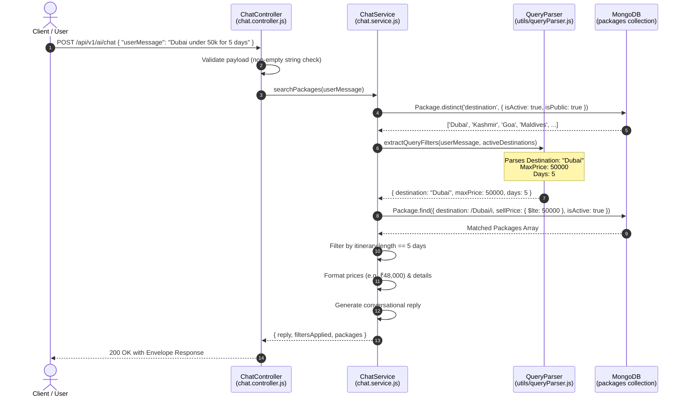

# 🤖 Maqam Travels — AI Chatbot & Trip Planner Architecture Guide

> **Module:** `modules/aiPlanner`  
> **Route:** `POST /api/v1/ai/chat`  
> **Purpose:** Intelligent conversational travel agent that understands natural language queries, extracts travel constraints (destination, budget, duration), queries active travel packages, and returns structured recommendations with personalized conversational replies.

---

## 📑 Table of Contents

1. [Overview & Executive Summary](#1-overview--executive-summary)
2. [High-Level Architecture & Data Flow](#2-high-level-architecture--data-flow)
3. [Step-by-Step Working Mechanism](#3-step-by-step-working-mechanism)
   - [Step 1: HTTP Request Ingestion & Validation](#step-1-http-request-ingestion--validation)
   - [Step 2: Dynamic Entity Extraction & NLP Parsing](#step-2-dynamic-entity-extraction--nlp-parsing)
   - [Step 3: Database Query Construction & Execution](#step-3-database-query-construction--execution)
   - [Step 4: Itinerary Duration Filtering](#step-4-itinerary-duration-filtering)
   - [Step 5: Package Presentation Formatting](#step-5-package-presentation-formatting)
   - [Step 6: Context-Aware Conversational Response Generation](#step-6-context-aware-conversational-response-generation)
4. [Query Parsing Engine (NLP & Entity Extraction)](#4-query-parsing-engine-nlp--entity-extraction)
   - [A. Destination Detection](#a-destination-detection)
   - [B. Budget & Price Detection](#b-budget--price-detection)
   - [C. Duration & Days Detection](#c-duration--days-detection)
5. [API Specification & Data Contracts](#5-api-specification--data-contracts)
   - [Endpoint Details](#endpoint-details)
   - [Request Schema](#request-schema)
   - [Success Response (200 OK)](#success-response-200-ok)
   - [Error Responses (400 / 500)](#error-responses-400--500)
6. [Real-World Query Scenarios](#6-real-world-query-scenarios)
7. [Current Architecture vs. Future LLM Roadmap](#7-current-architecture-vs-future-llm-roadmap)
8. [Developer & Testing Playbook](#8-developer--testing-playbook)

---

## 1. Overview & Executive Summary

The **AI Chatbot / Trip Planner** allows customers to search for travel packages using natural conversational language instead of navigating multiple static drop-down filters.

### Key Capabilities:
- **Free-Form Natural Language Understanding**: Users can type queries like `"Find packages for Dubai under 50k for 5 days"` or `"trip to Kashmir within 30000"`.
- **Hybrid Real-Time Parsing**: Employs deterministic regex rules combined with database-driven destination lists to eliminate hallucinations and extract precise search criteria.
- **Dynamic Database Search**: Performs regex-based destination filtering, MongoDB index-optimized price range queries (`$gte`, `$lte`), and itinerary array duration matching.
- **Dual Response Payload**: Provides both human-readable conversational replies and machine-readable structured JSON packages for UI rendering.

---

## 2. High-Level Architecture & Data Flow



---

## 3. Step-by-Step Working Mechanism

### Step 1: HTTP Request Ingestion & Validation
- **File**: `modules/aiPlanner/chat.controller.js`
- Checks that `req.body.userMessage` exists, is a string, and is not blank.
- Returns `400 Bad Request` if `userMessage` is invalid or missing.

### Step 2: Dynamic Entity Extraction & NLP Parsing
- **File**: `modules/aiPlanner/chat.service.js` & `utils/queryParser.js`
- Fetches all currently active, distinct destinations from the database (`Package.distinct('destination')`).
- Passes the user text and destination dictionary to `extractQueryFilters()`.
- Extracts:
  - `destination`: (e.g., `"Dubai"`, `"Kashmir"`)
  - `maxPrice` / `minPrice`: (e.g., `50000`, supports `k`, `lakh`, `lac`, commas, and currency symbols `₹`, `$`)
  - `days`: (e.g., `5`, handles `"5 days"`, `"duration 5"`, `"day 5"`)

### Step 3: Database Query Construction & Execution
- If any filter constraints were identified:
  - Constructs a strict MongoDB query:
    ```javascript
    const strictQuery = {
      isActive: true,
      isPublic: true,
      destination: { $regex: new RegExp(filters.destination.trim(), 'i') },
      sellPrice: { $lte: filters.maxPrice }
    };
    ```
  - Sorts results by `sellPrice: 1` (cheapest first) to ensure cost-effective recommendations.
- If no constraints were detected, the bot falls back to general package exploration (retrieves the top 5 cheapest public packages).

### Step 4: Itinerary Duration Filtering
- Each package in the database contains an `itinerary` array where each element represents one day's itinerary.
- The service filters results based on `p.itinerary.length`:
  ```javascript
  packages = packages.filter((p) => {
    const pDays = Array.isArray(p.itinerary) ? p.itinerary.length : 0;
    return filters.isMaxDays ? (pDays > 0 && pDays <= filters.days) : (pDays === filters.days);
  });
  ```

### Step 5: Package Presentation Formatting
- Packages are passed through `_formatPackage()`:
  - Calculates Indian Rupee formatting (e.g., `₹50,000`).
  - Standardizes key fields: `_id`, `title`, `description`, `destination`, `sellPrice`, `durationDays`, `images`, `inclusions`, `bundleDiscountPercentage`.

### Step 6: Context-Aware Conversational Response Generation
- Builds natural, conversational bot replies based on what was found:
  - **Matches Found**:
    > *"Packages are retrieved successfully in Dubai within your budget of ₹50,000 for 5 days:"*
  - **No Matches Found**:
    > *"Package doesn't exist for Dubai within ₹50,000 for 5 days. Try exploring other destinations or adjusting your budget and days!"*

---

## 4. Query Parsing Engine (NLP & Entity Extraction)

Located in `utils/queryParser.js`, this module uses a multi-layered extraction strategy:

### A. Destination Detection
1. **Dynamic DB Match**: Checks the query text against active database destinations (case-insensitive boundary matching).
2. **Explicit Prefix Match**: Detects labels like `"destination: Bali"`, `"place: Dubai"`, `"location Goa"`.
3. **Preposition Patterns**: Detects phrases like `"trip to Dubai"`, `"packages for Kashmir"`, `"tour of Ladakh"`.
4. **Leading Word Patterns**: Detects inputs starting with a destination like `"Dubai 50k 5 days"`.

### B. Budget & Price Detection
- **Shorthand Multipliers**:
  - `50k` $\rightarrow$ `50,000`
  - `1.5lakh` / `1.5lac` $\rightarrow$ `150,000`
  - `2L` $\rightarrow$ `200,000`
- **Range & Bound Operators**:
  - `"under 50k"`, `"below 40000"`, `"less than 60k"`, `"within 50000"` $\rightarrow$ sets `maxPrice`
  - `"above 30k"`, `"more than 20000"` $\rightarrow$ sets `minPrice`
  - `"between 20k and 40k"` $\rightarrow$ sets both `minPrice: 20000` and `maxPrice: 40000`

### C. Duration & Days Detection
- Detects patterns such as:
  - `"5 days"`, `"7 nights"`, `"5d"`, `"day: 5"`
  - `"under 5 days"` / `"max 5 days"` $\rightarrow$ sets `isMaxDays: true`

---

## 5. API Specification & Data Contracts

### Endpoint Details
- **HTTP Method**: `POST`
- **Route**: `/api/v1/ai/chat`
- **Authentication**: Public (no Bearer token required for customer search)
- **Rate Limiting**: Protected by standard `/api` rate limiter

### Request Schema

```json
{
  "userMessage": "Find packages for Dubai under 50000 for 5 days"
}
```

### Success Response (200 OK)

```json
{
  "success": true,
  "message": "Packages are retrieved successfully",
  "data": {
    "reply": "Packages are retrieved successfully in Dubai within your budget of ₹50,000 for 5 days:",
    "filtersApplied": {
      "destination": "Dubai",
      "maxPrice": 50000,
      "days": 5
    },
    "isRelativeMatch": false,
    "packages": [
      {
        "_id": "67a3f81e82845c001234abcd",
        "title": "Dubai Explorer 5-Day Extravaganza",
        "description": "5 days exploring Burj Khalifa, Desert Safari, and Marina Cruise.",
        "destination": "Dubai",
        "sellPrice": 48000,
        "formattedPrice": "₹48,000",
        "durationDays": 5,
        "images": [
          "https://cdn.maqamtravels.com/packages/dubai-1.jpg"
        ],
        "inclusions": [
          "Desert Safari with BBQ",
          "Dhow Cruise Dinner",
          "Burj Khalifa Top Entry",
          "4-Star Hotel Stay"
        ],
        "bundleDiscountPercentage": 10,
        "guideActive": true,
        "guidePrice": 3000,
        "isRelativeMatch": false
      }
    ]
  }
}
```

### Error Responses

#### 400 Bad Request (Missing Message)
```json
{
  "success": false,
  "message": "A non-empty 'userMessage' string is required."
}
```

#### 200 OK (Zero Packages Found)
```json
{
  "success": true,
  "message": "Package doesn't exist",
  "data": {
    "reply": "Package doesn't exist for Mars within ₹10,000. Try exploring other destinations or adjusting your budget and days!",
    "filtersApplied": {
      "destination": "Mars",
      "maxPrice": 10000
    },
    "isRelativeMatch": false,
    "packages": []
  }
}
```

---

## 6. Real-World Query Scenarios

| User Input Message | Extracted Filters | Database Query Behavior |
| :--- | :--- | :--- |
| `"Find Dubai tour under 60k for 5 days"` | `{ destination: "Dubai", maxPrice: 60000, days: 5 }` | Matches `destination: /Dubai/i`, `sellPrice <= 60000`, `itinerary.length == 5` |
| `"Packages for Kashmir"` | `{ destination: "Kashmir" }` | Matches all Kashmir packages, sorted cheapest first |
| `"Show trips under 25000"` | `{ maxPrice: 25000 }` | Matches all packages across all destinations priced $\le 25,000$ |
| `"Weekend gateway for 3 days"` | `{ days: 3 }` | Matches all packages with 3 days itinerary length |
| `"Hello, what packages do you have?"` | `{}` (No constraints) | Returns top 5 featured / cheapest active packages |

---

## 7. Current Architecture vs. Future LLM Roadmap

```
┌────────────────────────────────────────────────────────────────────────┐
│                   AI TRAVEL ASSISTANT ROADMAP                          │
├──────────────────────────────────┬─────────────────────────────────────┤
│   Phase 1: Deterministic Engine  │      Phase 2: Hybrid LLM Engine     │
│             (CURRENT)            │               (PLANNED)             │
├──────────────────────────────────┼─────────────────────────────────────┤
│ • Zero hallucination guarantees  │ • LLM Intent Classification (GPT-4o)│
│ • Sub-50ms ultra fast response   │ • Function calling / RAG embeddings │
│ • High regex & entity precision  │ • Multi-turn session chat memory    │
│ • No third-party LLM API costs   │ • Dynamic flight + hotel bundling   │
└──────────────────────────────────┴─────────────────────────────────────┘
```

---

## 8. Developer & Testing Playbook

### Testing via cURL

```bash
# 1. Full constraint query
curl -X POST "http://localhost:5000/api/v1/ai/chat" \
  -H "Content-Type: application/json" \
  -d '{"userMessage": "Find packages for Dubai under 50000 for 5 days"}'

# 2. Shorthand multiplier budget query
curl -X POST "http://localhost:5000/api/v1/ai/chat" \
  -H "Content-Type: application/json" \
  -d '{"userMessage": "Tour to Kashmir under 40k"}'

# 3. Exploration query
curl -X POST "http://localhost:5000/api/v1/ai/chat" \
  -H "Content-Type: application/json" \
  -d '{"userMessage": "Show me the best packages"}'
```

---


