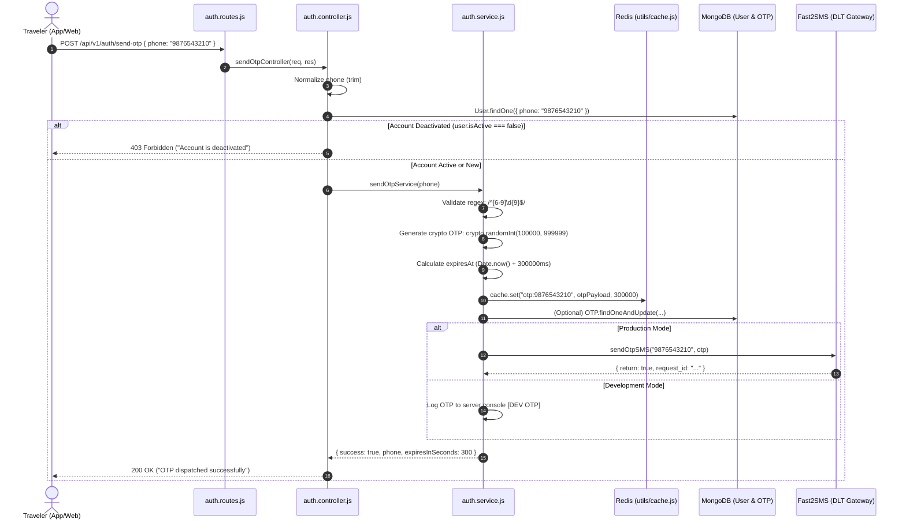
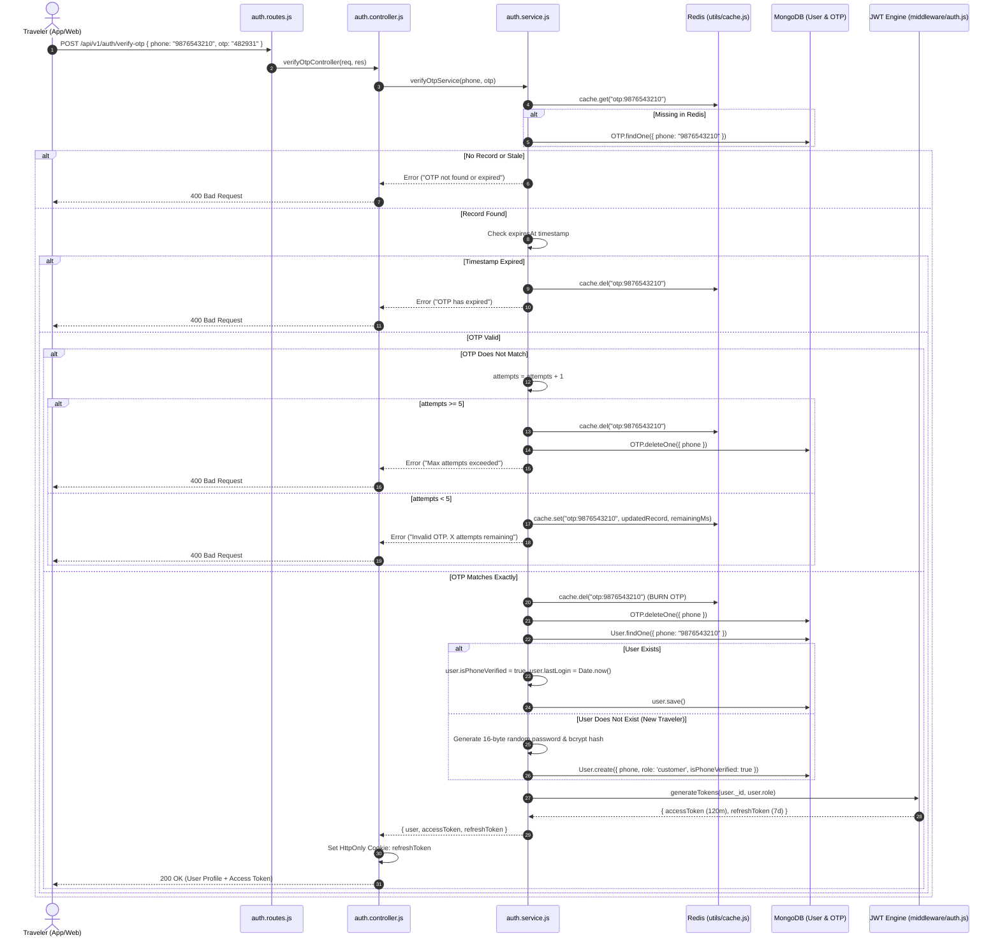

# 📱 Phone OTP Authentication System — Architecture & Implementation Guide
> **Maqam Travels Alpha — Identity & Access Management (IAM)**  
> Technical documentation, architectural design, dataflows, security controls, and API references for the phone-based One-Time Password (OTP) authentication system.

---

## 📑 Table of Contents

1. [Executive Overview & Design Philosophy](#1-executive-overview--design-philosophy)
2. [Dual-Store Architecture & Resilience](#2-dual-store-architecture--resilience)
3. [End-to-End System Workflows](#3-end-to-end-system-workflows)
   - [Workflow A: OTP Generation & Dispatch (`/send-otp`)](#workflow-a-otp-generation--dispatch-send-otp)
   - [Workflow B: OTP Verification & Auto-Provisioning (`/verify-otp`)](#workflow-b-otp-verification--auto-provisioning-verify-otp)
   - [Workflow C: Session Management & Refresh Token Flow](#workflow-c-session-management--refresh-token-flow)
4. [Component & Codebase Map](#4-component--codebase-map)
5. [REST API Endpoint Specifications](#5-rest-api-endpoint-specifications)
   - [1. Send OTP — `POST /api/v1/auth/send-otp`](#1-send-otp--post-apiv1authsend-otp)
   - [2. Verify OTP — `POST /api/v1/auth/verify-otp`](#2-verify-otp--post-apiv1authverify-otp)
   - [3. Refresh Token — `POST /api/v1/auth/refresh-token`](#3-refresh-token--post-apiv1authrefresh-token)
6. [Data Models & Key Schemas](#6-data-models--key-schemas)
   - [Redis Key-Value Schema](#redis-key-value-schema)
   - [MongoDB OTP Fallback Schema (`models/otp.model.js`)](#mongodb-otp-fallback-schema-modelsotpmodeljs)
   - [MongoDB User Identity Schema (`modules/auth/auth.model.js`)](#mongodb-user-identity-schema-modulesauthauthmodeljs)
7. [Telecom & DLT Regulatory Gateway (Fast2SMS)](#7-telecom--dlt-regulatory-gateway-fast2sms)
8. [Security Controls & Attack Mitigation](#8-security-controls--attack-mitigation)
9. [Environment Configuration Reference](#9-environment-configuration-reference)
10. [Developer & QA Verification Playbook](#10-developer--qa-verification-playbook)

---

## 1. Executive Overview & Design Philosophy

The OTP Authentication System provides **frictionless, passwordless registration and login** for consumer travelers on the Maqam Travels platform. It replaces traditional email/password registration with phone number verification compliant with Indian telecommunication (DLT) regulations.

### Key Architectural Pillars:
- **Zero Password Fatigue**: Customers register or log in in under 10 seconds using just their 10-digit mobile number.
- **Unified Auth Endpoint**: Both new customer registration and existing customer sign-in use the exact same two endpoints (`/send-otp` and `/verify-otp`). The backend transparently detects account existence and auto-provisions new accounts.
- **Sub-millisecond Latency via Redis**: Transient OTP state is cached in Redis with strict millisecond-level TTL, avoiding database read/write bottlenecks during high traffic spikes.
- **Fault-Tolerant Fallback**: If Redis becomes unavailable, the system automatically falls back to an in-memory storage buffer and MongoDB with native TTL indexing.
- **Single-Use Cryptographic Burning**: OTP tokens are burned (deleted) immediately upon verification or after reaching maximum failed attempts, eliminating replay attacks.
- **DLT Regulatory Compliance**: Dispatches SMS via TRAI-approved Distributed Ledger Technology (DLT) template and registered sender header (`MAQAMH`).

```
┌───────────────────────────────────────────────────────────────────────────────┐
│                           AUTHENTICATION PRINCIPLES                           │
├───────────────────────────────────────┬───────────────────────────────────────┤
│ Customer Public Portal (B2C)          │ Internal Back-Office / CRM (B2B)      │
├───────────────────────────────────────┼───────────────────────────────────────┤
│ • Primary: Passwordless Phone OTP     │ • Username/Email + Password ONLY      │
│ • Secondary: Email/Phone + Password   │ • OTP Login STRICTLY PROHIBITED       │
│ • Public Self-Registration Enabled    │ • Admin Provisioning ONLY             │
│ • Default Role: 'customer'            │ • Roles: 'sales_agent', 'admin', etc. │
└───────────────────────────────────────┴───────────────────────────────────────┘
```

---

## 2. Dual-Store Architecture & Resilience

The OTP subsystem is designed for 99.99% uptime through a tiered storage strategy:

```
                          ┌──────────────────────────┐
                          │  Incoming Client Request │
                          └─────────────┬────────────┘
                                        │
                                        ▼
                         ┌─────────────────────────────┐
                         │  modules/auth/auth.service  │
                         └──────────────┬──────────────┘
                                        │
                 ┌──────────────────────┴──────────────────────┐
                 ▼                                             ▼
       [Primary Cache Tier]                         [Resilient DB Fallback]
     Redis (ioredis Singleton)                       MongoDB (Mongoose)
    Key: otp:{normalizedPhone}                     Collection: otps
     TTL: 300,000 ms (5 mins)                   TTL Index: expiresAt (0s)
                 │                                             │
                 │ (If Redis connection fails)                 │
                 ▼                                             │
      [Local Memory Fallback]                                  │
    Map store inside utils/cache.js                            │
                 │                                             │
                 └──────────────────────┬──────────────────────┘
                                        ▼
                         Guaranteed OTP Read / Write
```

| Component | Storage Type | Key / Collection | TTL / Expiry | Purpose |
|---|---|---|---|---|
| **Primary** | Redis Cache | `otp:{phone}` | `300,000 ms` (5 mins) | Sub-millisecond lookup, attempt counting, auto-expiry |
| **Secondary** | Memory Buffer | `memoryStore` Map | `Date.now() + 300,000` | In-process fallback when Redis is unreachable |
| **Persistence** | MongoDB | `otps` Collection | `{ expireAfterSeconds: 0 }` | Resilient durable fallback record with auto-cleanup |

---

## 3. End-to-End System Workflows

### Workflow A: OTP Generation & Dispatch (`/send-otp`)



---

### Workflow B: OTP Verification & Auto-Provisioning (`/verify-otp`)



---

### Workflow C: Session Management & Refresh Token Flow

Once logged in via OTP:
1. The client receives a short-lived **`accessToken`** (valid for 120 minutes) in the JSON response body.
2. The client receives a long-lived **`refreshToken`** (valid for 7 days) stored securely in an `HttpOnly`, `Secure`, `SameSite=None` cookie.
3. Every authenticated API request sends `Authorization: Bearer <accessToken>`.
4. When `accessToken` expires (`401 Unauthorized`), the client calls `POST /api/v1/auth/refresh-token`:
   - Express extracts `req.cookies.refreshToken`.
   - `auth.service.js` verifies the token signature against `REFRESH_TOKEN_SECRET`.
   - A fresh `accessToken` is issued without requiring the user to re-enter an OTP.

---

## 4. Component & Codebase Map

| File Path | Role / Functionality | Key Exports / Methods |
|---|---|---|
| [`app.js`](file:///d:/Debanjan/joydeb_folder/MaqamTravelsAlpha/app.js#L152) | Mounts auth routes at `/api/v1/auth` | `app.use('/api/v1/auth', authRoutes)` |
| [`modules/auth/auth.routes.js`](file:///d:/Debanjan/joydeb_folder/MaqamTravelsAlpha/modules/auth/auth.routes.js#L245-L370) | Defines endpoints, Swagger JSDoc annotations, validator bindings | `router.post('/send-otp')`<br/>`router.post('/verify-otp')` |
| [`modules/auth/auth.controller.js`](file:///d:/Debanjan/joydeb_folder/MaqamTravelsAlpha/modules/auth/auth.controller.js#L149-L213) | Extracts request parameters, handles cookies, formats API response envelope | `sendOtpController`<br/>`verifyOtpController` |
| [`modules/auth/auth.service.js`](file:///d:/Debanjan/joydeb_folder/MaqamTravelsAlpha/modules/auth/auth.service.js#L195-L358) | OTP generation, Redis/MongoDB storage, verification, attempt tracking, user creation | `sendOtpService`<br/>`verifyOtpService` |
| [`modules/auth/auth.model.js`](file:///d:/Debanjan/joydeb_folder/MaqamTravelsAlpha/modules/auth/auth.model.js) | Mongoose User schema containing phone, verification flags, and credentials | `User` Model |
| [`models/otp.model.js`](file:///d:/Debanjan/joydeb_folder/MaqamTravelsAlpha/models/otp.model.js) | Mongoose schema with TTL index for durable fallback OTP storage | `OTP` Model |
| [`services/fast2sms.service.js`](file:///d:/Debanjan/joydeb_folder/MaqamTravelsAlpha/services/fast2sms.service.js) | Fast2SMS DLT HTTP POST integration layer with development fallback | `sendOtpSMS` |
| [`utils/cache.js`](file:///d:/Debanjan/joydeb_folder/MaqamTravelsAlpha/utils/cache.js) | Redis key-value cache operations with transparent in-memory Map fallback | `set`, `get`, `del`, `consume` |
| [`middleware/auth.js`](file:///d:/Debanjan/joydeb_folder/MaqamTravelsAlpha/middleware/auth.js) | JWT generation, verification, cookie configuration, RBAC middlewares | `generateTokens`, `authenticate` |
| [`scripts/test-fast2sms.js`](file:///d:/Debanjan/joydeb_folder/MaqamTravelsAlpha/scripts/test-fast2sms.js) | CLI utility to test Fast2SMS DLT SMS delivery to real numbers | CLI script |

---

## 5. REST API Endpoint Specifications

### 1. Send OTP — `POST /api/v1/auth/send-otp`

Generates a secure 6-digit numeric code, records it in Redis with a 5-minute TTL, and sends it via SMS.

- **URL**: `/api/v1/auth/send-otp`
- **Method**: `POST`
- **Auth Required**: No (Public)
- **Rate Limit**: Governed by `apiLimiter` (100 req / 15 min per IP)

#### Request Headers:
```http
Content-Type: application/json
```

#### Request Body:
```json
{
  "phone": "9876543210"
}
```

| Field | Type | Required | Description | Validation |
|---|---|:---:|---|---|
| `phone` | `string` | **Yes** | 10-digit Indian mobile number | Regex: `/^[6-9]\d{9}$/` |

#### Success Response (`200 OK`):
```json
{
  "success": true,
  "message": "OTP dispatched successfully.",
  "data": {
    "phone": "9876543210",
    "otp": "482931",
    "isNewUser": true,
    "userExists": false,
    "expiresInSeconds": 300
  }
}
```
> **Note**: In development mode (`NODE_ENV !== 'production'`), `data.otp` is included in the response payload for testing convenience. In production, this field is suppressed and delivered only via SMS.

#### Error Responses:
- **`400 Bad Request`** — Phone number missing or invalid format:
  ```json
  {
    "success": false,
    "message": "Please provide a valid 10-digit Indian mobile number."
  }
  ```
- **`403 Forbidden`** — User account is deactivated:
  ```json
  {
    "success": false,
    "message": "Account is deactivated. Please contact support."
  }
  ```
- **`500 Internal Server Error`** — Fast2SMS gateway failure or internal error:
  ```json
  {
    "success": false,
    "message": "Failed to dispatch SMS via Fast2SMS"
  }
  ```

#### cURL Example:
```bash
curl -X POST http://localhost:5000/api/v1/auth/send-otp \
  -H "Content-Type: application/json" \
  -d '{"phone": "9876543210"}'
```

---

### 2. Verify OTP — `POST /api/v1/auth/verify-otp`

Validates the provided OTP code against Redis (or MongoDB fallback). On match, single-use burns the OTP, creates the user if new, updates `lastLogin`, and issues JWT session tokens.

- **URL**: `/api/v1/auth/verify-otp`
- **Method**: `POST`
- **Auth Required**: No (Public)

#### Request Body:
```json
{
  "phone": "9876543210",
  "otp": "482931"
}
```

| Field | Type | Required | Description |
|---|---|:---:|---|
| `phone` | `string` | **Yes** | 10-digit mobile number matching the send request |
| `otp` | `string` | **Yes** | 6-digit numeric string received by the user |

#### Success Response (`200 OK`):
**Headers Set**:
`Set-Cookie: refreshToken=eyJhbGciOi...; Path=/; HttpOnly; Secure; SameSite=None; Max-Age=604800`

```json
{
  "success": true,
  "message": "OTP verified successfully. Login successful.",
  "data": {
    "user": {
      "id": "66d4b555e944f7b6b199e825",
      "phone": "9876543210",
      "firstName": "User",
      "lastName": "3210",
      "email": null,
      "avatar": null,
      "role": "customer",
      "isPhoneVerified": true,
      "isVerified": true
    },
    "accessToken": "eyJhbGciOiJIUzI1NiIsInR5cCI6IkpXVCJ9.eyJpZCI6IjY2ZDRiNTU1ZTk0NGY3YjZiMTk5ZTgyNSIsInJvbGUiOiJjdXN0b21lciIsImlhdCI6MTcyNzgxOTAwMCwiZXhwIjoxNzI3ODI2MjAwfQ.abc...",
    "refreshToken": "eyJhbGciOiJIUzI1NiIsInR5cCI6IkpXVCJ9.eyJpZCI6IjY2ZDRiNTU1ZTk0NGY3YjZiMTk5ZTgyNSIsInJvbGUiOiJjdXN0b21lciIsImlhdCI6MTcyNzgxOTAwMCwiZXhwIjoxNzI4NDIzODAwfQ.xyz..."
  }
}
```

#### Error Responses:
- **`400 Bad Request` — Missing Fields**:
  ```json
  { "success": false, "message": "Phone and OTP are required fields." }
  ```
- **`400 Bad Request` — Invalid OTP / Retry Counter**:
  ```json
  { "success": false, "message": "Invalid OTP provided. 4 attempt(s) remaining." }
  ```
- **`400 Bad Request` — Maximum Attempts Exceeded (Burn Triggered)**:
  ```json
  { "success": false, "message": "Maximum OTP verification attempts exceeded. Please request a new OTP." }
  ```
- **`400 Bad Request` — Expired / Missing Record**:
  ```json
  { "success": false, "message": "No OTP request found for this phone number or OTP has expired. Please request a new OTP." }
  ```

#### cURL Example:
```bash
curl -X POST http://localhost:5000/api/v1/auth/verify-otp \
  -H "Content-Type: application/json" \
  -d '{"phone": "9876543210", "otp": "482931"}'
```

---

### 3. Refresh Token — `POST /api/v1/auth/refresh-token`

Re-issues a new short-lived access token using the HttpOnly refresh token cookie.

- **URL**: `/api/v1/auth/refresh-token`
- **Method**: `POST`
- **Auth Required**: Refresh Token (via Cookie or Body)

#### Success Response (`200 OK`):
```json
{
  "success": true,
  "message": "Token refreshed",
  "data": {
    "accessToken": "eyJhbGciOiJIUzI1NiIsInR5cCI6IkpXVCJ9...",
    "refreshToken": "eyJhbGciOiJIUzI1NiIsInR5cCI6IkpXVCJ9..."
  }
}
```

---

## 6. Data Models & Key Schemas

### Redis Key-Value Schema

- **Key Format**: `otp:<normalized_10_digit_phone>` (e.g. `otp:9876543210`)
- **Storage Strategy**: Serialized JSON string
- **Expiry Command**: `SET key value PX 300000` (Automatic Redis expiration)

```json
{
  "otp": "482931",
  "phone": "9876543210",
  "attempts": 0,
  "maxAttempts": 5,
  "createdAt": "2026-09-15T12:00:00.000Z",
  "expiresAt": "2026-09-15T12:05:00.000Z"
}
```

---

### MongoDB OTP Fallback Schema (`models/otp.model.js`)

Used as a secondary storage fallback whenever Redis is offline:

```javascript
const otpSchema = new mongoose.Schema(
  {
    phone: {
      type: String,
      required: [true, 'Phone number is required'],
      trim: true,
      match: [/^[6-9]\d{9}$/, 'Enter a valid 10-digit Indian mobile number'],
    },
    otp: {
      type: String,
      required: [true, 'OTP is required'],
      trim: true,
    },
    expiresAt: {
      type: Date,
      required: true,
    },
  },
  { timestamps: true }
);

// Indexes
otpSchema.index({ phone: 1 });
otpSchema.index({ expiresAt: 1 }, { expireAfterSeconds: 0 }); // Native TTL index
```

---

### MongoDB User Identity Schema (`modules/auth/auth.model.js`)

When a new user verifies an OTP, the system auto-registers them:

```javascript
{
  phone: "9876543210",                // 10-digit unique mobile number
  password: "<bcrypt_hash_10_rounds>",// 16-byte random hex password (prevents password login)
  firstName: "User",                  // Default name prefix
  lastName: "3210",                   // Last 4 digits of phone number
  email: null,                        // Optional, added later via profile update
  avatar: null,                       // Default avatar placeholder
  role: "customer",                   // Public travelers are strictly assigned 'customer'
  isActive: true,                     // Active flag (if false, OTP dispatch is blocked)
  isPhoneVerified: true,              // Set to true upon successful OTP match
  isVerified: true,                   // Account verification flag
  lastLogin: "2026-09-15T12:05:00Z"   // Audit timestamp
}
```

---

## 7. Telecom & DLT Regulatory Gateway (Fast2SMS)

In India, commercial SMS messages must comply with **TRAI Distributed Ledger Technology (DLT)** mandates:

| Parameter | Configuration / Value | Description |
|---|---|---|
| **API Endpoint** | `https://www.fast2sms.com/dev/bulkV2` | Fast2SMS Bulk SMS V2 API endpoint |
| **API Key Header** | `authorization: process.env.FAST2SMS_API_KEY` | Fast2SMS merchant account secret |
| **Route** | `dlt` | Explicit DLT-compliant routing |
| **Sender ID** | `MAQAMH` (`FAST2SMS_SENDER_ID`) | 6-character registered header representing Maqam Travels |
| **Message / Template ID** | `224018` (`FAST2SMS_OTP_TEMPLATE_ID`) | Approved TRAI message template identifier |
| **Variable Values** | `{otp}` (e.g. `482931`) | Injected dynamically into template placeholder `{#var#}` |
| **Flash** | `0` | Standard SMS delivery (non-flash popup) |

### Non-Production Development Fallback:
In [`services/fast2sms.service.js`](file:///d:/Debanjan/joydeb_folder/MaqamTravelsAlpha/services/fast2sms.service.js#L18-L25):
- If `FAST2SMS_API_KEY` is not provided or SMS gateway fails during development (`NODE_ENV !== 'production'`), the service logs the OTP to the console.
- This ensures local developers and automated CI pipelines are never blocked by external gateway quotas.

---

## 8. Security Controls & Attack Mitigation

| Threat Vector | Mitigation Mechanism | Implementation |
|---|---|---|
| **Brute Force Guessing** | Max 5 failed attempts | Tracks `attempts` counter in Redis record. On the 5th failed attempt, the record is immediately purged from Redis and MongoDB. |
| **Replay Attacks** | Atomic Single-Use Burn | As soon as `otpRecord.otp === trimmedOtp`, `cache.del(redisKey)` and `OTP.deleteOne()` are called before issuing tokens. An OTP cannot be submitted twice. |
| **Weak Randomness** | Cryptographic Random Generator | Uses `crypto.randomInt(100000, 999999)` instead of insecure pseudorandom `Math.random()`. |
| **Expired Token Reuse** | Strict TTL Enforcement | Redis key has exact millisecond TTL. MongoDB has native TTL index. Service also explicitly validates `new Date() > new Date(otpRecord.expiresAt)`. |
| **Deactivated User Bypass** | Pre-dispatch State Check | `/send-otp` queries `User.findOne({ phone })`. If `user.isActive === false`, request is rejected with `403 Forbidden`. |
| **Token Theft / XSS** | HttpOnly Cookie Transport | The long-lived `refreshToken` is never exposed to frontend JavaScript, preventing token harvesting via XSS attacks. |
| **Unintended Staff Escalation** | Strict Role Gating | OTP auto-registration hardcodes `role: 'customer'`. Admin/staff roles can only be provisioned by authenticated administrators through CRM endpoints. |

---

## 9. Environment Configuration Reference

Add these keys to your `.env` configuration:

```env
# ─── Fast2SMS Gateway Configuration ───────────────────────────
FAST2SMS_API_KEY=Vt1l9nkQasFWNzO34py7wMfA0oHJ8mCxZUP5DIGqcgXdRj2LBvHfUzTS97GZXnvcQEV86ClpLaIskAwW
FAST2SMS_SENDER_ID=MAQAMH
FAST2SMS_OTP_TEMPLATE_ID=224018

# ─── OTP Policy & Expiration Settings ─────────────────────────
OTP_EXPIRY_MS=300000                   # Lifespan: 5 minutes (300,000 milliseconds)
OTP_MAX_ATTEMPTS=5                     # Maximum wrong OTP attempts before burn
OTP_RATE_LIMIT_WINDOW_MS=900000        # Rate limit window: 15 minutes
OTP_RATE_LIMIT_MAX=5                   # Maximum OTP dispatch requests per window

# ─── Redis Connection ─────────────────────────────────────────
REDIS_URL=redis://127.0.0.1:6379

# ─── JWT Secrets & Lifespans ──────────────────────────────────
ACCESS_TOKEN_SECRET=MAQAM_TRAVELS_VAIS_ACCESS_KEY_2026
REFRESH_TOKEN_SECRET=MAQAM_TRAVELS_REFRESH_VAIS_KEY_2026
NODE_ENV=development
```

---

## 10. Developer & QA Verification Playbook

### Step 1: CLI Smoke Test for Fast2SMS Dispatch
Run the standalone CLI test script to verify SMS gateway connectivity:
```bash
node scripts/test-fast2sms.js 9876543210
```
**Expected Output**:
```
──────────────────────────────────────
Fast2SMS DLT Test
──────────────────────────────────────
Phone       : 9876543210
OTP         : 582104
Sender ID   : MAQAMH
Message ID  : 224018
──────────────────────────────────────
✅  Response status: 200
✅  Response body : { "return": true, "request_id": "...", "message": ["SMS sent successfully."] }
```

---

### Step 2: Test OTP Dispatch via cURL
```bash
curl -X POST http://localhost:5000/api/v1/auth/send-otp \
  -H "Content-Type: application/json" \
  -d '{"phone": "9876543210"}'
```
**Expected Response**:
```json
{
  "success": true,
  "message": "OTP dispatched successfully.",
  "data": {
    "phone": "9876543210",
    "otp": "482931",
    "isNewUser": true,
    "userExists": false,
    "expiresInSeconds": 300
  }
}
```

---

### Step 3: Test Failed Attempt & Retry Counter
Submit an incorrect OTP:
```bash
curl -X POST http://localhost:5000/api/v1/auth/verify-otp \
  -H "Content-Type: application/json" \
  -d '{"phone": "9876543210", "otp": "000000"}'
```
**Expected Response (`400 Bad Request`)**:
```json
{
  "success": false,
  "message": "Invalid OTP provided. 4 attempt(s) remaining."
}
```

---

### Step 4: Test Successful Verification & Token Issuance
Submit the correct OTP:
```bash
curl -X POST http://localhost:5000/api/v1/auth/verify-otp \
  -i \
  -H "Content-Type: application/json" \
  -d '{"phone": "9876543210", "otp": "482931"}'
```
**Expected Response (`200 OK`)**:
```http
HTTP/1.1 200 OK
Set-Cookie: refreshToken=eyJhbGciOi...; Path=/; HttpOnly; SameSite=None
Content-Type: application/json

{
  "success": true,
  "message": "OTP verified successfully. Login successful.",
  "data": {
    "user": {
      "phone": "9876543210",
      "role": "customer",
      "isPhoneVerified": true
    },
    "accessToken": "eyJhbGciOi..."
  }
}
```

---

### Step 5: Verify Single-Use Burn
Re-submit the same OTP immediately:
```bash
curl -X POST http://localhost:5000/api/v1/auth/verify-otp \
  -H "Content-Type: application/json" \
  -d '{"phone": "9876543210", "otp": "482931"}'
```
**Expected Response (`400 Bad Request`)**:
```json
{
  "success": false,
  "message": "No OTP request found for this phone number or OTP has expired. Please request a new OTP."
}
```
*(Confirms that the OTP was burned upon first successful use).*

---

### Step 6: Verify Authenticated Route Access
Use the received `accessToken` to query the authenticated user profile:
```bash
curl -X GET http://localhost:5000/api/v1/auth/me \
  -H "Authorization: Bearer <accessToken>"
```
**Expected Response (`200 OK`)**:
```json
{
  "success": true,
  "message": "User profile retrieved successfully",
  "data": {
    "user": {
      "phone": "9876543210",
      "role": "customer",
      "isPhoneVerified": true,
      "isVerified": true
    }
  }
}
```

---

## 🏁 Summary Checklist for Developers

- [x] OTP generation uses `crypto.randomInt(100000, 999999)`.
- [x] Primary storage uses Redis (`otp:{phone}`) with 5-minute TTL (`300000 ms`).
- [x] Secondary fallback uses MongoDB `OTP` model with automatic TTL indexing.
- [x] Maximum failed verification attempts is capped at 5 before automatic burn.
- [x] Successful verification burns OTP immediately (single-use guarantee).
- [x] New users are auto-registered with `role: 'customer'` and random hashed password.
- [x] Existing users have their `lastLogin` and `isPhoneVerified` flags updated.
- [x] Fast2SMS DLT route uses registered Header `MAQAMH` and Message Template `224018`.
- [x] Non-production environments fall back to terminal logging to avoid blocking testing.
