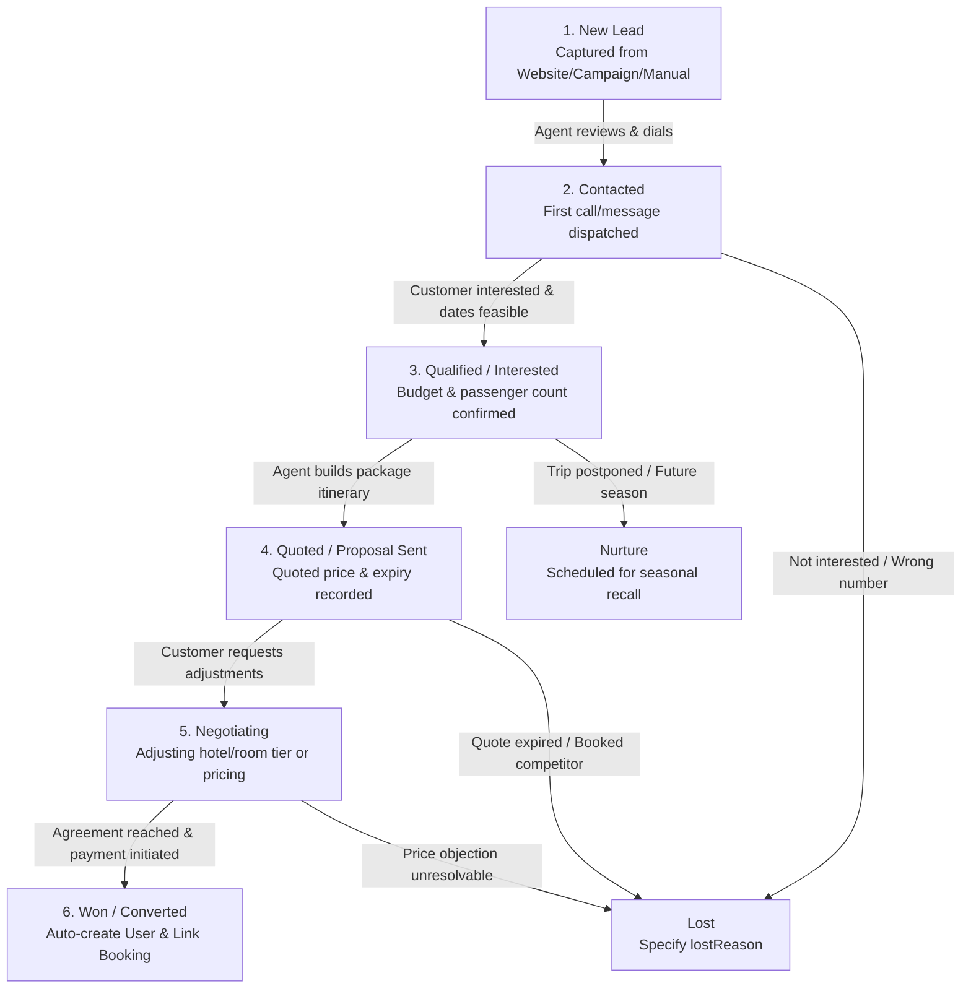

# 📋 CRM Lead Management — Architecture, Workflow & Implementation Guide

> **Maqam Travels Alpha — Operations & Sales CRM**  
> Comprehensive technical and operational documentation detailing the end-to-end lifecycle, domain models, state machine transitions, API specifications, and frontend Kanban/pipeline integration for handling sales leads.

---

## 📑 Table of Contents

1. [Executive Summary & Core Concepts](#1-executive-summary--core-concepts)
2. [Lead State Machine & Lifecycle Flow](#2-lead-state-machine--lifecycle-flow)
3. [Domain Model Architecture (`crm.model.js`)](#3-domain-model-architecture-crmmodeljs)
4. [Step-by-Step Operational Workflow](#4-step-by-step-operational-workflow)
   - [Phase 1: Ingestion & Capture](#phase-1-ingestion--capture)
   - [Phase 2: Assignment & Triaging](#phase-2-assignment--triaging)
   - [Phase 3: Qualification & Contact](#phase-3-qualification--contact)
   - [Phase 4: Quotation & Proposal](#phase-4-quotation--proposal)
   - [Phase 5: Conversion to Customer & Booking](#phase-5-conversion-to-customer--booking)
   - [Phase 6: Lost & Nurture Handling](#phase-6-lost--nurture-handling)
5. [Complete API Endpoints & Request/Response Contracts](#5-complete-api-endpoints--requestresponse-contracts)
   - [1. Create Lead (`POST /api/v1/crm/leads`)](#1-create-lead-post-apiv1crmleads)
   - [2. List & Filter Leads (`GET /api/v1/crm/leads`)](#2-list--filter-leads-get-apiv1crmleads)
   - [3. Get Lead Details (`GET /api/v1/crm/leads/:id`)](#3-get-lead-details-get-apiv1crmleadsid)
   - [4. Update Lead / Status Transition (`PATCH /api/v1/crm/leads/:id`)](#4-update-lead--status-transition-patch-apiv1crmleadsid)
   - [5. Add Follow-up Note & Timeline Entry (`POST /api/v1/crm/leads/:id/notes`)](#5-add-follow-up-note--timeline-entry-post-apiv1crmleadsidnotes)
   - [6. Convert Lead to Customer & Booking (`POST /api/v1/crm/leads/:id/convert`)](#6-convert-lead-to-customer--booking-post-apiv1crmleadsidconvert)
   - [7. Pipeline Overview & Analytics (`GET /api/v1/crm/pipeline`, `GET /api/v1/crm/stats`)](#7-pipeline-overview--analytics-get-apiv1crmpipeline-get-apiv1crmstats)
6. [Role-Based Access Control (RBAC) Matrix](#6-role-based-access-control-rbac-matrix)
7. [Frontend Pipeline & Kanban Board Integration Guide](#7-frontend-pipeline--kanban-board-integration-guide)
8. [Operational SLAs & Agent Best Practices](#8-operational-slas--agent-best-practices)

---

## 1. Executive Summary & Core Concepts

In the travel industry (specifically Umrah, Hajj, and luxury bespoke travel), holiday packages and hotel allocations rarely convert instantaneously through automated self-checkout. Potential travelers require **custom itinerary design, visa verification, group pricing, and high-touch consultation**.

The **CRM Lead Management Subsystem** bridges the gap between public interest (website inquiry forms, marketing campaigns, WhatsApp chats, phone calls) and confirmed transactional bookings.

### Key Capabilities:
- **Unified Ingestion**: Captures inquiries from Website forms, AI Planner, WhatsApp, Phone calls, and Manual agent entry.
- **Dynamic Kanban State Machine**: Tracks progression from `new` inquiry to `won` conversion across structured deal stages.
- **Audit & Timeline Feed**: Automatically logs status movements, agent follow-up notes, phone calls, and quotation dispatches in an immutable event timeline.
- **Frictionless Conversion**: Converts a qualified lead directly into a registered `User` (Customer) account and links it to a confirmed `Booking` in a single atomic action.

---

## 2. Lead State Machine & Lifecycle Flow

Every sales inquiry flows through a deterministic state machine managed by [`crm.service.js`](file:///d:/Debanjan/joydeb_folder/MaqamTravelsAlpha/modules/crm/crm.service.js):



### Stage Definitions & Transition Rules

| Stage | Internal Status Values | Description & Trigger Criteria |
| :--- | :--- | :--- |
| **New** | `new` | Inquiry created in system. No human sales representative has engaged with the prospect yet. |
| **Contacted** | `contacted` | Agent has made initial contact (outbound phone call, WhatsApp greeting, or email response). |
| **Qualified / Interested** | `qualified`, `interested` | Traveler has verified travel intent, destination, approximate dates, passenger count, and budget range. |
| **Proposal Sent / Quoted** | `proposal`, `quoted`, `proposal_sent` | Custom itinerary or package price has been formally calculated and communicated to the traveler. `quotedPrice` and `quoteExpiresAt` are logged. |
| **Negotiating** | `negotiation`, `negotiating` | Back-and-forth discussion regarding price discounts, room category upgrades, flights, or payment terms. |
| **Won / Converted** | `won`, `converted` | Deal closed! Payment deposited or reservation locked. Generates customer account and attaches booking. |
| **Lost** | `lost` | Deal terminated. Requires mandatory `lostReason` (e.g., "Competitor cheaper", "Dates cancelled", "Visa rejected"). |
| **Nurture** | `nurture` | Prospect is genuinely interested but cannot travel this month/quarter. Placed into long-term follow-up queue. |

---

## 3. Domain Model Architecture (`crm.model.js`)

The `Lead` model ([`modules/crm/crm.model.js`](file:///d:/Debanjan/joydeb_folder/MaqamTravelsAlpha/modules/crm/crm.model.js)) captures travel requirements, contact metadata, follow-up cadence, and audit trails:

```
┌────────────────────────────────────────────────────────────────────────┐
│                              LEAD DOCUMENT                             │
├────────────────────────────────────────────────────────────────────────┤
│  CONTACT INFO                                                          │
│  ├── firstName: String (Required)                                      │
│  ├── lastName: String                                                  │
│  ├── company: String                                                   │
│  ├── email: String                                                     │
│  └── phone: String (Required)                                          │
│                                                                        │
│  TRIP REQUIREMENTS                                                     │
│  ├── destination: String (e.g. "Makkah & Madinah", "Dubai")            │
│  ├── tripType: String ("Umrah", "Hajj", "Leisure", "Corporate")        │
│  ├── travelDates: { from: Date, to: Date }                             │
│  ├── budget: Number                                                    │
│  ├── numberOfPeople: Number (default: 1)                               │
│  └── specialRequests: String (room view, wheelchair, etc.)             │
│                                                                        │
│  SALES ASSIGNMENT & PRIORITY                                           │
│  ├── source: String ("Website", "Campaign", "WhatsApp", "Referral")    │
│  ├── priority: String ("high", "medium", "low")                        │
│  ├── assignedAgent: ObjectId -> User (Sales Agent)                     │
│  └── assignedTo: String (Agent name cache)                             │
│                                                                        │
│  FOLLOW-UP & QUOTE                                                     │
│  ├── nextFollowUpDate: Date                                            │
│  ├── lastContactDate: Date                                             │
│  ├── notes / contactNotes: String                                      │
│  ├── quotedPrice: Number                                               │
│  └── quoteExpiresAt: Date                                              │
│                                                                        │
│  CONVERSION & AUDIT                                                    │
│  ├── status: String (new | contacted | qualified | quoted | won | lost)│
│  ├── convertedCustomer: ObjectId -> User                               │
│  ├── convertedBooking: ObjectId -> Booking                             │
│  ├── convertedAt: Date                                                 │
│  ├── lostReason: String                                                │
│  ├── timeline: [ { id, type, title, detail, time, createdAt } ]        │
│  └── createdBy: ObjectId -> User                                       │
└────────────────────────────────────────────────────────────────────────┘
```

---

## 4. Step-by-Step Operational Workflow

### Phase 1: Ingestion & Capture
1. **Public Web Form Submission**: A user visits `/packages/umrah-14-days` and clicks "Inquire Now", submitting their name, phone, and travel dates.
2. **Backend Insertion**: Handled via `POST /api/v1/crm/leads` (or automated ingestion webhook).
3. **Timeline Event**: An automatic initial timeline record is created:
   ```json
   {
     "type": "created",
     "title": "Lead created",
     "detail": "Lead was created from Website Inquiry.",
     "time": "01 Oct, 14:00"
   }
   ```

### Phase 2: Assignment & Triaging
1. Admin or Sales Lead views the unassigned leads pool using `GET /api/v1/crm/leads?status=new&assignedTo=unassigned`.
2. Assigns the lead to a specific sales agent:
   `PATCH /api/v1/crm/leads/:id` with `{ "assignedAgent": "<user_id>" }`.
3. The assigned agent receives a notification on their CRM dashboard.

### Phase 3: Qualification & Contact
1. Sales agent calls the prospect to verify passenger count, hotel proximity preferences (e.g. Clock Tower Makkah), and budget.
2. Agent records the discussion notes via:
   `POST /api/v1/crm/leads/:id/notes` with `{ "note": "Customer needs 2 quadruple sharing rooms close to Haram." }`.
3. Agent advances the stage:
   `PATCH /api/v1/crm/leads/:id` with `{ "status": "interested", "nextFollowUpDate": "2026-10-03T10:00:00Z" }`.
4. The system automatically pushes a `status` item to `lead.timeline` ("Moved to Interested").

### Phase 4: Quotation & Proposal
1. Agent checks available hotel allotments (`modules/packages/stock/stock.service.js`) and flight series.
2. Agent sends an official package proposal and updates the lead:
   `PATCH /api/v1/crm/leads/:id`
   ```json
   {
     "status": "proposal",
     "quotedPrice": 320000,
     "quoteExpiresAt": "2026-10-06T18:00:00Z",
     "notes": "Sent VIP 10-Day Umrah proposal with Pullman Zamzam & SV Flights."
   }
   ```

### Phase 5: Conversion to Customer & Booking
1. Traveler accepts the quote and deposits initial payment.
2. Sales agent triggers conversion:
   `POST /api/v1/crm/leads/:id/convert`
   ```json
   {
     "customerType": "new",
     "bookingId": "6ab9876543210fedcba12345"
   }
   ```
3. **Automatic Backend Actions**:
   - Checks if a `User` with `lead.phone` exists. If not, auto-generates a customer account with a secure temporary password.
   - Sets `lead.convertedCustomer = user._id`.
   - Links `lead.convertedBooking = bookingId`.
   - Sets `lead.status = "won"` and `lead.convertedAt = new Date()`.
   - Appends "Lead converted" to the activity timeline.

### Phase 6: Lost & Nurture Handling
1. If the customer declines or chooses an alternate agency:
   `PATCH /api/v1/crm/leads/:id`
   ```json
   {
     "status": "lost",
     "lostReason": "Selected competitor due to non-stop flight availability"
   }
   ```
2. The lead is archived from active pipeline views while preserving metrics for sales analytics.

---

## 5. Complete API Endpoints & Request/Response Contracts

Base Route: `/api/v1/crm` (or `/api/v1/ops-crm`)  
Security Header: `Authorization: Bearer <accessToken>`  
Authorized Roles: `admin`, `super_admin`, `sales_agent`

---

### 1. Create Lead (`POST /api/v1/crm/leads`)

#### 📩 Request Body:
```json
{
  "firstName": "Ahmed",
  "lastName": "Farooq",
  "phone": "9876543210",
  "email": "ahmed.farooq@example.com",
  "destination": "Makkah & Madinah",
  "tripType": "Umrah",
  "travelDates": {
    "from": "2026-11-15",
    "to": "2026-11-25"
  },
  "numberOfPeople": 4,
  "budget": 350000,
  "specialRequests": "Quadruple sharing room with Kaaba view",
  "source": "Website",
  "priority": "high"
}
```

#### ✅ Response Body (`HTTP 201 Created`):
```json
{
  "success": true,
  "message": "Lead created successfully",
  "data": {
    "id": "6abe315c97033b181b2b88aa",
    "_id": "6abe315c97033b181b2b88aa",
    "name": "Ahmed Farooq",
    "firstName": "Ahmed",
    "lastName": "Farooq",
    "phone": "9876543210",
    "email": "ahmed.farooq@example.com",
    "destination": "Makkah & Madinah",
    "tripType": "Umrah",
    "travelers": 4,
    "numberOfPeople": 4,
    "budget": 350000,
    "source": "Website",
    "status": "new",
    "priority": "high",
    "specialRequests": "Quadruple sharing room with Kaaba view",
    "assignedTo": null,
    "assignedAgent": null,
    "timeline": [
      {
        "id": "T1759302400000",
        "type": "created",
        "title": "Lead created",
        "detail": "Lead was created from Website.",
        "time": "01 Oct, 14:00",
        "createdAt": "2026-10-01T08:30:00.000Z"
      }
    ],
    "createdAt": "2026-10-01T08:30:00.000Z",
    "updatedAt": "2026-10-01T08:30:00.000Z"
  }
}
```

---

### 2. List & Filter Leads (`GET /api/v1/crm/leads`)

#### 🔍 Query Parameters:
- `status` or `stage`: e.g. `new`, `contacted`, `interested`, `proposal`, `won`, `lost`.
- `priority`: `high`, `medium`, `low`.
- `source`: `Website`, `Campaign`, `WhatsApp`, etc.
- `assignedTo`: Agent ID or agent name.
- `search`: Keyword searched across Name, Email, Phone, Destination, Company.
- `page`: Page index (default: `1`).
- `limit`: Items per page (default: `20`, max: `100`).

#### ✅ Response Body (`HTTP 200 OK`):
```json
{
  "success": true,
  "message": "Leads list retrieved successfully",
  "data": {
    "leads": [
      {
        "id": "6abe315c97033b181b2b88aa",
        "name": "Ahmed Farooq",
        "phone": "9876543210",
        "email": "ahmed.farooq@example.com",
        "destination": "Makkah & Madinah",
        "tripType": "Umrah",
        "travelers": 4,
        "budget": 350000,
        "source": "Website",
        "status": "interested",
        "priority": "high",
        "assignedTo": "Sarah Jenkins",
        "assignedAgent": {
          "_id": "6aae3e137f011d78bb87e5f0",
          "firstName": "Sarah",
          "lastName": "Jenkins",
          "email": "sarah@maqamtravels.com"
        },
        "nextFollowUpDate": "2026-10-03T10:00:00.000Z",
        "createdAt": "2026-10-01T08:30:00.000Z"
      }
    ],
    "pagination": {
      "total": 48,
      "page": 1,
      "limit": 20,
      "totalPages": 3
    }
  }
}
```

---

### 3. Get Lead Details (`GET /api/v1/crm/leads/:id`)

Retrieves full lead details, complete activity timeline history, populated assigned agent, and converted booking entity.

#### ✅ Response Body (`HTTP 200 OK`):
```json
{
  "success": true,
  "message": "Lead details retrieved successfully",
  "data": {
    "lead": {
      "id": "6abe315c97033b181b2b88aa",
      "firstName": "Ahmed",
      "lastName": "Farooq",
      "phone": "9876543210",
      "email": "ahmed.farooq@example.com",
      "destination": "Makkah & Madinah",
      "travelDates": {
        "from": "2026-11-15T00:00:00.000Z",
        "to": "2026-11-25T00:00:00.000Z"
      },
      "budget": 350000,
      "status": "quoted",
      "priority": "high",
      "quotedPrice": 320000,
      "quoteExpiresAt": "2026-10-06T18:00:00.000Z",
      "assignedAgent": {
        "_id": "6aae3e137f011d78bb87e5f0",
        "firstName": "Sarah",
        "lastName": "Jenkins",
        "email": "sarah@maqamtravels.com",
        "phone": "9876543210"
      },
      "timeline": [
        {
          "id": "T1759302400000",
          "type": "created",
          "title": "Lead created",
          "detail": "Lead was created from Website.",
          "time": "01 Oct, 14:00"
        },
        {
          "id": "T1759303500000",
          "type": "note",
          "title": "Note added",
          "detail": "Client confirmed 4 travelers with elderly parents. Needs 5-star hotel near gate 338.",
          "time": "01 Oct, 14:15"
        },
        {
          "id": "T1759305000000",
          "type": "status",
          "title": "Status changed",
          "detail": "Moved to Quoted",
          "time": "01 Oct, 14:35"
        }
      ]
    }
  }
}
```

---

### 4. Update Lead / Status Transition (`PATCH /api/v1/crm/leads/:id`)

Updates lead attributes. **Any status change automatically generates an audit record in `timeline`**.

#### 📩 Request Body:
```json
{
  "status": "negotiation",
  "priority": "high",
  "quotedPrice": 310000,
  "nextFollowUpDate": "2026-10-04T11:00:00.000Z",
  "notes": "Offered 10k discount if booked before Friday."
}
```

#### ✅ Response Body (`HTTP 200 OK`):
```json
{
  "success": true,
  "message": "Lead updated successfully",
  "data": {
    "lead": {
      "id": "6abe315c97033b181b2b88aa",
      "status": "negotiation",
      "quotedPrice": 310000,
      "notes": "Offered 10k discount if booked before Friday.",
      "updatedAt": "2026-10-01T08:50:00.000Z"
    }
  }
}
```

---

### 5. Add Follow-up Note & Timeline Entry (`POST /api/v1/crm/leads/:id/notes`)

Appends a discrete interaction entry to the activity timeline and updates `lastContactDate`.

#### 📩 Request Body:
```json
{
  "note": "Spoke with Ahmed. He reviewed the itinerary and is confirming passenger passport copies."
}
```

#### ✅ Response Body (`HTTP 200 OK`):
```json
{
  "success": true,
  "message": "Note added successfully",
  "data": {
    "lead": {
      "id": "6abe315c97033b181b2b88aa",
      "lastContactDate": "2026-10-01T08:55:00.000Z",
      "timeline": [
        {
          "id": "T1759308900000",
          "type": "note",
          "title": "Note added",
          "detail": "Spoke with Ahmed. He reviewed the itinerary and is confirming passenger passport copies.",
          "time": "01 Oct, 14:25"
        }
      ]
    }
  }
}
```

---

### 6. Convert Lead to Customer & Booking (`POST /api/v1/crm/leads/:id/convert`)

Finalizes the lead, converts the status to `won`, and establishes relational linkage with the customer profile and booking records.

#### 📩 Request Body:
```json
{
  "customerType": "new",
  "bookingId": "6abb1234567890abcdef1234"
}
```

#### ✅ Response Body (`HTTP 200 OK`):
```json
{
  "success": true,
  "message": "Lead converted to booking/customer successfully",
  "data": {
    "lead": {
      "id": "6abe315c97033b181b2b88aa",
      "status": "won",
      "convertedAt": "2026-10-01T09:00:00.000Z",
      "convertedCustomer": {
        "_id": "6abe550097033b181b2b9999",
        "firstName": "Ahmed",
        "lastName": "Farooq",
        "email": "ahmed.farooq@example.com",
        "phone": "9876543210"
      },
      "convertedBooking": {
        "_id": "6abb1234567890abcdef1234",
        "bookingReference": "MQ-PKG-2026-8812",
        "status": "confirmed"
      }
    }
  }
}
```

---

### 7. Pipeline Overview & Analytics (`GET /api/v1/crm/pipeline`, `GET /api/v1/crm/stats`)

Provides aggregated counts and metrics for CRM Kanban headers and sales team dashboards.

#### `GET /api/v1/crm/pipeline` Response:
```json
{
  "success": true,
  "message": "Pipeline overview retrieved successfully",
  "data": {
    "totalLeads": 128,
    "stages": {
      "new": 24,
      "contacted": 38,
      "qualified": 22,
      "proposal": 18,
      "negotiation": 10,
      "won": 12,
      "lost": 4
    },
    "conversionRate": "9.38%"
  }
}
```

#### `GET /api/v1/crm/stats` (Agent Performance):
```json
{
  "success": true,
  "message": "Agent statistics retrieved successfully",
  "data": {
    "totalLeads": 35,
    "new": 5,
    "contacted": 12,
    "qualified": 8,
    "proposal": 4,
    "negotiation": 2,
    "won": 4,
    "lost": 0
  }
}
```

---

## 6. Role-Based Access Control (RBAC) Matrix

| Action | `super_admin` | `admin` | `sales_agent` | `support_agent` | `customer` / `hotelier` |
| :--- | :---: | :---: | :---: | :---: | :---: |
| **Create Lead** | 🟢 Allowed | 🟢 Allowed | 🟢 Allowed | 🔴 Denied | 🔴 Denied |
| **View All Leads** | 🟢 All | 🟢 All | 🟡 Own / Assigned | 🟡 Read Only | 🔴 Denied |
| **Assign / Reassign Lead** | 🟢 Allowed | 🟢 Allowed | 🔴 Denied | 🔴 Denied | 🔴 Denied |
| **Update Status / Notes** | 🟢 Allowed | 🟢 Allowed | 🟢 Assigned Leads | 🔴 Denied | 🔴 Denied |
| **Convert to Customer** | 🟢 Allowed | 🟢 Allowed | 🟢 Allowed | 🔴 Denied | 🔴 Denied |
| **Delete Lead** | 🟢 Allowed | 🟢 Allowed | 🔴 Denied | 🔴 Denied | 🔴 Denied |
| **View Overall Pipeline**| 🟢 Allowed | 🟢 Allowed | 🟡 Own Stats | 🔴 Denied | 🔴 Denied |

---

## 7. Frontend Pipeline & Kanban Board Integration Guide

In the React Admin app ([`src/admin/features/leads/`](file:///d:/Debanjan/joydeb_folder/Maqam-Frontend/src/admin/features/leads/)), the pipeline is presented as a high-density Kanban board.

### Column Mapping:

```javascript
export const PIPELINE_COLUMNS = [
  { key: 'new', label: 'New Inquiries', color: 'border-blue-500' },
  { key: 'contacted', label: 'Contacted', color: 'border-amber-500' },
  { key: 'qualified', label: 'Interested', color: 'border-purple-500' },
  { key: 'proposal', label: 'Proposal Sent', color: 'border-indigo-500' },
  { key: 'negotiation', label: 'Negotiating', color: 'border-pink-500' },
  { key: 'won', label: 'Won / Booked', color: 'border-emerald-500' },
  { key: 'lost', label: 'Lost', color: 'border-slate-400' },
];
```

### Drag-and-Drop Handler:
When a card is dragged from "Contacted" to "Interested":
```javascript
const handleDrop = async (leadId, targetColumnKey) => {
  // 1. Optimistic UI state update
  setLeads(prev => prev.map(l => l.id === leadId ? { ...l, status: targetColumnKey } : l));
  
  // 2. Dispatch API PATCH request
  try {
    await apiClient.patch(`/crm/leads/${leadId}`, { status: targetColumnKey });
    toast.success(`Lead moved to ${targetColumnKey}`);
  } catch (err) {
    // 3. Rollback on failure
    toast.error('Failed to update stage. Reverting...');
    refreshPipeline();
  }
};
```

---

## 8. Operational SLAs & Agent Best Practices

1. **15-Minute First Contact SLA**:
   - Any lead entering `new` must be called or messaged on WhatsApp within **15 minutes** of submission during operational hours (9 AM – 9 PM).
2. **Mandatory Timeline Hygiene**:
   - Every customer phone interaction must have a summary note added using `POST /leads/:id/notes`. Never leave a phone call untracked.
3. **Always Set Next Follow-Up**:
   - No active lead should have an empty `nextFollowUpDate`. Agents must explicitly book the next conversation date.
4. **Strict Lost Categorization**:
   - Never mark a lead as `lost` without filling `lostReason`. These data points directly drive product pricing adjustments and supplier negotiations.
