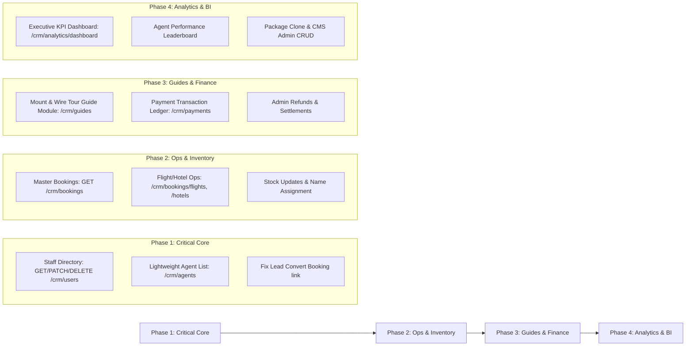

# CRM API Gap Analysis & Missing Endpoints Specification

> **Document Version:** 1.0.0  
> **Audience:** Backend Engineers, CRM Frontend Developers, Product Managers  
> **Location:** `server/docs/crm/CRM_MISSING_ENDPOINTS_SPECIFICATION.md`  
> **Base Route Prefix:** `/api/v1`

---

## 1. Executive Summary

A comprehensive architectural audit was performed on the travel agency backend codebase, cross-referencing:
1. **Mounted Express Routes:** [app.js](file:///d:/Arun-Shaw/TravelAgency/server/app.js)
2. **Current CRM Route Definitions:** [crm.routes.js](file:///d:/Arun-Shaw/TravelAgency/server/modules/crm/crm.routes.js)
3. **Admin Modules:** [packageAdmin.routes.js](file:///d:/Arun-Shaw/TravelAgency/server/modules/packages/admin/packageAdmin.routes.js), [stockAdmin.routes.js](file:///d:/Arun-Shaw/TravelAgency/server/modules/packages/stock/stockAdmin.routes.js), [offerAdmin.routes.js](file:///d:/Arun-Shaw/TravelAgency/server/modules/packages/offers/offerAdmin.routes.js), and [adminVisa.routes.js](file:///d:/Arun-Shaw/TravelAgency/server/modules/visa/visaAdmin/adminVisa.routes.js)
4. **Target Business Architecture:** [`CRM_SYSTEM_FLOW_AND_FE_ALIGNMENT_GUIDE.md`](file:///d:/Arun-Shaw/TravelAgency/server/docs/crm/CRM_SYSTEM_FLOW_AND_FE_ALIGNMENT_GUIDE.md)

### Key Finding
While wholesale packages, stock allotment creation, and visa administration have solid initial foundations, the platform lacks **staff directory lookup, master bookings operations across flights/hotels, payment transaction auditing, and tour guide management**. Furthermore, several modules exist in the codebase but are unmounted or partially commented out.

---

## 2. Current Live Endpoints Matrix

The table below summarizes what is actively mounted and functioning in the backend today:

| Domain | Base Path | Active Capabilities |
| :--- | :--- | :--- |
| **Leads & Pipeline** | `/api/v1/crm/leads` | Create lead, list leads, lead details, update lead, convert lead to booking, agent stats, pipeline overview count. |
| **Hotels & Approvals** | `/api/v1/crm/hotels` `/api/v1/crm/hotel-stock` | Create hotel entity, list hotels, hotel details, update hotel, list pending stock, review stock (approve/reject), list approved stock. |
| **Packages Admin** | `/api/v1/crm/packages` | List packages with margin analytics, create package (multipart/JSON), get package detail, update package, deactivate package, image uploads, book for customer offline, list package bookings, assign booking, cancel booking. |
| **Wholesale Stock** | `/api/v1/crm/stocks` | Inventory overview metrics, list/create flight stocks, list/create hotel stocks, get stock by ID. |
| **Retail Offers** | `/api/v1/crm/offers` | List/create standalone offers, image management, book for customer offline, list offer bookings, cancel offer booking. |
| **Visa Operations** | `/api/v1/visa/admin` | Visa admin dashboard, applications management, assign agent, update review status, document rejection, visa catalog CRUD. |

---

## 3. Comprehensive Missing Endpoints Specification

Below is the detailed specification for all endpoints currently missing on the CRM side, grouped by functional domain.

---

### Category 1: Staff & User Management (`/api/v1/crm/users`) — **Most of it done**

Currently, only `POST /api/v1/crm/users` exists. The CRM UI cannot render a staff directory, edit staff permissions, or populate "Assigned Agent" dropdowns.

| Method | Endpoint | Allowed Roles | Description & Requirements |
| :--- | :--- | :--- | :--- |
| `GET` | `/api/v1/crm/users` | `admin`, `super_admin` | **List Staff & CRM Users:** Paginated search with filters for `role` (`sales_agent`, `support_agent`, `admin`, `hotelier`, `customer`), `status` (`active`, `inactive`), and text search on name/email/phone. |
| `GET` | `/api/v1/crm/users/:id` | `admin`, `super_admin` | **User 360 View:** Profile information, assigned leads count, active bookings count, creation timestamp, and creator info. |
| `PATCH` | `/api/v1/crm/users/:id` | `admin`, `super_admin` | **Update Staff Member:** Modify `role`, `firstName`, `lastName`, `phone`, `email`, or toggle `isActive`. |
| `DELETE` | `/api/v1/crm/users/:id` | `super_admin` | **Deactivate / Soft-Delete Staff:** Disables account and prevents future logins while preserving audit history. |
| `GET` | `/api/v1/crm/agents` | `admin`, `super_admin`, `sales_agent` | **Lightweight Agent List:** Returns `{ id, name, role, email }` for all active agents. Used directly by frontend dropdowns to assign leads and bookings. |

---

### Category 2: Master Bookings & Operations Desk (`/api/v1/crm/bookings`) — **Critical**

Currently, package and offer bookings have endpoints, but **regular Flight and Hotel bookings ([modules/bookings](file:///d:/Arun-Shaw/TravelAgency/server/modules/bookings)) only provide customer-facing `getMyBookings`**. Operations staff cannot inspect or manage standalone bookings.

| Method | Endpoint | Allowed Roles | Description & Requirements |
| :--- | :--- | :--- | :--- |
| `GET` | `/api/v1/crm/bookings` | `admin`, `super_admin`, `finance`, `support_agent` | **Unified Booking Search:** Master table listing all bookings across all types (`flight`, `hotel`, `package`, `offer`). Filter by `bookingType`, `status`, `paymentStatus`, date range, and customer name/email. |
| `GET` | `/api/v1/crm/bookings/:id` | `admin`, `super_admin`, `finance`, `support_agent` | **Booking File Inspection:** Full snapshot of itinerary, supplier references (PNR, hotel voucher), passenger list, pricing breakdown, and payment transaction link. |
| `GET` | `/api/v1/crm/bookings/flights` | `admin`, `super_admin`, `support_agent` | **Flight Operations Queue:** Filterable by airline, PNR, flight number, supplier status (SRDV live booking state), and departure date. |
| `GET` | `/api/v1/crm/bookings/hotels` | `admin`, `super_admin`, `support_agent` | **Hotel Operations Queue:** Filterable by hotel property, check-in date, room type, and supplier confirmation code. |
| `PATCH` | `/api/v1/crm/bookings/:id/status` | `admin`, `super_admin` | **Manual Status Override:** Force update booking status (`confirmed`, `failed`, `cancelled`) with mandatory operational reason audit log. |
| `POST` | `/api/v1/crm/bookings/:id/resend-voucher` | `admin`, `super_admin`, `support_agent` | **Resend Voucher / Ticket:** Re-triggers email notification with booking PDF confirmation to customer. |

---

### Category 3: Wholesale Inventory (Stock) Lifecycle (`/api/v1/crm/stocks`) — **High**

Wholesale flight series and hotel blocks currently cannot be edited, nor can individual seats/rooms be assigned passenger names.

| Method | Endpoint | Allowed Roles | Description & Requirements |
| :--- | :--- | :--- | :--- |
| `PATCH` | `/api/v1/crm/stocks/flights/:id` | `admin`, `super_admin` | **Update Flight Batch:** Modify departure/arrival times, `nameAdditionDeadline`, internal cost per seat, or add extra units. |
| `DELETE` | `/api/v1/crm/stocks/flights/:id` | `super_admin` | **Cancel / Archive Flight Series:** Marks batch inactive. Disallows deletion if units are already bound to confirmed customer bookings. |
| `PATCH` | `/api/v1/crm/stocks/hotels/:id` | `admin`, `super_admin` | **Update Hotel Room Block:** Modify room type label, price per night, reservation reference, meals, or deadline. |
| `DELETE` | `/api/v1/crm/stocks/hotels/:id` | `super_admin` | **Cancel / Archive Hotel Stock:** Archives hotel allotment batch. |
| `GET` | `/api/v1/crm/stocks/expiring-soon` | `admin`, `super_admin`, `sales_agent` | **Deadline Alert Queue:** Lists flight and hotel batches where `nameAdditionDeadline` is within 48 hours or 7 days and has unassigned seats/rooms. |
| `PATCH` | `/api/v1/crm/stocks/flights/:id/units/:unitId` | `admin`, `super_admin` | **Assign Passenger to PNR Unit:** Manually attach traveler legal name, passport number, and e-ticket number to a bulk seat. |
| `PATCH` | `/api/v1/crm/stocks/hotels/:id/units/:unitId` | `admin`, `super_admin` | **Assign Guest to Room Unit:** Attach guest details to a block hotel room unit. |

---
Guide is deprecated 

---

### Category 5: Payments, Financials & Reconciliation (`/api/v1/crm/payments`) — **High**

Payments currently exist only as consumer checkout gateways. Finance and CRM staff have no audit or transaction desk.

| Method | Endpoint | Allowed Roles | Description & Requirements |
| :--- | :--- | :--- | :--- |
| `GET` | `/api/v1/crm/payments` | `admin`, `super_admin`, `finance` | **Financial Transaction Ledger:** Paginated list of all transactions across Razorpay, PayPal, PhonePe, and Bank Transfer. Filters: status, date range, gateway, booking ID. |
| `GET` | `/api/v1/crm/payments/:id` | `admin`, `super_admin`, `finance` | **Transaction Audit File:** Raw gateway order IDs, capture IDs, webhook payload history, refund traces, and linked booking ID. |
| `POST` | `/api/v1/crm/payments/:id/refund` | `admin`, `super_admin`, `finance` | **Admin Triggered Refund:** Issues partial or full refund through the original payment gateway or marks manual bank transfer refund. Logs audit remark. |
| `GET` | `/api/v1/crm/payments/summary` | `admin`, `super_admin`, `finance` | **Financial Reconciliation Totals:** Gross transaction volume, payment gateway commissions, total refunds, and net settled revenue. |

---

### Category 6: Executive Analytics & Business Intelligence (`/api/v1/crm/analytics`) — **Medium**

Currently, `/crm/stats` only returns lead counts for a single agent, and `/crm/pipeline` only provides raw lead status counts.

| Method | Endpoint | Allowed Roles | Description & Requirements |
| :--- | :--- | :--- | :--- |
| `GET` | `/api/v1/crm/analytics/dashboard` | `admin`, `super_admin`, `finance` | **Executive Overview:** Consolidated metrics: Gross Revenue, Gross Profit Margin, Total Bookings by category (Packages, Flights, Hotels, Visas), Lead Conversion Rate, and Live Stock Utilization. |
| `GET` | `/api/v1/crm/analytics/revenue` | `admin`, `super_admin`, `finance` | **Revenue Trends:** Aggregated sales volume grouped by day, week, or month for interactive charts. |
| `GET` | `/api/v1/crm/analytics/agents` | `admin`, `super_admin` | **Agent Performance Leaderboard:** Metrics per sales agent: total assigned leads, conversion percentage, bookings value generated, and average response time. |

---

### Category 7: Lead Management Pipeline Enhancements (`/api/v1/crm/leads`) — **Medium**

| Method | Endpoint | Allowed Roles | Description & Requirements |
| :--- | :--- | :--- | :--- |
| `DELETE` | `/api/v1/crm/leads/:leadId` | `admin`, `super_admin` | **Delete / Archive Lead:** Soft-delete dead or spam inquiries. |
| `PATCH` | `/api/v1/crm/leads/:leadId/assign` | `admin`, `super_admin` | **Single Lead Reassign:** Transfer lead ownership to another sales agent. |
| `POST` | `/api/v1/crm/leads/bulk-assign` | `admin`, `super_admin` | **Bulk Lead Reassign:** Distribute selected leads to one or more agents. |
| `POST` | `/api/v1/crm/leads/:leadId/notes` | `admin`, `super_admin`, `sales_agent` | **Add Timeline Activity:** Add structured interaction entry (`call`, `email`, `meeting`, `whatsapp`) with timestamp and notes. |
| `GET` | `/api/v1/crm/leads/:leadId/notes` | `admin`, `super_admin`, `sales_agent` | **Lead Activity Timeline:** Retrieve chronological interaction history. |
| `GET` | `/api/v1/crm/leads/export` | `admin`, `super_admin` | **Export Leads:** Download filtered leads as CSV / Excel. |

---

### Category 8: Customer 360 Directory (`/api/v1/crm/customers`) — **Medium**  for later  

| Method | Endpoint | Allowed Roles | Description & Requirements |
| :--- | :--- | :--- | :--- |
| `GET` | `/api/v1/crm/customers` | `admin`, `super_admin`, `sales_agent` | **Customer Directory:** Search customer database by name, phone, or email. Displays total bookings count, total spend, and registration date. |
| `GET` | `/api/v1/crm/customers/:id` | `admin`, `super_admin`, `sales_agent` | **Customer 360 File:** Consolidated view: personal details, saved co-travellers, all past flight/hotel/package bookings, visa applications, and previous CRM leads. |

---

### Category 9: Package & Offer Operations Quality-of-Life — **Medium**

| Method | Endpoint | Allowed Roles | Description & Requirements |
| :--- | :--- | :--- | :--- |
| `POST` | `/api/v1/crm/packages/:id/clone` | `admin`, `super_admin` | **Duplicate Package:** Creates a new draft copy of an existing package with its inclusions, itinerary, and stock configurations. |
| `DELETE` | `/api/v1/crm/packages/:id` | `super_admin` | **Archive / Delete Package:** Hides package from catalog if no active bookings depend on it. |
| `DELETE` | `/api/v1/crm/offers/:id` | `super_admin` | **Archive / Delete Offer:** Soft-deletes a retail standalone offer. |

---

### Category 10: CMS Administration (`/api/v1/crm/cms`) — **Low**

In [modules/cms/cms.routes.js:L18-L21](file:///d:/Arun-Shaw/TravelAgency/server/modules/cms/cms.routes.js#L18-L21), the admin write routes are commented out.

| Method | Endpoint | Allowed Roles | Description & Requirements |
| :--- | :--- | :--- | :--- |
| `POST` | `/api/v1/crm/cms/pages` | `admin`, `super_admin` | **Create Static Page:** Create Terms, Privacy Policy, About Us page with slug and markdown/HTML body. |
| `PUT` | `/api/v1/crm/cms/pages/:id` | `admin`, `super_admin` | **Update Static Page:** Modify page title, content, or SEO meta tags. |
| `DELETE` | `/api/v1/crm/cms/pages/:id` | `super_admin` | **Delete Static Page:** Remove page. |
| `POST|PUT|DELETE` | `/api/v1/crm/cms/faqs` | `admin`, `super_admin` | **FAQ CRUD:** Manage categorized frequently asked questions. |
| `POST|PUT|DELETE` | `/api/v1/crm/cms/blog` | `admin`, `super_admin` | **Blog Post CRUD:** Manage destination travel guides and promotional articles. |

---

## 4. Known Bugs & Inconsistencies to Fix

1. **Lead Conversion Does Not Link Booking:**  
   In [crm.service.js:L90](file:///d:/Arun-Shaw/TravelAgency/server/modules/crm/crm.service.js#L90), `lead.convertedBooking = null` is hardcoded upon conversion. The endpoint `POST /api/v1/crm/leads/:leadId/convert` must accept `{ bookingId }` in the request body and save the relation.
2. **Unmounted Tour Guide Module:**  
   [`modules/guide/guide.routes.js`](file:///d:/Arun-Shaw/TravelAgency/server/modules/guide/guide.routes.js) has full business logic and controller code, but is never imported or mounted in [app.js](file:///d:/Arun-Shaw/TravelAgency/server/app.js).
3. **Commented-Out CMS Admin Endpoints:**  
   [`modules/cms/cms.routes.js`](file:///d:/Arun-Shaw/TravelAgency/server/modules/cms/cms.routes.js) has admin routes commented out with missing `adminMiddleware`.

---

## 5. Phased Implementation Roadmap

### Suggested Implementation Order:
1. **Phase 1 (Immediate Frontend Blocker):** Staff Directory & Agents Dropdown (`GET /api/v1/crm/users`, `/api/v1/crm/agents`) + fix `lead.convertedBooking`.
2. **Phase 2 (Operations Blocker):** Master Bookings Desk (`GET /api/v1/crm/bookings`) & Stock Batch Lifecycle (`PATCH /stocks/flights/:id`, `/stocks/hotels/:id`).
3. **Phase 3 (Vertical Expansion):** Mount Tour Guide module (`/api/v1/crm/guides`) & Financial Transaction Ledger (`/api/v1/crm/payments`).
4. **Phase 4 (Executive Intelligence):** Unified Analytics Dashboard (`/api/v1/crm/analytics/dashboard`), Agent Leaderboard, and Package Cloning.
