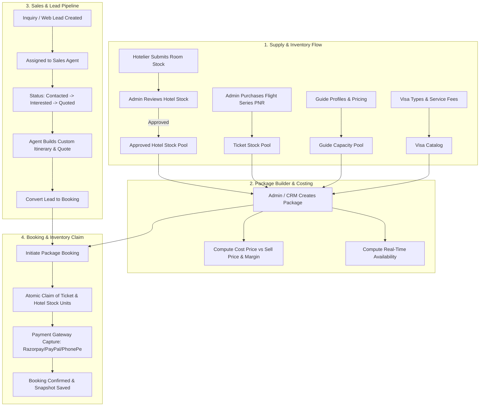

# Travel Agency CRM — System Architecture, Business Flows & Frontend Integration Guide

> **Target Audience:** CRM Frontend Engineering Team, Fullstack Developers, Product & Operations Managers  
> **Document Purpose:** Detailed reference for aligning CRM UI/UX mockups with backend domain models, transactional flows, role permissions, inventory mechanics, and the upcoming **Guide** & **Visa** package integrations.

---

## 1. System Overview & Core Philosophy

Our Travel Platform is built on a **modular, multi-tier architecture** that powers both B2C self-service channels and internal CRM/ERP operations.

### Key Business Realities to Understand:
1. **Shared Block Inventory (Flight Series & Hotel Allocations):**  
   Flights and Hotels are often purchased in bulk blocks (series fares under a single PNR or block hotel contract). Units in a batch are unnamed until assigned to a customer booking.
2. **Dynamic Package Availability & Cost Calculation:**  
   Packages do not have an arbitrary "stock number". A package's availability is **computed in real time** as the mathematical minimum of its referenced flight stock, hotel room stock, and service capacities.
3. **Immutable Booking Snapshots:**  
   When a booking is confirmed, a full snapshot of the package, inclusions, itinerary, flight PNR details, and hotel room types is frozen into the booking record. Future edits to the package will never alter past bookings.
4. **CRM Role Separation:**  
   Sales agents manage leads and convert quotes; Hotelier partners submit room stock for approval; Admin/Super Admins review inventory, manage users, and curate packages; Finance tracks payment captures, cancellations, and settlements.

---

## 2. Authentication, Roles & Route Structure

### 2.1 Route Prefixes
All endpoints are versioned under `/api/v1`. CRM operational endpoints are organized into dedicated route namespaces:

| Module Namespace | Route Prefix | Primary Users |
| :--- | :--- | :--- |
| **Auth & Sessions** | `/api/v1/auth` | All users |
| **CRM Leads & Staff** | `/api/v1/ops-crm` (or configurable `${CRM_PREFIX}`) | `admin`, `super_admin`, `sales_agent` |
| **CRM Package Admin** | `/api/v1/crm/packages` | `admin`, `super_admin`, `finance` |
| **Hotelier Portal** | `/api/v1/hotelier` | `hotelier` partners |
| **B2C / Public Packages** | `/api/v1/packages` | Public & Authenticated Customers |
| **Offers & Flash Sales** | `/api/v1/offers` | Public & Authenticated Customers |
| **Bookings** | `/api/v1/bookings` | Customers & CRM Staff |
| **Payments** | `/api/v1/payments` | Customers & Webhook Gateways |
| **CMS & Static Pages** | `/api/v1/cms` | Public & Admin |

### 2.2 Role-Based Access Control (RBAC)
Every authenticated request must provide the JWT in the `Authorization: Bearer <token>` header.

```
┌─────────────────────────────────────────────────────────────────────────────┐
│                             ROLE MATRIX                                     │
├──────────────┬──────────────┬──────────────┬──────────────┬─────────────────┤
│ Role         │ Leads / CRM  │ Package Admin│ Hotel Stock  │ User Management │
├──────────────┼──────────────┼──────────────┼──────────────┼─────────────────┤
│ super_admin  │ Full Control │ Full Control │ Full Control │ Full Control    │
│ admin        │ Full Control │ Full Control │ Full Review  │ Full Control    │
│ sales_agent  │ Leads & Stats│ Read-Only    │ View Approved│ No Access       │
│ finance      │ View Pipeline│ Read Bookings│ No Access    │ No Access       │
│ hotelier     │ No Access    │ No Access    │ Own Stock CRUD│ No Access      │
│ support_agent│ View Leads   │ Read-Only    │ No Access    │ No Access       │
│ customer     │ No Access    │ Public Only  │ No Access    │ Self Only       │
└──────────────┴──────────────┴──────────────┴──────────────┴─────────────────┘
```

---

## 3. Module-by-Module Business Flows



---

## 4. Detailed Functional Workflows

### 4.1 Lead Management & Sales Pipeline Flow

The CRM Sales Pipeline allows sales agents to track potential travelers from initial inquiry to final booking.

#### Lead Status State Machine:
`new` ➔ `contacted` ➔ `interested` ➔ `quoted` ➔ `converted` *(or `lost` / `nurture`)*

```
[ New Lead ] ──(Agent Assigned)──► [ Contacted ]
      │                                  │
      ▼                                  ▼
   [ Lost ] ◄────────(Drop-off)──── [ Interested ]
      ▲                                  │
      │                             (Send Quote)
      │                                  ▼
      └─────────(Quote Expired)──── [ Quoted ]
                                         │
                                   (Payment / Book)
                                         ▼
                                  [ Converted ]
```

#### Frontend Flow & Endpoints:
1. **Lead Listing & Pipeline Board:**
   - `GET /api/v1/ops-crm/leads?status=interested&page=1&limit=20`
   - `GET /api/v1/ops-crm/pipeline` ➔ Returns summary counters by status.
   - `GET /api/v1/ops-crm/stats` ➔ Returns agent performance metrics (conversion rate, open leads).
2. **Create / Capture Lead:**
   - `POST /api/v1/ops-crm/leads`
   - Payload: `firstName`, `lastName`, `email`, `phone`, `destination`, `travelDates`, `budget`, `numberOfPeople`, `specialRequests`, `source`.
3. **Follow-Up & Notes:**
   - `PUT /api/v1/ops-crm/leads/:leadId`
   - Updates: `status`, `nextFollowUpDate`, `contactNotes`, `quotedPrice`, `quoteExpiresAt`.
4. **Convert Lead:**
   - `POST /api/v1/ops-crm/leads/:leadId/convert`
   - Links the lead to a newly created `Booking` and marks status as `converted`.

---

### 4.2 Hotel & Hotelier Partner Stock Management Flow

Hotels are onboarded as master entities. Approved hotelier partners can submit room blocks, which CRM Admins review before the stock becomes eligible for packages.

1. **Admin Onboards Hotel Entity:**
   - `POST /api/v1/ops-crm/hotels` (Creates hotel profile: name, destination, amenities, contact, tie-up dates).
2. **Admin Creates Hotelier User Account:**
   - `POST /api/v1/ops-crm/users` with `{ role: 'hotelier', hotelId: '<hotel_id>' }`.
3. **Hotelier Submits Block Stock:**
   - `POST /api/v1/hotelier/stock`
   - Defines: `roomType`, `checkIn`, `checkOut`, `pricePerNight`, `reservationRef`, `nameAdditionDeadline`, `meals`, and unit batch count.
   - Stock enters `reviewStatus: 'pending_review'`.
4. **Admin Review Queue:**
   - `GET /api/v1/ops-crm/hotel-stock/pending`
   - `PATCH /api/v1/ops-crm/hotel-stock/:id/review` with `{ decision: 'approved' | 'rejected', reviewNotes }`.
5. **Approved Stock Active for Packages:**
   - `GET /api/v1/ops-crm/hotel-stock/approved`

---

### 4.3 Ticket Stock (Flight Series / Bulk PNRs) Flow

Admins enter series flight tickets purchased in bulk from airlines or consolidators:
- **Shared PNR:** Group booking reference without initial passenger names.
- **Name Addition Deadline:** Cutoff date by which traveler names must be submitted to the airline.
- **Unit Pool:** Individual seats with status (`available`, `assigned`, `used`).
- **Bulk Cost per Unit:** Internal buying cost used by the package pricing engine to compute margin.

---

### 4.4 Packages Engine: Structure, Inclusions, Guide & Visa Integration

A Package represents a curated travel bundle. Packages link directly to live Flight Stock, Hotel Stock, and service add-ons.

```
                          PACKAGE DOCUMENT
 ┌────────────────────────────────────────────────────────────────┐
 │ Title: "10-Day Umrah & Historical Istanbul Special"            │
 │ Destination: "Saudi Arabia & Turkey"                           │
 │ Sell Price: $2,499.00                                          │
 ├────────────────────────────────────────────────────────────────┤
 │ 1. Flight Stock References (flightRefs)                        │
 │    - Ref: DEL-JED TicketStock Batch (2 units per booking)      │
 │    - Ref: JED-IST TicketStock Batch (2 units per booking)      │
 ├────────────────────────────────────────────────────────────────┤
 │ 2. Hotel Stock References (hotelRefs)                          │
 │    - Ref: Makkah Clock Tower HotelStock (1 room, 5 nights)     │
 │    - Ref: Istanbul Bosphorus HotelStock (1 room, 4 nights)     │
 ├────────────────────────────────────────────────────────────────┤
 │ 3. [NEW] Guide Section (guideRefs / guideDetails)              │
 │    - Guide Option: Dedicated Multilingual Historian Guide      │
 │    - Languages: English, Urdu, Arabic                          │
 │    - Scope: Daily city tours & ziyarat assistance              │
 │    - Daily / Fixed Cost Price & Included Days                  │
 ├────────────────────────────────────────────────────────────────┤
 │ 4. [NEW] Visa Section (visaDetails / visaRefs)                 │
 │    - Visa Type: Saudi Tourist / Umrah E-Visa + Turkey E-Visa   │
 │    - Processing Window: 3 to 5 business days                   │
 │    - Document Checklist: Passport scan, photo, insurance       │
 │    - Visa Cost per Applicant + Admin Filing Margin             │
 ├────────────────────────────────────────────────────────────────┤
 │ 5. Other Items & Inclusions (otherItems / inclusions)          │
 │    - Private VIP Airport Transfers, Breakfast Included         │
 ├────────────────────────────────────────────────────────────────┤
 │ 6. Day-by-Day Itinerary (itinerary)                            │
 │    - Day 1: Arrival & Transfer                                 │
 │    - Day 2: Guided Historical Tour                             │
 └────────────────────────────────────────────────────────────────┘
```

#### Real-Time Availability Formula:
$$\text{Available Slots} = \min \left( \left\lfloor \frac{\text{Flight Stock Available Units}}{\text{Units per Booking}} \right\rfloor, \left\lfloor \frac{\text{Hotel Stock Available Units}}{\text{Units per Booking}} \right\rfloor, \text{Guide Capacity} \right)$$

#### Profitability & Cost Price Breakdown (Admin-Only):
$$\text{Total Cost Price} = \sum (\text{Flight Stock Cost} \times \text{Units}) + \sum (\text{Hotel Cost per Unit}) + \text{Guide Cost} + \text{Visa Cost} + \sum \text{Other Items}$$
$$\text{Gross Profit Margin} = \text{Sell Price} - \text{Total Cost Price}$$

---

## 5. Specification for Upcoming Guide & Visa Package Additions

To assist the frontend team in completing the UI/UX package creation wizard and detail views, here is the exact schema and operational behavior for **Guide** and **Visa**:

### 5.1 Guide Integration Section (`guideDetails` / `guideRefs`)

| Field | Type | Description |
| :--- | :--- | :--- |
| `included` | Boolean | Whether professional guide service is bundled in this package |
| `guideType` | Enum: `['group', 'private', 'on_demand', 'none']` | Type of guide service offered |
| `languages` | Array of Strings | Supported languages (e.g. `['English', 'Arabic', 'Hindi']`) |
| `coverageDays` | Array of Numbers or String | Days on which the guide is active (e.g. `[1, 2, 3, 5]`) |
| `costPerDay` or `totalGuideCost` | Number | Internal cost to agency (factored into package cost price) |
| `guideNotes` | String | Operational remarks / meeting point instructions |
| `assignedGuideId` | ObjectId (Ref: User / Partner) | Optional link to an assigned guide profile |

### 5.2 Visa Integration Section (`visaDetails`)

| Field | Type | Description |
| :--- | :--- | :--- |
| `required` | Boolean | Whether visa processing is handled under this package |
| `visaType` | String | e.g. "Tourist E-Visa", "Umrah Visa", "Schengen Assistance" |
| `country` | String | Destination country requiring visa |
| `validityDays` | Number | Visa validity period (e.g. 30 days, 90 days) |
| `entryType` | Enum: `['single', 'multiple']` | Entry permissions |
| `processingTimeDays`| Number | Expected SLA in business days (e.g. 5 days) |
| `documentChecklist` | Array of Strings | e.g. `['Original Passport (6m validity)', 'Passport Size Photo (White BG)', 'Bank Statement']` |
| `govtFee` | Number | Actual embassy/consulate cost |
| `serviceFee` | Number | Agency processing charge included in sell price |
| `visaInstructions` | String | Detailed instructions for the customer/agent |

---

## 6. Package Booking & Atomic Claim Life-Cycle

When a customer or sales agent completes a package booking, the backend orchestrates inventory protection:

```
[ Booking Initiated ]
        │
        ▼
[ Atomic Unit Claim ] ────► Locks 1 Flight Unit per ref in TicketStock
        │              ────► Locks 1 Room Unit in HotelStock
        ▼
[ Status: Pending ]
        │
        ├─── If Payment Succeeds ───► [ Status: Confirmed ]
        │                                  │
        │                                  ├── Freezes Package Snapshot
        │                                  └── Marks Units as 'assigned'
        │
        └─── If Cancelled / Expired ─► [ Status: Cancelled ]
                                           │
                                           └── Reverts Stock Units to 'available'
```

---

## 7. CRM Frontend Screen Alignment Matrix

Use this matrix to audit the CRM UI screens built by the frontend team against backend endpoints and data contracts:

| CRM Frontend Screen / View | UI State & Actions | Existing Backend API | Planned / Needed API |
| :--- | :--- | :--- | :--- |
| **CRM Dashboard** | Total leads, pipeline counters, conversion chart, recent activities | `GET /api/v1/ops-crm/stats`<br/>`GET /api/v1/ops-crm/pipeline` | Unified multi-agent revenue analytics endpoint |
| **Leads Kanban / Table** | Filter by status/agent, pagination, search, quick status drag-and-drop | `GET /api/v1/ops-crm/leads`<br/>`POST /api/v1/ops-crm/leads` | Bulk lead reassign endpoint |
| **Lead Detail Drawer** | Timeline, contact notes, follow-up calendar, quote builder, convert button | `GET /api/v1/ops-crm/leads/:id`<br/>`PUT /api/v1/ops-crm/leads/:id`<br/>`POST /api/v1/ops-crm/leads/:id/convert` | Send PDF quote email directly to client |
| **Package Builder Wizard** | Multi-step form: Basic details, select Flight Stock, select Hotel Stock, **Guide config**, **Visa checklist**, pricing breakdown, itinerary builder | `POST /api/v1/crm/packages`<br/>`PATCH /api/v1/crm/packages/:id`<br/>`GET /api/v1/crm/packages/:id` | Update validator to accept `guideDetails` and `visaDetails` objects |
| **Package Catalog (Admin)** | List all packages, toggle active/public, view calculated cost vs sell price, view real-time availability | `GET /api/v1/crm/packages`<br/>`PATCH /api/v1/crm/packages/:id/deactivate` | Duplicate/Clone package endpoint |
| **Hotel Stock Approval Queue** | List pending batches submitted by hoteliers, preview room specs, approve/reject with feedback notes | `GET /api/v1/ops-crm/hotel-stock/pending`<br/>`PATCH /api/v1/ops-crm/hotel-stock/:id/review`<br/>`GET /api/v1/ops-crm/hotel-stock/approved` | Bulk batch approval endpoint |
| **Ticket Stock Manager** | Create bulk flight PNR series, view unit status breakdown (available vs assigned vs used) | Direct DB / Mongoose model ready | Expose full REST endpoints for CRUD on `TicketStock` |
| **Hotelier Partner Portal** | Hotelier dashboard: create room stock, view approval status, manage guest allocations | `GET /api/v1/hotelier/stock`<br/>`POST /api/v1/hotelier/stock`<br/>`PATCH /api/v1/hotelier/stock/:id`<br/>`POST /api/v1/hotelier/stock/:id/units` | Rooming list export (PDF / Excel) |
| **Bookings & Orders Manager** | Master booking table (Packages, Flights, Hotels, Offers), payment status badge, cancel & refund trigger | `GET /api/v1/crm/packages/bookings/:id`<br/>`GET /api/v1/bookings/:id`<br/>`POST /api/v1/bookings/:id/cancel` | Unified CRM all-bookings search & filter endpoint |
| **User & Staff Management** | List staff, create sales agents, finance admins, hotelier accounts | `POST /api/v1/ops-crm/users`<br/>`GET /api/v1/auth/...` | `GET /api/v1/ops-crm/users` (List & filter internal staff) |

---

## 8. Frontend Implementation Checklist for CRM Developers

When connecting the CRM Frontend to the backend APIs, ensure the following frontend rules are applied:

1. **Authentication Token Management:**  
   - Store access token in memory or secure storage.
   - Include `Authorization: Bearer <accessToken>` in all Axios/Fetch interceptors.
   - Handle `401 Unauthorized` by invoking `POST /api/v1/auth/refresh-token`.
2. **Handle Computed vs Stored Values:**  
   - Do **NOT** send `costPrice` or `availableSlots` when creating or editing a package. These are calculated dynamically on the server from underlying stock.
   - Use `sellPrice` for public and quote pricing.
3. **Handle Stock Selection in Package Wizard:**  
   - Step 1: Query approved hotel stock (`GET /api/v1/ops-crm/hotel-stock/approved`) and available flight ticket batches.
   - Step 2: Allow admin to attach multiple stock references and define `unitsPerBooking`.
4. **Wire Up Guide & Visa Sections:**  
   - Add the **Guide** toggle (Type, Languages, Scope, Cost).
   - Add the **Visa** toggle (Country, Entry Type, SLA, Document Checklist, Govt Fee + Service Margin).
5. **Role-Gated Navigation:**  
   - Hide Hotel Stock Approval and User Creation from `sales_agent`.
   - Restrict `hotelier` to the `/hotelier/*` portal views only.

---

## 9. Quick API Contract Cheat Sheet for Frontend

### A. Create a Package (Admin)
```http
POST /api/v1/crm/packages
Content-Type: application/json
Authorization: Bearer <admin_token>

{
  "title": "Premium Dubai & Abu Dhabi 7-Day Tour",
  "description": "Luxurious stay with desert safari, private tours, and all transfers.",
  "destination": "United Arab Emirates",
  "images": [
    "https://images.unsplash.com/photo-1512453979798-5ea266f8880c"
  ],
  "sellPrice": 1850,
  "flightRefs": [
    {
      "stock": "66ce01a8f3b123456789abcd",
      "unitsPerBooking": 1
    }
  ],
  "hotelRefs": [
    {
      "stock": "66ce02b9f3b987654321ef01",
      "unitsPerBooking": 1
    }
  ],
  "guideDetails": {
    "included": true,
    "guideType": "private",
    "languages": ["English", "Arabic"],
    "coverageDays": [2, 3, 4],
    "totalGuideCost": 300,
    "guideNotes": "Licensed Emirates tour guide for historical districts & museums."
  },
  "visaDetails": {
    "required": true,
    "visaType": "30-Day UAE Tourist E-Visa",
    "country": "United Arab Emirates",
    "processingTimeDays": 3,
    "documentChecklist": [
      "Passport Bio Page Copy (Minimum 6 months validity)",
      "Passport Size Photo with White Background"
    ],
    "govtFee": 80,
    "serviceFee": 30
  },
  "otherItems": [
    {
      "label": "Desert Safari 4x4 & BBQ Dinner",
      "cost": 65
    }
  ],
  "inclusions": [
    "Return Flights",
    "5-Star Hotel Accommodation with Breakfast",
    "Guided City Tour",
    "UAE Tourist Visa Assistance",
    "Airport Transfers"
  ],
  "itinerary": [
    { "day": 1, "description": "Arrival at DXB & Private Transfer to Hotel" },
    { "day": 2, "description": "Dubai City Highlights & Burj Khalifa Observation Deck" },
    { "day": 3, "description": "Desert Safari & Cultural Show" }
  ],
  "validity": {
    "from": "2026-09-01T00:00:00.000Z",
    "to": "2026-12-31T23:59:59.000Z"
  },
  "isActive": true,
}
```

### B. Update Lead Status & Notes
```http
PUT /api/v1/ops-crm/leads/66ce09aaf3b1122334455667
Content-Type: application/json
Authorization: Bearer <agent_token>

{
  "status": "quoted",
  "quotedPrice": 3700,
  "quoteExpiresAt": "2026-09-15T18:00:00.000Z",
  "contactNotes": "Client requested upgraded private guide and family suite. Sent revised quote.",
  "nextFollowUpDate": "2026-09-05T10:00:00.000Z"
}
```
