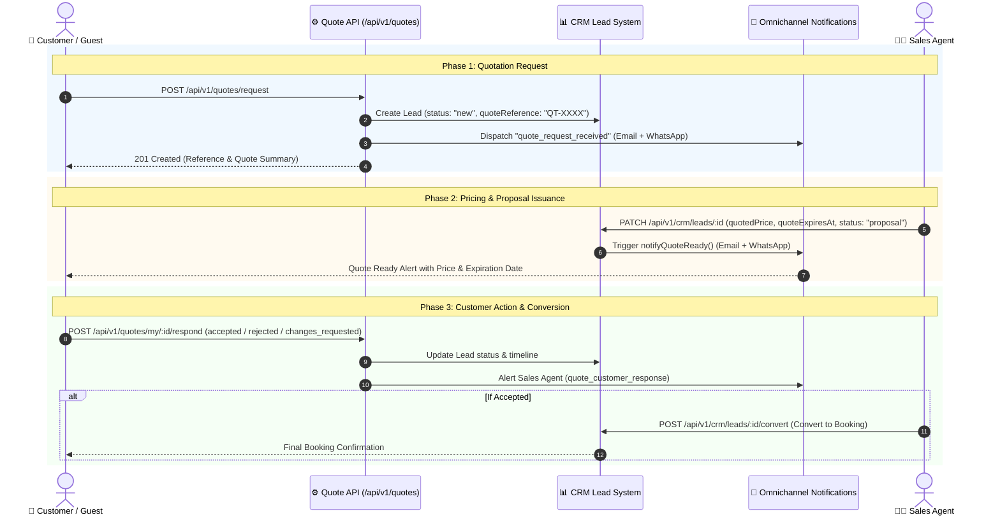

# 📋 Customer Quotation & Proposal System Documentation

> **Module Base Path**: `/api/v1/quotes`  
> **CRM Integration**: Integrates directly with [`Lead`](../../modules/crm/crm.model.js) model & [`NotificationService`](../../modules/notifications/notification.service.js)

---

## 🌟 Overview

The Customer Quotation System provides a complete, seamless experience for travelers to request custom Umrah or Holiday package quotes, track proposal progress in real-time, and respond (Accept / Decline / Request Changes) to issued quotations.

### Key Highlights
- **Guest & Customer Support**: Guests can request quotes and track them using their **Reference Number** (`QT-XXXXXXXX`) and **Phone Number**.
- **Omnichannel Dispatch**: Automatic real-time Email & WhatsApp notifications when a quote request is received, when an agent issues a price, and when a customer responds.
- **Double-Submit Protection**: Built-in 10-minute deduplication window for quote requests with rate limiting.
- **Data Privacy**: Customer-facing endpoints sanitize internal CRM fields (agent notes, priority, internal timeline) while exposing a clean `stage` and timeline.

---

## 🔄 Quotation Lifecycle Diagram



---

## 🚦 Customer Stage Mapping

Internal CRM statuses automatically translate to customer-facing stages:

| Internal CRM `status` | Customer Response | Customer Stage | Description |
|---|---|---|---|
| `new`, `contacted`, `qualified`, `interested` | *None* | `under_review` | Proposal is being calculated by sales team |
| `proposal`, `quoted`, `proposal_sent` | *None* | `quote_ready` | Quotation issued with price and expiration date |
| `proposal`, `quoted`, `proposal_sent` | *Expired* | `expired` | Quotation validity date has passed |
| Any | `accepted` | `accepted` | Traveler accepted quote; agent processing booking |
| `negotiation`, `negotiating` | `changes_requested` | `revision_requested` | Customer asked for customized itinerary/price revision |
| `won`, `converted` | Any | `booked` | Lead converted to confirmed booking |
| `lost` | Any | `closed` | Request closed or declined |

---

## 📡 API Endpoints Summary

| Method | Endpoint | Auth Required | Rate Limit | Description |
|---|---|---|---|---|
| `POST` | `/api/v1/quotes/request` | Optional | 10 / 15m | Request a new travel quotation |
| `POST` | `/api/v1/quotes/track` | Public | 30 / 15m | Track quote status via Reference + Phone |
| `GET` | `/api/v1/quotes/my` | Required | Standard | List logged-in user's quotation requests |
| `GET` | `/api/v1/quotes/my/:id` | Required | Standard | Get detailed view of a single quotation |
| `POST` | `/api/v1/quotes/my/:id/respond` | Required | Standard | Accept, decline, or request changes |

---

## 📝 API Request & Response Specs

### 1. Request a Quotation
`POST /api/v1/quotes/request`

#### Request Body:
```json
{
  "firstName": "Ahmed",
  "lastName": "Farooq",
  "email": "ahmed.farooq@example.com",
  "phone": "+919876543210",
  "destination": "Makkah & Madinah",
  "tripType": "umrah",
  "travelDates": {
    "from": "2026-11-10",
    "to": "2026-11-20"
  },
  "numberOfPeople": 4,
  "budget": 350000,
  "specialRequests": "2 quadruple rooms near Clock Tower, non-stop flights"
}
```

#### Response (`201 Created`):
```json
{
  "success": true,
  "message": "Quotation request submitted successfully. You will receive updates via Email/WhatsApp.",
  "data": {
    "quote": {
      "id": "66f1a2b3c4d5e6f7a8b9c0d1",
      "reference": "QT-F4A9B1C2",
      "stage": "under_review",
      "destination": "Makkah & Madinah",
      "tripType": "umrah",
      "travelDates": {
        "from": "2026-11-10T00:00:00.000Z",
        "to": "2026-11-20T00:00:00.000Z"
      },
      "numberOfPeople": 4,
      "budget": 350000,
      "specialRequests": "2 quadruple rooms near Clock Tower, non-stop flights",
      "quote": null,
      "availableActions": [],
      "customerResponse": null,
      "timeline": [
        {
          "type": "created",
          "title": "Quotation requested",
          "detail": "Customer requested a quotation for Makkah & Madinah (4 traveller(s)). Ref QT-F4A9B1C2.",
          "createdAt": "2026-10-03T15:40:00.000Z"
        }
      ],
      "createdAt": "2026-10-03T15:40:00.000Z",
      "updatedAt": "2026-10-03T15:40:00.000Z"
    }
  }
}
```

---

### 2. Guest Track Quote
`POST /api/v1/quotes/track`

#### Request Body:
```json
{
  "reference": "QT-F4A9B1C2",
  "phone": "+919876543210"
}
```

#### Response (`200 OK`):
```json
{
  "success": true,
  "message": "Quotation status retrieved successfully",
  "data": {
    "quote": {
      "id": "66f1a2b3c4d5e6f7a8b9c0d1",
      "reference": "QT-F4A9B1C2",
      "stage": "quote_ready",
      "destination": "Makkah & Madinah",
      "tripType": "umrah",
      "travelDates": {
        "from": "2026-11-10T00:00:00.000Z",
        "to": "2026-11-20T00:00:00.000Z"
      },
      "numberOfPeople": 4,
      "budget": 350000,
      "specialRequests": "2 quadruple rooms near Clock Tower, non-stop flights",
      "quote": {
        "price": 320000,
        "currency": "INR",
        "expiresAt": "2026-10-10T18:00:00.000Z",
        "isExpired": false
      },
      "availableActions": ["accepted", "rejected", "changes_requested"],
      "customerResponse": null,
      "timeline": [
        {
          "type": "created",
          "title": "Quotation requested",
          "detail": "Customer requested a quotation for Makkah & Madinah (4 traveller(s)). Ref QT-F4A9B1C2.",
          "createdAt": "2026-10-03T15:40:00.000Z"
        }
      ]
    }
  }
}
```

---

### 3. Customer Respond to Quotation
`POST /api/v1/quotes/my/:id/respond`  
*Header: `Authorization: Bearer <accessToken>`*

#### Request Body:
```json
{
  "action": "accepted",
  "note": "Looks great! Please process our booking for quadruple sharing."
}
```

#### Response (`200 OK`):
```json
{
  "success": true,
  "message": "Quotation response (accepted) submitted successfully",
  "data": {
    "quote": {
      "id": "66f1a2b3c4d5e6f7a8b9c0d1",
      "reference": "QT-F4A9B1C2",
      "stage": "accepted",
      "quote": {
        "price": 320000,
        "currency": "INR",
        "expiresAt": "2026-10-10T18:00:00.000Z",
        "isExpired": false
      },
      "availableActions": [],
      "customerResponse": {
        "action": "accepted",
        "note": "Looks great! Please process our booking for quadruple sharing.",
        "respondedAt": "2026-10-03T15:42:00.000Z"
      }
    }
  }
}
```
