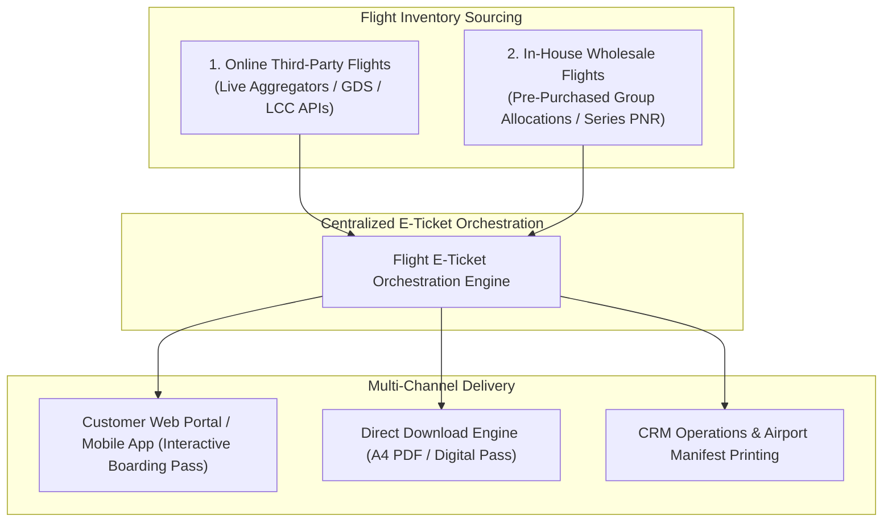
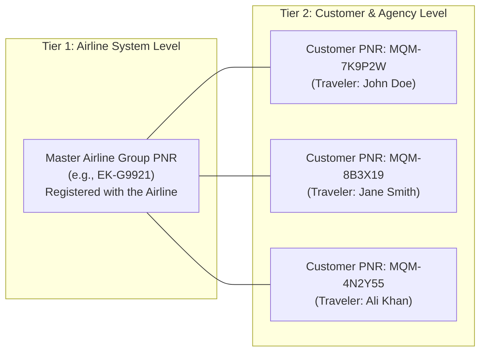
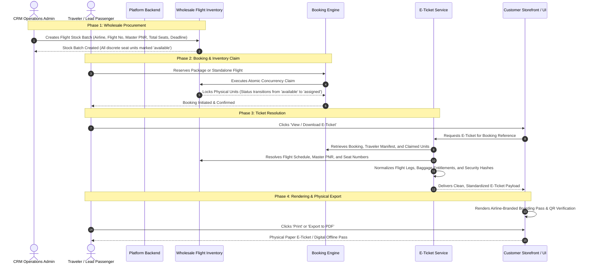
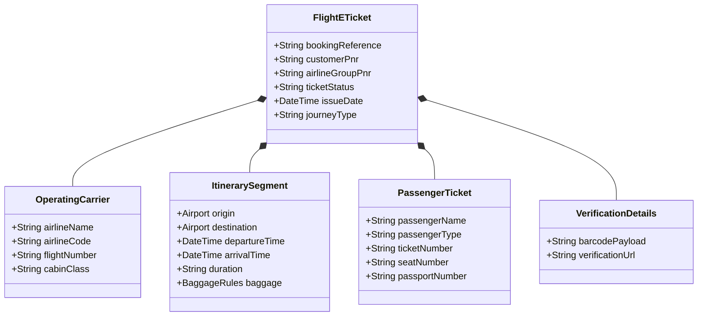

# Flight E-Ticket Architecture & Implementation Guide

> **Document Classification:** Engineering Architecture, Data Flow Specification & System Blueprint  
> **Target Audience:** Backend Engineers, System Architects, CRM Operations, and Frontend Integration Leads  
> **Scope:** Comprehensive, from-scratch explanation of In-House and Online Flight E-Ticketing  
> **Status:** Production Design Reference  

---

## 1. Executive Overview & Foundational Concepts

### What is an Electronic Ticket (E-Ticket)?
In modern civil aviation and the travel industry, an Electronic Ticket (E-Ticket) is not merely a visual receipt or a PDF document. It is a legally recognized, tamper-proof digital record stored within airline reservation databases and travel management engines. It entitles an identified passenger to board a specific flight on a scheduled date, origin, destination, and cabin class.

An E-Ticket serves three simultaneous functions:
1. **Operational Travel Document:** Presented by travelers at airport check-in counters and security gates alongside government-issued identification to obtain physical or digital boarding passes.
2. **Legal Contract of Carriage:** Proves a binding contract between the air carrier, the travel agency, and the passenger, subject to international aviation conventions and domestic civil aviation regulations.
3. **Financial & Accounting Ledger:** Acts as the proof of inventory consumption, linking customer payment to reserved wholesale seat blocks or retail inventory allocations.

---

## 2. The Two Flight Worlds: Online vs. In-House Flights

A core architectural challenge in our platform is managing flights originating from two fundamentally different business models:

### Comparative Analysis of Online vs. In-House Flights

| Dimension | Online Flights (GDS / LCC) | In-House Flights (Wholesale / Packages) |
| :--- | :--- | :--- |
| **Inventory Ownership** | External airlines; seats are queried, held, and purchased in real time via supplier APIs. | Proprietary inventory; agency pre-purchased a bulk block of seats directly from the airline under a master contract. |
| **Ticketing Authority** | Sourced via external ticketing APIs (GDS issuance commands or LCC instant confirmation). | Sourced internally via our inventory engine by assigning passengers to claimed physical stock units. |
| **PNR Structure** | Provided by external systems (Airline PNR and optional GDS PNR). | Dual-PNR Model: Master Airline Group PNR + Unique Customer Booking Locator. |
| **Data Completeness at Checkout** | Supplier returns full flight itineraries, aircraft models, and baggage allowances. | Flight details and airline PNR are stored in the stock record; traveler details are linked via claimed inventory units. |

---

## 3. Dual-PNR Architecture for In-House Flights

### The Problem with Group & In-House Ticketing
When our agency contracts a group block (for example, 50 seats on an Emirates flight between Delhi and Dubai for an Umrah pilgrimage tour), the airline issues **one single shared Group PNR** for the entire batch.

If travelers were only given the shared Group PNR:
1. Traveler A could look up the shared PNR on the airline website and see all other 49 passengers' personal names and details, creating a severe data privacy violation.
2. The agency's customer portal would fail to differentiate individual bookings, making automated customer self-service impossible.

### The Solution: The Dual-PNR Hierarchy
To solve this, our system introduces a two-tiered PNR hierarchy:

1. **Master Airline Group PNR:**
   - Stored in the physical flight stock allotment.
   - Represents the master block registered with the operating carrier.
   - Printed on the e-ticket for airport ground staff and check-in desks.
2. **Customer Booking Locator (In-House PNR):**
   - An algorithmic, collision-resistant 6-character identifier unique to each traveler or booking group.
   - Used by the passenger to log in, view their itinerary, and manage their individual reservation on our customer portal.

---

## 4. End-to-End E-Ticket Lifecycle

The following diagram details the chronological journey of an in-house flight e-ticket from wholesale inventory procurement to passenger boarding:

---

## 5. Architectural Implementation Plan: Step-by-Step

To enable full e-ticket capability for in-house services without disrupting existing databases, the implementation is divided into four distinct architectural layers:

### Layer 1: Data Association & Model Resolution
Currently, package and offer bookings store relationships as independent identifiers. To generate a complete e-ticket, the retrieval layer must resolve and aggregate three interconnected data sources:
1. **The Booking Document:** Provides the booking reference, payment confirmation status, creation timestamp, and assigned operations officer.
2. **The Traveler Manifest:** Resolves each traveler record to extract legal passenger titles, first names, middle names, last names, date of birth, gender, and international travel passport numbers.
3. **The Inventory Stock Allotment:** Cross-references claimed unit identifiers against the flight stock collection to retrieve airline codes, flight numbers, origin and destination airport codes, scheduled departure and arrival timestamps, aircraft cabin class, and the master airline PNR.

### Layer 2: Passenger-to-Seat Unit Mapping
In a bulk flight allocation, physical seats are tracked as discrete subdocuments within the stock collection. The e-ticket engine must:
1. Match the unique unit identifier associated with the booking to the traveler index.
2. Extract the individual ticket number or seat number assigned to that unit.
3. If an individual ticket number has not yet been manually assigned by operations, automatically format the display as confirmed under the master group PNR to ensure ground staff can locate the traveler on the airline manifest.

### Layer 3: Unified Normalization Layer
The frontend should never have to distinguish whether a flight was booked through an external supplier or contracted in-house. The backend must provide a unified normalization layer that produces an identical structure regardless of origin:
* Standardizes airport codes into departure and arrival objects containing city names, airport names, and terminal designators.
* Formats ISO date-time strings into traveler-friendly departure dates, scheduled departure times, arrival dates, and calculated flight durations.
* Unifies baggage rules into cabin allowance and check-in allowance.
* Generates an IATA-compliant Barcoded Boarding Pass (BCBP) data string and a verification URL for digital ticket validation.

### Layer 4: Multi-Channel API Delivery & Download Strategy
To serve web applications, native mobile apps, and automated distribution channels:
1. **Interactive Data Endpoint:** Delivers a comprehensive JSON response consumed by frontend components to render dynamic boarding passes, airline badge graphics, and seat layouts.
2. **File Download Endpoint:** Supports direct browser file downloading by accepting either standard authorization headers or temporary authentication tokens passed via query parameters, setting the appropriate content-disposition response headers.
3. **Public Traveler Lookup Endpoint:** Enables travelers to retrieve their e-ticket on the storefront without logging into an account, authenticated securely by combining their customer PNR and registered last name.

---

## 6. Information Architecture: Mandatory E-Ticket Data Points

An e-ticket must contain all required operational and legal fields to ensure travelers do not experience friction at international check-in desks:

### Data Dictionary

1. **Ticketing & Booking Identifiers:**
   - Agency Booking Reference: Primary internal order identifier.
   - Customer Locator: 6-character alphanumeric reference for customer self-service.
   - Airline Group PNR: Master airline carrier reservation locator.
   - Ticket Status: Current lifecycle state (`CONFIRMED`, `ISSUED`, `CANCELLED`).
   - Issue Timestamp: Exact date and time the reservation was ticketed.
2. **Flight Segment Itinerary:**
   - Airline Branding: Operating carrier commercial name and two-letter IATA code.
   - Flight Identifier: Flight service number.
   - Origin Airport: Three-letter IATA code, municipal city name, and departure terminal.
   - Destination Airport: Three-letter IATA code, municipal city name, and arrival terminal.
   - Flight Schedule: ISO departure date-time and arrival date-time.
   - Cabin Class: Service tier (`Economy`, `Premium Economy`, `Business`, `First`).
   - Allowances: Check-in baggage limit and cabin carry-on limit.
3. **Passenger Manifest:**
   - Full Traveler Name: Formatted matching government passport standards (Title, Given Name, Surname).
   - Passenger Category: Classification (`Adult`, `Child`, `Infant`).
   - Electronic Ticket Number: Dedicated ticket serial number.
   - Seat Allocation: Specific assigned aircraft seat or general counter-assignment status.
   - Identity Verification: Masked passport number for international validation.
4. **Airport Operational Advisories:**
   - Reporting Requirements: Mandatory airport arrival advisory (3 hours prior for international, 2 hours for domestic).
   - Documentation Notice: Requirement for original passport with minimum 6-month validity.
   - Baggage Limitations: Dangerous goods regulations and weight enforcement policies.

---

## 7. Security, Access Control & Data Governance

### 1. Multi-Tenant Role-Based Isolation
* **Authenticated Customers:** A customer can only access e-tickets where their user account matches the booking's owning user identifier. Attempting to query an e-ticket belonging to another traveler returns an HTTP 403 Forbidden error.
* **Operations & Administrative Agents:** Support agents and operations officers with appropriate administrative roles have authorized clearance to view and generate e-tickets across all customer bookings to assist with airport support and re-issuance.

### 2. Secure Public Ticket Verification
When travelers or airport staff need to verify an e-ticket without active platform session credentials:
* The lookup requires two matching factors: the 6-character Customer PNR and the traveler's legal last name.
* Rate limiting is enforced on lookup endpoints to prevent brute-force discovery of booking locators.
* Sensitive payment information (such as internal net wholesale margins, credit card transaction hashes, and bank settlement details) is permanently stripped from the e-ticket response.

### 3. State-Locked Immutability
* E-tickets can only be generated for bookings in a confirmed or ticketed status.
* Bookings in an initiated, pending payment, or cancelled state reject e-ticket generation requests with an appropriate state error, ensuring unconfirmed itineraries or cancelled travel vouchers cannot be circulated.

---

## 8. Summary of Implementation Work Required

To realize this architecture in the platform, the following three core modules are to be constructed:

1. **In-House Stock Resolver Module:** Enriches booking queries by populating traveler identities from the traveler registry and resolving wholesale flight stock data (carrier, flight number, master PNR, and seat numbers) from claimed inventory units.
2. **Unified E-Ticket Data Normalizer:** Merges online supplier responses and in-house wholesale records into the standardized operational schema, establishing deterministic customer PNRs and generating digital verification barcodes.
3. **Delivery & Export Routing Engine:** Implements the customer-facing data retrieval route, direct file download stream, and public PNR lookup endpoint, adhering to multi-tenant security and state-locked immutability rules.
