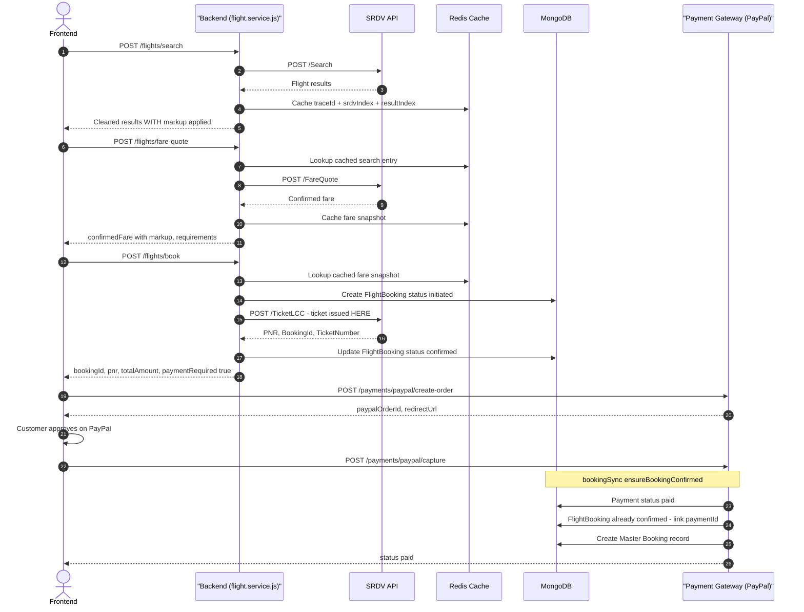
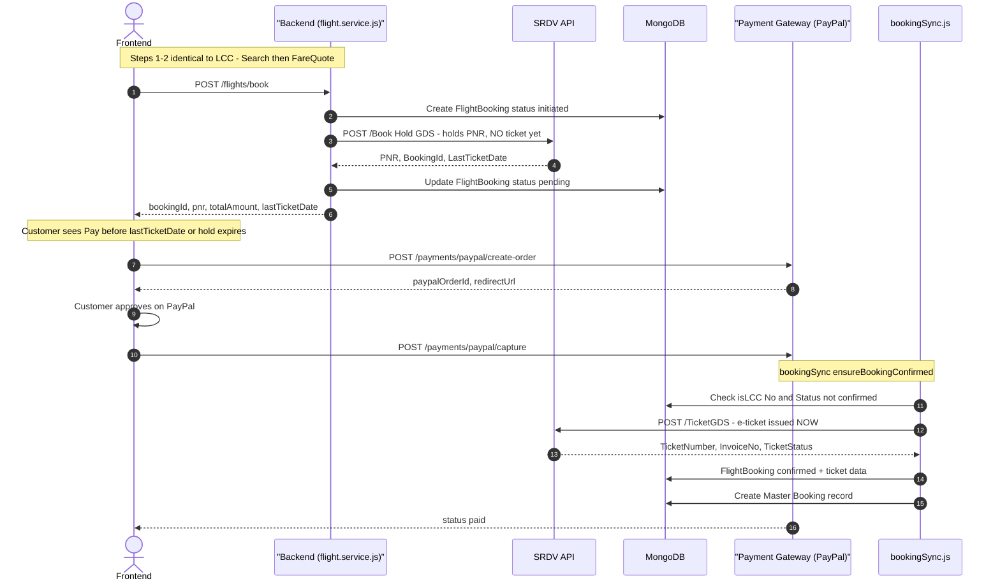
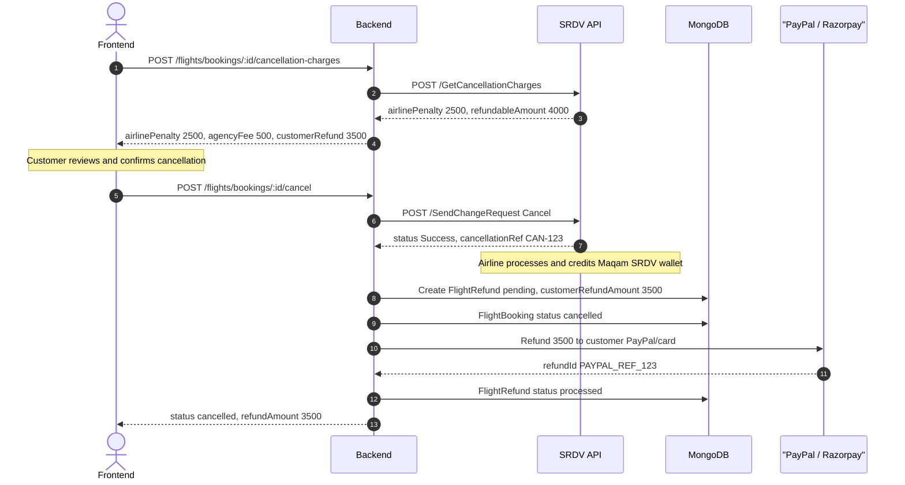

# Flight Module — Complete Architecture & Status

> This document maps the entire flight module: what's built, what's missing, which SRDV APIs exist, how payment connects, and the exact order of API calls between Frontend, Backend, SRDV, and the Payment Gateway.

---

## 1. SRDV Flight APIs — Full Inventory

| # | SRDV API Endpoint | Direction | Purpose | Status |
|---|---|---|---|---|
| 1 | `POST /Search` | You → SRDV | Search available flights | ✅ Built ([srdv.client.js](file:///d:/Arun-Shaw/TravelAgency/server/providers/srdv/srdv.client.js), [srdv.adapter.js](file:///d:/Arun-Shaw/TravelAgency/server/providers/srdv/srdv.adapter.js)) |
| 2 | `POST /FareQuote` | You → SRDV | Lock live price, check passport/GST requirements | ✅ Built |
| 3 | `POST /SSR` | You → SRDV | Fetch available meals, baggage, and seat options | ✅ Built |
| 4 | `POST /SeatMap` | You → SRDV | Fetch seat layout for selection | ✅ Built |
| 5 | `POST /TicketLCC` | You → SRDV | Book + issue ticket instantly (LCC airlines) | ✅ Built |
| 6 | `POST /Book` (Hold GDS) | You → SRDV | Create PNR hold without ticketing (GDS airlines) | ✅ Built |
| 7 | `POST /TicketGDS` | You → SRDV | Issue e-ticket on held PNR after payment | ✅ Built |
| 8 | `POST /GetCalendarFare` | You → SRDV | Get fare calendar for flexible date search | ✅ Built |
| 9 | `POST /flight_callback` | SRDV → You | Webhook: SRDV pushes final booking status | ❌ **Not Built** |
| 10 | `POST /GetCancellationCharges` | You → SRDV | Query airline penalty before cancelling | ❌ **Not Built** |
| 11 | `POST /SendChangeRequest` | You → SRDV | Submit actual cancellation request | ❌ **Not Built** |
| 12 | `POST /GetBookingDetail` | You → SRDV | Poll/reconcile a booking's current supplier status | ❌ **Not Built** |

---

## 2. How Payment APIs Connect to Flight APIs

> **Key insight:** The payment APIs (`/api/v1/payments/paypal/*`) are **generic** — they work for flights, hotels, packages, and offers. The Frontend calls them **after** calling the flight-specific `/api/v1/flights/book` endpoint.

### The Two API Families

```
┌─────────────────────────────────────────────────────────────────────┐
│ FLIGHT APIs (/api/v1/flights/*)                                     │
│   POST /search         → Returns flight options + traceId           │
│   POST /fare-quote     → Returns confirmed price + requirements     │
│   POST /ssr            → Returns meals/baggage options              │
│   POST /seat-map       → Returns seat layout                        │
│   POST /book           → Creates FlightBooking + calls SRDV         │
│                           Returns: { bookingId, totalAmount,        │
│                                      paymentRequired: true }        │
└─────────────────────────┬───────────────────────────────────────────┘
                          │
                          │  Frontend takes bookingId
                          │  and calls the payment API ↓
                          │
┌─────────────────────────▼───────────────────────────────────────────┐
│ PAYMENT APIs (/api/v1/payments/*)                                   │
│   POST /paypal/create-order  → { bookingId, bookingType: "flight" } │
│   POST /paypal/capture       → { orderId }                          │
│   POST /razorpay/create-order → { bookingId, bookingType: "flight" }│
│   POST /razorpay/verify       → { orderId, paymentId, signature }   │
└─────────────────────────────────────────────────────────────────────┘
```

The payment service uses [bookingResolver.js](file:///d:/Arun-Shaw/TravelAgency/server/modules/payments/bookingResolver.js) to dynamically resolve any booking type (`flight`, `hotel`, `package`, `offer`) by its `bookingId`.

---

## 3. Complete Flow — LCC Flight (IndiGo, SpiceJet)

LCC = **Ticket is issued instantly** at booking time, before payment.



> **Notice:** For LCC, the ticket is issued **before payment**. The payment is collected after. If payment fails, the ticket is already issued and Maqam absorbs the risk. This is how all Indian OTAs work with LCC carriers.

---

## 4. Complete Flow — GDS Flight (Air India, Emirates)

GDS = **PNR is held first**, ticket issued only **after payment**.



> **Key difference:** For GDS, the call to `POST /TicketGDS` happens **inside** `bookingSync.js` after payment capture — NOT by the frontend. See [bookingSync.js:L163-L176](file:///d:/Arun-Shaw/TravelAgency/server/modules/payments/bookingSync.js#L163-L176).

---

## 5. Where Each Piece Lives in Code

### Flight Service Layer
| Method | File | What it does |
|---|---|---|
| `searchFlightsService` | [flight.service.js:L22](file:///d:/Arun-Shaw/TravelAgency/server/modules/flights/flight.service.js#L22) | Calls SRDV Search, caches results, applies markup, groups by flight |
| `getFareQuoteService` | [flight.service.js:L128](file:///d:/Arun-Shaw/TravelAgency/server/modules/flights/flight.service.js#L128) | Calls SRDV FareQuote, caches fare snapshot, applies markup |
| `bookFlightService` | [flight.service.js:L238](file:///d:/Arun-Shaw/TravelAgency/server/modules/flights/flight.service.js#L238) | Creates FlightBooking, calls TicketLCC or HoldGDS, saves result |
| `ticketGDSAfterPayment` | [flight.service.js:L443](file:///d:/Arun-Shaw/TravelAgency/server/modules/flights/flight.service.js#L443) | Called by bookingSync after payment capture for GDS flights |
| `getSeatMapService` | [flight.service.js:L549](file:///d:/Arun-Shaw/TravelAgency/server/modules/flights/flight.service.js#L549) | Fetches seat layout from SRDV |
| `getSsrService` | [flight.service.js:L568](file:///d:/Arun-Shaw/TravelAgency/server/modules/flights/flight.service.js#L568) | Fetches meal/baggage options from SRDV |

### Payment Integration Layer
| Method | File | What it does |
|---|---|---|
| `ensureBookingConfirmed` | [bookingSync.js:L145](file:///d:/Arun-Shaw/TravelAgency/server/modules/payments/bookingSync.js#L145) | Dispatches to correct module after payment capture |
| Flight-specific branch | [bookingSync.js:L163-L176](file:///d:/Arun-Shaw/TravelAgency/server/modules/payments/bookingSync.js#L163-L176) | If GDS and not confirmed → calls `ticketGDSAfterPayment`. If LCC → just links paymentId |
| `resolveBooking` | [bookingResolver.js](file:///d:/Arun-Shaw/TravelAgency/server/modules/payments/bookingResolver.js) | Maps `bookingType: "flight"` → `FlightBooking` model |

### SRDV Provider Layer
| Method | File | SRDV Endpoint |
|---|---|---|
| `searchFlights` | [srdv.client.js](file:///d:/Arun-Shaw/TravelAgency/server/providers/srdv/srdv.client.js) | `POST /Search` |
| `fareQuote` | srdv.client.js | `POST /FareQuote` |
| `ticketLCC` | srdv.client.js | `POST /TicketLCC` |
| `holdGDS` | srdv.client.js | `POST /Book` |
| `ticketGDS` | srdv.client.js | `POST /TicketGDS` |
| `seatMap` | srdv.client.js | `POST /SeatMap` |
| `ssr` | srdv.client.js | `POST /SSR` |
| `getCalendarFare` | srdv.client.js | `POST /GetCalendarFare` |

---

## 6. What's Missing — Needs to Be Built

### 1. Flight Callback Webhook (`/webhooks/srdv/callback`)
- **SRDV API:** `POST /flight_callback` — SRDV pushes to YOUR endpoint.
- **Purpose:** Receives async status updates when TicketLCC/HoldGDS comes back `Pending` initially. Delivers final `Success` / `Failed` / `Aborted` status + ticket numbers.
- **Spec:** Documented in [srdv-flights-api-reference:L321-L381](file:///d:/Arun-Shaw/TravelAgency/server/srdv-flights-api-reference%20(4).md).
- **Requires:** ngrok tunnel for local testing; configure your callback URL in SRDV dashboard.

### 2. Get Cancellation Charges (`/GetCancellationCharges`)
- **SRDV API:** `POST /GetCancellationCharges`
- **Purpose:** Before actually cancelling, query SRDV to find out the airline penalty amount.
- **Used by:** The cancellation flow — show the customer "Airline Penalty: ₹2,500, You'll receive: ₹3,500" before they confirm.

### 3. Send Change Request / Cancel (`/SendChangeRequest`)
- **SRDV API:** `POST /SendChangeRequest`
- **Purpose:** Submit the actual cancellation to the airline via SRDV. SRDV processes it and credits the refund to your SRDV wallet.
- **Used by:** After customer confirms cancellation, this triggers the supplier-side cancel.

### 4. Get Booking Detail (`/GetBookingDetail`)
- **SRDV API:** `POST /GetBookingDetail`
- **Purpose:** Poll/reconcile a booking's current status from SRDV's side.
- **Used by:** Safety net poller if the webhook doesn't arrive; admin reconciliation tools.

### 5. Flight Refund Model (`FlightRefund`)
- **Purpose:** Track the financial breakdown of every cancellation: `totalBookingAmount`, `airlinePenalty`, `agencyFee` (= `markupAmount`, non-refundable), and `customerRefundAmount`.
- **Triggers:** Gateway refund to customer's PayPal/card after SRDV confirms wallet credit.

### 6. GDS Ticketing BullMQ Worker
- **Purpose:** Currently `ticketGDSAfterPayment` is called synchronously inside the payment capture request. If SRDV is slow (10-20s), the customer's browser times out.
- **Fix:** Move to an async BullMQ worker with retry, exactly like [hotel-book.worker.js](file:///d:/Arun-Shaw/TravelAgency/server/workers/hotels/hotel-book.worker.js).

---

## 7. Markup Flow — How It's Applied

Markup is applied at **3 stages** and persisted on the `FlightBooking` document:

```
Stage 1: Search (line 63)
  const markupPercent = 10;  ← HARDCODED (should be env var)
  totalAmount = OfferedFare × (1 + markup/100)
  → Sent to frontend as the displayed price

Stage 2: FareQuote (line 205)
  Same formula, but on the LIVE confirmed fare from SRDV
  → Sent to frontend as "confirmedFare"

Stage 3: Booking (line 273)
  baseTicketAmount = OfferedFare × (1 + markup/100)
  totalAmount = baseTicketAmount + ancillaries (meals/bags/seats)
  markupAmount = totalAmount - OfferedFare
  → Both saved on FlightBooking document
  → markupAmount = agency's non-refundable fee on cancellation
```

---

## 8. Cancellation Flow — How It Should Work (To Be Built)


