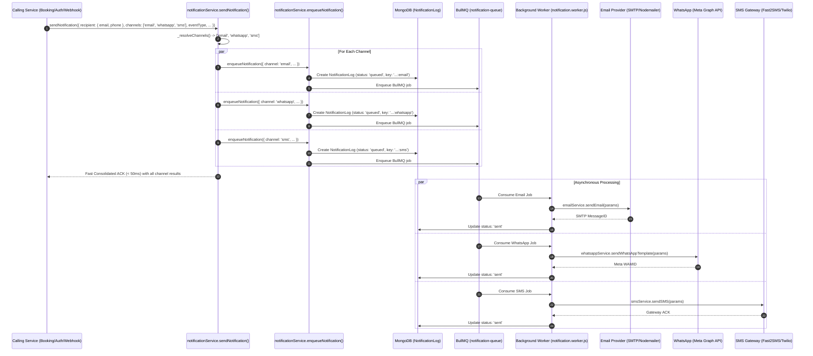

# Notifications Module - Architecture & Implementation Guide

> **Module Path**: `modules/notifications`  
> **Platform**: MaqamTravels Backend Engine  
> **Channels Supported**: Email, SMS, WhatsApp, Push, In-App Notification Outbox  
> **Queue Engine**: BullMQ / Redis  

---

## 📌 Table of Contents

1. [Module Overview](#1-module-overview)
2. [Folder & File Scan Summary](#2-folder--file-scan-summary)
3. [System Architecture & Flow](#3-system-architecture--flow)
   - [3.1 Single-Function Omnichannel Architecture](#31-single-function-omnichannel-architecture)
   - [3.2 High-Level Architecture Sequence](#32-high-level-architecture-sequence)
   - [3.3 Step-by-Step Function Call Flow Diagram](#33-step-by-step-function-call-flow-diagram)
   - [3.4 End-to-End Function Call Execution Breakdown](#34-end-to-end-function-call-execution-breakdown)
4. [Component Specifications](#4-component-specifications)
   - [4.1 Notification Data Model (`notification.model.js`)](#41-notification-data-model-notificationmodeljs)
   - [4.2 Unified Notification Service (`notification.service.js`)](#42-unified-notification-service-notificationservicejs)
   - [4.3 Email Sub-service (`email/emailService.js`)](#43-email-sub-service-emailemailservicejs)
   - [4.4 SMS Sub-service (`sms/smsService.js`)](#44-sms-sub-service-smssmsservicejs)
   - [4.5 WhatsApp Sub-service (`whatsapp/whatsapp.service.js`)](#45-whatsapp-sub-service-whatsappwhatsappservicejs)
5. [Where and How to Use This in Your Application](#5-where-and-how-to-use-this-in-your-application)
   - [5.1 User Authentication & OTP Dispatch (`modules/auth/auth.service.js`)](#51-user-authentication--otp-dispatch-modulesauthauthservicejs)
   - [5.2 In-House Packages & Offers Booking Confirmation (`modules/payments/bookingSync.js`)](#52-in-house-packages--offers-booking-confirmation-modulespaymentsbookingsyncjs)
   - [5.3 Live GDS Flight Ticketing (`workers/flights/flight-ticket-gds.worker.js`)](#53-live-gds-flight-ticketing-workersflightsflight-ticket-gdsworkerjs)
   - [5.4 Live Hotel Supplier Confirmation (`workers/hotels/hotel-book.worker.js`)](#54-live-hotel-supplier-confirmation-workershotelshotel-bookworkerjs)
   - [5.5 Visa Application Status Updates (`modules/visa/`)](#55-visa-application-status-updates-modulesvisa)
   - [5.6 Payment Gateway Failure & Refund Alerts (`webhook/` & `modules/payments/gateways/`)](#56-payment-gateway-failure--refund-alerts-webhook--modulespaymentsgateways)
   - [5.7 CRM Operations Desk: Agent Manual Resend (`modules/bookings/crm/bookingCrm.routes.js`)](#57-crm-operations-desk-agent-manual-resend-modulesbookingscrmbookingcrmroutesjs)
6. [Supported Notification Events & Templates](#6-supported-notification-events--templates)
7. [Queue, Idempotency & Retry Architecture](#7-queue-idempotency--retry-architecture)
8. [Environment Variables & Configuration](#8-environment-variables--configuration)
9. [Developer Implementation Roadmap](#9-developer-implementation-roadmap)

---

## 1. Module Overview

The **Notifications Module** is the centralized messaging, alerting, and transactional communication hub of the **MaqamTravels** platform. It handles omnichannel user engagement across travel booking lifecycles, payment states, authentication events, and administrative alerts.

### Core Objectives:
* **Decoupled Asynchronous Dispatch:** Decouples core checkout, booking, and webhook flows from third-party communication latency (SMTP, SendGrid, Meta WhatsApp Cloud API, Twilio, Fast2SMS). API responses return immediately in `<100ms`.
* **Guaranteed Delivery & Idempotency:** Implements deduplication keys to guarantee that guests are never spammed or double-messaged with duplicate confirmation alerts when webhooks or workers retry.
* **Auditability & Compliance:** Persists a transactional audit log (`NotificationLog`) tracking delivery status, provider message IDs, timestamps, and failure reasons.
* **Omnichannel Orchestration:** Intelligently combines channels:
  - **Email:** Rich HTML booking vouchers, itineraries, and attached PDF invoices/tickets.
  - **WhatsApp:** High-conversion mobile alerts, PDF attachment cards, and instant PNR updates via Meta WhatsApp Cloud API.
  - **SMS:** High-urgency, low-latency OTP verification and immediate plain-text payment alerts.
* **Multi-Provider Resilience:** Supports primary and fallback transport channels (e.g., Fast2SMS DLT for domestic Indian users, Twilio for international Umrah travelers in Saudi Arabia/UAE, and Meta Cloud API for global WhatsApp).

---

## 2. Folder & File Scan Summary

The notifications directory is organized with dedicated sub-services per channel:

```
modules/notifications/
│
├── email/
│   └── emailService.js         # Dedicated Email transport layer (SMTP / SendGrid / SES + PDF attachments)
│
├── sms/
│   └── smsService.js           # Regional SMS gateway layer (Fast2SMS DLT for India + Twilio for International)
│
├── whatsapp/
│   └── whatsapp.service.js     # Meta WhatsApp Cloud API (Graph API) + Twilio WhatsApp fallback
│
├── notification.model.js       # Mongoose Schema for delivery tracking & audit logs
├── notification.service.js     # Unified facade routing events to appropriate channels & queues
└── NOTIFICATIONS_DOCUMENTATION.md # Architectural and implementation reference
```

### Scan Inspection Details:

| File / Folder | Type | Current State | Target Role |
| :--- | :--- | :--- | :--- |
| `email/emailService.js` | JavaScript | **Implemented** | Transports emails via Nodemailer connection pool with support for HTML templates, PDF vouchers, and tax invoices. |
| `sms/smsService.js` | JavaScript | **Implemented** | Delivers transactional SMS messages and mobile OTP dispatch with Fast2SMS (India DLT) and Twilio (International). |
| `whatsapp/whatsapp.service.js` | JavaScript | **Implemented** | Sends official Meta HSM templates, booking status alerts, and streams PDF documents over WhatsApp Graph API. |
| `notification.model.js` | JavaScript | **Implemented** | Persists `NotificationLog` documents tracking delivery status, recipients, payload, channel, and retries. |
| `notification.service.js` | JavaScript | **Implemented** | Central unified dispatcher (`sendNotification`) invoked across the platform to enqueue omnichannel alerts into BullMQ. |
| `workers/notifications/notification.worker.js` | JavaScript | **Implemented** | Background BullMQ worker daemon registered in `workers/index.js` processing notification dispatch jobs. |

---

## 3. System Architecture & Flow

### 3.1 Single-Function Omnichannel Architecture

The notifications engine is built on a **Single-Function Calling Paradigm**:
Any service, controller, or webhook across the platform invokes **one single function** (`notificationService.sendNotification`). The caller does not need to worry about the underlying differences between email, SMS, and WhatsApp:

1. **Single Entry Call**: The caller passes recipient contact data (`email`, `phone`), event details, and optionally targeted channels (e.g. `['email', 'whatsapp', 'sms']` or defaults to all applicable channels).
2. **Internal Orchestration**: The single function evaluates recipient capabilities, resolves the channels, and fans out calls to each specific channel dispatch function.
3. **Non-Blocking Dispatch**: The single function writes immutable audit records to MongoDB and schedules background BullMQ jobs, returning a consolidated `< 50ms` acknowledgment to the caller.
4. **Channel Execution**: Dedicated background workers consume the jobs and execute the underlying channel functions (`emailService.sendEmail`, `whatsappService.sendWhatsAppTemplate`, and `smsService.sendSMS`).

---

### 3.2 High-Level Architecture Sequence



---

### 3.3 Step-by-Step Function Call Flow Diagram

The flowchart below traces **exactly how a single function call triggers the downstream channel functions step by step**:

```mermaid
flowchart TD
    %% ─────────────────────────────────────────────────────────────
    %% STYLES & DEFINITIONS
    %% ─────────────────────────────────────────────────────────────
    classDef caller fill:#e1f5fe,stroke:#0288d1,stroke-width:2px,color:#01579b
    classDef singleFunc fill:#fff3e0,stroke:#f57c00,stroke-width:2.5px,color:#e65100
    classDef core fill:#e8f5e9,stroke:#388e3c,stroke-width:1.5px,color:#1b5e20
    classDef queue fill:#f3e5f5,stroke:#7b1fa2,stroke-width:1.5px,color:#4a148c
    classDef worker fill:#fbe9e7,stroke:#d84315,stroke-width:1.5px,color:#bf360c
    classDef channel fill:#ede7f6,stroke:#512da8,stroke-width:2px,color:#311b92
    classDef provider fill:#e0f2f1,stroke:#00695c,stroke-width:1.5px,color:#004d40
    classDef decision fill:#fff9c4,stroke:#fbc02d,stroke-width:1.5px,color:#f57f17

    %% ─────────────────────────────────────────────────────────────
    %% STEP 1: SINGLE FUNCTION INVOCATION
    %% ─────────────────────────────────────────────────────────────
    subgraph Step1["Step 1: Caller Layer (One Single Function Call)"]
        APP_CALLER["Caller (Checkout / Auth / Webhooks / CRM)"]:::caller
        APP_CALLER -->|"1. Single Call: sendNotification({ recipient, channels, eventType, ... })"| SINGLE_FN
    end

    %% ─────────────────────────────────────────────────────────────
    %% STEP 2: CHANNEL RESOLUTION & FAN-OUT
    %% ─────────────────────────────────────────────────────────────
    subgraph Step2["Step 2: Single Function Orchestrator (notification.service.js)"]
        SINGLE_FN["<b>notificationService.sendNotification(options)</b><br/><i>Single Unified Entry Point</i>"]:::singleFunc

        SINGLE_FN --> RESOLVE["2.1 _resolveChannels(channels, recipient)<br/>(Validates email/phone availability)"]:::singleFunc
        RESOLVE --> FAN_OUT["2.2 Promise.allSettled()<br/>Dispatches concurrent calls to each channel:"]:::singleFunc

        FAN_OUT -->|"Channel: 'email'"| ENQ_EMAIL["2.3 enqueueNotification({ channel: 'email', ... })"]:::core
        FAN_OUT -->|"Channel: 'whatsapp'"| ENQ_WA["2.3 enqueueNotification({ channel: 'whatsapp', ... })"]:::core
        FAN_OUT -->|"Channel: 'sms'"| ENQ_SMS["2.3 enqueueNotification({ channel: 'sms', ... })"]:::core

        ENQ_EMAIL --> DUP_CHECK{"Idempotency check"}:::decision
        ENQ_WA --> DUP_CHECK
        ENQ_SMS --> DUP_CHECK

        DUP_CHECK -- "Not duplicate" --> CREATE_LOG["2.4 NotificationLog.create({ channel, status: 'queued', ... })"]:::core
        DUP_CHECK -- "Duplicate" --> RETURN_EXISTING["Return existing log"]:::core

        CREATE_LOG --> GET_QUEUE["2.5 getNotificationQueue()"]:::queue
        GET_QUEUE --> QUEUE_AVAIL{"Redis Available?"}:::decision
        QUEUE_AVAIL -- "Yes" --> ADD_JOB["2.6 queue.add('send-notification', { logId }, { jobId, attempts: 3, backoff })"]:::queue
        QUEUE_AVAIL -- "No (Dev fallback)" --> FALLBACK_TIMEOUT["2.6b setTimeout(() => processNotificationJob(logId), 50)"]:::worker

        ADD_JOB --> FAST_ACK["2.7 Fast ACK returned to Caller in < 50ms<br/>{ success: true, dispatchedChannels: [...] }"]:::caller
        FALLBACK_TIMEOUT --> FAST_ACK
    end

    %% ─────────────────────────────────────────────────────────────
    %% STEP 3: BULLMQ WORKER JOB INGESTION
    %% ─────────────────────────────────────────────────────────────
    subgraph Step3["Step 3: Background Worker Processing (notification.worker.js)"]
        ADD_JOB -.->|"BullMQ Redis Job Consumer"| WORKER_PICK["3.1 Worker receives job"]:::worker
        FALLBACK_TIMEOUT -.->|"Timer Trigger"| WORKER_PICK

        WORKER_PICK --> CALL_PROC["3.2 processNotificationJob(logId)"]:::worker
        CALL_PROC --> FIND_LOG["3.3 NotificationLog.findById(logId)"]:::worker

        FIND_LOG --> LOG_GUARD{"Record found AND status != 'sent'?"}:::decision
        LOG_GUARD -- "No" --> ABORT_DUPLICATE["Abort early (Avoid duplicate sending)"]:::worker
        LOG_GUARD -- "Yes" --> SET_PROCESSING["3.4 record.status = 'processing'<br/>record.attempts += 1<br/>await record.save()"]:::worker

        SET_PROCESSING --> CHANNEL_ROUTER{"3.5 Branch by record.channel"}:::decision
    end

    %% ─────────────────────────────────────────────────────────────
    %% STEP 4: DOWNSTREAM CHANNEL FUNCTION CALLS
    %% ─────────────────────────────────────────────────────────────
    subgraph Step4["Step 4: Downstream Channel Function Execution"]
        %% Branch A: Email Function Call
        CHANNEL_ROUTER -- "'email'" --> CALL_EMAIL["<b>4.A.1 emailService.sendEmail(params)</b>"]:::channel
        CALL_EMAIL --> GET_TRANS["4.A.2 getTransporter() (Nodemailer Pool)"]:::channel
        GET_TRANS --> CHECK_MEDIA_EMAIL{"mediaUrl provided?"}:::decision
        CHECK_MEDIA_EMAIL -- "Yes" --> FETCH_PDF["4.A.3 axios.get(mediaUrl, { responseType: 'arraybuffer' })"]:::channel
        CHECK_MEDIA_EMAIL -- "No" --> SEND_MAIL["4.A.4 mailer.sendMail(mailOptions)"]:::provider
        FETCH_PDF -->|"Attach PDF Buffer"| SEND_MAIL
        SEND_MAIL --> RET_EMAIL["return { success: true, provider: 'nodemailer', messageId }"]:::channel

        %% Branch B: WhatsApp Function Call
        CHANNEL_ROUTER -- "'whatsapp'" --> CALL_WA["<b>4.B.1 whatsappService.sendWhatsAppTemplate(params)</b>"]:::channel
        CALL_WA --> CLEAN_PHONE["4.B.2 Normalize phone digits"]:::channel
        CLEAN_PHONE --> BUILD_WA_PAYLOAD["4.B.3 Construct Meta Graph API JSON<br/>(Header document link + Body parameters)"]:::channel
        BUILD_WA_PAYLOAD --> POST_GRAPH["4.B.4 axios.post(Graph API v19.0, payload, headers)"]:::provider
        POST_GRAPH --> RET_WA["return { success: true, provider: 'meta_whatsapp', messageId }"]:::channel

        %% Branch C: SMS Function Call
        CHANNEL_ROUTER -- "'sms'" --> CALL_SMS["<b>4.C.1 smsService.sendSMS(params)</b>"]:::channel
        CALL_SMS --> PARSE_PHONE["4.C.2 parsePhoneNumber(phone)"]:::channel
        PARSE_PHONE --> CHECK_REGION{"isIndian (+91)?"}:::decision
        CHECK_REGION -- "Yes (India)" --> FAST2SMS["4.C.3 fast2smsService.sendOtpSMS(mobile10Digits, variables)"]:::provider
        CHECK_REGION -- "No (International)" --> TWILIO_POST["4.C.4 axios.post(Twilio Messages API, params, auth)"]:::provider
        FAST2SMS --> RET_SMS["return { success: true, provider, messageId }"]:::channel
        TWILIO_POST --> RET_SMS
    end

    %% ─────────────────────────────────────────────────────────────
    %% STEP 5: STATUS FINALIZATION & AUDIT
    %% ─────────────────────────────────────────────────────────────
    subgraph Step5["Step 5: Audit Log Finalization & Resilience"]
        RET_EMAIL --> MARK_SENT["5.1 record.status = 'sent'<br/>record.provider = { name, messageId, response }<br/>await record.save()"]:::core
        RET_WA --> MARK_SENT
        RET_SMS --> MARK_SENT

        CALL_EMAIL -.->|"On Exception"| CATCH_ERR["5.2 catch (err)"]:::worker
        CALL_WA -.->|"On Exception"| CATCH_ERR
        CALL_SMS -.->|"On Exception"| CATCH_ERR

        CATCH_ERR --> EVAL_ATTEMPTS{"record.attempts >= 3?"}:::decision
        EVAL_ATTEMPTS -- "Yes (Exhausted)" --> STATUS_FAIL["record.status = 'failed'"]:::core
        EVAL_ATTEMPTS -- "No (Retryable)" --> STATUS_QUEUED["record.status = 'queued'"]:::core

        STATUS_FAIL --> SAVE_ERR["5.3 record.lastError = err.message<br/>await record.save()<br/>throw err"]:::core
        STATUS_QUEUED --> SAVE_ERR
        SAVE_ERR -.->|"Trigger BullMQ Retry"| BULLMQ_RETRY["5.4 BullMQ Exponential Backoff (4000ms delay)"]:::queue
    end
```



---

### 3.4 End-to-End Function Call Execution Breakdown

The entire notification lifecycle maps from a single trigger call down to provider delivery:

| Step | Function Invoked | Location | Arguments Received | Action / Returned Result |
| :--- | :--- | :--- | :--- | :--- |
| **1.0** | `notificationService.sendNotification(options)` | [notification.service.js](file:///d:/Debanjan/joydeb_folder/MaqamTravelsAlpha/modules/notifications/notification.service.js) | `{ userId, recipient: { email, phone }, channels, eventType, subject, templateName, variables, messageText, mediaUrl, idempotencyKey }` | **Single function called by customer/caller.** Auto-detects channels, executes multi-channel dispatch, returns consolidated ACK. |
| **2.1** | `notificationService._resolveChannels(channels, recipient)` | [notification.service.js](file:///d:/Debanjan/joydeb_folder/MaqamTravelsAlpha/modules/notifications/notification.service.js) | `channels, recipient` | Inspects recipient object; filters only valid channels (requires `email` for email, `phone` for whatsapp/sms). |
| **2.2** | `notificationService.enqueueNotification(params)` | [notification.service.js](file:///d:/Debanjan/joydeb_folder/MaqamTravelsAlpha/modules/notifications/notification.service.js) | `{ channel, eventType, recipientEmail, recipientPhone, ... }` | Invoked concurrently for each target channel with namespaced key (`${idempotencyKey}:${channel}`). |
| **2.3** | `NotificationLog.findOne({ idempotencyKey })` | [notification.model.js](file:///d:/Debanjan/joydeb_folder/MaqamTravelsAlpha/modules/notifications/notification.model.js) | `{ idempotencyKey }` | Checks whether this channel's message was already queued or sent to prevent double dispatch. |
| **2.4** | `NotificationLog.create(docData)` | [notification.model.js](file:///d:/Debanjan/joydeb_folder/MaqamTravelsAlpha/modules/notifications/notification.model.js) | Object with `status: 'queued'` | Creates MongoDB audit document tracking the pending transmission. |
| **2.5** | `queue.add('send-notification', { logId }, opts)` | `workers/notifications/notification.worker.js` | `{ logId: logDoc._id }, { jobId, attempts: 3, backoff }` | Pushes job to BullMQ Redis stream with exponential backoff (`delay: 4000ms`). Immediate ACK returned. |
| **3.1** | `processNotificationJob(logId)` | `workers/notifications/notification.worker.js` | `logId: ObjectId` | Consumer function picked up by BullMQ worker daemon (concurrency: 5). |
| **3.2** | `NotificationLog.findById(logId)` | [notification.model.js](file:///d:/Debanjan/joydeb_folder/MaqamTravelsAlpha/modules/notifications/notification.model.js) | `logId` | Fetches record; verifies `status !== 'sent'` before updating `status = 'processing'`. |
| **4.A** | `emailService.sendEmail(params)` | [emailService.js](file:///d:/Debanjan/joydeb_folder/MaqamTravelsAlpha/modules/notifications/email/emailService.js) | `{ to, subject, htmlBody, mediaUrl }` | Called if `record.channel === 'email'`. Fetches remote PDF buffer if `mediaUrl` exists, dispatches via Nodemailer connection pool. |
| **4.B** | `whatsappService.sendWhatsAppTemplate(params)` | [whatsapp.service.js](file:///d:/Debanjan/joydeb_folder/MaqamTravelsAlpha/modules/notifications/whatsapp/whatsapp.service.js) | `{ to, templateName, languageCode, bodyVariables, mediaUrl }` | Called if `record.channel === 'whatsapp'`. Normalizes phone number, builds Meta Cloud API JSON payload, issues `axios.post()` to Graph API v19.0. |
| **4.C** | `smsService.sendSMS(params)` | [smsService.js](file:///d:/Debanjan/joydeb_folder/MaqamTravelsAlpha/modules/notifications/sms/smsService.js) | `{ phone, message, variables }` | Called if `record.channel === 'sms'`. Routes Indian numbers (`+91`) to `fast2smsService.sendOtpSMS()`, and international numbers to Twilio Messages API. |
| **5.1** | `record.save()` (Success Path) | [notification.model.js](file:///d:/Debanjan/joydeb_folder/MaqamTravelsAlpha/modules/notifications/notification.model.js) | `status: 'sent', provider: { name, messageId, response }` | Persists delivery confirmation, provider message ID, and execution timestamp in MongoDB. |
| **5.2** | `record.save()` (Error Path) | [notification.model.js](file:///d:/Debanjan/joydeb_folder/MaqamTravelsAlpha/modules/notifications/notification.model.js) | `status: attempts >= 3 ? 'failed' : 'queued', lastError` | Logs failure reason. Re-throws error to trigger BullMQ exponential retry or moves to Dead Letter Queue (DLQ). |

---

## 4. Component Specifications

### 4.1 Notification Data Model (`notification.model.js`)

The `NotificationLog` schema stores the complete lifecycle of every communication sent:

```javascript
const mongoose = require('mongoose');
const { Schema } = mongoose;

const NotificationLogSchema = new Schema(
  {
    userId: {
      type: Schema.Types.ObjectId,
      ref: 'User',
      index: true,
      default: null,
    },
    recipient: {
      email: { type: String, trim: true, lowercase: true },
      phone: { type: String, trim: true },
    },
    channel: {
      type: String,
      enum: ['email', 'sms', 'whatsapp', 'push', 'in_app'],
      required: true,
      index: true,
    },
    eventType: {
      type: String,
      required: true,
      enum: [
        'booking_confirmation',
        'booking_cancellation',
        'ticket_issued',
        'payment_success',
        'payment_failed',
        'refund_processed',
        'visa_status_updated',
        'otp_verification',
        'password_reset',
        'welcome_user',
        'admin_alert',
      ],
      index: true,
    },
    subject: { type: String, default: '' },
    bodyContent: { type: String, default: '' },
    templateName: { type: String, default: null },
    metadata: { type: Schema.Types.Mixed, default: {} },
    
    status: {
      type: String,
      enum: ['queued', 'processing', 'sent', 'delivered', 'failed', 'bounced'],
      default: 'queued',
      index: true,
    },
    provider: {
      name: { type: String, default: null }, // 'nodemailer', 'sendgrid', 'meta_whatsapp', 'twilio', 'fast2sms'
      messageId: { type: String, default: null },
      response: { type: Schema.Types.Mixed, default: null },
    },
    attempts: { type: Number, default: 0 },
    lastError: { type: String, default: null },
    idempotencyKey: {
      type: String,
      unique: true,
      sparse: true,
      index: true,
    },
  },
  { timestamps: true }
);

module.exports = mongoose.models.NotificationLog || mongoose.model('NotificationLog', NotificationLogSchema);
```

---

### 4.2 Unified Notification Service (`notification.service.js`)

Acts as the **single point of entry** for the entire platform. It abstracts channels, coordinates omnichannel fan-out, and handles BullMQ job scheduling:

```javascript
const NotificationLog = require('./notification.model');
const { getNotificationQueue } = require('../../workers/notifications/notification.worker');
const logger = require('../../utils/logger');

class NotificationService {
  /**
   * =========================================================================
   * 🌟 1. UNIFIED SINGLE-FUNCTION ENTRY POINT (Omnichannel Orchestrator)
   * =========================================================================
   * The customer or application caller calls this SINGLE function.
   * Internally, it resolves recipient capabilities, fans out to the required
   * channels (Email, WhatsApp, SMS), and calls each channel's dispatch pipeline.
   *
   * @param {Object} options
   * @param {string} [options.userId] - Optional User ID reference
   * @param {Object} options.recipient - Recipient contact info: { email: string, phone: string }
   * @param {Array<string>|string} [options.channels] - Target channels: ['email', 'whatsapp', 'sms'] or 'all'. Auto-inferred if omitted.
   * @param {string} options.eventType - Notification event identifier (e.g. 'booking_confirmation')
   * @param {string} [options.subject] - Subject line for Email
   * @param {string} [options.templateName] - Template identifier for WhatsApp HSM or branded Email
   * @param {Array} [options.variables] - Template variables (e.g. [name, pnr, amount])
   * @param {string} [options.messageText] - Plaintext SMS body or general message text
   * @param {string} [options.mediaUrl] - Remote URL for PDF invoice / ticket / voucher attachment
   * @param {string} [options.idempotencyKey] - Unique key for deduplication across retries
   * @returns {Promise<{ success: boolean, eventType: string, dispatchedChannels: string[], results: Object }>}
   */
  async sendNotification({
    userId = null,
    recipient = {},
    channels = null, // ['email', 'whatsapp', 'sms'] or 'all' (auto-resolves if omitted)
    eventType,
    subject = '',
    templateName = null,
    variables = [],
    messageText = '',
    mediaUrl = null,
    idempotencyKey = null,
  }) {
    try {
      // 1. Resolve target channels based on recipient contact capabilities
      const targetChannels = this._resolveChannels(channels, recipient);

      if (targetChannels.length === 0) {
        logger.warn(`[NotificationService] No valid channels resolved for recipient: ${JSON.stringify(recipient)}`);
        return {
          success: false,
          eventType,
          message: 'No valid recipient contact for requested channels',
          dispatchedChannels: [],
          results: {},
        };
      }

      // 2. Dispatch concurrently to each channel sub-task
      const dispatchPromises = targetChannels.map((channel) => {
        const channelKey = idempotencyKey ? `${idempotencyKey}:${channel}` : null;
        return this.enqueueNotification({
          userId,
          recipientEmail: recipient.email,
          recipientPhone: recipient.phone,
          channel,
          eventType,
          subject,
          templateName,
          variables,
          messageText,
          mediaUrl,
          idempotencyKey: channelKey,
        }).then((doc) => ({
          channel,
          success: true,
          status: doc?.status || 'queued',
          logId: doc?._id,
        })).catch((err) => ({
          channel,
          success: false,
          error: err.message,
        }));
      });

      const settled = await Promise.allSettled(dispatchPromises);
      const channelResults = {};
      settled.forEach((res) => {
        if (res.status === 'fulfilled') {
          channelResults[res.value.channel] = res.value;
        }
      });

      logger.info(`[NotificationService] '${eventType}' dispatched to [${targetChannels.join(', ')}]`);
      return {
        success: true,
        eventType,
        dispatchedChannels: targetChannels,
        results: channelResults,
      };
    } catch (err) {
      logger.error(`[NotificationService] sendNotification failed: ${err.message}`);
      throw err;
    }
  }

  /**
   * Helper: Resolves and validates target channels against available recipient contact data
   * @private
   */
  _resolveChannels(channels, recipient) {
    const available = [];
    const hasEmail = Boolean(recipient?.email && recipient.email.includes('@'));
    const hasPhone = Boolean(recipient?.phone && String(recipient.phone).trim().length >= 8);

    // If omitted or set to 'all', automatically route to all reachable channels
    if (!channels || channels === 'all') {
      if (hasEmail) available.push('email');
      if (hasPhone) {
        available.push('whatsapp');
        available.push('sms');
      }
      return available;
    }

    const requested = Array.isArray(channels) ? channels : [channels];
    return requested.filter((ch) => {
      if (ch === 'email' && hasEmail) return true;
      if (ch === 'whatsapp' && hasPhone) return true;
      if (ch === 'sms' && hasPhone) return true;
      return false;
    });
  }

  /**
   * =========================================================================
   * ⚙️ 2. LOW-LEVEL CHANNEL ENQUEUE (Idempotent Outbox Pipeline)
   * =========================================================================
   */
  async enqueueNotification({
    userId = null,
    recipientEmail = null,
    recipientPhone = null,
    channel, // 'email' | 'whatsapp' | 'sms'
    eventType,
    subject = '',
    templateName = null,
    variables = [],
    messageText = '',
    mediaUrl = null,
    idempotencyKey,
  }) {
    try {
      // 1. Check idempotency: avoid duplicate sending on retries
      if (idempotencyKey) {
        const existing = await NotificationLog.findOne({ idempotencyKey });
        if (existing && ['sent', 'delivered', 'queued', 'processing'].includes(existing.status)) {
          logger.info(`[Notification] Duplicate skipped for idempotencyKey: ${idempotencyKey}`);
          return existing;
        }
      }

      // 2. Persist audit log
      const logDoc = await NotificationLog.create({
        userId,
        recipient: { email: recipientEmail, phone: recipientPhone },
        channel,
        eventType,
        subject,
        templateName,
        bodyContent: messageText,
        metadata: { variables, mediaUrl },
        idempotencyKey,
        status: 'queued',
      });

      // 3. Queue into BullMQ
      const queue = getNotificationQueue();
      if (queue) {
        await queue.add(
          'send-notification',
          { logId: logDoc._id },
          {
            jobId: idempotencyKey || String(logDoc._id),
            attempts: 3,
            backoff: { type: 'exponential', delay: 4000 },
          }
        );
      } else {
        // Fallback for dev / non-Redis environments
        const { processNotificationJob } = require('../../workers/notifications/notification.worker');
        setTimeout(() => processNotificationJob(logDoc._id), 50);
      }

      return logDoc;
    } catch (err) {
      logger.error(`[Notification Service] Enqueue failed: ${err.message}`);
    }
  }

  /**
   * =========================================================================
   * 🚀 3. HIGH-LEVEL HELPERS (Powered by single sendNotification)
   * =========================================================================
   */
  async sendBookingConfirmation({ booking, user, invoicePdfUrl = null }) {
    const bookingRef = booking.bookingReference || `BK-${booking._id}`;
    const destination = booking.details?.destination || booking.destination || 'Holy Makkah & Madinah';

    return this.sendNotification({
      userId: user._id,
      recipient: { email: user.email, phone: user.phone },
      channels: ['email', 'whatsapp'],
      eventType: 'booking_confirmation',
      subject: `Booking Confirmed: ${bookingRef} - Maqam Travels`,
      templateName: 'booking_confirmation_v1',
      variables: [user.name, bookingRef, destination, booking.details?.totalPrice || booking.totalAmount],
      mediaUrl: invoicePdfUrl,
      idempotencyKey: `booking:${booking._id}:confirm`,
    });
  }

  async sendFlightTicketed({ booking, pnr, user, eTicketPdfUrl = null }) {
    const origin = booking.origin || booking.details?.destination?.split('-')[0] || 'Origin';
    const destination = booking.destination || booking.details?.destination?.split('-')[1] || 'Destination';

    return this.sendNotification({
      userId: user._id,
      recipient: { email: user.email, phone: user.phone },
      channels: ['email', 'whatsapp'],
      eventType: 'ticket_issued',
      subject: `E-Ticket Issued: PNR ${pnr} (${origin} -> ${destination})`,
      templateName: 'flight_ticket_issued',
      variables: [user.name, pnr, `${origin} to ${destination}`],
      mediaUrl: eTicketPdfUrl,
      idempotencyKey: `ticket:${booking._id}:${pnr}`,
    });
  }

  async sendOtp(phone, otpCode) {
    return this.sendNotification({
      recipient: { phone },
      channels: ['sms', 'whatsapp'],
      eventType: 'otp_verification',
      messageText: `Your Maqam Travels verification code is ${otpCode}. Valid for 5 minutes. Do not share this code.`,
      variables: [otpCode],
      idempotencyKey: `otp:${phone}:${Date.now()}`,
    });
  }
}

module.exports = new NotificationService();
```

---

### 4.3 Email Sub-service (`email/emailService.js`)

Uses **Nodemailer** with connection pooling. It injects dynamic variables into branded HTML layouts and attaches PDF vouchers or tax invoices.

```javascript
const nodemailer = require('nodemailer');
const axios = require('axios');
const logger = require('../../../utils/logger');

let transporter = null;

const getTransporter = () => {
  if (!transporter) {
    transporter = nodemailer.createTransport({
      host: process.env.SMTP_HOST || 'smtp.hostinger.com',
      port: Number(process.env.SMTP_PORT) || 465,
      secure: process.env.SMTP_SECURE === 'true',
      auth: {
        user: process.env.SMTP_USER,
        pass: process.env.SMTP_PASS,
      },
      pool: true,
      maxConnections: 5,
      maxMessages: 100,
    });
  }
  return transporter;
};

/**
 * Sends a transactional email with optional PDF attachments
 */
const sendEmail = async ({ to, subject, htmlBody, attachments = [], mediaUrl = null }) => {
  const mailer = getTransporter();

  const mailAttachments = [...attachments];

  // If a remote PDF url (e.g. Cloudinary) is provided, stream it as an attachment
  if (mediaUrl) {
    try {
      const response = await axios.get(mediaUrl, { responseType: 'arraybuffer' });
      mailAttachments.push({
        filename: 'MaqamTravels_Document.pdf',
        content: Buffer.from(response.data),
        contentType: 'application/pdf',
      });
    } catch (err) {
      logger.warn(`[Email Service] Failed to attach media from URL: ${mediaUrl} - ${err.message}`);
    }
  }

  const mailOptions = {
    from: `"${process.env.EMAIL_FROM_NAME || 'Maqam Travels'}" <${process.env.EMAIL_FROM_ADDRESS || process.env.SMTP_USER}>`,
    to,
    subject,
    html: htmlBody,
    attachments: mailAttachments,
  };

  const info = await mailer.sendMail(mailOptions);
  logger.info(`[Email Service] Sent email to ${to} (MessageID: ${info.messageId})`);
  return {
    success: true,
    provider: 'nodemailer',
    messageId: info.messageId,
    data: info,
  };
};

module.exports = { sendEmail };
```

---

### 4.4 SMS Sub-service (`sms/smsService.js`)

Handles regional routing between **Fast2SMS** for Indian domestic numbers (`+91`) and **Twilio** for international mobile numbers:

```javascript
const axios = require('axios');
const logger = require('../../../utils/logger');
const fast2smsService = require('../../../services/fast2sms.service');

const parsePhoneNumber = (phone) => {
  const clean = String(phone).replace(/[^\d+]/g, '');
  const isIndian = clean.startsWith('+91') || (clean.length === 10 && !clean.startsWith('+'));
  const digitsOnly = clean.replace(/^\+/, '');
  return { isIndian, clean, digitsOnly };
};

const sendSMS = async ({ phone, message, variables }) => {
  const { isIndian, digitsOnly, clean } = parsePhoneNumber(phone);

  // 1. Indian Mobile Numbers -> Fast2SMS DLT route
  if (isIndian) {
    const mobile10Digits = digitsOnly.slice(-10);
    return await fast2smsService.sendOtpSMS(mobile10Digits, variables || message);
  }

  // 2. International Mobile Numbers -> Twilio Gateway
  if (process.env.TWILIO_ACCOUNT_SID && process.env.TWILIO_AUTH_TOKEN) {
    const url = `https://api.twilio.com/2010-04-01/Accounts/${process.env.TWILIO_ACCOUNT_SID}/Messages.json`;
    const params = new URLSearchParams();
    params.append('To', clean.startsWith('+') ? clean : `+${clean}`);
    params.append('From', process.env.TWILIO_PHONE_NUMBER);
    params.append('Body', message);

    const auth = Buffer.from(`${process.env.TWILIO_ACCOUNT_SID}:${process.env.TWILIO_AUTH_TOKEN}`).toString('base64');
    const response = await axios.post(url, params, {
      headers: {
        Authorization: `Basic ${auth}`,
        'Content-Type': 'application/x-www-form-urlencoded',
      },
    });

    return {
      success: true,
      provider: 'twilio',
      messageId: response.data.sid,
      data: response.data,
    };
  }

  logger.warn(`[SMS] No international provider configured. Dev fallback: to=${phone} text=${message}`);
  return { success: true, provider: 'mock', messageId: `mock_${Date.now()}` };
};

module.exports = { sendSMS };
```

---

### 4.5 WhatsApp Sub-service (`whatsapp/whatsapp.service.js`)

Direct integration with **Meta WhatsApp Cloud API** (Graph API). It dispatches approved WhatsApp High Structured Message (HSM) templates with dynamic variables and optional PDF documents (e-tickets, vouchers, tax invoices):

```javascript
const axios = require('axios');
const logger = require('../../../utils/logger');

const GRAPH_API_VERSION = 'v19.0';

/**
 * Dispatches an approved WhatsApp Template message via Meta Cloud API
 *
 * @param {string} to - Recipient number with country code (e.g. '919876543210' or '966501234567')
 * @param {string} templateName - Approved template slug (e.g. 'booking_confirmation_v1')
 * @param {string} languageCode - e.g. 'en', 'en_US', 'ar'
 * @param {Array} bodyVariables - List of values replacing {{1}}, {{2}} in template
 * @param {string} mediaUrl - Optional PDF/image link to attach as Document Header
 */
const sendWhatsAppTemplate = async ({
  to,
  templateName,
  languageCode = 'en',
  bodyVariables = [],
  mediaUrl = null,
}) => {
  const phoneNumberId = process.env.WHATSAPP_PHONE_NUMBER_ID;
  const accessToken = process.env.WHATSAPP_ACCESS_TOKEN;

  if (!phoneNumberId || !accessToken) {
    logger.warn(`[WhatsApp] Meta credentials not set. Mock dispatch to ${to} for template: ${templateName}`);
    return { success: true, provider: 'mock', messageId: `wa_mock_${Date.now()}` };
  }

  // Recipient phone must be plain digits without '+'
  const recipient = String(to).replace(/[^\d]/g, '');

  const components = [];

  // Header Component: Attach PDF Document if available
  if (mediaUrl) {
    components.push({
      type: 'header',
      parameters: [
        {
          type: 'document',
          document: {
            link: mediaUrl,
            filename: 'MaqamTravels_Booking.pdf',
          },
        },
      ],
    });
  }

  // Body Component: Dynamic Variables {{1}}, {{2}}, etc.
  if (bodyVariables && bodyVariables.length > 0) {
    components.push({
      type: 'body',
      parameters: bodyVariables.map((val) => ({
        type: 'text',
        text: String(val),
      })),
    });
  }

  const payload = {
    messaging_product: 'whatsapp',
    recipient_type: 'individual',
    to: recipient,
    type: 'template',
    template: {
      name: templateName,
      language: { code: languageCode },
      components,
    },
  };

  try {
    const url = `https://graph.facebook.com/${GRAPH_API_VERSION}/${phoneNumberId}/messages`;
    const response = await axios.post(url, payload, {
      headers: {
        Authorization: `Bearer ${accessToken}`,
        'Content-Type': 'application/json',
      },
    });

    const messageId = response.data?.messages?.[0]?.id;
    logger.info(`[WhatsApp] Dispatched template ${templateName} to ${recipient} (WAMID: ${messageId})`);

    return {
      success: true,
      provider: 'meta_whatsapp',
      messageId,
      data: response.data,
    };
  } catch (error) {
    const errorDetails = error.response?.data?.error || error.message;
    logger.error(`[WhatsApp] Dispatch failed for ${recipient}: ${JSON.stringify(errorDetails)}`);
    throw new Error(typeof errorDetails === 'object' ? errorDetails.message : errorDetails);
  }
};

module.exports = { sendWhatsAppTemplate };
```

---

## 5. Where and How to Use This in Your Application

Here are the concrete integration touchpoints across the Maqam Travels codebase:

```
                                      ┌────────────────────────────────┐
                                      │   modules/auth/auth.service    │
                                      │   * Mobile Login / Verify OTP  │
                                      └───────────────┬────────────────┘
                                                      │ (OTP SMS / WhatsApp)
                                                      ▼
┌─────────────────────────────────┐       ┌────────────────────────┐       ┌───────────────────────────────┐
│  workers/flights/flight-ticket  │──────►│  notification.service  │◄──────┤   modules/payments/bookingSync│
│  * Live GDS Flight Ticketing    │       └───────────┬────────────┘       │   * In-House Packages & Offers│
└─────────────────────────────────┘                   │                    └───────────────────────────────┘
                                                      │
         ┌────────────────────────────────────────────┼───────────────────────────────────────────┐
         │                                            │                                           │
         ▼                                            ▼                                           ▼
  ┌──────────────┐                             ┌──────────────┐                            ┌──────────────┐
  │ emailService │                             │  smsService  │                            │   whatsapp   │
  │ * HTML Mail  │                             │ * Fast2SMS   │                            │ * Meta Graph │
  │ * PDF Attach │                             │ * Twilio     │                            │ * PDF Header │
  └──────────────┘                             └──────────────┘                            └──────────────┘
```

---

### 5.1 User Authentication & OTP Dispatch (`modules/auth/auth.service.js`)

**Trigger**: Customer requests a login OTP or registers via phone number.  
**Action**: Sends 6-digit OTP via SMS (Fast2SMS DLT) and optionally via WhatsApp.

**Code Location**: [modules/auth/auth.service.js](file:///d:/Debanjan/joydeb_folder/MaqamTravelsAlpha/modules/auth/auth.service.js)

```javascript
const notificationService = require('../notifications/notification.service');

// Inside sendOtpService(phone):
const otp = generateOtp();
await cacheManager.set(`otp:${phone}`, { otp, attempts: 0 }, OTP_TTL_SECONDS);

// Dispatch OTP via Notification Service
await notificationService.sendOtp(phone, otp);
```

---

### 5.2 In-House Packages & Offers Booking Confirmation (`modules/payments/bookingSync.js`)

**Trigger**: Payment completes and stock is claimed for Umrah/Holiday packages and offers.  
**Action**: Sends an Email with the booking voucher + PDF invoice, and sends a WhatsApp confirmation with the PDF voucher attachment.

**Code Location**: [modules/payments/bookingSync.js](file:///d:/Debanjan/joydeb_folder/MaqamTravelsAlpha/modules/payments/bookingSync.js#L235-L245)

```javascript
// Inside ensureBookingConfirmed() when payment.bookingType === 'package' || 'offer':
booking.status = BOOKING_STATUS.CONFIRMED;
await booking.save({ session });

const masterBooking = await createOrUpdateMasterBooking(payment, booking, session);

// Trigger Omnichannel Notification (Email + WhatsApp)
const notificationService = require('../notifications/notification.service');
const recipientUser = booking.userId || payment.userId;

notificationService.sendBookingConfirmation({
  booking,
  user: {
    _id: recipientUser?._id,
    name: recipientUser?.name || 'Valued Pilgrim',
    email: recipientUser?.email,
    phone: recipientUser?.phone || booking.contactPhone,
  },
  invoicePdfUrl: booking.invoicePdfUrl || null,
});

return { booking, masterBooking };
```

---

### 5.3 Live GDS Flight Ticketing (`workers/flights/flight-ticket-gds.worker.js`)

**Trigger**: The BullMQ ticketing worker receives confirmed PNR and ticket numbers from the airline / SRDV.  
**Action**: Sends an official e-ticket Email + WhatsApp message containing the PNR, airline route, and attached e-ticket PDF.

**Code Location**: [workers/flights/flight-ticket-gds.worker.js](file:///d:/Debanjan/joydeb_folder/MaqamTravelsAlpha/workers/flights/flight-ticket-gds.worker.js#L135-L151)

```javascript
// Inside processGDSTicketing() after ticket is confirmed:
flightBooking.set({
  ticketStatus: result.ticketStatus,
  invoiceNo: result.invoiceNo,
  eTicketData: result.eTicketData,
  status: FLIGHT_BOOKING_STATUS.CONFIRMED,
});
await flightBooking.save();

// Trigger Flight Ticketed Email & WhatsApp
const notificationService = require('../../modules/notifications/notification.service');
const passenger = flightBooking.passengers?.[0];

notificationService.sendFlightTicketed({
  booking: flightBooking,
  pnr: flightBooking.pnr,
  user: {
    _id: flightBooking.user?._id,
    name: passenger ? `${passenger.firstName} ${passenger.lastName}` : 'Passenger',
    email: flightBooking.contactDetails?.email || flightBooking.user?.email,
    phone: flightBooking.contactDetails?.phone || flightBooking.user?.phone,
  },
  eTicketPdfUrl: flightBooking.eTicketPdfUrl || null,
});
```

---

### 5.4 Live Hotel Supplier Confirmation (`workers/hotels/hotel-book.worker.js`)

**Trigger**: SRDV hotel reservation worker receives `status === 'confirmed'` with hotel confirmation number and voucher code.  
**Action**: Sends an Email and WhatsApp confirmation with hotel check-in date, room category, and hotel address.

**Code Location**: [workers/hotels/hotel-book.worker.js](file:///d:/Debanjan/joydeb_folder/MaqamTravelsAlpha/workers/hotels/hotel-book.worker.js#L153-L170)

```javascript
// Inside hotel-book worker when rawResult.status === 'confirmed':
booking.status = HOTEL_BOOKING_STATUS.CONFIRMED;
await booking.save({ session: finalSession });

const notificationService = require('../../modules/notifications/notification.service');

// Send Hotel Booking Voucher via Email + WhatsApp in ONE single call:
await notificationService.sendNotification({
  userId: booking.userId,
  recipient: { email: booking.guestEmail, phone: booking.guestPhone },
  channels: ['email', 'whatsapp'],
  eventType: 'booking_confirmation',
  subject: `Hotel Booking Confirmed: ${booking.hotelName}`,
  templateName: 'hotel_booking_confirmed',
  variables: [
    booking.guestName,
    booking.hotelName,
    booking.confirmationNo || booking.bookingRefNo,
    booking.checkInDate,
  ],
  mediaUrl: booking.voucherPdfUrl,
  idempotencyKey: `hotel:${booking._id}:confirm`,
});
```

---

### 5.5 Visa Application Status Updates (`modules/visa/`)

**Trigger**: Admin or case officer updates an Umrah/tourist visa application to `DOCUMENTS_REQUIRED` or `APPROVED` with eVisa copy.  
**Action**: Dispatches immediate WhatsApp and Email alerts to the applicant with action buttons or eVisa PDF link.

**Code Location**: `modules/visa/visaAdmin/adminVisa.service.js`

```javascript
const notificationService = require('../../notifications/notification.service');

// Inside updateVisaStatus(applicationId, newStatus):
if (newStatus === 'APPROVED') {
  // Single function call dispatches to WhatsApp + Email simultaneously
  await notificationService.sendNotification({
    recipient: { email: applicant.email, phone: applicant.phone },
    channels: ['whatsapp', 'email'],
    eventType: 'visa_status_updated',
    subject: 'Visa Application Approved - Saudi eVisa Attached',
    templateName: 'visa_approved_v1',
    variables: [applicant.name, applicant.passportNumber, 'Saudi Arabia'],
    mediaUrl: visaDocumentUrl,
    idempotencyKey: `visa:${applicationId}:APPROVED`,
  });
}
```

---

### 5.6 Payment Gateway Failure & Refund Alerts (`webhook/` & `modules/payments/gateways/`)

**Trigger**: Gateway returns `PAYMENT.FAILED` or `REFUND.PROCESSED`.  
**Action**: Dispatches SMS/WhatsApp alerts with payment retry link or refund credit reference.

**Code Locations**:
- Razorpay: [webhook/razorpay/razorpay.webhook.js](file:///d:/Debanjan/joydeb_folder/MaqamTravelsAlpha/webhook/razorpay/razorpay.webhook.js)
- PayPal: [modules/payments/gateways/paypal/paypal.webhook.js](file:///d:/Debanjan/joydeb_folder/MaqamTravelsAlpha/modules/payments/gateways/paypal/paypal.webhook.js)
- PhonePe: [modules/payments/gateways/phonepe/phonepe.webhook.js](file:///d:/Debanjan/joydeb_folder/MaqamTravelsAlpha/modules/payments/gateways/phonepe/phonepe.webhook.js)

```javascript
const notificationService = require('../../notifications/notification.service');

// On Payment Failed: Single call dispatches WhatsApp and SMS
await notificationService.sendNotification({
  recipient: { email: payment.customerEmail, phone: payment.customerPhone },
  channels: ['whatsapp', 'sms'],
  eventType: 'payment_failed',
  templateName: 'payment_failed_alert',
  messageText: `Dear ${payment.customerName}, payment of ${payment.currency} ${payment.amount} failed. Retry: ${payment.retryCheckoutUrl}`,
  variables: [payment.customerName, payment.amount, payment.currency, payment.retryCheckoutUrl],
  idempotencyKey: `pay_failed:${payment.transactionId}`,
});
```

---

### 5.7 CRM Operations Desk: Agent Manual Resend (`modules/bookings/crm/bookingCrm.routes.js`)

**Trigger**: A support agent in the CRM cockpit clicks **"Resend Voucher via WhatsApp"** or **"Resend Invoice via Email"**.  
**Action**: Endpoint triggers an on-demand notification dispatch with a dedicated manual idempotency key.

**Code Location**: [modules/bookings/crm/bookingCrm.routes.js](file:///d:/Debanjan/joydeb_folder/MaqamTravelsAlpha/modules/bookings/crm/bookingCrm.routes.js)

```javascript
// POST /api/v1/crm/bookings/:bookingType/:id/notify
router.post('/:bookingType/:id/notify', authenticate, requireRole(['admin', 'sales_agent']), async (req, res) => {
  const { channels, templateName } = req.body; // channels can be ['email', 'whatsapp', 'sms'] or ['whatsapp']
  const booking = await resolveBooking(req.params.id, req.params.bookingType);

  const result = await notificationService.sendNotification({
    userId: booking.userId?._id,
    recipient: {
      email: booking.userId?.email,
      phone: booking.userId?.phone,
    },
    channels: channels || ['whatsapp'],
    eventType: 'booking_confirmation',
    templateName: templateName || 'booking_confirmation_v1',
    variables: [booking.userId?.name, booking._id, booking.destination],
    mediaUrl: booking.invoicePdfUrl,
    idempotencyKey: `crm:resend:${booking._id}:${Date.now()}`,
  });

  res.json({ success: true, message: 'Notification dispatched', result });
});
```

---

## 6. Supported Notification Events & Templates

| Event Type | Channels Supported | Trigger Point in Code | Content / Attachments Delivered |
| :--- | :--- | :--- | :--- |
| `otp_verification` | SMS + WhatsApp | `modules/auth/auth.service.js` | 6-digit OTP authentication code |
| `booking_confirmation` | Email + WhatsApp | `modules/payments/bookingSync.js` | Booking summary, hotel/flight snapshot, attached PDF voucher |
| `ticket_issued` | Email + WhatsApp | `workers/flights/flight-ticket-gds.worker.js` | Airline PNR, flight dates, baggage info, attached e-ticket PDF |
| `payment_success` | Email + WhatsApp | Payment webhooks (`razorpay`, `paypal`, `phonepe`) | Transaction receipt ID, total paid, attached tax invoice PDF |
| `payment_failed` | WhatsApp + SMS | Payment gateway webhooks | Decline reason, active hold timer, checkout recovery URL |
| `refund_processed` | Email + WhatsApp + SMS | Admin refund flow / gateway webhooks | Refund reference number, amount credited, bank SLA |
| `visa_status_updated` | WhatsApp + Email | `modules/visa/visaAdmin/` | Stage transition (Approved / Docs Needed) + eVisa PDF |
| `booking_cancellation` | Email + WhatsApp | `modules/packages/` / CRM routes | Cancellation confirmation, fee deduction, credit note |
| `admin_alert` | Email | System monitor / BullMQ DLQ worker | Critical alerts: supplier timeout, low wallet balance |

---

## 7. Queue, Idempotency & Retry Architecture

### 7.1 Idempotency Key Format
To prevent duplicate alerts when payment webhooks retry or users refresh checkout:

$$\text{idempotencyKey} = \text{eventType} : \text{channel} : \text{entityId} : \text{statusOrTimestamp}$$

*Examples:*
- `notif:whatsapp:booking:66e19f8a4b2c123456789abc:CONFIRMED`
- `notif:email:ticket:66e19f8a4b2c123456789abc:PNR789`
- `notif:sms:otp:9876543210:1727602000000`

### 7.2 BullMQ Worker Implementation (`workers/notifications/notification.worker.js`)

```javascript
const { Queue, Worker } = require('bullmq');
const redisClient = require('../../utils/redis');
const NotificationLog = require('../../modules/notifications/notification.model');
const { sendEmail } = require('../../modules/notifications/email/emailService');
const { sendSMS } = require('../../modules/notifications/sms/smsService');
const { sendWhatsAppTemplate } = require('../../modules/notifications/whatsapp/whatsapp.service');
const logger = require('../../utils/logger');

const QUEUE_NAME = 'notification-dispatch-queue';
let notificationQueue = null;

const getNotificationQueue = () => {
  if (!notificationQueue && redisClient.status === 'ready') {
    notificationQueue = new Queue(QUEUE_NAME, { connection: redisClient });
  }
  return notificationQueue;
};

const processNotificationJob = async (logId) => {
  const record = await NotificationLog.findById(logId);
  if (!record || record.status === 'sent') return;

  record.status = 'processing';
  record.attempts += 1;
  await record.save();

  try {
    let result;

    if (record.channel === 'email') {
      result = await sendEmail({
        to: record.recipient.email,
        subject: record.subject,
        htmlBody: record.bodyContent,
        mediaUrl: record.metadata?.mediaUrl,
      });
    } else if (record.channel === 'whatsapp') {
      result = await sendWhatsAppTemplate({
        to: record.recipient.phone,
        templateName: record.templateName,
        bodyVariables: record.metadata?.variables || [],
        mediaUrl: record.metadata?.mediaUrl || null,
      });
    } else if (record.channel === 'sms') {
      result = await sendSMS({
        phone: record.recipient.phone,
        message: record.bodyContent,
        variables: record.metadata?.variables?.[0] || '',
      });
    }

    record.status = 'sent';
    record.provider = {
      name: result.provider,
      messageId: result.messageId,
      response: result.data,
    };
    await record.save();
  } catch (err) {
    record.status = record.attempts >= 3 ? 'failed' : 'queued';
    record.lastError = err.message;
    await record.save();
    throw err;
  }
};

const initWorker = () => {
  if (!redisClient) return null;
  return new Worker(QUEUE_NAME, async (job) => {
    await processNotificationJob(job.data.logId);
  }, { connection: redisClient, concurrency: 5 });
};

module.exports = { getNotificationQueue, processNotificationJob, initWorker };
```

---

## 8. Environment Variables & Configuration

Add the following credentials to your `.env` configuration:

```env
# ─── EMAIL (SMTP / PROVIDER) ─────────────────────────
EMAIL_PROVIDER=smtp                        # 'smtp' | 'sendgrid' | 'ses'
SMTP_HOST=smtp.hostinger.com
SMTP_PORT=465
SMTP_SECURE=true
SMTP_USER=bookings@maqamtravels.com
SMTP_PASS=your_smtp_password
EMAIL_FROM_NAME="Maqam Travels"
EMAIL_FROM_ADDRESS=bookings@maqamtravels.com

# ─── META WHATSAPP CLOUD API ─────────────────────────
WHATSAPP_PHONE_NUMBER_ID=109876543210987
WHATSAPP_ACCESS_TOKEN=EAAG...your_permanent_system_user_token...
WHATSAPP_BUSINESS_ACCOUNT_ID=123456789012345

# ─── SMS GATEWAYS ─────────────────────────────────────
# Fast2SMS (India Domestic DLT)
FAST2SMS_API_KEY=your_fast2sms_api_key
FAST2SMS_SENDER_ID=MAQAMH
FAST2SMS_OTP_TEMPLATE_ID=224018

# Twilio (International SMS & WhatsApp Fallback)
TWILIO_ACCOUNT_SID=ACxxxxxxxxxxxxxxxxxxxxxxxxxxxx
TWILIO_AUTH_TOKEN=your_twilio_auth_token
TWILIO_PHONE_NUMBER=+1234567890

# ─── REDIS & BULLMQ QUEUE ─────────────────────────────
REDIS_URL=redis://127.0.0.1:6379
NOTIFICATIONS_QUEUE_CONCURRENCY=5
```

---

## 9. Developer Implementation Roadmap

Follow this exact sequence to deploy the notification engine:

- [x] **Step 1 — Model Definition (`notification.model.js`):** Implemented `NotificationLog` Mongoose schema with indexes on `idempotencyKey`, `status`, and `createdAt`.
- [x] **Step 2 — Email Transport (`email/emailService.js`):** Configured Nodemailer transporter with connection pooling, PDF buffer attachments, and safe development fallbacks.
- [x] **Step 3 — SMS Gateway (`sms/smsService.js`):** Integrated Fast2SMS (India domestic DLT) and Twilio (international) with automatic phone parsing.
- [x] **Step 4 — WhatsApp Gateway (`whatsapp/whatsapp.service.js`):** Configured Meta WhatsApp Cloud API client with HSM template support and PDF document headers.
- [x] **Step 5 — Worker Hookup (`workers/notifications/notification.worker.js`):** Implemented BullMQ notification worker and registered it in `workers/index.js`.
- [x] **Step 6 — Service Facade (`notification.service.js`):** Implemented `sendNotification` unified single-function entry point and `enqueueNotification` outbox pipeline.
- [ ] **Step 7 — Application Touchpoints Wiring:**
  - Wire OTP dispatch into `modules/auth/auth.service.js`.
  - Wire booking confirmations into `modules/payments/bookingSync.js`.
  - Wire ticket issuance alerts into `workers/flights/flight-ticket-gds.worker.js`.
  - Wire hotel confirmations into `workers/hotels/hotel-book.worker.js`.
  - Wire visa updates into `modules/visa/`.
  - Wire CRM manual resend into `modules/bookings/crm/bookingCrm.routes.js`.
