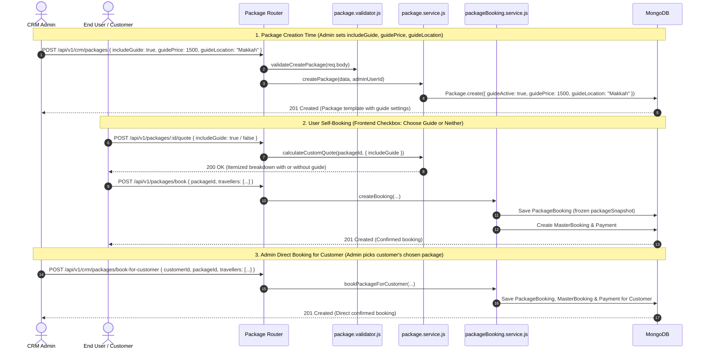

# Package Module Guide Integration Documentation

> **File Location**: `docs/packageAndOffer/PACKAGE_GUIDE_INTEGRATION.md`  
> **Source Module**: [`modules/packages`](file:///d:/Debanjan/joydeb_folder/MaqamTravelsAlpha/modules/packages), [`modules/guide`](file:///d:/Debanjan/joydeb_folder/MaqamTravelsAlpha/modules/guide)  
> **Direct Module Doc**: [`modules/packages/PACKAGE_GUIDE_INTEGRATION.md`](file:///d:/Debanjan/joydeb_folder/MaqamTravelsAlpha/modules/packages/PACKAGE_GUIDE_INTEGRATION.md)  
> **Test Suite**: [`tests/packages/package_guide_booking.test.js`](file:///d:/Debanjan/joydeb_folder/MaqamTravelsAlpha/tests/packages/package_guide_booking.test.js)  
> **Last Updated**: 2026-09-12

---

## 1. Executive Summary

In Maqam Travels, a **Package** is a pre-configured travel bundle composed of retail **Offers** (Flights, Hotels) backed by physical inventory **Stocks** (TicketStock, HotelStock).

The **Tour Guide (Instructor)** portion functions as an optional or included service addon, designed around three core business workflows:

1. **Package Creation Time (Admin / CRM)**:
   - **At package creation time, the admin adds `guideLocation`, `guidePrice`, and `includeGuide` (or `guideActive`).**
   - No `guideId` is required or needed at creation time. The package simply acts as a template defining whether a tour guide addon is supported, the default destination city (`guideLocation`), and the baseline price (`guidePrice`).

2. **When an Admin Books a Package for a Customer**:
   - **When an admin books a package for a customer (`POST /api/v1/crm/packages/book-for-customer`), the admin can choose the customer's chosen package (`packageId`).**
   - Guide details (`includeGuide`, `guideSelected`, `guideLocation`, `guidePrice`) are excluded from admin direct customer bookings; guide selection is controlled directly by users during self-booking.

3. **When a User Books a Package for Themselves**:
   - **Quote Preview**: The user can preview the dynamic quote with guide or without guide (`POST /api/v1/packages/:id/quote`) using the frontend checkbox.
   - **Booking Execution (`POST /api/v1/packages/book`)**: Guide details are excluded from the booking payload; the booking is confirmed using standard package configurations.

---

## 2. Architecture & Data Flow



---

## 3. Codebase Integration Details (File by File)

### A. Data Schemas

#### 1. Package Schema: [`modules/packages/models/package.model.js`](file:///d:/Debanjan/joydeb_folder/MaqamTravelsAlpha/modules/packages/models/package.model.js)
Defines the template defaults configured by the admin during package creation:
```javascript
guideActive: {
  type: Boolean,
  default: false,
},
guideLocation: {
  type: String,
  default: null, // e.g. "Makkah", "Madinah", or "Makkah & Madinah"
},
guidePrice: {
  type: Number,
  default: 0,    // Baseline addon price applied if includeGuide is selected
},
```

#### 2. Package Booking Schema: [`modules/packages/models/packageBooking.model.js`](file:///d:/Debanjan/joydeb_folder/MaqamTravelsAlpha/modules/packages/models/packageBooking.model.js)
Stores the chosen guide and persists an immutable snapshot whether booked by the user or by an admin:
```javascript
guideSelected: {
  type: String,   // Name/Label of chosen guide, e.g. "Sheikh Ahmad Al-Makki" or "Guide (Makkah)"
  default: null,
},
guideLocation: {
  type: [String], // Destination cities, e.g. ["Makkah"]
  default: [null],
},
guidePrice: {
  type: Number,   // Charged guide fee (0 if user opted out)
  default: 0,
},
packageSnapshot: Schema.Types.Mixed, // Complete frozen snapshot of package & guide details at checkout
```

---

### B. Input Validator: [`modules/packages/core/package.validator.js`](file:///d:/Debanjan/joydeb_folder/MaqamTravelsAlpha/modules/packages/core/package.validator.js)

The dedicated helper `validateGuideInput(data)` validates guide options across package creation, package updates, and quote requests:

```javascript
const validateGuideInput = (data) => {
  // Validate includeGuide / guideActive
  if (
    data.includeGuide !== undefined &&
    typeof data.includeGuide !== "boolean" &&
    data.includeGuide !== "true" &&
    data.includeGuide !== "false"
  ) {
    throw new AppError("includeGuide must be a boolean", 400);
  }

  if (
    data.guideActive !== undefined &&
    typeof data.guideActive !== "boolean" &&
    data.guideActive !== "true" &&
    data.guideActive !== "false"
  ) {
    throw new AppError("guideActive must be a boolean", 400);
  }

  // Validate guidePrice
  if (data.guidePrice !== undefined && data.guidePrice !== null && data.guidePrice !== "") {
    if (isNaN(Number(data.guidePrice)) || Number(data.guidePrice) < 0) {
      throw new AppError("guidePrice must be a number >= 0", 400);
    }
  }

  // Validate guideLocation
  if (data.guideLocation !== undefined && data.guideLocation !== null) {
    if (
      typeof data.guideLocation !== "string" &&
      !Array.isArray(data.guideLocation)
    ) {
      throw new AppError(
        "guideLocation must be a string or an array of strings",
        400,
      );
    }
  }
};
```

This helper is invoked in:
- `validateCreatePackage(data)`
- `validateUpdatePackage(data)`
- `validateQuotePreview(data)`

---

### C. Package Service: [`modules/packages/core/package.service.js`](file:///d:/Debanjan/joydeb_folder/MaqamTravelsAlpha/modules/packages/core/package.service.js)

#### 1. Package Creation (`createPackage`):
At package creation time, the admin supplies `includeGuide` (or `guideActive`), `guidePrice`, and `guideLocation`:
```javascript
const createPackage = async (data, adminUserId) => {
  try {
    // Normalize guide options (admin passes includeGuide or guideActive, guidePrice, guideLocation)
    const isGuideEnabled =
      data.includeGuide === true ||
      data.includeGuide === "true" ||
      data.guideActive === true ||
      data.guideActive === "true";

    data.guideActive = isGuideEnabled;

    if (data.guidePrice !== undefined && data.guidePrice !== null && data.guidePrice !== "") {
      data.guidePrice = Number(data.guidePrice) >= 0 ? Number(data.guidePrice) : 0;
    } else {
      data.guidePrice = 0;
    }

    if (data.guideLocation) {
      data.guideLocation = Array.isArray(data.guideLocation)
        ? data.guideLocation.join(", ")
        : String(data.guideLocation).trim();
    } else if (isGuideEnabled) {
      data.guideLocation = data.destination || null;
    } else {
      data.guideLocation = null;
    }

    // Auto-calculate sellPrice if omitted
    if (data.sellPrice === undefined || data.sellPrice === null) {
      const populatedOfferRefs = await Promise.all(
        (data.offerRefs || []).map(async (ref) => ({
          ...ref,
          offer: await Offer.findById(ref.offer),
        })),
      );
      const pricing = calculateBasePackagePricing({
        offerRefs: populatedOfferRefs,
        bundleDiscountPercentage: data.bundleDiscountPercentage || 0,
      });
      data.sellPrice = pricing.sellPrice;
    }

    return await Package.create({ ...data, createdBy: adminUserId });
  } catch (error) {
    logger.error(`Create package failed: ${error.message}`);
    throw error;
  }
};
```

#### 2. Pricing & Quote Calculation (`calculateCustomQuote`):
- When the frontend checkbox is **checked** (`includeGuide: true`):
  - Uses default `pkg.guidePrice` (e.g. 1500) and `pkg.guideLocation`.
  - Injects a `guide_tour` item into `quote.items`.
  - Adds `unitGuidePrice` to `finalSellPrice`.
- When the frontend checkbox is **unchecked** (`includeGuide: false` or omitted):
  - `guidePrice = 0`, `guideSelected = null`, and no guide fee is charged.

---

### D. Booking Engine: [`modules/packages/core/packageBooking.service.js`](file:///d:/Debanjan/joydeb_folder/MaqamTravelsAlpha/modules/packages/core/packageBooking.service.js)

1. **User Self-Booking (`createCustomPackageBooking`)**:
   - The user decides whether to check the guide checkbox (`includeGuide: true` or `false`).
   - If checked, guide details are frozen in `packageSnapshot` and added to `Payment.amount`.
   - If unchecked, standard package amount is charged with no guide fees.

2. **Admin Booking for Customer (`bookPackageForCustomer`)**:
   - The admin selects the package chosen by the customer (`packageId`).
   - The admin applies the customer's preferences (`includeGuide`, custom `guidePrice`, or custom `guideSelected`).
   - Stock units (Flight tickets and Hotel rooms) are claimed and marked as `used`.
   - MasterBooking and Payment records are confirmed directly.

---

## 4. Mounting Guide Routes in `app.js`

To make the standalone guide catalog API accessible to client applications and the admin portal, mount [`guide.routes.js`](file:///d:/Debanjan/joydeb_folder/MaqamTravelsAlpha/modules/guide/guide.routes.js) in [`app.js`](file:///d:/Debanjan/joydeb_folder/MaqamTravelsAlpha/app.js):

### Step 1: Import Guide Routes (near line 30)
```javascript
const guideRoutes = require('./modules/guide/guide.routes');
```

### Step 2: Register Middleware Route (near line 158)
```javascript
app.use('/api/v1/crm/packages', adminPackageRoutes);
app.use('/api/v1/crm/stocks', adminStockRoutes);
app.use('/api/v1/crm/offers', adminOfferRoutes);
app.use('/api/v1/packages', userPackageRoutes);
app.use('/api/v1/offers', offerRoutes);
app.use('/api/v1/guides', guideRoutes);           // <--- Mount standalone Guide module here
app.use('/api/v1/payments', paymentRoutes);
```

---

## 5. API Reference & Payloads

### A. Admin Creates a Package with Guide Settings
- **Method / URL**: `POST /api/v1/crm/packages`
- **Headers**: `Authorization: Bearer <ADMIN_JWT>`
- **Rule**: At package creation time, the admin adds `guideLocation`, `guidePrice`, and `includeGuide` (or `guideActive`).

#### Request Payload:
```json
{
  "title": "Deluxe Umrah Package with Private Ziyarat Guide",
  "destination": "Makkah",
  "bundleDiscountPercentage": 10,
  "includeGuide": true,
  "guidePrice": 1500,
  "guideLocation": "Makkah",
  "offerRefs": [
    {
      "offer": "6640a1b2c3d4e5f6a7b8c9d0",
      "unitsPerBooking": 1,
      "isOptional": false
    },
    {
      "offer": "6640a1b2c3d4e5f6a7b8c9d1",
      "unitsPerBooking": 1,
      "isOptional": false
    }
  ]
}
```

---

### B. User / Agent Requests a Custom Quote

- **Method / URL**: `POST /api/v1/packages/:packageId/quote`
- **Headers**: `Content-Type: application/json`

#### Option 1: Frontend Checkbox Checked (User Chooses Guide)
```json
{
  "quantity": 1,
  "includeGuide": true
}
```
*Result: Automatically applies package's default `guidePrice` (1500) and sets `guideSelected: "Guide (Makkah)"`.*

#### Option 2: Frontend Checkbox Unchecked (User Neither / No Guide)
```json
{
  "quantity": 1,
  "includeGuide": false
}
```
*Result: Baseline package price without any guide fee (`guidePrice: 0`, `guideSelected: null`).*

#### Option 3: Optional Catalog Guide Profile Selection
```json
{
  "quantity": 1,
  "guideId": "6650b2c3d4e5f6a7b8c9d012"
}
```

#### Quote Response Example (`200 OK` with Guide Included):
```json
{
  "success": true,
  "message": "Quote calculated successfully",
  "data": {
    "packageId": "6640a1b2c3d4e5f6a7b8c9e9",
    "packageTitle": "Deluxe Umrah Package with Private Ziyarat Guide",
    "basePackageSellPrice": 40500,
    "bundleDiscountPercentage": 10,
    "deductions": 0,
    "swapDeltas": 0,
    "guidePrice": 1500,
    "guideSelected": "Guide (Makkah)",
    "guideLocation": ["Makkah"],
    "finalSellPrice": 42000,
    "quantity": 1,
    "totalAmount": 42000,
    "items": [
      {
        "id": "guide-tour-addon",
        "name": "Guide: Guide (Makkah)",
        "type": "guide_tour",
        "retailPrice": 1500,
        "units": 1,
        "isIncluded": true,
        "guideLocation": ["Makkah"]
      }
    ]
  }
}
```

---

### C. User Books Package for Themselves
- **Method / URL**: `POST /api/v1/packages/book`
- **Headers**: `Authorization: Bearer <USER_JWT>`
- **Rule**: User creates their package booking. Guide details (`includeGuide`, `guideSelected`, `guideLocation`, `guidePrice`) are excluded from the booking request.

#### Request Payload:
```json
{
  "packageId": "6640a1b2c3d4e5f6a7b8c9e9",
  "quantity": 1,
  "travellers": [
    {
      "travellerId": "6645c1d2e3f4a5b6c7d8e901",
      "isLead": true
    }
  ],
  "payment": {
    "method": "razorpay"
  }
}
```

---

### D. Admin Books Package for Customer
- **Method / URL**: `POST /api/v1/crm/packages/book-for-customer`
- **Headers**: `Authorization: Bearer <ADMIN_JWT>`
- **Rule**: When an admin books a package for a customer, the admin chooses the package chosen by the customer (`packageId`), attaches the customer ID (`customerId`), and completes the direct booking without guide details.

#### Request Payload:
```json
{
  "packageId": "6640a1b2c3d4e5f6a7b8c9e9",
  "customerId": "6645c1d2e3f4a5b6c7d8e900",
  "quantity": 1,
  "travellers": [
    {
      "travellerId": "6645c1d2e3f4a5b6c7d8e901",
      "isLead": true
    }
  ],
  "payment": {
    "method": "bank_transfer",
    "referenceNumber": "TXN-DIRECT-1001",
    "notes": "Direct CRM booking for customer"
  }
}
```

#### Booking Confirmation Response (`201 Created`):
```json
{
  "success": true,
  "message": "Package booked successfully",
  "data": {
    "booking": {
      "_id": "6655d2e3f4a5b6c7d8e90111",
      "status": "confirmed",
      "guideSelected": "Sheikh Ahmad Al-Makki",
      "guideLocation": ["Makkah"],
      "guidePrice": 1500,
      "totalAmount": 42000,
      "packageSnapshot": {
        "packageId": "6640a1b2c3d4e5f6a7b8c9e9",
        "title": "Deluxe Umrah Package with Private Ziyarat Guide",
        "guidePrice": 1500,
        "guideSelected": "Sheikh Ahmad Al-Makki",
        "guideLocation": ["Makkah"]
      }
    },
    "payment": {
      "_id": "6655d2e3f4a5b6c7d8e90222",
      "status": "paid",
      "amount": 42000,
      "paymentMethod": "bank_transfer"
    },
    "masterBooking": {
      "_id": "6655d2e3f4a5b6c7d8e90333",
      "bookingType": "package",
      "status": "confirmed",
      "details": {
        "totalPrice": 42000
      }
    }
  }
}
```

---

## 6. Verification & Automated Testing

The package guide integration is verified via an automated test suite located at:
[`tests/packages/package_guide_booking.test.js`](file:///d:/Debanjan/joydeb_folder/MaqamTravelsAlpha/tests/packages/package_guide_booking.test.js)

### Execute the Test Suite:
```bash
node --test tests/packages/package_guide_booking.test.js
```

### Test Case Coverage:
| Test ID | Description | Verified Assertions |
|---|---|---|
| **TC-01** | Default Guide Pricing | When `includeGuide: true`, applies default `pkg.guidePrice` (1500), adds `guide_tour` into `items`, and increments `totalAmount`. |
| **TC-02** | Custom Guide Override | Custom `guideSelected`, `guideLocation: ["Makkah", "Madinah"]`, and `guidePrice: 2000` override default values and scale properly with `quantity`. |
| **TC-03** | Catalog Profile Resolution | Resolves `Guide` catalog record via `guideId`, extracts `fullDayRate`, builds `guideDetails` object with avatar/rating/languages. |
| **TC-04** | Admin Direct Booking for Customer | Admin selects customer's chosen package, creates confirmed `PackageBooking` with snapshot, verifies `Payment.amount` matches the quote total, and deducts inventory stocks. |
