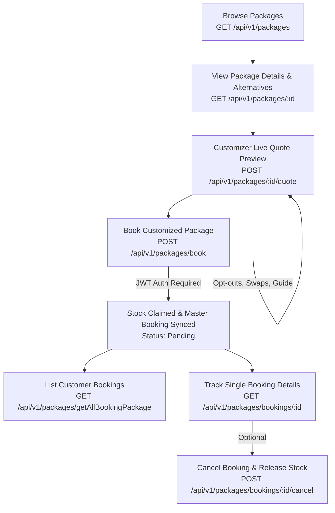

# Package Module - Customer / User API Documentation

**Base Path:** `/api/v1/packages`  
**Authentication:** Required for booking, profile, and account operations (`Authorization: Bearer <CUSTOMER_JWT_TOKEN>`); browsing, details, and live customizer quote calculation are public.

---

## 📋 Table of Contents
1. [Overview & Customer Workflow](#1-overview--customer-workflow)
2. [API Endpoints Summary](#2-api-endpoints-summary)
3. [Endpoint Details](#3-endpoint-details)
   - [3.1 Browse & Search Packages (`GET /api/v1/packages`)](#31-browse--search-packages)
   - [3.2 Get All Booking Packages for User Profile (`GET /api/v1/packages/getAllBookingPackage`)](#32-get-all-booking-packages-for-user-profile)
   - [3.3 Get Package Details & Swappable Alternatives (`GET /api/v1/packages/:id`)](#33-get-package-details--swappable-alternatives)
   - [3.4 Live Dynamic Customizer Quote (`POST /api/v1/packages/:id/quote`)](#34-live-dynamic-customizer-quote)
   - [3.5 Book Customized Package (`POST /api/v1/packages/book`)](#35-book-customized-package)
   - [3.6 Get Customer Booking by ID (`GET /api/v1/packages/bookings/:id`)](#36-get-customer-booking-by-id)
   - [3.7 Cancel Customer Booking (`POST /api/v1/packages/bookings/:id/cancel`)](#37-cancel-customer-booking)
4. [Option A Customization & Pricing Engine](#4-option-a-customization--pricing-engine)
   - [4.1 Component Selection Mechanics: `includedOfferIds` vs `excludedOfferIds`](#41-component-selection-mechanics-includedofferids-vs-excludedofferids)
5. [Error Responses Reference](#5-error-responses-reference)

---

## 1. Overview & Customer Workflow

The customer package workflow enables travelers to browse bundled holiday and religious tour packages, customize components (opt out of optional items, upgrade hotels/flights, or attach a dedicated tour guide), obtain real-time dynamic pricing quotes, and initiate bookings with atomic inventory stock reservations (`TicketStock`, `HotelStock`).



---

## 2. API Endpoints Summary

| Method | Endpoint | Auth Required | Description |
| :--- | :--- | :--- | :--- |
| `GET` | `/api/v1/packages` | Public | Browse, paginate, and search active packages with itemized breakdown & live availability |
| `GET` | `/api/v1/packages/getAllBookingPackage` | **Bearer Token** | Retrieve all package bookings created by the authenticated customer for their profile (Alias: `/bookings`) |
| `GET` | `/api/v1/packages/:id` | Public | Retrieve full package details, day-by-day itinerary, and eligible swappable alternatives |
| `POST` | `/api/v1/packages/:id/quote` | Public | Calculate real-time customizer quote with opt-outs, swaps & guide (Option A formula) |
| `POST` | `/api/v1/packages/book` | **Bearer Token** | Book package, claim physical inventory units atomically, freeze snapshot & sync Master Booking |
| `GET` | `/api/v1/packages/bookings/:id` | **Bearer Token** | Fetch single booking snapshot, assigned operations case officer & claimed stock units |
| `POST` | `/api/v1/packages/bookings/:id/cancel` | **Bearer Token** | Cancel booking, release claimed inventory units back to available stock & cancel Master Booking |

---

## 3. Endpoint Details

---

### 3.1 Browse & Search Packages
Returns a paginated list of public active packages with itemized bundled components, pricing, itinerary, validity dates, and calculated lowest live stock availability.

- **Method:** `GET`
- **Path:** `/api/v1/packages`
- **Authentication:** Public (No token required)
- **Query Parameters:**
  - `destination` *(optional, string)*: Filter by destination city or country (case-insensitive regex, e.g. `"Dubai"`, `"Makkah"`)
  - `sellPriceMin` *(optional, number)*: Minimum package sell price filter
  - `sellPriceMax` *(optional, number)*: Maximum package sell price filter
  - `page` *(optional, integer, default: `1`)*: Page number for pagination
  - `limit` *(optional, integer, default: `10`)*: Items per page

#### Request Example (cURL)
```bash
curl -X GET "http://localhost:5000/api/v1/packages?destination=Dubai&sellPriceMin=20000&sellPriceMax=60000&page=1&limit=10"
```

#### Success Response (`200 OK`)
```json
{
  "success": true,
  "message": "Packages fetched successfully",
  "data": {
    "packages": [
      {
        "_id": "66d4a8e2e944f7b6b199e815",
        "title": "Dubai Explorer 5D4N",
        "description": "Complete Dubai package with return flights, 4-star hotel, and transfers",
        "destination": "Dubai",
        "images": [
          "https://res.cloudinary.com/travelagency/image/upload/dubai_hero.jpg"
        ],
        "bundleDiscountPercentage": 10,
        "sellPrice": 36000,
        "inclusions": [
          "Return Flights (DEL-DXB)",
          "4-Star Luxury Hotel",
          "Airport Transfers"
        ],
        "itinerary": [
          {
            "day": 1,
            "title": "Arrival in Dubai & Marina Dhow Cruise",
            "description": "Airport pickup and hotel check-in.",
            "assignedOffers": [
              {
                "offer": "66d4a8e2e944f7b6b199e810",
                "role": "flight_arrival",
                "notes": "Flight lands at DXB Terminal 3"
              }
            ]
          }
        ],
        "validity": {
          "from": "2026-10-01T00:00:00.000Z",
          "to": "2026-12-31T23:59:59.000Z"
        },
        "availableSlots": 14,
        "priceBreakdown": [
          {
            "id": "66d4a8e2e944f7b6b199e810",
            "refId": "66d4a8e2e944f7b6b199e809",
            "title": "IndiGo DEL-DXB Return Flight",
            "itemType": "flight",
            "retailPrice": 15000,
            "unitsPerBooking": 1,
            "totalRetail": 15000,
            "isOptional": false,
            "isDefaultSelected": true,
            "allowSwap": true,
            "details": {
              "destination": "Dubai",
              "images": [
                "https://res.cloudinary.com/travelagency/image/upload/indigo.jpg"
              ],
              "flightDetails": {
                "_id": "66d4a8e2e944f7b6b199e805",
                "airline": "IndiGo",
                "flightNumber": "6E-1234",
                "departure": "2026-11-01T08:00:00.000Z",
                "arrival": "2026-11-01T10:30:00.000Z",
                "origin": "DEL",
                "destination": "DXB",
                "units": 20
              },
              "hotelDetails": null
            }
          },
          {
            "id": "66d4a8e2e944f7b6b199e811",
            "refId": "66d4a8e2e944f7b6b199e808",
            "title": "City Marina 4-Star Stay",
            "itemType": "hotel",
            "retailPrice": 25000,
            "unitsPerBooking": 1,
            "totalRetail": 25000,
            "isOptional": true,
            "isDefaultSelected": true,
            "allowSwap": true,
            "details": {
              "destination": "Dubai",
              "images": [
                "https://res.cloudinary.com/travelagency/image/upload/hotel.jpg"
              ],
              "flightDetails": null,
              "hotelDetails": {
                "_id": "66d4a8e2e944f7b6b199e806",
                "hotelId": {
                  "_id": "66d4a8e2e944f7b6b199e801",
                  "name": "City Marina Hotel",
                  "location": "Dubai Marina",
                  "starRating": 4,
                  "isActive": true
                },
                "roomType": "Deluxe Double",
                "checkIn": "2026-11-01T14:00:00.000Z",
                "checkOut": "2026-11-05T11:00:00.000Z",
                "units": 15,
                "reviewStatus": "approved"
              }
            }
          }
        ]
      }
    ],
    "meta": {
      "total": 1,
      "page": 1,
      "limit": 10,
      "totalPages": 1
    }
  },
  "meta": {
    "total": 1,
    "page": 1,
    "limit": 10,
    "totalPages": 1
  }
}
```

---

### 3.2 Get All Booking Packages for User Profile
Returns all customized package bookings created by the authenticated customer for their own profile, sorted in descending order of creation date (`createdAt: -1`), with pagination, populated package summary, and assigned operations officer.

- **Method:** `GET`
- **Path:** `/api/v1/packages/getAllBookingPackage` *(Alternative Alias: `/api/v1/packages/bookings`)*
- **Authentication:** Required (`Authorization: Bearer <CUSTOMER_JWT_TOKEN>`)
- **Query Parameters:**
  - `status` *(optional, string, enum: `["initiated", "pending", "confirmed", "cancelled"]`)*: Filter bookings by lifecycle status
  - `packageId` *(optional, string, ObjectId)*: Filter bookings for a specific package
  - `page` *(optional, integer, default: `1`)*: Page number
  - `limit` *(optional, integer, default: `10`)*: Items per page (min: 1, max: 100)

#### Request Example (cURL)
```bash
curl -X GET "http://localhost:5000/api/v1/packages/getAllBookingPackage?status=pending&page=1&limit=10" \
  -H "Authorization: Bearer <CUSTOMER_JWT_TOKEN>"
```

#### Success Response (`200 OK`)
```json
{
  "success": true,
  "message": "Package bookings retrieved successfully",
  "data": [
    {
      "_id": "66d4b555e944f7b6b199e825",
      "userId": "66c1b011e944f7b6b199e801",
      "packageId": {
        "_id": "66d4a8e2e944f7b6b199e815",
        "title": "Dubai Explorer 5D4N",
        "destination": "Dubai",
        "sellPrice": 36000,
        "images": [
          "https://res.cloudinary.com/travelagency/image/upload/dubai_hero.jpg"
        ],
        "itinerary": [
          {
            "day": 1,
            "title": "Arrival in Dubai & Marina Dhow Cruise",
            "description": "Airport pickup and hotel check-in."
          }
        ]
      },
      "guideSelected": "Sheikh Ahmad Al-Makki",
      "guideLocation": [
        "Dubai"
      ],
      "guidePrice": 1500,
      "packageSnapshot": {
        "title": "Dubai Explorer 5D4N",
        "destination": "Dubai",
        "basePackageSellPrice": 36000,
        "bundleDiscountPercentage": 10,
        "deductions": 0,
        "swapDeltas": 10000,
        "finalSellPrice": 47500,
        "guidePrice": 1500,
        "guideSelected": "Sheikh Ahmad Al-Makki"
      },
      "customizedSelections": {
        "includedOfferIds": [
          "66d4a8e2e944f7b6b199e810",
          "66d4a8e2e944f7b6b199e899"
        ],
        "excludedOfferIds": [],
        "swappedOffers": [
          {
            "originalOfferId": "66d4a8e2e944f7b6b199e811",
            "replacementOfferId": "66d4a8e2e944f7b6b199e899"
          }
        ]
      },
      "travellers": [
        {
          "travellerId": "66c1b011e944f7b6b199e801",
          "isLead": true
        }
      ],
      "quantity": 1,
      "totalAmount": 47500,
      "status": "pending",
      "assignedTo": {
        "_id": "66ce08f0e944f7b6b199e810",
        "firstName": "Sarah",
        "lastName": "Agent",
        "email": "sarah.agent@maqam.com",
        "phone": "+971501234567",
        "avatar": "https://res.cloudinary.com/travelagency/image/upload/sarah.jpg"
      },
      "claimedUnits": [
        {
          "stockModel": "TicketStock",
          "stock": "66d4a8e2e944f7b6b199e805",
          "unitId": "66d4a8e2e944f7b6b199e814"
        },
        {
          "stockModel": "HotelStock",
          "stock": "66d4a8e2e944f7b6b199e888",
          "unitId": "66d4a8e2e944f7b6b199e820"
        }
      ],
      "claimedFlightUnits": [],
      "claimedHotelUnits": [],
      "createdAt": "2026-09-11T10:00:00.000Z",
      "updatedAt": "2026-09-11T10:00:00.000Z"
    }
  ],
  "meta": {
    "total": 1,
    "page": 1,
    "limit": 10,
    "totalPages": 1
  }
}
```

---

### 3.3 Get Package Details & Swappable Alternatives
Retrieves full details of a specific package including the day-by-day itinerary, itemized price breakdown, and eligible alternative offers (hotels/flights in the same destination) that users can swap in with calculated retail price deltas.

- **Method:** `GET`
- **Path:** `/api/v1/packages/:id`
- **Authentication:** Public (No token required)
- **Path Parameters:**
  - `id` *(required, string, ObjectId)*: Package ID

#### Request Example (cURL)
```bash
curl -X GET "http://localhost:5000/api/v1/packages/66d4a8e2e944f7b6b199e815"
```

#### Success Response (`200 OK`)
```json
{
  "success": true,
  "message": "Package details fetched successfully",
  "data": {
    "_id": "66d4a8e2e944f7b6b199e815",
    "title": "Dubai Explorer 5D4N",
    "description": "Complete Dubai package with return flights, 4-star hotel, and transfers",
    "destination": "Dubai",
    "images": [
      "https://res.cloudinary.com/travelagency/image/upload/dubai_hero.jpg"
    ],
    "bundleDiscountPercentage": 10,
    "sellPrice": 36000,
    "inclusions": [
      "Return Flights (DEL-DXB)",
      "4-Star Luxury Hotel",
      "Airport Transfers"
    ],
    "itinerary": [
      {
        "day": 1,
        "title": "Arrival in Dubai & Marina Dhow Cruise",
        "description": "Airport pickup, check-in, and evening marina cruise.",
        "assignedOffers": [
          {
            "offer": "66d4a8e2e944f7b6b199e810",
            "role": "flight_arrival",
            "notes": "Flight lands at DXB Terminal 3"
          }
        ]
      }
    ],
    "validity": {
      "from": "2026-10-01T00:00:00.000Z",
      "to": "2026-12-31T23:59:59.000Z"
    },
    "availableSlots": 14,
    "priceBreakdown": [
      {
        "id": "66d4a8e2e944f7b6b199e810",
        "refId": "66d4a8e2e944f7b6b199e809",
        "title": "IndiGo DEL-DXB Return Flight",
        "itemType": "flight",
        "retailPrice": 15000,
        "unitsPerBooking": 1,
        "totalRetail": 15000,
        "isOptional": false,
        "isDefaultSelected": true,
        "allowSwap": true,
        "details": {
          "destination": "Dubai",
          "images": [
            "https://res.cloudinary.com/travelagency/image/upload/indigo.jpg"
          ],
          "flightDetails": {
            "_id": "66d4a8e2e944f7b6b199e805",
            "airline": "IndiGo",
            "flightNumber": "6E-1234",
            "departure": "2026-11-01T08:00:00.000Z",
            "arrival": "2026-11-01T10:30:00.000Z",
            "origin": "DEL",
            "destination": "DXB",
            "units": 20
          },
          "hotelDetails": null
        }
      },
      {
        "id": "66d4a8e2e944f7b6b199e811",
        "refId": "66d4a8e2e944f7b6b199e808",
        "title": "City Marina 4-Star Stay",
        "itemType": "hotel",
        "retailPrice": 25000,
        "unitsPerBooking": 1,
        "totalRetail": 25000,
        "isOptional": true,
        "isDefaultSelected": true,
        "allowSwap": true,
        "details": {
          "destination": "Dubai",
          "images": [
            "https://res.cloudinary.com/travelagency/image/upload/hotel.jpg"
          ],
          "flightDetails": null,
          "hotelDetails": {
            "_id": "66d4a8e2e944f7b6b199e806",
            "hotelId": {
              "_id": "66d4a8e2e944f7b6b199e801",
              "name": "City Marina Hotel",
              "location": "Dubai Marina",
              "starRating": 4,
              "isActive": true
            },
            "roomType": "Deluxe Double",
            "checkIn": "2026-11-01T14:00:00.000Z",
            "checkOut": "2026-11-05T11:00:00.000Z",
            "units": 15,
            "reviewStatus": "approved"
          }
        }
      }
    ],
    "availableAlternatives": {
      "offers": {
        "66d4a8e2e944f7b6b199e811": [
          {
            "_id": "66d4a8e2e944f7b6b199e899",
            "title": "Luxury Marina 5-Star Resort",
            "itemType": "hotel",
            "destination": "Dubai",
            "sellPrice": 35000,
            "priceDelta": 10000,
            "images": [
              "https://res.cloudinary.com/travelagency/image/upload/resort5star.jpg"
            ],
            "flightDetails": null,
            "hotelDetails": {
              "_id": "66d4a8e2e944f7b6b199e888",
              "hotelId": {
                "_id": "66d4a8e2e944f7b6b199e880",
                "name": "Luxury Marina Resort & Spa",
                "location": "Dubai Marina",
                "starRating": 5,
                "isActive": true
              },
              "roomType": "Sea View Suite",
              "checkIn": "2026-11-01T14:00:00.000Z",
              "checkOut": "2026-11-05T11:00:00.000Z",
              "units": 10,
              "reviewStatus": "approved"
            }
          }
        ]
      }
    }
  }
}
```

---

### 3.4 Live Dynamic Customizer Quote
Recalculates pricing in real time based on user customizations (opting out of optional items, swapping hotels/flights, or attaching a dedicated guide). Enforces the **Option A formula** (`finalSellPrice = basePackageSellPrice - deductions + swapDeltas + guidePrice`) and the minimum 2 active offer components guardrail.

- **Method:** `POST`
- **Path:** `/api/v1/packages/:id/quote`
- **Authentication:** Public (No token required)
- **Path Parameters:**
  - `id` *(required, string, ObjectId)*: Package ID

#### Request Body Schema
```json
{
  "quantity": 1,
  "excludedOfferIds": [
    "66d4a8e2e944f7b6b199e812"
  ],
  "swappedOffers": [
    {
      "originalOfferId": "66d4a8e2e944f7b6b199e811",
      "replacementOfferId": "66d4a8e2e944f7b6b199e899"
    }
  ],
  "includeGuide": true,
  "guideId": "66c1b011e944f7b6b199e855",
  "guideSelected": "Sheikh Ahmad Al-Makki",
  "guideLocation": "Dubai",
  "guidePrice": 1500
}
```

#### Request Fields Specification

| Field | Type | Required | Default | Description & Key-Value Details |
| :--- | :--- | :--- | :--- | :--- |
| `quantity` | `integer` | No | `1` | Number of package units (must be `>= 1`) |
| `excludedOfferIds` | `array` of ObjectIds | No | `[]` | **Opt-Out List:** Array of Offer ObjectIds (`string[]`) to exclude from the package (e.g. `["66d4a8e2e944f7b6b199e812"]`). Each ID must correspond to an offer bundled in the package where `isOptional: true` (obtained from `priceBreakdown[].id`). If an offer has `isOptional: false`, passing its ID here throws a `400 Bad Request`.<br>*(Note: Clients do **not** send `includedOfferIds`; any bundled offer not listed in `excludedOfferIds` or `swappedOffers` is included automatically).* |
| `swappedOffers` | `array` of objects | No | `[]` | Pairings of `originalOfferId` and `replacementOfferId` (original must have `allowSwap: true`) |
| `swappedOffers[].originalOfferId` | `string` (ObjectId) | Yes (if swapped) | - | Target bundled offer ObjectId to replace (e.g. `"66d4a8e2e944f7b6b199e811"`) |
| `swappedOffers[].replacementOfferId` | `string` (ObjectId) | Yes (if swapped) | - | Candidate replacement offer ObjectId matching `itemType` and `destination` (e.g. `"66d4a8e2e944f7b6b199e899"`) |
| `includeGuide` | `boolean` | No | `false` | Set `true` to include dedicated tour guide service |
| `guideId` | `string` (ObjectId) | No | `null` | Optional Guide model document ID to pull verified guide bio, rating & hourly/full-day rates |
| `guideSelected` | `string` / ObjectId | No | `null` | Guide name string or Guide document ObjectId |
| `guideLocation` | `string` / `array` of strings | No | `[]` | Destination or area for guide |
| `guidePrice` | `number` | No | `0` | Custom guide fee override (defaults to Guide rate or package `guidePrice` if omitted) |

> [!TIP]
> **Where to get Offer IDs for `excludedOfferIds`:**
> Call `GET /api/v1/packages/:id` first and inspect the `priceBreakdown` array. Use the **`id`** field (which contains `offer._id`). **Do NOT use `refId`** (which is internal MongoDB subdocument reference ID `offerRefs[]._id`). Only items marked `"isOptional": true` can be passed into `excludedOfferIds`.

#### Request Example (cURL)
```bash
curl -X POST "http://localhost:5000/api/v1/packages/66d4a8e2e944f7b6b199e815/quote" \
  -H "Content-Type: application/json" \
  -d '{
    "quantity": 1,
    "swappedOffers": [
      {
        "originalOfferId": "66d4a8e2e944f7b6b199e811",
        "replacementOfferId": "66d4a8e2e944f7b6b199e899"
      }
    ],
    "includeGuide": true,
    "guideSelected": "Sheikh Ahmad Al-Makki",
    "guideLocation": "Dubai",
    "guidePrice": 1500
  }'
```

#### Success Response (`200 OK`)
```json
{
  "success": true,
  "message": "Quote review fetched successfully",
  "data": {
    "packageId": "66d4a8e2e944f7b6b199e815",
    "packageTitle": "Dubai Explorer 5D4N",
    "basePackageSellPrice": 36000,
    "bundleDiscountPercentage": 10,
    "deductions": 0,
    "swapDeltas": 10000,
    "guidePrice": 1500,
    "guideSelected": "Sheikh Ahmad Al-Makki",
    "guideLocation": [
      "Dubai"
    ],
    "guideDetails": {
      "fullName": "Sheikh Ahmad Al-Makki"
    },
    "finalSellPrice": 47500,
    "quantity": 1,
    "totalAmount": 47500,
    "activeComponentsCount": 2,
    "items": [
      {
        "id": "66d4a8e2e944f7b6b199e810",
        "name": "IndiGo DEL-DXB Return Flight",
        "type": "flight",
        "retailPrice": 15000,
        "units": 1,
        "isIncluded": true
      },
      {
        "id": "66d4a8e2e944f7b6b199e899",
        "originalOfferId": "66d4a8e2e944f7b6b199e811",
        "name": "Luxury Marina 5-Star Resort",
        "type": "hotel",
        "retailPrice": 35000,
        "units": 1,
        "isIncluded": true,
        "isSwapped": true,
        "originalPrice": 25000,
        "delta": 10000,
        "replacementDetails": {
          "flightDetails": null,
          "hotelDetails": {
            "_id": "66d4a8e2e944f7b6b199e888",
            "hotelId": {
              "_id": "66d4a8e2e944f7b6b199e880",
              "name": "Luxury Marina Resort & Spa",
              "location": "Dubai Marina",
              "starRating": 5,
              "isActive": true
            },
            "roomType": "Sea View Suite",
            "checkIn": "2026-11-01T14:00:00.000Z",
            "checkOut": "2026-11-05T11:00:00.000Z",
            "units": 10,
            "reviewStatus": "approved"
          }
        }
      },
      {
        "id": "guide-tour-addon",
        "name": "Guide: Sheikh Ahmad Al-Makki",
        "type": "guide_tour",
        "retailPrice": 1500,
        "units": 1,
        "isIncluded": true,
        "guideLocation": [
          "Dubai"
        ],
        "guideDetails": {
          "name": "Sheikh Ahmad Al-Makki"
        }
      }
    ]
  }
}
```

---

### 3.5 Book Customized Package
Creates a customized package booking for the authenticated user, atomically claims physical wholesale stock units (`TicketStock`, `HotelStock`), freezes the immutable package snapshot, and creates/syncs a corresponding record in `MasterBooking` (`status: "pending"`).

- **Method:** `POST`
- **Path:** `/api/v1/packages/book`
- **Authentication:** Required (`Authorization: Bearer <CUSTOMER_JWT_TOKEN>`)

#### Request Body Schema
```json
{
  "packageId": "66d4a8e2e944f7b6b199e815",
  "quantity": 1,
  "travellers": [
    {
      "travellerId": "66c1b011e944f7b6b199e801",
      "isLead": true
    }
  ],
  "excludedOfferIds": [],
  "swappedOffers": [
    {
      "originalOfferId": "66d4a8e2e944f7b6b199e811",
      "replacementOfferId": "66d4a8e2e944f7b6b199e899"
    }
  ],
  "includeGuide": true,
  "guideSelected": "Sheikh Ahmad Al-Makki",
  "guideLocation": "Dubai",
  "guidePrice": 1500
}
```

#### Request Fields Specification

| Field | Type | Required | Default | Description & Key-Value Details |
| :--- | :--- | :--- | :--- | :--- |
| `packageId` | `string` (ObjectId) | **Yes** | - | Target package ObjectId (e.g. `"66d4a8e2e944f7b6b199e815"`) |
| `quantity` | `integer` | No | `1` | Number of package units (must be `>= 1`) |
| `travellers` | `array` of objects | **Yes** | - | Array of traveller profiles. At least 1 required. **Exactly one** traveller must have `isLead: true`. |
| `travellers[].travellerId` | `string` (ObjectId) | **Yes** | - | Saved Traveller profile ID from `/api/v1/account/travellers` |
| `includedOfferIds` | `array` of ObjectIds | No | `[]` | **Inclusion List:** Array of Offer ObjectIds (`string[]`) to explicitly include in booking (e.g. `["66d4a8e2e944f7b6b199e810"]`). Optional offers omitted from this list are automatically excluded. |
| `excludedOfferIds` | `array` of ObjectIds | No | `[]` | **Opt-Out List:** Array of Offer ObjectIds (`string[]`) to exclude from booking (e.g. `["66d4a8e2e944f7b6b199e812"]`). Only offers with `isOptional: true` may be excluded. If no items are opted out, pass `[]`. |
| `swappedOffers` | `array` of objects | No | `[]` | Swapped offer replacements |
| `swappedOffers[].originalOfferId` | `string` (ObjectId) | Yes (if swap) | - | Original default bundled offer ObjectId to replace (e.g. `"66d4a8e2e944f7b6b199e811"`) |
| `swappedOffers[].replacementOfferId` | `string` (ObjectId) | Yes (if swap) | - | Target replacement offer ObjectId (e.g. `"66d4a8e2e944f7b6b199e899"`) |
| `includeGuide` | `boolean` | No | `false` | Set `true` to include tour guide service |
| `guideSelected` | `string` | No | `null` | Guide name or identifier |
| `guideLocation` | `string` / `array` | No | `[]` | Destination or area for guide |
| `guidePrice` | `number` | No | `0` | Guide fee override |

#### Request Example (cURL)
```bash
curl -X POST "http://localhost:5000/api/v1/packages/book" \
  -H "Authorization: Bearer <CUSTOMER_JWT_TOKEN>" \
  -H "Content-Type: application/json" \
  -d '{
    "packageId": "66d4a8e2e944f7b6b199e815",
    "quantity": 1,
    "travellers": [
      {
        "travellerId": "66c1b011e944f7b6b199e801",
        "isLead": true
      }
    ],
    "swappedOffers": [
      {
        "originalOfferId": "66d4a8e2e944f7b6b199e811",
        "replacementOfferId": "66d4a8e2e944f7b6b199e899"
      }
    ],
    "includeGuide": true,
    "guideSelected": "Sheikh Ahmad Al-Makki",
    "guideLocation": "Dubai",
    "guidePrice": 1500
  }'
```

#### Success Response (`201 Created`)
```json
{
  "success": true,
  "message": "Created successfully",
  "data": {
    "message": "Customized package booking created. Proceed to payment.",
    "data": {
      "_id": "66d4b555e944f7b6b199e825",
      "bookingId": "66d4b555e944f7b6b199e825",
      "packageId": "66d4a8e2e944f7b6b199e815",
      "totalAmount": 47500,
      "guideSelected": "Sheikh Ahmad Al-Makki",
      "guideLocation": [
        "Dubai"
      ],
      "guidePrice": 1500,
      "status": "pending",
      "quantity": 1,
      "customizedSelections": {
        "includedOfferIds": [
          "66d4a8e2e944f7b6b199e810",
          "66d4a8e2e944f7b6b199e899"
        ],
        "excludedOfferIds": [],
        "swappedOffers": [
          {
            "originalOfferId": "66d4a8e2e944f7b6b199e811",
            "replacementOfferId": "66d4a8e2e944f7b6b199e899"
          }
        ]
      },
      "packageSnapshot": {
        "title": "Dubai Explorer 5D4N",
        "destination": "Dubai",
        "basePackageSellPrice": 36000,
        "bundleDiscountPercentage": 10,
        "deductions": 0,
        "swapDeltas": 10000,
        "finalSellPrice": 47500,
        "guidePrice": 1500,
        "guideSelected": "Sheikh Ahmad Al-Makki",
        "guideLocation": [
          "Dubai"
        ],
        "guideDetails": {
          "fullName": "Sheikh Ahmad Al-Makki"
        },
        "inclusions": [
          "Return Flights",
          "4-Star Luxury Hotel",
          "Airport Transfers"
        ],
        "itinerary": [
          {
            "day": 1,
            "title": "Arrival in Dubai & Marina Dhow Cruise",
            "description": "Airport pickup and hotel check-in."
          }
        ],
        "validity": {
          "from": "2026-10-01T00:00:00.000Z",
          "to": "2026-12-31T23:59:59.000Z"
        },
        "items": [
          {
            "id": "66d4a8e2e944f7b6b199e810",
            "name": "IndiGo DEL-DXB Return Flight",
            "type": "flight",
            "retailPrice": 15000,
            "units": 1,
            "isIncluded": true
          },
          {
            "id": "66d4a8e2e944f7b6b199e899",
            "originalOfferId": "66d4a8e2e944f7b6b199e811",
            "name": "Luxury Marina 5-Star Resort",
            "type": "hotel",
            "retailPrice": 35000,
            "units": 1,
            "isIncluded": true,
            "isSwapped": true,
            "originalPrice": 25000,
            "delta": 10000
          },
          {
            "id": "guide-tour-addon",
            "name": "Guide: Sheikh Ahmad Al-Makki",
            "type": "guide_tour",
            "retailPrice": 1500,
            "units": 1,
            "isIncluded": true,
            "guideLocation": [
              "Dubai"
            ]
          }
        ]
      },
      "claimedUnits": [
        {
          "stockModel": "TicketStock",
          "stock": "66d4a8e2e944f7b6b199e805",
          "unitId": "66d4a8e2e944f7b6b199e814"
        },
        {
          "stockModel": "HotelStock",
          "stock": "66d4a8e2e944f7b6b199e888",
          "unitId": "66d4a8e2e944f7b6b199e820"
        }
      ]
    }
  }
}
```

---

### 3.6 Get Customer Booking by ID
Retrieves details of an existing package booking belonging to the authenticated customer, including customized selections, frozen snapshot, claimed inventory units, and assigned operations case officer.

- **Method:** `GET`
- **Path:** `/api/v1/packages/bookings/:id`
- **Authentication:** Required (`Authorization: Bearer <CUSTOMER_JWT_TOKEN>`)
- **Path Parameters:**
  - `id` *(required, string, ObjectId)*: Package Booking ID

#### Request Example (cURL)
```bash
curl -X GET "http://localhost:5000/api/v1/packages/bookings/66d4b555e944f7b6b199e825" \
  -H "Authorization: Bearer <CUSTOMER_JWT_TOKEN>"
```

#### Success Response (`200 OK`)
```json
{
  "success": true,
  "message": "Fetch the booking successfully",
  "data": {
    "_id": "66d4b555e944f7b6b199e825",
    "userId": "66c1b011e944f7b6b199e801",
    "packageId": "66d4a8e2e944f7b6b199e815",
    "guideSelected": "Sheikh Ahmad Al-Makki",
    "guideLocation": [
      "Dubai"
    ],
    "guidePrice": 1500,
    "quantity": 1,
    "totalAmount": 47500,
    "status": "pending",
    "assignedTo": {
      "_id": "66ce08f0e944f7b6b199e810",
      "firstName": "Sarah",
      "lastName": "Agent",
      "email": "sarah.agent@maqam.com",
      "phone": "+971501234567",
      "avatar": "https://res.cloudinary.com/travelagency/image/upload/sarah.jpg"
    },
    "customizedSelections": {
      "includedOfferIds": [
        "66d4a8e2e944f7b6b199e810",
        "66d4a8e2e944f7b6b199e899"
      ],
      "excludedOfferIds": [],
      "swappedOffers": [
        {
          "originalOfferId": "66d4a8e2e944f7b6b199e811",
          "replacementOfferId": "66d4a8e2e944f7b6b199e899"
        }
      ]
    },
    "travellers": [
      {
        "travellerId": "66c1b011e944f7b6b199e801",
        "isLead": true
      }
    ],
    "packageSnapshot": {
      "title": "Dubai Explorer 5D4N",
      "destination": "Dubai",
      "basePackageSellPrice": 36000,
      "bundleDiscountPercentage": 10,
      "deductions": 0,
      "swapDeltas": 10000,
      "finalSellPrice": 47500,
      "guidePrice": 1500,
      "guideSelected": "Sheikh Ahmad Al-Makki",
      "guideLocation": [
        "Dubai"
      ],
      "inclusions": [
        "Return Flights",
        "4-Star Luxury Hotel",
        "Airport Transfers"
      ],
      "itinerary": [
        {
          "day": 1,
          "title": "Arrival in Dubai & Marina Dhow Cruise",
          "description": "Airport pickup and hotel check-in."
        }
      ]
    },
    "claimedUnits": [
      {
        "stockModel": "TicketStock",
        "stock": "66d4a8e2e944f7b6b199e805",
        "unitId": "66d4a8e2e944f7b6b199e814"
      },
      {
        "stockModel": "HotelStock",
        "stock": "66d4a8e2e944f7b6b199e888",
        "unitId": "66d4a8e2e944f7b6b199e820"
      }
    ],
    "claimedFlightUnits": [],
    "claimedHotelUnits": [],
    "createdAt": "2026-09-11T10:00:00.000Z",
    "updatedAt": "2026-09-11T10:00:00.000Z"
  }
}
```

---

### 3.7 Cancel Customer Booking
Cancels a booking in `initiated` or `pending` status, atomically releases claimed stock units (`TicketStock`, `HotelStock`) back to available wholesale inventory, sets booking status to `cancelled`, and synchronizes the cancellation on the linked `MasterBooking`.

- **Method:** `POST`
- **Path:** `/api/v1/packages/bookings/:id/cancel`
- **Authentication:** Required (`Authorization: Bearer <CUSTOMER_JWT_TOKEN>`)
- **Path Parameters:**
  - `id` *(required, string, ObjectId)*: Package Booking ID

#### Request Body Schema
```json
{
  "reason": "Change of travel plans"
}
```

#### Request Fields Specification

| Field | Type | Required | Default | Description |
| :--- | :--- | :--- | :--- | :--- |
| `reason` | `string` | No | `"User requested cancellation"` | Explanation for cancellation |

#### Request Example (cURL)
```bash
curl -X POST "http://localhost:5000/api/v1/packages/bookings/66d4b555e944f7b6b199e825/cancel" \
  -H "Authorization: Bearer <CUSTOMER_JWT_TOKEN>" \
  -H "Content-Type: application/json" \
  -d '{
    "reason": "Change of travel plans"
  }'
```

#### Success Response (`200 OK`)
```json
{
  "success": true,
  "message": "Cancel the package successfully",
  "data": {
    "_id": "66d4b555e944f7b6b199e825",
    "userId": "66c1b011e944f7b6b199e801",
    "packageId": "66d4a8e2e944f7b6b199e815",
    "status": "cancelled",
    "cancellationReason": "Change of travel plans",
    "cancelledAt": "2026-09-11T10:15:00.000Z",
    "totalAmount": 47500,
    "quantity": 1,
    "claimedUnits": [],
    "claimedFlightUnits": [],
    "claimedHotelUnits": [],
    "updatedAt": "2026-09-11T10:15:00.000Z"
  }
}
```

---

## 4. Option A Customization & Pricing Engine

The package calculation engine uses the **Option A** formula:
$$\text{finalSellPrice} = \max\left(0, \text{basePackageSellPrice} - \text{totalDeductions} + \text{totalSwapDeltas} + \text{guidePrice}\right)$$
$$\text{totalAmount} = \text{finalSellPrice} \times \text{quantity}$$

### Pricing Rules:
1. **Anchored Base Discount:** The `bundleDiscountPercentage` is applied exclusively to the default bundled items. If the package was created with a tour guide pre-included in the `sellPrice`, the system deducts the default `guidePrice` to accurately resolve the base offer bundle price before applying customizations.
2. **Opt-Out Deductions:** When an optional offer is excluded, its exact individual retail sell price multiplied by `unitsPerBooking` is deducted from the base price:
   $$\text{deduction} = \text{offer.sellPrice} \times \text{unitsPerBooking}$$
3. **Swap Deltas:** Upgrades or downgrades add or subtract the exact difference:
   $$\Delta = (\text{Replacement Retail Price} \times \text{units}) - (\text{Original Retail Price} \times \text{units})$$
4. **Tour Guide Add-on:** When `includeGuide: true` (or `guideSelected`, `guidePrice`, or `guideId`) is provided:
   - If a valid `guideId` (or 24-hex `guideSelected`) is provided, the system resolves the verified Guide profile, bio, city, and hourly/full-day rates.
   - The guide rate (`resolvedGuidePrice`) is added directly to `finalSellPrice`.
5. **Guardrail:** A package booking must maintain **at least 2 active Offer components** (e.g., Flight + Hotel). Opting out beyond this limit throws a `400 Bad Request`.

---

### 4.1 Component Selection Mechanics: `includedOfferIds` vs `excludedOfferIds`

In the package customization engine, individual travel components (flights, hotels) are stored as standalone **Offer** records. Understanding how `includedOfferIds` and `excludedOfferIds` function between the frontend request and backend response is essential for customizer and checkout integration:

#### Direct Key & Value Definitions

| Concept | `excludedOfferIds` | `includedOfferIds` |
| :--- | :--- | :--- |
| **Where it appears** | **Request Body** (`POST /:id/quote`, `POST /book`) & **Response** (`customizedSelections.excludedOfferIds`) | **Request Body** (`POST /:id/quote`, `POST /book`) & **Response Payload** (`customizedSelections.includedOfferIds`) |
| **Data Type** | `array` of 24-character hex MongoDB ObjectIds (`string[]`) | `array` of 24-character hex MongoDB ObjectIds (`string[]` / `ObjectId[]`) |
| **Client Requirement** | **Optional** (send `[]` if keeping all default components) | **Optional** (client may pass explicit Offer ObjectIds to include; any optional offers omitted are automatically treated as excluded) |
| **Source of Value** | Selected by user from `GET /packages/:id` &rarr; `priceBreakdown[].id` where `isOptional: true` | Array of Offer ObjectIds (`priceBreakdown[].id` or replacement offer IDs from `availableAlternatives`) |
| **Direct Meaning** | **Opt-out list:** Offers the user explicitly chose to remove from the bundle | **Inclusion list:** Offers explicitly included and actively booked for traveller(s) |
| **Wholesale Stock Impact** | **No stock is claimed**; retail price is subtracted from `basePackageSellPrice` | **Physical units claimed** (`TicketStock`, `HotelStock`) atomically |
| **Safety Guardrail** | Cannot exclude mandatory offers (`isOptional: false`) | Must contain at least **2 active offer components** (`length >= 2`) |

---

#### 1. How to Obtain the Correct Key Value for `excludedOfferIds`
When a customer browses package details via `GET /api/v1/packages/:id`, inspect the `priceBreakdown` array:
```json
"priceBreakdown": [
  {
    "id": "66d4a8e2e944f7b6b199e810",     // 👈 THIS is the Offer ObjectId to send in excludedOfferIds
    "refId": "66d4a8e2e944f7b6b199e809",  // ⚠️ DO NOT USE refId (internal subdocument reference)
    "title": "IndiGo DEL-DXB Return Flight",
    "itemType": "flight",
    "retailPrice": 15000,
    "isOptional": false,                  // ❌ Cannot be excluded (Throws 400 Bad Request)
    "allowSwap": true
  },
  {
    "id": "66d4a8e2e944f7b6b199e811",     // 👈 Offer ObjectId
    "refId": "66d4a8e2e944f7b6b199e808",
    "title": "City Marina 4-Star Stay",
    "itemType": "hotel",
    "retailPrice": 25000,
    "isOptional": true,                   // ✅ CAN be excluded in excludedOfferIds
    "allowSwap": true
  }
]
```
- **Correct Key Value:** `"excludedOfferIds": ["66d4a8e2e944f7b6b199e811"]`
- **Invalid Key Value:** `"excludedOfferIds": ["66d4a8e2e944f7b6b199e808"]` *(using `refId` will fail with offer not found).*

---

#### 2. Why `includedOfferIds` is NOT Sent in the Request
Packages are pre-bundled collections. By default, **every bundled offer is included**.
- Asking the frontend to submit an inclusion list is error-prone.
- Instead, the frontend submits **strictly the customer's changes**:
  1. `excludedOfferIds`: which optional items were turned off.
  2. `swappedOffers`: which default items were replaced.

---

#### 3. How the Backend Resolves `includedOfferIds` in the Response
When processing `POST /api/v1/packages/book`, the backend runs this logic:
```javascript
// Step 1: Start with all default bundled offers in package
// Step 2: Remove offers listed in excludedOfferIds
// Step 3: If an offer was swapped, replace originalOfferId with replacementOfferId
// Step 4: Populate activeOfferIds into customizedSelections.includedOfferIds

customizedSelections: {
  includedOfferIds: [
    "66d4a8e2e944f7b6b199e810", // Default flight kept
    "66d4a8e2e944f7b6b199e899"  // 5-Star Hotel replacement from swappedOffers
  ],
  excludedOfferIds: [
    "66d4a8e2e944f7b6b199e812"  // Optional desert safari excluded
  ],
  swappedOffers: [
    {
      originalOfferId: "66d4a8e2e944f7b6b199e811",
      replacementOfferId: "66d4a8e2e944f7b6b199e899"
    }
  ]
}
```
Physical inventory seats (`TicketStock`) and hotel rooms (`HotelStock`) are claimed **strictly for the offer IDs present in `includedOfferIds`**.

---

## 5. Error Responses Reference

Standard error response envelope returned by backend middleware:
```json
{
  "success": false,
  "message": "Descriptive error message"
}
```

| HTTP Status | Error Message | Cause / Resolution |
| :--- | :--- | :--- |
| `400 Bad Request` | `At least one traveller is required` | The `travellers` array was empty or omitted |
| `400 Bad Request` | `Exactly one traveller must be marked isLead` | Missing `isLead: true` or multiple travellers marked as lead |
| `400 Bad Request` | `quantity must be an integer >= 1` | Zero or negative booking quantity provided |
| `400 Bad Request` | `travellers[0].travellerId must be a valid ObjectId` | Malformed MongoDB ObjectId in traveller list |
| `400 Bad Request` | `A Package must contain at least 2 Offer components (e.g. Flight + Hotel).` | Opt-outs reduced active offers below minimum 2 |
| `400 Bad Request` | `Offer '...' is mandatory and cannot be excluded` | Attempted to opt out of an offer marked `isOptional: false` |
| `400 Bad Request` | `Offer '...' cannot be swapped` | Attempted to swap an offer marked `allowSwap: false` |
| `400 Bad Request` | `Replacement offer ... not found or inactive` | Swapped offer ID does not exist or is inactive |
| `400 Bad Request` | `Stock reservation failed: ...` | Insufficient available stock units in `TicketStock` or `HotelStock` |
| `401 Unauthorized` | `Authentication token missing` / `Invalid token` | Missing or invalid Bearer JWT in `Authorization` header |
| `404 Not Found` | `Package not found or inactive` | Package ID does not exist, is inactive, or not public |
| `404 Not Found` | `Booking not found` | Booking ID not found or does not belong to authenticated user |
| `500 Server Error` | `Internal Server Error` | Unexpected backend or database exception |
