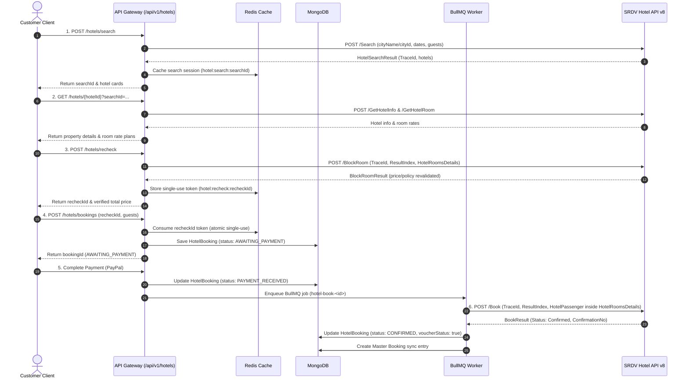

# Hotels Module

> **Production Architecture Reference**: For detailed system design and sequence diagrams, refer to [Production Hotel Booking Architecture](./hotel-booking-architecture).

The Hotels Module provides end-to-end hotel discovery, price revalidation, booking creation, payment confirmation, and live supplier integration with **SRDV (v8 REST API)**. It is mounted at `/api/v1/hotels`.

---

## 🚀 Production Capabilities Summary

| Capability | Status | Description |
| :--- | :--- | :--- |
| **Search & Discovery** | ✅ Fully Integrated | Live SRDV `/Search` integration with city auto-derivation, date filters, star rating filters, and Redis session caching. |
| **Hotel Details & Rooms** | ✅ Fully Integrated | SRDV `/GetHotelInfo` and `/GetHotelRoom` combination fetching property details, image galleries, and rate plan options. |
| **Price & Policy Recheck** | ✅ Fully Integrated | SRDV `/BlockRoom` mandatory pre-payment revalidation. Guarantees live availability and single-use `recheckId` token generation. |
| **Booking Creation** | ✅ Fully Integrated | Single-use recheck token consumption, guest validation (PAN, Age, Passport), and database transaction safety. |
| **Async Supplier Execution** | ✅ Fully Integrated | Multi-phase payment confirmation via BullMQ background queues and Redlock distributed locking (`hotel-book:<bookingId>`) calling SRDV `/Book`. |
| **My Bookings & Cancellation** | ✅ Fully Integrated | Authenticated booking retrieval and live SRDV `/HotelCancel` integration with cancellation penalty calculations. |

---

## 🏗️ Production Architecture & Code Structure

The module strictly follows **Clean Architecture** boundaries:

| File / Component | Responsibility |
| :--- | :--- |
| `modules/hotels/hotel.routes.js` | HTTP route declarations, rate limiters, validation middleware, and OpenAPI Swagger documentation. |
| `modules/hotels/hotel.controller.js` | HTTP request handling, DTO formatting, and role-based response filtering (Public vs Admin/Developer view). |
| `modules/hotels/hotel.validator.js` | Express-validator schemas for search criteria, recheck payloads, guest lists, and PAN/Age validation. |
| `modules/hotels/application/hotel-search.usecase.js` | Business logic for Search, Details, and Recheck (BlockRoom) operations. |
| `modules/hotels/application/hotel-booking.usecase.js` | Transactional booking creation, outbox event generation, and post-payment status transitions. |
| `modules/hotels/application/hotel-cancel.usecase.js` | Supplier cancellation orchestration (SRDV `/HotelCancel`). |
| `providers/hotels/srdv/srdv-hotel.client.js` | Low-level HTTP client for SRDV REST v8 API (`X-API-Key`, `Api-Token`, credentials block). |
| `providers/hotels/srdv/srdv-hotel.provider.js` | Maqam Hotel Provider Contract adapter for SRDV. |
| `providers/hotels/srdv/srdv-hotel.mapper.js` | Data transfer object (DTO) mapper converting Maqam entities to/from SRDV API payloads. |
| `workers/hotels/hotel-book.worker.js` | BullMQ background worker executing async SRDV `/Book` reservations with Redlock concurrency guards. |
| `modules/hotels/hotel.model.js` | MongoDB Mongoose schema for persistent `HotelBooking` records. |

---

## 🔄 End-to-End Hotel Reservation Lifecycle



---

## 🔑 Critical Supplier & Compliance Rules

### 1. Mandatory PAN Validation (Indian Stays)
For Indian hotel bookings, the SRDV supplier mandates a valid Permanent Account Number (**PAN**) for lead passengers when `IsPANMandatory: true`.
- Validation regex: `/^[A-Z]{5}[0-9]{4}[A-Z]{1}$/`
- Sandbox test PAN: `EXVPR5555M`

### 2. Session TraceId Alignment
All steps within a reservation flow (`Search` → `GetHotelRoom` → `BlockRoom` → `Book`) **must share the exact same `TraceId`**. The system preserves `searchSession.traceId` in Redis and persists it on `HotelBooking.traceId`.

### 3. Redlock Concurrency Protection
To prevent accidental duplicate supplier bookings caused by concurrent payment webhooks or manual retry scripts, `hotel-book.worker.js` wraps the SRDV call in a Redis distributed lock:
- Lock key: `hotel-book:<bookingId>`
- Lock TTL: 45 seconds

### 4. Role-Based Financial Response Filtering
- **Public View (Standard Users)**: Receives clean selling prices (`perNightPrice`, `totalPrice`, `nights`, `currency`).
- **Admin/Developer View (`admin` / `super_admin` JWT)**: Receives complete financial minor-unit breakdown (`supplierAmountMinor`, `markupMinor`, `feeMinor`, `customerTotalMinor`, `pricingVersion`, and raw `srdvRoomDetails`).

---

## 🛠️ Automated Testing

The automated E2E hotel booking verification script can be executed at any time:

```bash
node scripts/run-full-hotel-booking.js
```

**Script Execution Steps:**
1. Connects to MongoDB & authenticates test user.
2. Performs live hotel search via `POST /api/v1/hotels/search`.
3. Fetches room details via `GET /api/v1/hotels/{hotelId}`.
4. Executes rate recheck via `POST /api/v1/hotels/recheck`.
5. Creates a booking via `POST /api/v1/hotels/bookings`.
6. Simulates payment confirmation in MongoDB (`PAID`).
7. Triggers supplier booking integration via `processSupplierBooking`.
8. Verifies final status `CONFIRMED` and voucher confirmation in MongoDB.
