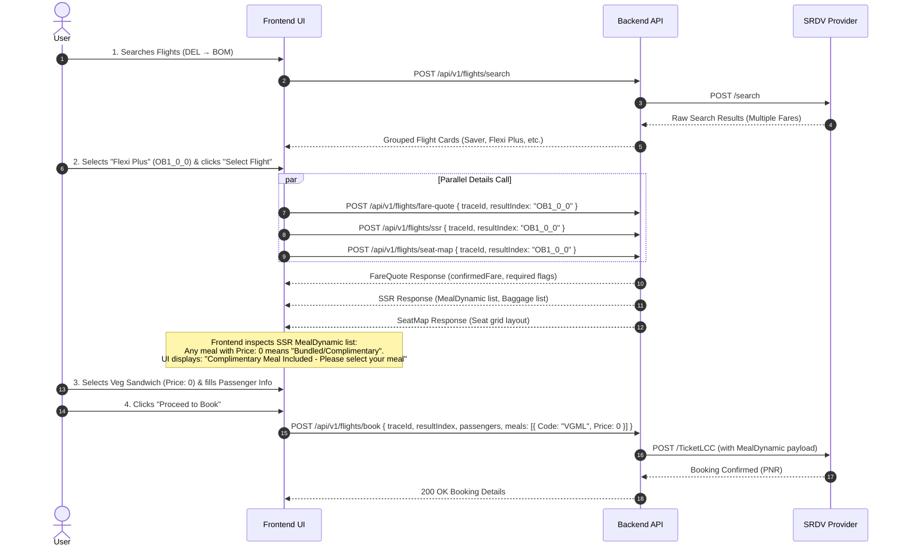

# Flight Search Grouping & SSR (Meal / Seat / Fare Family) Architecture Guide

This document explains how multiple fare options for the same physical flight are grouped, how meals and ancillaries (SSR) work, and whether grouping & SSR detection should be handled by the **Backend (BE)** or **Frontend (FE)**.

---

## 1. Why the Same Flight Appears Multiple Times in Search Results

When searching for flights (e.g. `DEL → BOM`), SRDV returns dozens or hundreds of options. Often, 5–10 of those options belong to the **exact same physical airplane** (same Airline Code, same Flight Number, same Departure & Arrival Times).

### Why does the airline return the same flight multiple times?
Airlines sell the same flight under different **Fare Families / Fare Brands**:

| Fare Brand / Type | ResultIndex Example | Features & Inclusions | Price | Meal Requirement |
| :--- | :--- | :--- | :--- | :--- |
| **Saver / Economy** | `OB6_0_2` | Standard 15kg baggage. No free meal. Non-refundable. | Lowest (e.g. ₹4,169) | **Optional** (`MealDynamic: []` works) |
| **Flexi Plus / Super Saver** | `OB1_0_0` | Complimentary meal included, free seat selection, lower change fee. | Medium (e.g. ₹6,300) | **Mandatory Selection** (Bundled ₹0 meal choice required by airline) |
| **Corporate / Premium** | `OB12_0_10` | Extra baggage (25kg), free gourmet meal, zero cancellation fee. | Higher (e.g. ₹7,683) | **Mandatory Selection** (Bundled ₹0 meal choice required by airline) |

---

## 2. Flight Grouping Architecture: Backend vs Frontend Responsibility

### Who should group the search results?
**Recommendation: The Backend (BE) should group search results before returning them to the Frontend.**

#### Why BE Grouping is Superior:
1. **Reduces Payload Size**: Prevents duplicating heavy flight segment details 10 times for the same flight.
2. **Simplifies Frontend Logic**: Frontend just renders a list of unique flight cards with a dropdown/toggle for fare options.
3. **Clean Contract**: Frontend doesn't have to guess or write complex string parsing/matching logic.

---

### How to Group Flights (The Grouping Formula)

A unique physical flight is identified by a `flightKey`:
```js
flightKey = `${airlineCode}_${flightNumber}_${origin}_${destination}_${departureTime}`
// Example: "6E_826_DEL_BLR_2026-08-15T09:30:00"
```

### Proposed Backend Grouped Response Schema (`POST /api/v1/flights/search`)

```json
{
  "status": "success",
  "data": {
    "traceId": "274513",
    "outbound": [
      {
        "flightKey": "6E_826_DEL_BOM_2026-08-15T09:30:00",
        "airline": "IndiGo",
        "airlineCode": "6E",
        "flightNumber": "826",
        "origin": "DEL",
        "destination": "BOM",
        "departureTime": "2026-08-15T09:30:00",
        "arrivalTime": "2026-08-15T12:25:00",
        "duration": 175,
        "stops": 0,
        "lowestPrice": 4169,
        "fareOptions": [
          {
            "resultIndex": "OB6_0_2",
            "srdvIndex": "1",
            "fareName": "Saver",
            "isLCC": true,
            "totalAmount": 4169,
            "refundType": "Non-Refundable",
            "inclusions": ["15 KG Baggage", "7 KG Cabin Baggage"]
          },
          {
            "resultIndex": "OB1_0_0",
            "srdvIndex": "1",
            "fareName": "Flexi Plus",
            "isLCC": true,
            "totalAmount": 6300,
            "refundType": "Partially Refundable",
            "inclusions": ["15 KG Baggage", "Free Seat", "Complimentary Meal Included"]
          }
        ]
      }
    ]
  }
}
```

---

## 3. How the User Knows a Meal Must Be Selected

### The Complete Step-by-Step User & API Flow



---

## 4. How the Frontend Detects Mandatory / Complimentary Meals from SSR Response

When the Frontend calls `POST /api/v1/flights/ssr`, SRDV returns the list of available meals under `MealDynamic`:

### Sample SSR Response from Backend (`POST /api/v1/flights/ssr`)

```json
{
  "status": "success",
  "data": {
    "meals": [
      {
        "Code": "VGML",
        "AirlineDescription": "Veg Sandwich & Beverage",
        "Price": 0,
        "Currency": "INR",
        "Origin": "DEL",
        "Destination": "BOM"
      },
      {
        "Code": "NVGML",
        "AirlineDescription": "Chicken Tikka Sandwich",
        "Price": 0,
        "Currency": "INR",
        "Origin": "DEL",
        "Destination": "BOM"
      }
    ]
  }
}
```

### Detection Rule for Frontend:
1. **If all meal options have `Price: 0`**:
   - The fare is a **Bundled / Flexi Fare**. The meal is complimentary, but the airline **requires** a meal selection code to issue the ticket.
   - **UI Action**: Show a prominent badge: `🎁 Free Meal Included`. Prompt the user to select their choice before proceeding to payment.
2. **If meal options have prices (e.g. `Price: 350`)**:
   - The fare is a **Saver Fare**. Meals are add-ons.
   - **UI Action**: Show `Add-on Meals (Optional)`. User can skip or add.
3. **If SRDV rejects `TicketLCC` with `ErrorCode: 3 ("Meal selection is mandatory")`**:
   - Safety net: The Backend catch block catches ErrorCode 3 and returns a friendly 400 error: `"Please select a meal for your flight before booking"`.

---

## 5. Developer Action Items Checklist

- [x] **Backend Fix**: `getFareQuoteService` caches updated fare in Redis before returning `priceChanged: true`.
- [x] **Verified Payloads**: `indigoWorkingPayload.json` and `spicejetWorkingPayload.json` saved and tested.
- [ ] **Backend Flight Grouping**: Add `flightKey` grouping utility in `flight.service.js` for `searchFlightsService` to group multiple `resultIndex` entries under the same physical flight.
- [ ] **Frontend Integration**:
  - Call `fare-quote`, `ssr`, and `seat-map` concurrently when user selects a flight.
  - Check SSR meal `Price: 0` to highlight complimentary/mandatory meal selection.
