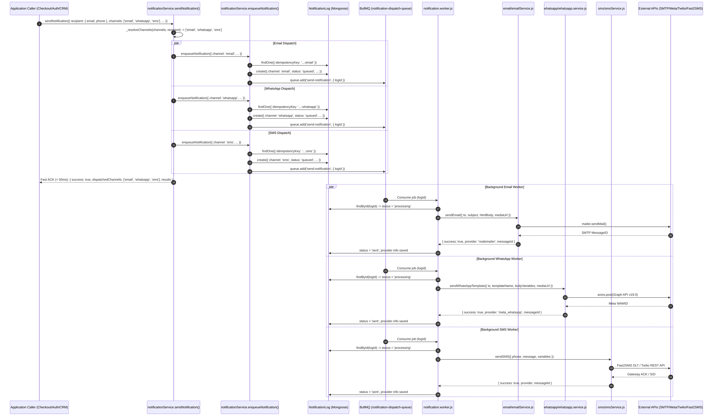
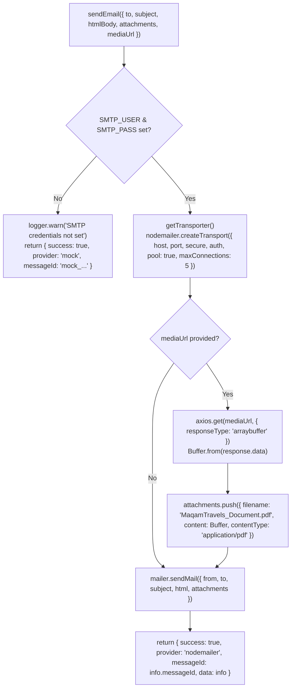
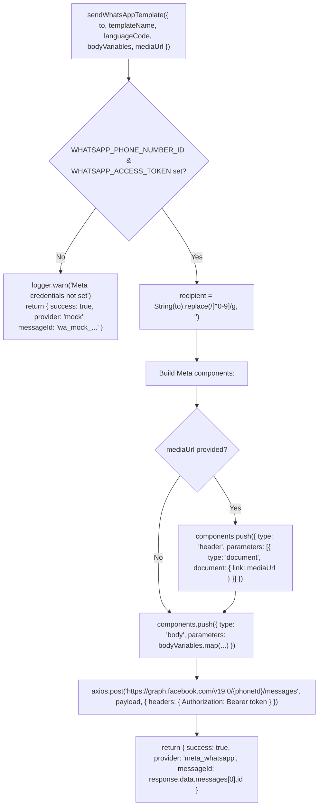
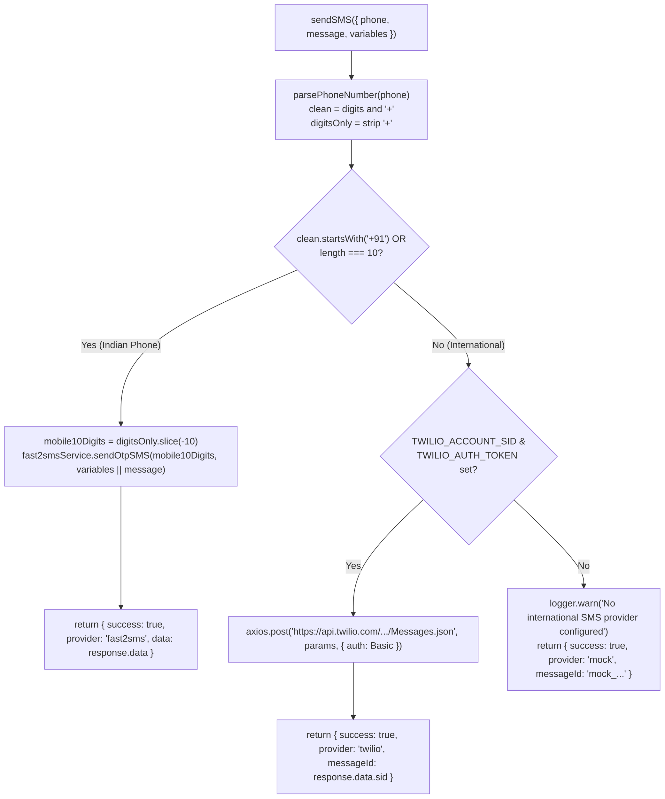

# Notifications Module - Function Call Flow Diagrams

<style>
  .mermaid {
    overflow: auto !important;
    max-height: 720px !important;
    max-width: 100% !important;
    display: block !important;
    padding: 18px !important;
    background: rgba(10, 15, 30, 0.95) !important;
    border: 1px solid rgba(255, 255, 255, 0.1) !important;
    border-radius: 12px !important;
    box-shadow: 0 8px 24px rgba(0, 0, 0, 0.4) !important;
    scrollbar-width: thin !important;
    scrollbar-color: #6366f1 rgba(15, 23, 42, 0.8) !important;
  }
  .mermaid::-webkit-scrollbar {
    width: 10px !important;
    height: 10px !important;
  }
  .mermaid::-webkit-scrollbar-track {
    background: rgba(15, 23, 42, 0.8) !important;
    border-radius: 6px !important;
  }
  .mermaid::-webkit-scrollbar-thumb {
    background: #6366f1 !important;
    border-radius: 6px !important;
  }
  .mermaid svg {
    max-width: none !important;
    height: auto !important;
  }
</style>

> **Module Path**: `modules/notifications`  
> **Target Files**:
>
> - [notification.service.js](file:///d:/Arun-Shaw/TravelAgency/server/modules/notifications/notification.service.js)
> - [notification.model.js](file:///d:/Arun-Shaw/TravelAgency/server/modules/notifications/notification.model.js)
> - [email/emailService.js](file:///d:/Arun-Shaw/TravelAgency/server/modules/notifications/email/emailService.js)
> - [sms/smsService.js](file:///d:/Arun-Shaw/TravelAgency/server/modules/notifications/sms/smsService.js)
> - [whatsapp/whatsapp.service.js](file:///d:/Arun-Shaw/TravelAgency/server/modules/notifications/whatsapp/whatsapp.service.js)
> - [workers/notifications/notification.worker.js](file:///d:/Arun-Shaw/TravelAgency/server/workers/notifications/notification.worker.js)

---

## 📌 Table of Contents

1. [Architectural Overview](#1-architectural-overview)
2. [Master End-to-End Function Call Flowchart](#2-master-end-to-end-function-call-flowchart)
3. [Step-by-Step Chronological Sequence Diagram](#3-step-by-step-chronological-sequence-diagram)
4. [Channel-Specific Execution Deep Dives](#4-channel-specific-execution-deep-dives)
   - [4.1 Email Channel (`emailService.js`)](#41-email-channel-emailservicejs)
   - [4.2 WhatsApp Channel (`whatsapp.service.js`)](#42-whatsapp-channel-whatsappservicejs)
   - [4.3 SMS Channel (`smsService.js`)](#43-sms-channel-smsservicejs)
5. [Complete Function Calling Reference Matrix](#5-complete-function-calling-reference-matrix)

---

## 1. Architectural Overview

The Notifications Module implements a **Single-Function Calling Paradigm**:
Any application service (e.g., booking sync, auth OTP, flight ticketing, hotel booking, payment webhooks, or CRM admin desk) invokes **one unified function**:
`notificationService.sendNotification(options)`.

The service internally resolves target channels (`email`, `whatsapp`, `sms`), checks deduplication keys, stores audit entries in MongoDB via Mongoose, and dispatches jobs to Redis BullMQ. A background worker picks up the jobs and executes the appropriate channel sub-service.

```
Caller (Checkout / Auth / Webhook)
                │
                ▼
notificationService.sendNotification()   <── Single Unified Entry Point
                │
      ┌─────────┼─────────┐
      ▼         ▼         ▼
    email   whatsapp     sms             <── Handled Asynchronously via BullMQ
      │         │         │
      ▼         ▼         ▼
  Nodemailer  Meta API  Fast2SMS/Twilio
```

---

## 2. Master End-to-End Function Call Flowchart

> 🧭 **Navigation Controls**:
> - **In Markdown Preview**: The diagram is framed in a 720px scrollable viewport with both vertical and horizontal scrollbars. Hold `Shift` + Mouse Wheel to scroll horizontally, or scroll normally to pan vertically.
> - **In Web Browser**: Open **[FLOW_DIAGRAM.html](file:///d:/Arun-Shaw/TravelAgency/server/modules/notifications/FLOW_DIAGRAM.html)** for click-and-drag panning, smooth mouse-wheel zooming, and Fullscreen canvas mode!

The following flowchart details **every function invocation, parameter handoff, decision branch, and database interaction** across the entire notification lifecycle:

```mermaid
%%{init: {"flowchart": {"useMaxWidth": false}}}%%
flowchart TD
    %% ─────────────────────────────────────────────────────────────
    %% STYLES & DEFINITIONS
    %% ─────────────────────────────────────────────────────────────
    classDef caller fill:#e1f5fe,stroke:#0288d1,stroke-width:2px,color:#01579b
    classDef singleFunc fill:#fff3e0,stroke:#f57c00,stroke-width:2.5px,color:#e65100
    classDef core fill:#e8f5e9,stroke:#388e3c,stroke-width:1.5px,color:#1b5e20
    classDef db fill:#f3e5f5,stroke:#7b1fa2,stroke-width:1.5px,color:#4a148c
    classDef queue fill:#ede7f6,stroke:#512da8,stroke-width:1.5px,color:#311b92
    classDef worker fill:#fbe9e7,stroke:#d84315,stroke-width:1.5px,color:#bf360c
    classDef channel fill:#efebe9,stroke:#5d4037,stroke-width:2px,color:#3e2723
    classDef provider fill:#e0f2f1,stroke:#00695c,stroke-width:1.5px,color:#004d40
    classDef decision fill:#fff9c4,stroke:#fbc02d,stroke-width:1.5px,color:#f57f17

    %% ─────────────────────────────────────────────────────────────
    %% STEP 1: CALLER INVOCATION
    %% ─────────────────────────────────────────────────────────────
    subgraph Step1["1. Application Caller Layer"]
        C_AUTH["modules/auth/auth.service.js<br/>sendOtp(phone, otp)"]:::caller
        C_BOOK["modules/payments/bookingSync.js<br/>sendBookingConfirmation(...)"]:::caller
        C_FLIGHT["workers/flights/flight-ticket-gds.worker.js<br/>sendFlightTicketed(...)"]:::caller
        C_GENERIC["Payment Webhook / CRM Desk / Visa Admin<br/>Direct invocation"]:::caller

        C_AUTH -->|"Calls"| H_OTP["notificationService.sendOtp(phone, otpCode)"]:::singleFunc
        C_BOOK -->|"Calls"| H_BOOK["notificationService.sendBookingConfirmation({ booking, user, invoicePdfUrl })"]:::singleFunc
        C_FLIGHT -->|"Calls"| H_TICK["notificationService.sendFlightTicketed({ booking, pnr, user, eTicketPdfUrl })"]:::singleFunc

        H_OTP -->|"Delegates to"| S_FN["notificationService.sendNotification(options)"]:::singleFunc
        H_BOOK -->|"Delegates to"| S_FN
        H_TICK -->|"Delegates to"| S_FN
        C_GENERIC -->|"Direct call to"| S_FN
    end

    %% ─────────────────────────────────────────────────────────────
    %% STEP 2: CHANNEL RESOLUTION & FAN-OUT
    %% ─────────────────────────────────────────────────────────────
    subgraph Step2["2. Orchestration Layer (notification.service.js)"]
        S_FN --> RESOLVE["2.1 notificationService._resolveChannels(channels, recipient)"]:::singleFunc
        RESOLVE --> CHECK_CHANS{"Are any channels reachable?<br/>(Valid email / phone)"}:::decision
        CHECK_CHANS -- "No" --> RET_WARN["return { success: false, message: 'No valid recipient contact' }"]:::singleFunc

        CHECK_CHANS -- "Yes" --> PROMISE_LOOP["2.2 Promise.allSettled(targetChannels.map(...))"]:::singleFunc
        PROMISE_LOOP -->|"For each channel"| MAKE_KEY["Construct channel key: `${idempotencyKey}:${channel}`"]:::singleFunc
        MAKE_KEY --> CALL_ENQ["2.3 notificationService.enqueueNotification(channelParams)"]:::singleFunc
    end

    %% ─────────────────────────────────────────────────────────────
    %% STEP 3: INGESTION & OUTBOX PIPELINE
    %% ─────────────────────────────────────────────────────────────
    subgraph Step3["3. Ingestion & Outbox Pipeline"]
        CALL_ENQ --> CHK_KEY{"Has idempotencyKey?"}:::decision
        CHK_KEY -- "Yes" --> DB_FIND["3.1 NotificationLog.findOne({ idempotencyKey })"]:::db
        CHK_KEY -- "No" --> DB_CREATE["3.3 NotificationLog.create({ status: 'queued', ... })"]:::db

        DB_FIND --> CHK_DUP{"status in [sent, queued, processing]?"}:::decision
        CHK_DUP -- "Yes (Duplicate)" --> SKIP_DUP["logger.info('Duplicate skipped')<br/>return existing record"]:::singleFunc
        CHK_DUP -- "No" --> DB_CREATE

        DB_CREATE --> GET_Q["3.4 getNotificationQueue()"]:::queue
        GET_Q --> IS_Q{"Redis Queue Available?"}:::decision

        IS_Q -- "Yes (Redis BullMQ)" --> BULLMQ_ADD["3.5 queue.add('send-notification', { logId: logDoc._id }, { jobId, attempts: 3, backoff })"]:::queue
        IS_Q -- "No (Dev Fallback)" --> TIMEOUT_RUN["3.5b setTimeout(() => processNotificationJob(logDoc._id), 50)"]:::worker

        BULLMQ_ADD --> RET_ACK["return logDoc (Fast ACK to Caller in < 50ms)"]:::caller
        TIMEOUT_RUN --> RET_ACK
    end

    %% ─────────────────────────────────────────────────────────────
    %% STEP 4: BACKGROUND WORKER EXECUTION
    %% ─────────────────────────────────────────────────────────────
    subgraph Step4["4. Background Worker (notification.worker.js)"]
        BULLMQ_ADD -.->|"BullMQ Redis Stream"| W_PICK["4.1 Worker picks up job"]:::worker
        TIMEOUT_RUN -.->|"Event Loop Timer"| W_PICK

        W_PICK --> W_PROC["4.2 processNotificationJob(job.data.logId)"]:::worker
        W_PROC --> W_FIND["4.3 NotificationLog.findById(logId)"]:::db

        W_FIND --> W_GUARD{"Record exists AND status != 'sent'?"}:::decision
        W_GUARD -- "No" --> W_ABORT["return early (Idempotent guard)"]:::worker
        W_GUARD -- "Yes" --> W_MARK["4.4 record.status = 'processing'<br/>record.attempts += 1<br/>await record.save()"]:::db

        W_MARK --> ROUTE_CH{"record.channel"}:::decision
    end

    %% ─────────────────────────────────────────────────────────────
    %% STEP 5: DOWNSTREAM CHANNEL SUB-SERVICES
    %% ─────────────────────────────────────────────────────────────
    subgraph Step5["5. Channel Sub-Service Layer"]
        %% Email Channel Execution
        ROUTE_CH -- "'email'" --> CALL_EMAIL["<b>5.A.1 emailService.sendEmail(params)</b>"]:::channel
        CALL_EMAIL --> GET_T["5.A.2 getTransporter() (Nodemailer Pool)"]:::channel
        GET_T --> CHK_MEDIA["mediaUrl provided?"]:::decision
        CHK_MEDIA -- "Yes" --> FETCH_PDF["5.A.3 axios.get(mediaUrl, { responseType: 'arraybuffer' })"]:::channel
        CHK_MEDIA -- "No" --> SEND_MAIL["5.A.4 mailer.sendMail(mailOptions)"]:::provider
        FETCH_PDF -->|"Attach Buffer to mailOptions"| SEND_MAIL
        SEND_MAIL --> RES_EMAIL["return { success: true, provider: 'nodemailer', messageId }"]:::channel

        %% WhatsApp Channel Execution
        ROUTE_CH -- "'whatsapp'" --> CALL_WA["<b>5.B.1 whatsappService.sendWhatsAppTemplate(params)</b>"]:::channel
        CALL_WA --> NORM_PHONE["5.B.2 Normalize phone digits (remove '+')"]:::channel
        NORM_PHONE --> BUILD_HSM["5.B.3 Construct Meta Graph API payload<br/>(Header document link + Body parameters)"]:::channel
        BUILD_HSM --> POST_WA["5.B.4 axios.post(Graph API v19.0, payload, headers)"]:::provider
        POST_WA --> RES_WA["return { success: true, provider: 'meta_whatsapp', messageId }"]:::channel

        %% SMS Channel Execution
        ROUTE_CH -- "'sms'" --> CALL_SMS["<b>5.C.1 smsService.sendSMS(params)</b>"]:::channel
        CALL_SMS --> PARSE_P["5.C.2 parsePhoneNumber(phone)"]:::channel
        PARSE_P --> CHK_INDIA{"isIndian (+91)?"}:::decision
        CHK_INDIA -- "Yes (India)" --> DLT_SMS["5.C.3 fast2smsService.sendOtpSMS(10Digits, variables)"]:::provider
        CHK_INDIA -- "No (International)" --> TWILIO_SMS["5.C.4 axios.post(Twilio Messages API, params, auth)"]:::provider
        DLT_SMS --> RES_SMS["return { success: true, provider: 'fast2sms', data }"]:::channel
        TWILIO_SMS --> RES_SMS
    end

    %% ─────────────────────────────────────────────────────────────
    %% STEP 6: STATE UPDATE & RETRIES
    %% ─────────────────────────────────────────────────────────────
    subgraph Step6["6. State Finalization & Retry Handling"]
        RES_EMAIL --> SAVE_OK["6.1 record.status = 'sent'<br/>record.provider = { name, messageId, response }<br/>await record.save()"]:::db
        RES_WA --> SAVE_OK
        RES_SMS --> SAVE_OK

        CALL_EMAIL -.->|"On Error"| W_ERR["6.2 catch (err)"]:::worker
        CALL_WA -.->|"On Error"| W_ERR
        CALL_SMS -.->|"On Error"| W_ERR

        W_ERR --> CHK_ATTEMPTS{"record.attempts >= 3?"}:::decision
        CHK_ATTEMPTS -- "Yes (Max Retries)" --> SET_FAIL["record.status = 'failed'"]:::db
        CHK_ATTEMPTS -- "No (Retryable)" --> SET_QUEUED["record.status = 'queued'"]:::db

        SET_FAIL --> SAVE_ERR["6.3 record.lastError = err.message<br/>await record.save()<br/>throw err"]:::db
        SET_QUEUED --> SAVE_ERR
        SAVE_ERR -.->|"BullMQ Backoff Trigger"| RETRY_Q["6.4 BullMQ Exponential Backoff Retry (4000ms delay)"]:::queue
    end
```

<div style="overflow-x: auto; max-width: 100%; padding-bottom: 14px;">



</div>

---

## 3. Step-by-Step Chronological Sequence Diagram

This diagram shows the asynchronous handoffs between the calling application, the notification service, the queue, and the providers:

<div style="overflow-x: auto; max-width: 100%; padding-bottom: 14px;">



</div>

---

## 4. Channel-Specific Execution Deep Dives

### 4.1 Email Channel (`emailService.js`)

**Target File**: [email/emailService.js](file:///d:/Arun-Shaw/TravelAgency/server/modules/notifications/email/emailService.js)

<div style="overflow-x: auto; max-width: 100%; padding-bottom: 14px;">



</div>

---

### 4.2 WhatsApp Channel (`whatsapp.service.js`)

**Target File**: [whatsapp/whatsapp.service.js](file:///d:/Arun-Shaw/TravelAgency/server/modules/notifications/whatsapp/whatsapp.service.js)

<div style="overflow-x: auto; max-width: 100%; padding-bottom: 14px;">



</div>

---

### 4.3 SMS Channel (`smsService.js`)

**Target File**: [sms/smsService.js](file:///d:/Arun-Shaw/TravelAgency/server/modules/notifications/sms/smsService.js)

<div style="overflow-x: auto; max-width: 100%; padding-bottom: 14px;">



</div>

---

## 5. Complete Function Calling Reference Matrix

| Step | Caller Function | Executed Function | File Location | Input Parameters | Output / Return Value |
| :---: | :--- | :--- | :--- | :--- | :--- |
| **1.0** | Domain Service (e.g. `bookingSync.js`) | `sendNotification()` | [notification.service.js](file:///d:/Arun-Shaw/TravelAgency/server/modules/notifications/notification.service.js) | `{ userId, recipient: { email, phone }, channels, eventType, subject, templateName, variables, messageText, mediaUrl, idempotencyKey }` | `{ success, eventType, dispatchedChannels, results }` |
| **1.1** | `sendNotification()` | `_resolveChannels()` | [notification.service.js](file:///d:/Arun-Shaw/TravelAgency/server/modules/notifications/notification.service.js) | `channels, recipient` | `['email', 'whatsapp', 'sms']` |
| **1.2** | `sendNotification()` | `enqueueNotification()` | [notification.service.js](file:///d:/Arun-Shaw/TravelAgency/server/modules/notifications/notification.service.js) | `{ channel, eventType, recipientEmail, recipientPhone, idempotencyKey, ... }` | `logDoc` (Mongoose Document) |
| **1.3** | `enqueueNotification()` | `NotificationLog.findOne()` | [notification.model.js](file:///d:/Arun-Shaw/TravelAgency/server/modules/notifications/notification.model.js) | `{ idempotencyKey }` | `existingDoc` or `null` |
| **1.4** | `enqueueNotification()` | `NotificationLog.create()` | [notification.model.js](file:///d:/Arun-Shaw/TravelAgency/server/modules/notifications/notification.model.js) | `{ userId, recipient, channel, eventType, status: 'queued', ... }` | `logDoc` |
| **1.5** | `enqueueNotification()` | `getNotificationQueue()` | [workers/notifications/notification.worker.js](file:///d:/Arun-Shaw/TravelAgency/server/workers/notifications/notification.worker.js) | *None* | `Queue` instance |
| **1.6** | `enqueueNotification()` | `queue.add()` | `bullmq` | `'send-notification', { logId }, { jobId, attempts: 3, backoff }` | `Job` instance |
| **2.0** | BullMQ Worker Daemon | `processNotificationJob()` | [workers/notifications/notification.worker.js](file:///d:/Arun-Shaw/TravelAgency/server/workers/notifications/notification.worker.js) | `logId` | `result` |
| **2.1** | `processNotificationJob()` | `NotificationLog.findById()` | [notification.model.js](file:///d:/Arun-Shaw/TravelAgency/server/modules/notifications/notification.model.js) | `logId` | `record` |
| **2.2** | `processNotificationJob()` | `record.save()` | [notification.model.js](file:///d:/Arun-Shaw/TravelAgency/server/modules/notifications/notification.model.js) | `status: 'processing', attempts: record.attempts + 1` | Updated `record` |
| **3.A** | `processNotificationJob()` (Email) | `sendEmail()` | [email/emailService.js](file:///d:/Arun-Shaw/TravelAgency/server/modules/notifications/email/emailService.js) | `{ to, subject, htmlBody, mediaUrl }` | `{ success: true, provider: 'nodemailer', messageId }` |
| **3.A.1**| `sendEmail()` | `getTransporter()` | [email/emailService.js](file:///d:/Arun-Shaw/TravelAgency/server/modules/notifications/email/emailService.js) | *None* | Pooled Nodemailer transporter |
| **3.A.2**| `sendEmail()` | `axios.get()` (if PDF) | `axios` | `mediaUrl, { responseType: 'arraybuffer' }` | Remote file Buffer |
| **3.A.3**| `sendEmail()` | `mailer.sendMail()` | `nodemailer` | `{ from, to, subject, html, attachments }` | SMTP Info / MessageID |
| **3.B** | `processNotificationJob()` (WhatsApp) | `sendWhatsAppTemplate()` | [whatsapp/whatsapp.service.js](file:///d:/Arun-Shaw/TravelAgency/server/modules/notifications/whatsapp/whatsapp.service.js) | `{ to, templateName, languageCode, bodyVariables, mediaUrl }` | `{ success: true, provider: 'meta_whatsapp', messageId }` |
| **3.B.1**| `sendWhatsAppTemplate()` | `axios.post()` | `axios` | `Graph_API_URL, payload, { headers: { Authorization } }` | Graph API response with WAMID |
| **3.C** | `processNotificationJob()` (SMS) | `sendSMS()` | [sms/smsService.js](file:///d:/Arun-Shaw/TravelAgency/server/modules/notifications/sms/smsService.js) | `{ phone, message, variables }` | `{ success: true, provider, messageId }` |
| **3.C.1**| `sendSMS()` | `parsePhoneNumber()` | [sms/smsService.js](file:///d:/Arun-Shaw/TravelAgency/server/modules/notifications/sms/smsService.js) | `phone` | `{ isIndian, clean, digitsOnly }` |
| **3.C.2**| `sendSMS()` (Indian `+91`) | `fast2smsService.sendOtpSMS()` | `fast2sms` | `mobile10Digits, variables` | Fast2SMS API response |
| **3.C.3**| `sendSMS()` (International) | `axios.post()` | `axios` | `Twilio_URL, params, { headers: { Authorization: Basic } }` | Twilio message SID |
| **4.0** | `processNotificationJob()` (Success) | `record.save()` | [notification.model.js](file:///d:/Arun-Shaw/TravelAgency/server/modules/notifications/notification.model.js) | `status: 'sent', provider: { name, messageId, response }` | Updated `record` |
| **4.1** | `processNotificationJob()` (Failure) | `record.save()` | [notification.model.js](file:///d:/Arun-Shaw/TravelAgency/server/modules/notifications/notification.model.js) | `status: attempts >= 3 ? 'failed' : 'queued', lastError: err.message` | Updated `record` + `throw err` (BullMQ exponential retry) |
