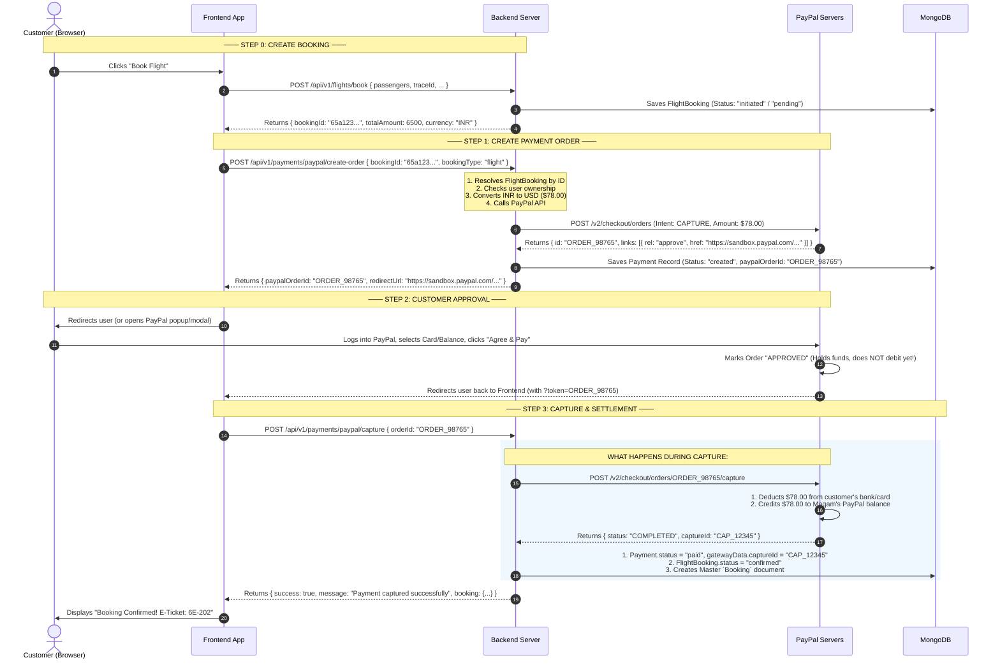

# Complete Payment Flow & Capture Explained

This guide explains **every single step of the payment lifecycle** between Frontend, Backend, PayPal, and the Database.

---

## 1. High-Level Summary: The 3-Step Payment Dance

Every modern payment gateway (PayPal, Stripe, Razorpay) uses a **3-step sequence**:

```
Step 1: INTENT / ORDER  ──►  Step 2: USER APPROVES  ──►  Step 3: CAPTURE / SETTLEMENT
(Backend registers           (Customer enters card /      (Backend actually pulls the
 intention to charge $X)      logs in to PayPal & clicks)  money from the customer's account)
```

---

## 2. Step-by-Step Walkthrough



---

## 3. What Exactly Is "Capture" & Why Is It Needed?

### Why does PayPal have "Approve" AND "Capture" as 2 separate steps?

Think of it like booking a hotel or pumping gas:
* **Approve (Authorize)**: The customer says: *"Yes, I allow Maqam to charge up to $78 on my Visa card."* PayPal verifies the customer has $78, locks the funds, and marks the order as **`APPROVED`**. 
  > ⚠️ **NO MONEY HAS MOVED YET!** The customer has not been charged, and Maqam has not received a single penny.
* **Capture (Execute the charge)**: Your backend contacts PayPal and says: *"Okay, everything is verified on our side. Please pull the $78 from their card and transfer it into Maqam's PayPal bank account right now."* 
  > 💰 **MONEY MOVES NOW!** PayPal transfers the funds and marks the order as **`COMPLETED`**.

---

## 4. What Happens In Your Code During Each Step?

### Step 1: Frontend calls `POST /api/v1/payments/paypal/create-order`
* **File:** [paypal.service.js](file:///d:/Arun-Shaw/TravelAgency/server/modules/payments/gateways/paypal/paypal.service.js#L20-L75)
* **What Backend Does:**
  1. Calls `resolveBooking(bookingId, 'flight')` to fetch the `FlightBooking` from MongoDB.
  2. Ensures the user calling this endpoint is the actual owner of the booking.
  3. Checks if the booking was already paid (prevents double payments).
  4. Calls PayPal API (`POST /v2/checkout/orders`) with the calculated USD amount.
  5. Creates a `Payment` record in MongoDB with `status: "created"`.
  6. Returns `{ paypalOrderId, redirectUrl }` to the Frontend.

---

### Step 2: Customer Approves on PayPal
* Frontend either opens a popup with PayPal SDK (`paypal.Buttons()`) or redirects the browser to `redirectUrl`.
* The customer signs in and clicks **"Complete Purchase"**.
* PayPal locks the funds and tells the Frontend: *"The customer approved order `ORDER_98765`."*

---

### Step 3: Frontend calls `POST /api/v1/payments/paypal/capture`
* **File:** [paypal.service.js](file:///d:/Arun-Shaw/TravelAgency/server/modules/payments/gateways/paypal/paypal.service.js#L140-L240)
* **What Backend Does:**
  1. Acquires a **Distributed Redis Lock** on `orderId` (so 2 simultaneous clicks or webhook collisions don't capture twice).
  2. Calls PayPal API: `POST /v2/checkout/orders/{orderId}/capture`.
  3. PayPal debits the customer and returns `status: "COMPLETED"` and `captureId`.
  4. Backend runs [bookingSync.js: ensureBookingConfirmed()](file:///d:/Arun-Shaw/TravelAgency/server/modules/payments/bookingSync.js#L145-L177):
     * **For LCC Flight:** Marks `FlightBooking.status = "confirmed"`, links `paymentId`.
     * **For GDS Flight:** Automatically calls SRDV `ticketGDSAfterPayment()` to issue the live e-ticket numbers!
     * **For Master Database:** Creates a unified record in the `Booking` collection with all trip details.
  5. Updates `Payment.status = "paid"`.
  6. Records audit event `PAYMENT_CAPTURE_COMPLETED` in `PaymentAuditLog`.
  7. Returns HTTP 200 to Frontend $\rightarrow$ Frontend shows confirmed ticket to the user!

---

## 5. What If The User Closes Their Browser Right After Approving?

If a user approves on PayPal and immediately shuts their laptop before the Frontend can call `/capture`, the **PayPal Webhook** acts as the automated safety net:

1. PayPal sends a webhook event `CHECKOUT.ORDER.APPROVED` to your server at `/webhook/paypal`.
2. Your server's webhook handler catches it and executes the exact same **Capture** step automatically in the background.
3. When the user opens their email or logs in later, their booking is already confirmed and paid!

---

## 6. Summary Comparison: Frontend Responsibilities vs Backend

| Action | Who does it? | API Endpoint |
|---|---|---|
| 1. Create Flight Itinerary & Hold | Frontend $\rightarrow$ Backend | `POST /api/v1/flights/book` |
| 2. Start Payment Process | Frontend $\rightarrow$ Backend | `POST /api/v1/payments/paypal/create-order` |
| 3. Login & Authorize Funds | Customer $\leftrightarrow$ PayPal | PayPal Hosted Interface / Popup |
| 4. Finalize & Claim the Money | Frontend $\rightarrow$ Backend | `POST /api/v1/payments/paypal/capture` |
| 5. Issue GDS Ticket & Update DB | Backend (automatically inside capture) | Internal call to `bookingSync.js` & SRDV |
